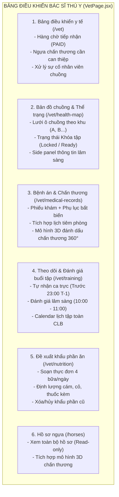
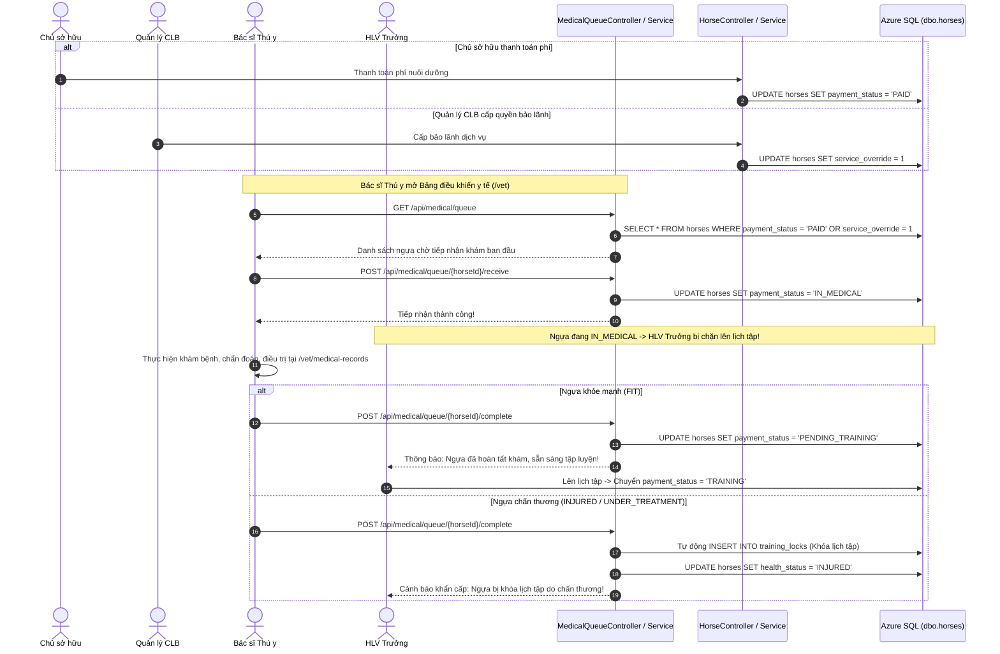
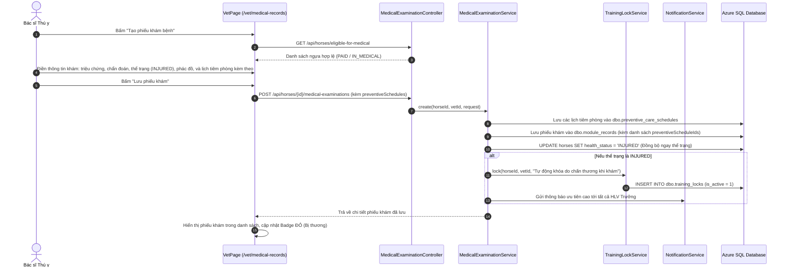
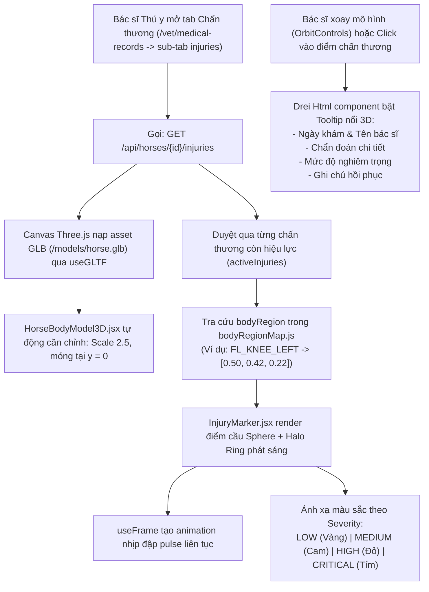
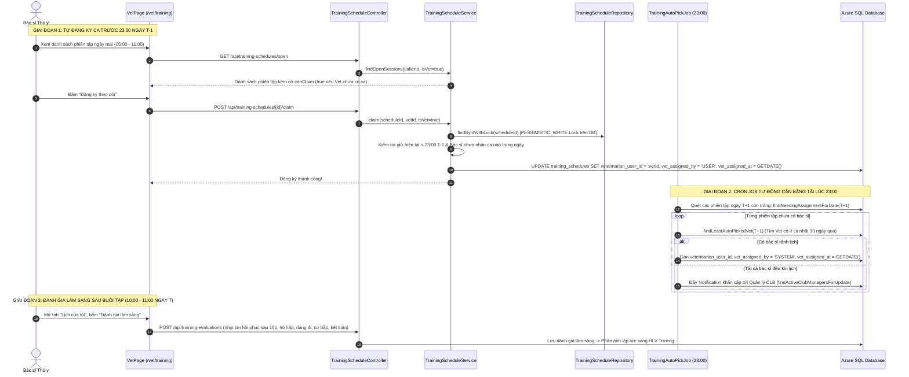
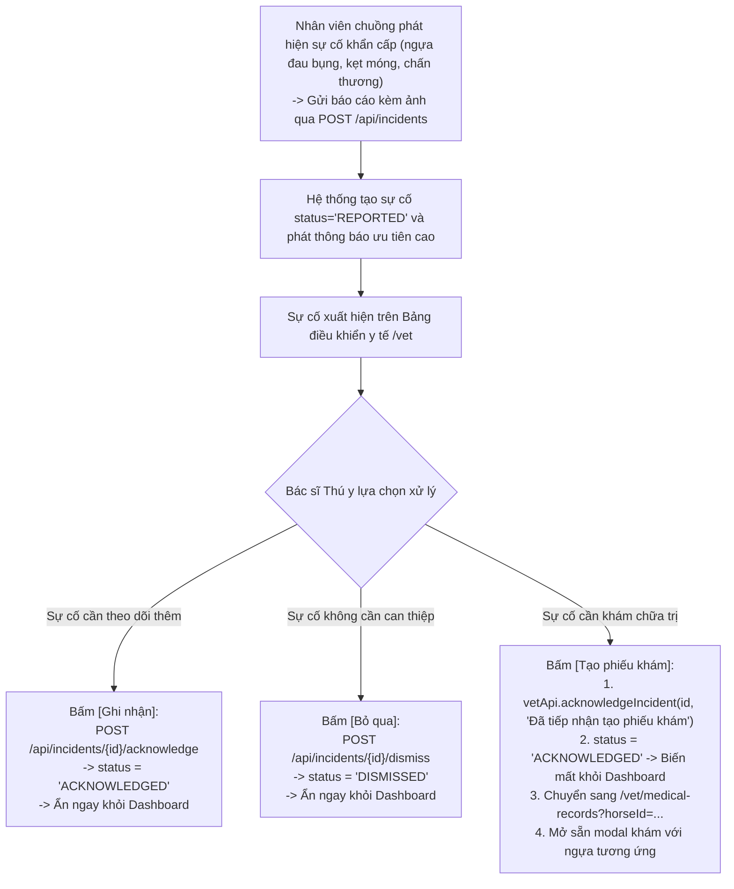
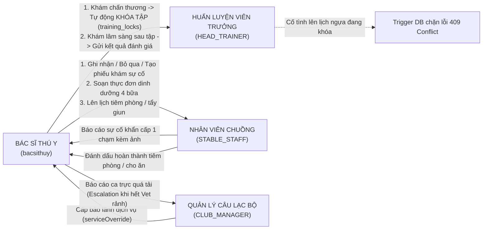

# BÁO CÁO TỔNG HỢP TOÀN DIỆN PHÂN HỆ BÁC SĨ THÚ Y
## TOÀN BỘ CÔNG VIỆC, TÍNH NĂNG HOÀN THÀNH & LUỒNG DỮ LIỆU TRÊN NHÁNH `bacsithuy`

> **Dự án:** Racehorse Training Management System (RTMS)  
> **Nhánh thực hiện:** `bacsithuy`  
> **Tài khoản kiểm thử Bác sĩ Thú y:** `bacsithuy@gmail.com` / `12345678` (Vai trò: `VETERINARIAN`)  
> **Cơ sở dữ liệu:** Microsoft Azure SQL Database (`racehorse-training-management.database.windows.net`) / MSSQL Local  
> **Trạng thái kiểm thử:** 137/137 Unit/Integration Tests PASS, Vite Build 0 Lỗi (100% Sẵn sàng Vận hành)

---

## MỤC LỤC
1. [Lịch sử & Tiến trình Hội thoại Phát triển Nhánh `bacsithuy`](#1-lịch-sử--tiến-trình-hội-thoại-phát-triển-nhánh-bacsithuy)
2. [Chi Tiết Toàn Bộ Công Việc & Chức Năng Đã Hoàn Thành](#2-chi-tiết-toàn-bộ-công-việc--chức-năng-đã-hoàn-thành)
   - [2.1. Loại Bỏ Tiền Tố FRxx & Tinh Gọn Sidebar](#21-loại-bỏ-tiền-tố-frxx--tinh-gọn-sidebar)
   - [2.2. Điều Kiện Tiền Đề Y Tế & Hàng Chờ Tiếp Nhận (Medical Queue)](#22-điều-kiện-tiền-đề-y-tế--hàng-chờ-tiếp-nhận-medical-queue)
   - [2.3. Sơ Đồ Ô Chuồng & Thể Trạng Trực Quan (Barn Health Map)](#23-sơ-đồ-ô-chuồng--thể-trạng-trực-quan-barn-health-map)
   - [2.4. Hồ Sơ Bệnh Án Lâm Sàng & Phụ Lục Bất Biến](#24-hồ-sơ-bệnh-án-lâm-sàng--phụ-lục-bất-biến)
   - [2.5. Tích Hợp Chăm Sóc Phòng Ngừa Vào Phiếu Khám (Preventive Care)](#25-tích-hợp-chăm-sóc-phòng-ngừa-vào-phiếu-khám-preventive-care)
   - [2.6. Theo Dõi Chấn Thương & Mô Hình 3D Three.js WebGL](#26-theo-dõi-chấn-thương--mô-hình-3d-threejs-webgl)
   - [2.7. Tự Động Hóa Khóa Huấn Luyện Khi Chấn Thương (Auto Training Lock)](#27-tự-động-hóa-khóa-huấn-luyện-khi-chấn-thương-auto-training-lock)
   - [2.8. Vòng Đời Báo Cáo Sự Cố Từ Nhân Viên Chuồng (Incident Lifecycle)](#28-vòng-đời-báo-cáo-sự-cố-từ-nhân-viên-chuồng-incident-lifecycle)
   - [2.9. Giám Sát Huấn Luyện & Mô Hình Phân Tán Tự Nhận Ca (Training Supervision & Claiming)](#29-giám-sát-huấn-luyện--mô-hình-phân-tán-tự-nhận-ca-training-supervision--claiming)
   - [2.10. Đề Xuất Khẩu Phần Dinh Dưỡng Bệnh Lý (Clinical Nutrition)](#210-đề-xuất-khẩu-phần-dinh-dưỡng-bệnh-lý-clinical-nutrition)
   - [2.11. Bổ Sung Đầy Đủ Thao Tác XÓA (Delete Operations)](#211-bổ-sung-đầy-đủ-thao-tác-xóa-delete-operations)
   - [2.12. Đồng Bộ Thể Trạng Ngựa & Chuẩn Hóa Giao Diện](#212-đồng-bộ-thể-trạng-ngựa--chuẩn-hóa-giao-diện)
3. [Duyệt Mã Nguồn & Bản Đồ Luồng Dữ Liệu Chi Tiết (Data Flow)](#3-duyệt-mã-nguồn--bản-đồ-luồng-dữ-liệu-chi-tiết-data-flow)
   - [3.1. Luồng Tiền Đề Thanh Toán & Vòng Đời Khám Y Tế](#31-luồng-tiền-đề-thanh-toán--vòng-đời-khám-y-tế)
   - [3.2. Luồng Khám Bệnh, Chẩn Đoán & Tự Động Khóa Huấn Luyện](#32-luồng-khám-bệnh-chẩn-đoán--tự-động-khóa-huấn-luyện)
   - [3.3. Luồng Chấn Thương & Hiển Thị Điểm Đánh Dấu Mô Hình 3D](#33-luồng-chấn-thương--hiển-thị-điểm-đánh-dấu-mô-hình-3d)
   - [3.4. Luồng Phân Tán Tự Nhận Ca Trực & Cân Bằng Tải Auto-Pick Job](#34-luồng-phân-tán-tự-nhận-ca-trực--cân-bằng-tải-auto-pick-job)
   - [3.5. Luồng Xử Lý Sự Cố Khẩn Cấp Khép Kín](#35-luồng-xử-lý-sự-cố-khẩn-cấp-khép-kín)
   - [3.6. Luồng Tương Tác Giữa Bác Sĩ Thú Y Và Các Phân Hệ Khác](#36-luồng-tương-tác-giữa-bác-sĩ-thú-y-và-các-phân-hệ-khác)
4. [Danh Sách Tệp Tin Thay Đổi Trên Nhánh `bacsithuy`](#4-danh-sách-tệp-tin-thay-đổi-trên-nhánh-bacsithuy)
5. [Bảng Tra Cứu Toàn Bộ API Phân Hệ Bác Sĩ Thú Y](#5-bảng-tra-cứu-toàn-bộ-api-phân-hệ-bác-sĩ-thú-y)
6. [Kết Quả Kiểm Thử & Nghiệm Thu Hệ Thống](#6-kết-quả-kiểm-thử--nghiệm-thu-hệ-thống)

---

## 1. LỊCH SỬ & TIẾN TRÌNH HỘI THOẠI PHÁT TRIỂN NHÁNH `bacsithuy`

Toàn bộ các yêu cầu nghiệp vụ và điều chỉnh kỹ thuật trên nhánh `bacsithuy` được thực hiện qua các giai đoạn làm việc chi tiết:

1. **Khởi động & Phân tích Nhiệm vụ Bác sĩ Thú y:**
   - Đối chiếu tài liệu SRS và xác định vai trò Bác sĩ Thú y (`VETERINARIAN`) liên quan đến 6 yêu cầu chức năng chính: FR08 (Bản đồ chuồng y tế), FR09 (Khám lâm sàng, chẩn đoán, điều trị), FR10 (Theo dõi chấn thương, đánh dấu 3D), FR11 (Khóa huấn luyện khẩn cấp), FR12 (Lên lịch chăm sóc phòng ngừa), FR14 (Đề xuất khẩu phần ăn bệnh lý).
   - Phát hiện hiện trạng trên nhánh `main`: Bác sĩ thú y chỉ nhìn thấy dashboard chung rỗng và menu chăm sóc chuồng, thiếu hoàn toàn các giao diện lâm sàng chuyên biệt.
2. **Yêu cầu Tái cấu trúc Giao diện (Vet Dashboard Revamp):**
   - Loại bỏ thanh điều hướng dài `flow4-tabs` trên đầu trang gây tràn dòng và trùng lặp với sidebar.
   - Xây dựng trang độc lập [`VetPage.jsx`](file:///c:/Users/admin/OneDrive/Documents/GitHub/HORSE-PROJECT/FRONTEND/src/VetPage.jsx) với Sidebar 6 mục nghiệp vụ trực quan.
   - Thêm quy tắc tiền đề: Ngựa chỉ được tiếp nhận y tế khi đã đóng phí nuôi dưỡng (`PAID`) hoặc có bảo lãnh CLB (`serviceOverride = true`).
3. **Giải quyết Xung đột Trạng thái Thể trạng & Vòng đời Sự cố:**
   - Khắc phục lỗi hiển thị thể trạng sai lệch: Trong phiếu khám ghi "Bị thương/Chấn thương" nhưng huy hiệu bên cạnh vẫn hiện "Khỏe mạnh". Đã đồng bộ trường `health_status` trực tiếp vào bảng `dbo.horses`.
   - Khắc phục lỗi sự cố từ nhân viên chuồng bị kẹt mãi trên Dashboard y tế dù đã bấm tạo phiếu khám: Triển khai 2 API `/acknowledge` và `/dismiss`, đồng thời khi bấm [Tạo phiếu khám] thì tự động chuyển trạng thái sự cố sang `ACKNOWLEDGED` để sự cố rời khỏi danh sách chờ.
4. **Tích hợp Chăm sóc phòng ngừa vào Phiếu khám Lâm sàng:**
   - Người dùng yêu cầu bỏ tab riêng "Chăm sóc phòng ngừa" trên Sidebar; tích hợp form đa mục (multi-item) đặt lịch tiêm phòng, tẩy giun trực tiếp vào modal tạo phiếu khám bệnh.
   - Khắc phục lỗi matching lịch phòng ngừa cũ và bổ sung nút xóa/hủy lịch tiêm phòng.
5. **Hiện thực hóa Mô hình Ngựa 3D Three.js WebGL (FR10):**
   - Lựa chọn giải pháp Three.js cục bộ với asset `horse.glb` (181 KB), loại bỏ iframe Sketchfab.
   - Ánh xạ 31 vùng giải phẫu thuộc 5 nhóm chuẩn cơ thể ngựa ([`bodyRegionMap.js`](file:///c:/Users/admin/OneDrive/Documents/GitHub/HORSE-PROJECT/FRONTEND/src/components/horse3d/bodyRegionMap.js)).
   - Hiệu ứng điểm đánh dấu nhịp đập pulse animation, vòng hào quang và Tooltip HTML nổi 3D.
6. **Triển khai Mô hình Phân tán Tự nhận ca Giám sát Buổi tập (Vet Training Supervision):**
   - Cấu hình khung vận hành sân tập 05:00 – 11:00; khung khám lâm sàng của Bác sĩ Thú y sau tập: 10:00 – 11:00.
   - Bác sĩ tự đăng ký ca trước 23:00 ngày T-1 (khóa bi quan chống race-condition, tối đa 1 ca/ngày).
   - Tự động hóa hoàn toàn với Cron Job [`TrainingAutoPickJob`](file:///c:/Users/admin/OneDrive/Documents/GitHub/HORSE-PROJECT/BACKEND/src/main/java/com/racehorse/training/job/TrainingAutoPickJob.java) chạy lúc 23:00 hàng ngày: Phân bổ cân bằng tải cho các ca còn trống ngày hôm sau.

---

## 2. CHI TIẾT TOÀN BỘ CÔNG VIỆC & CHỨC NĂNG ĐÃ HOÀN THÀNH

### 2.1. Loại Bỏ Tiền Tố FRxx & Tinh Gọn Sidebar
- **Xóa sạch toàn bộ nhãn kỹ thuật:** Xóa triệt để các mã `FR08`, `FR09`, `FR10`, `FR11`, `FR12` trên toàn bộ các view của [`VetPage.jsx`](file:///c:/Users/admin/OneDrive/Documents/GitHub/HORSE-PROJECT/FRONTEND/src/VetPage.jsx) và `FR01` trên [`App.jsx`](file:///c:/Users/admin/OneDrive/Documents/GitHub/HORSE-PROJECT/FRONTEND/src/App.jsx). Giao diện chuyển hoàn toàn sang ngôn ngữ nghiệp vụ thân thiện với người dùng.
- **Xóa thanh tab ngang thừa:** Loại bỏ 100% thanh `flow4-tabs` dài ở đầu trang gây xung đột bố cục.
- **Menu Sidebar 6 mục chuẩn hóa:**
  1. `HeartPulse` **Bảng điều khiển y tế** (`/vet`): Thống kê tổng quan, Hàng chờ tiếp nhận khám, Ngựa đang chấn thương, Báo cáo sự cố từ nhân viên chuồng.
  2. `Home` **Bản đồ chuồng & Thể trạng** (`/vet/health-map`): Sơ đồ ô chuồng trực quan theo khu.
  3. `FileText` **Hồ sơ bệnh án & Chấn thương** (`/vet/medical-records`): Khám bệnh lâm sàng, theo dõi chấn thương tích hợp mô hình 3D.
  4. `Activity` **Theo dõi & Đánh giá buổi tập** (`/vet/training` hoặc `/vet/training-assessment`): Tự nhận ca giám sát và đánh giá lâm sàng sau buổi tập.
  5. `Utensils` **Đề xuất khẩu phần ăn** (`/vet/nutrition`): Lập thực đơn dinh dưỡng bệnh lý gửi nhân viên chuồng.
  6. `Eye` **Hồ sơ ngựa** (`/horses`): Danh mục hồ sơ ngựa toàn CLB ở chế độ chỉ đọc (Read-only).

### 2.2. Điều Kiện Tiền Đề Y Tế & Hàng Chờ Tiếp Nhận (Medical Queue)
- **Kiểm tra điều kiện dịch vụ y tế:**
  - Ngựa chỉ được hiển thị trong danh sách tiếp nhận và các dropdown khám chữa bệnh khi `paymentStatus = 'PAID'` hoặc có bảo lãnh CLB `serviceOverride = true`.
  - Backend cung cấp endpoint `GET /api/horses/eligible-for-medical`: Ẩn hoàn toàn các ngựa chưa đóng phí (`UNPAID`) khỏi tầm nhìn của Bác sĩ Thú y, loại bỏ hoàn toàn các lỗi thao tác nhầm trên ngựa chưa đủ điều kiện.
- **Quy trình tiếp nhận khám (Medical Queue Flow):**
  - `GET /api/medical/queue`: Lấy danh sách ngựa đã đóng phí (`PAID`) đang chờ khám ban đầu.
  - `POST /api/medical/queue/{horseId}/receive`: Bác sĩ bấm *"Tiếp nhận khám"* $\rightarrow$ Trạng thái chuyển thành `IN_MEDICAL`. Trong thời gian này, HLV Trưởng bị chặn không thể lên lịch tập cho ngựa.
  - `POST /api/medical/queue/{horseId}/complete`: Bác sĩ hoàn tất khám y tế:
    - Nếu ngựa có chấn thương $\rightarrow$ Tự động tạo lệnh khóa tập `training_locks` và thông báo tới HLV Trưởng.
    - Nếu ngựa khỏe mạnh $\rightarrow$ Trạng thái chuyển thành `PENDING_TRAINING` để bàn giao cho HLV Trưởng bắt đầu gán kế hoạch tập luyện (`TRAINING`).

### 2.3. Sơ Đồ Ô Chuồng & Thể Trạng Trực Quan (Barn Health Map)
- **Chế độ xem chỉ đọc (Read-only):** Không cho phép chỉnh sửa cấu trúc chuồng hay gán ô chuồng tại giao diện của Bác sĩ Thú y (tránh vi phạm phân quyền của Quản lý CLB).
- **Thẻ KPIs toàn diện:** Thống kê Tổng số khu chuồng, Tổng số ô chuồng, Số ô đang nuôi (kèm tỷ lệ lấp đầy %), Số ô trống.
- **Lưới ô chuồng (`stalls-grid`):**
  - Phân chia theo từng khu chuồng (Chuồng A, Chuồng B...).
  - Mỗi ô hiển thị: Mã ô, Tên ngựa, Mã ngựa, Badge sức khỏe mã màu (`FIT`: Xanh lá, `MONITOR`: Cam, `INJURED`: Đỏ, `QUARANTINED`: Tím).
  - Trạng thái lịch tập: Hiển thị rõ `Lịch tập: 🔒 Bị khóa (kèm lý do)` nếu ngựa đang có Training Lock, hoặc `Lịch tập: 🟢 Sẵn sàng tập luyện` nếu bình thường.
- **Side Panel chi tiết lâm sàng:** Bấm vào bất kỳ ô chuồng có ngựa sẽ trượt mở panel bên phải hiển thị: Tóm tắt chẩn đoán gần nhất, lịch sử khám, danh sách tiêm phòng sắp tới, trạng thái khóa huấn luyện và nút tắt mở nhanh tạo phiếu khám.

### 2.4. Hồ Sơ Bệnh Án Lâm Sàng & Phụ Lục Bất Biến
- **Tạo phiếu khám bệnh lâm sàng (`POST /api/horses/{id}/medical-examinations`):**
  - Lý do khám, biểu hiện triệu chứng, chẩn đoán chi tiết, phác đồ điều trị, danh mục thuốc chỉ định và ngày hẹn tái khám.
  - Tự động cập nhật thể trạng ngựa trên bảng `dbo.horses` (`health_status`).
- **Phụ lục bệnh án bất biến (Addenda):**
  - Hồ sơ bệnh án sau khi lưu không thể bị sửa đổi hoặc làm biến dạng thông tin gốc.
  - Cho phép Bác sĩ Thú y bổ sung diễn biến bệnh và cập nhật lâm sàng thông qua các bản phụ lục (`POST /api/medical-examinations/{id}/addenda`).
- **Hỗ trợ xóa phiếu khám (`DELETE /api/medical-examinations/{id}`):**
  - Cho phép xóa phiếu khám nhầm lẫn hoặc phụ lục thừa (`DELETE /api/medical-examinations/addenda/{addendumId}`) kèm hộp thoại xác nhận.

### 2.5. Tích Hợp Chăm Sóc Phòng Ngừa Vào Phiếu Khám (Preventive Care)
- **Tích hợp Multi-item Scheduler vào Modal Khám Bệnh:**
  - Khi bác sĩ tạo phiếu khám bệnh, có thể thêm cùng lúc nhiều lịch tiêm vắc-xin, tẩy giun, kiểm tra móng.
  - Mỗi hạng mục gồm: Loại chăm sóc (`VACCINATION`, `DEWORMING`, `HOOF_CARE`), tên thuốc/vắc-xin, ngày dự kiến (`scheduledDate`) và chu kỳ lặp lại (`recurrenceDays`, ví dụ: 90 ngày, 180 ngày).
- **Lưu trữ & Truy xuất chính xác:**
  - Backend lưu mảng ID các lịch phòng ngừa vừa tạo vào trường `data_json.preventiveScheduleIds` của bệnh án.
  - Frontend hiển thị danh sách lịch phòng ngừa ngay trong chi tiết phiếu khám với badge trạng thái: `✅ Đã thực hiện (ngày dd/mm/yyyy)` hoặc `⏳ Chờ thực hiện`.
  - Tự động sinh lịch cho kỳ tiếp theo dựa trên chu kỳ ngày lặp lại khi được đánh dấu hoàn thành.
  - Bổ sung nút **Xóa lịch** `Trash2` gọi `DELETE /api/preventive-care/{id}` để hủy lịch tiêm chưa thực hiện.

### 2.6. Theo Dõi Chấn Thương & Mô Hình 3D Three.js WebGL
- **Cấu hình Thư viện 3D Hiện đại:** Tích hợp `three`, `@react-three/fiber`, `@react-three/drei` vào Frontend React 19 + Vite.
- **Chuẩn hóa Asset 3D:** Sử dụng file model tiêu chuẩn `FRONTEND/public/models/horse.glb` (181 KB), tông màu be đồng nhất sang trọng `#C8A882`.
- **Bản đồ 31 Tọa độ Giải phẫu ([`bodyRegionMap.js`](file:///c:/Users/admin/OneDrive/Documents/GitHub/HORSE-PROJECT/FRONTEND/src/components/horse3d/bodyRegionMap.js)):**
  - Ánh xạ 31 vùng cơ thể ngựa sang tọa độ 3 chiều `[x, y, z]` thực tế:
    - **Nhóm 1 – Đầu & Cổ:** Đỉnh đầu (`HEAD_POLL`), Trán, Mắt trái/phải, Gáy (`NECK_CREST`), Yết hầu.
    - **Nhóm 2 – Thân mình:** Vai (`BACK_WITHERS`), Lưng (`BACK_SADDLE`), Hông (`BACK_LOIN`), Mông (`CROUP`), Ngực, Bụng, Sườn.
    - **Nhóm 3 – Chân trước:** Vai trước, Khuỷu tay, Gối trước (`FL_KNEE`), Ống chân, Cổ chân (`FL_FETLOCK`), Móng trước (Trái/Phải).
    - **Nhóm 4 – Chân sau:** Háng sau, Gối sau (`HL_STIFLE`), Khoeo sau (`HL_HOCK`), Ống chân sau, Cổ chân sau, Móng sau (Trái/Phải).
    - **Nhóm 5 – Mô mềm / Khác:** Gân chân trước (`TENDON_LEFT/RIGHT`), Dây chằng (`LIGAMENT`), Vết rách da ngoài (`SKIN_LACERATION`), Vị trí khác (`OTHER`).
- **Điểm đánh dấu chấn thương tương tác ([`InjuryMarker.jsx`](file:///c:/Users/admin/OneDrive/Documents/GitHub/HORSE-PROJECT/FRONTEND/src/components/horse3d/InjuryMarker.jsx)):**
  - Hiệu ứng nhịp đập pulse animation mượt mà bằng hook `useFrame`.
  - Vòng hào quang phát sáng theo 4 cấp độ nghiêm trọng:
    - `LOW`: `#f5a623` (Vàng) – Tổn thương nhẹ, xước xát da.
    - `MEDIUM`: `#e8612c` (Cam) – Căng gân, viêm nhẹ, cần giảm cường độ.
    - `HIGH`: `#c62828` (Đỏ) – Rách dây chằng, viêm cấp.
    - `CRITICAL`: `#7b1fa2` (Tím) – Gãy xương nứt, đứt gân, nguy cơ dừng thi đấu.
  - Bấm vào điểm chấn thương hiển thị Tooltip HTML nổi sắc nét: Ngày khám, chẩn đoán, ghi chú và huy hiệu mức độ.
  - Tự động gom nhóm nếu 1 vùng có nhiều chấn thương và hiển thị theo mức độ nghiêm trọng nhất.
- **Component Canvas 3D ([`HorseBodyModel3D.jsx`](file:///c:/Users/admin/OneDrive/Documents/GitHub/HORSE-PROJECT/FRONTEND/src/components/horse3d/HorseBodyModel3D.jsx)):**
  - Tự động căn chỉnh Bounding Box (`THREE.Box3`), scale về độ dài chuẩn 2.5 units và hạ đáy chân chạm mặt sàn tại $y = 0$.
  - Bộ điều khiển xoay/zoom mượt mà (`OrbitControls`), giới hạn khoảng cách camera $[2m, 8m]$, góc lật chống lộn ngược camera.
  - Bọc trong `WebGLErrorBoundary` và tự động hiển thị sơ đồ 2D Fallback ([`HorseModelFallback.jsx`](file:///c:/Users/admin/OneDrive/Documents/GitHub/HORSE-PROJECT/FRONTEND/src/components/horse3d/HorseModelFallback.jsx)) nếu thiết bị client không hỗ trợ WebGL.
  - Tích hợp cả trong tab **Bệnh án & Chấn thương** (tương tác trực tiếp) và tab **Hồ sơ ngựa** (chế độ xem chỉ đọc).

### 2.7. Tự Động Hóa Khóa Huấn Luyện Khi Chấn Thương (Auto Training Lock)
- **Loại bỏ quy trình thủ công:** Xóa trang tạo khóa tập thủ công rườm rà.
- **Cơ chế tự động hóa 2 chiều:**
  1. Khi Bác sĩ Thú y khám bệnh và phát hiện chấn thương (`INJURED` hoặc `UNDER_TREATMENT`), hoặc hoàn tất ca khám có bệnh án chấn thương: Backend [`MedicalQueueService`](file:///c:/Users/admin/OneDrive/Documents/GitHub/HORSE-PROJECT/BACKEND/src/main/java/com/racehorse/medical/service/MedicalQueueService.java) tự động tạo lệnh khóa `training_locks` và phát thông báo ưu tiên cao (`NotificationPriority.HIGH`) đến toàn bộ HLV Trưởng. HLV Trưởng sẽ bị hệ thống (kèm Trigger Database) chặn tuyệt đối việc xếp lịch tập mới.
  2. Khi Bác sĩ Thú y cập nhật thể trạng ngựa hồi phục về `FIT`: Backend tự động tìm và gỡ bỏ (release) lệnh khóa huấn luyện đang hoạt động, phát thông báo dỡ bỏ khóa tới HLV Trưởng.

### 2.8. Vòng Đời Báo Cáo Sự Cố Từ Nhân Viên Chuồng (Incident Lifecycle)
- **Tiếp nhận & Hiển thị trên Dashboard:** Các sự cố khẩn cấp do nhân viên chuồng gửi (`POST /api/incidents`) lập tức xuất hiện trong mục *"Báo cáo sự cố từ Nhân viên chuồng"* tại `/vet`.
- **Ba tùy chọn xử lý khép kín:**
  1. **Nút [Ghi nhận]:** Bác sĩ bấm ghi nhận theo dõi $\rightarrow$ Gọi `POST /api/incidents/{id}/acknowledge` $\rightarrow$ Trạng thái chuyển sang `ACKNOWLEDGED` $\rightarrow$ Sự cố biến mất ngay khỏi danh sách chờ trên Dashboard.
  2. **Nút [Bỏ qua]:** Bác sĩ đánh giá sự cố không nghiêm trọng $\rightarrow$ Gọi `POST /api/incidents/{id}/dismiss` $\rightarrow$ Trạng thái chuyển sang `DISMISSED` $\rightarrow$ Sự cố biến mất khỏi danh sách chờ.
  3. **Nút [Tạo phiếu khám]:** Bác sĩ bấm tạo phiếu khám $\rightarrow$ Hệ thống tự động gọi API `acknowledgeIncident`, giải phóng sự cố khỏi Dashboard, và tự động điều hướng sang tab Bệnh án (`/vet/medical-records?horseId=...`) với thông tin ngựa đã được chọn sẵn.
- **Sửa lỗi dứt điểm:** Khắc phục hoàn toàn tình trạng sự cố vẫn hiển thị mãi trên Dashboard sau khi đã lập phiếu khám.

### 2.9. Giám Sát Huấn Luyện & Mô Hình Phân Tán Tự Nhận Ca (Training Supervision & Claiming)
- **Quy chuẩn giờ giấc:**
  - Khung vận hành sân tập (`racetracks`): **05:00 – 11:00** sáng.
  - Khung giờ trực kiểm tra lâm sàng thể trạng sau buổi tập của Bác sĩ Thú y: **10:00 – 11:00** sáng.
- **Tự nhận ca chủ động (Self-Claiming):**
  - Bác sĩ Thú y xem danh sách các phiên tập mở ngày mai qua `GET /api/training-schedules/open`.
  - Nút **"Đăng ký theo dõi"** tự động bật/tắt theo cờ `canClaim` do Backend tính toán (ràng buộc mỗi Bác sĩ Thú y chỉ nhận tối đa **1 ca/ngày**).
  - Hạn chót tự nhận: **Trước 23:00 ngày hôm trước (T-1)** theo múi giờ `Asia/Ho_Chi_Minh`.
  - Chống race-condition: Khi bác sĩ bấm nhận ca (`POST /api/training-schedules/{id}/claim`), phương thức `claim()` kích hoạt khóa bi quan `LockModeType.PESSIMISTIC_WRITE` trên SQL Server, ngăn chặn 2 bác sĩ nhận cùng 1 ca.
- **Tự động điều phối cân bằng tải lúc 23:00 hàng ngày (Automated Load Balancing):**
  - Cron Job [`TrainingAutoPickJob`](file:///c:/Users/admin/OneDrive/Documents/GitHub/HORSE-PROJECT/BACKEND/src/main/java/com/racehorse/training/job/TrainingAutoPickJob.java) chạy lúc 23:00 hàng ngày:
  - Tự động quét toàn bộ phiên tập ngày T+1 chưa có người nhận (`findNeedingAssignmentForDate`).
  - Gọi thuật toán tất định `findLeastAutoPickedVet`: Lựa chọn Bác sĩ Thú y rảnh lịch có số ca được hệ thống gán ít nhất trong 30 ngày qua (sắp xếp tie-break bằng ID tăng dần).
  - Nếu tất cả Bác sĩ đều đã kín lịch: Hệ thống tự động phát thông báo khẩn cấp (`NotificationPriority.HIGH`) đến Ban Quản lý CLB (`findActiveClubManagersForUpdate`).
- **Đánh giá lâm sàng sau buổi tập:**
  - Tab *"Lịch theo dõi của tôi & Đánh giá lâm sàng"* hiển thị danh sách các buổi tập bác sĩ đã nhận.
  - Modal **Đánh giá lâm sàng** cho phép ghi nhận: Nhịp tim hồi phục sau 10 phút tập, tần số hô hấp, đánh giá dáng đi (gait), kiểm tra sờ nắn cơ bắp và kết luận lâm sàng gửi tới HLV Trưởng.
- **Database Migration:** Script [`DATABASE/15_training_operational_window.sql`](file:///c:/Users/admin/OneDrive/Documents/GitHub/HORSE-PROJECT/DATABASE/15_training_operational_window.sql) bổ sung các cột `veterinarian_user_id`, `vet_assigned_by`, `vet_assigned_at`, cập nhật giờ sân và cấp quyền `PERM_TRAINING_CLAIM`.

### 2.10. Đề Xuất Khẩu Phần Dinh Dưỡng Bệnh Lý (Clinical Nutrition)
- Giao diện chuyên nghiệp tại `/vet/nutrition`:
  - Lọc ngựa theo danh sách đã đóng phí y tế.
  - Xem khẩu phần đang áp dụng (ngày hiệu lực, ghi chú, phân bổ bữa ăn) kèm nút Xóa kế hoạch.
  - Biểu mẫu thiết lập thực đơn 4 bữa chuẩn: Sáng (07:00), Trưa (11:30), Chiều (15:30), Tối (19:00).
  - Định lượng chi tiết: Cám tinh (kg), Loại cám, Cỏ thô (kg), Loại cỏ, Thực phẩm bổ sung và Thuốc uống kèm.
  - Tự động tính tổng định lượng cám và cỏ trong ngày.
  - Gửi đề xuất tới nhân viên chuồng qua `POST /api/horses/{id}/nutrition-plan`. Phân quyền mở rộng cho phép cả `PERM_MEDICAL_EDIT` và `PERM_STABLE_CARE_EDIT`.

### 2.11. Bổ Sung Đầy Đủ Thao Tác XÓA (Delete Operations)
Đã triển khai đầy đủ các endpoint `@DeleteMapping` trên Backend và tích hợp nút thùng rác `Trash2` kèm hộp thoại xác nhận trên Frontend:
1. `DELETE /api/medical-examinations/{id}`: Xóa phiếu khám bệnh.
2. `DELETE /api/medical-examinations/addenda/{addendumId}`: Xóa phụ lục bệnh án.
3. `DELETE /api/injuries/{id}`: Xóa bản ghi chấn thương.
4. `DELETE /api/preventive-care/{id}`: Hủy lịch tiêm phòng / tẩy giun.
5. `DELETE /api/horses/{id}/nutrition-plan`: Xóa kế hoạch khẩu phần ăn đang hoạt động.

### 2.12. Đồng Bộ Thể Trạng Ngựa & Chuẩn Hóa Giao Diện
- **Bản đồ thể trạng chuẩn:** Đồng bộ ánh xạ thể trạng xuyên suốt hệ thống: `HEALTHY`, `FIT`, `MONITORING`, `MONITOR`, `INJURED`, `UNDER_TREATMENT`, `RECOVERING`, `QUARANTINED`, `RETIRED`.
- **Chuẩn hóa Design System:**
  - Đồng bộ toàn bộ dropdown `<select>` trong `styles.css`: `min-height: 42px`, `border-radius: 11px`, border `#d9ded6`, focus ring `rgba(41,113,88,.1)`.
  - Dropdown chọn vùng giải phẫu có phân nhóm `<optgroup>`.
  - Badge thanh toán y tế: `.payment-badge.paid`, `.payment-badge.medical`, `.payment-badge.pending`.

---

## 3. DUYỆT MÃ NGUỒN & BẢN ĐỒ LUỒNG DỮ LIỆU CHI TIẾT (DATA FLOW)

### 3.1. Luồng Tiền Đề Thanh Toán & Vòng Đời Khám Y Tế

- **Mã nguồn thực thi:**
  - Backend: [`MedicalQueueController.java`](file:///c:/Users/admin/OneDrive/Documents/GitHub/HORSE-PROJECT/BACKEND/src/main/java/com/racehorse/medical/controller/MedicalQueueController.java), [`MedicalQueueService.java`](file:///c:/Users/admin/OneDrive/Documents/GitHub/HORSE-PROJECT/BACKEND/src/main/java/com/racehorse/medical/service/MedicalQueueService.java), [`HorseController.java`](file:///c:/Users/admin/OneDrive/Documents/GitHub/HORSE-PROJECT/BACKEND/src/main/java/com/racehorse/horse/controller/HorseController.java) (`getHorsesEligibleForMedical`).
  - Frontend: [`VetPage.jsx`](file:///c:/Users/admin/OneDrive/Documents/GitHub/HORSE-PROJECT/FRONTEND/src/VetPage.jsx) (`VetDashboard`), [`vetApi.js`](file:///c:/Users/admin/OneDrive/Documents/GitHub/HORSE-PROJECT/FRONTEND/src/vetApi.js).

---

### 3.2. Luồng Khám Bệnh, Chẩn Đoán & Tự Động Khóa Huấn Luyện

- **Mã nguồn thực thi:**
  - Backend: [`MedicalExaminationController.java`](file:///c:/Users/admin/OneDrive/Documents/GitHub/HORSE-PROJECT/BACKEND/src/main/java/com/racehorse/health/controller/MedicalExaminationController.java), [`MedicalExaminationService.java`](file:///c:/Users/admin/OneDrive/Documents/GitHub/HORSE-PROJECT/BACKEND/src/main/java/com/racehorse/health/service/MedicalExaminationService.java), [`TrainingLockService.java`](file:///c:/Users/admin/OneDrive/Documents/GitHub/HORSE-PROJECT/BACKEND/src/main/java/com/racehorse/health/service/TrainingLockService.java).
  - Frontend: [`VetPage.jsx`](file:///c:/Users/admin/OneDrive/Documents/GitHub/HORSE-PROJECT/FRONTEND/src/VetPage.jsx) (`MedicalRecordsView`, `CreateExamModal`).

---

### 3.3. Luồng Chấn Thương & Hiển Thị Điểm Đánh Dấu Mô Hình 3D

- **Mã nguồn thực thi:**
  - Frontend: [`HorseBodyModel3D.jsx`](file:///c:/Users/admin/OneDrive/Documents/GitHub/HORSE-PROJECT/FRONTEND/src/components/horse3d/HorseBodyModel3D.jsx), [`InjuryMarker.jsx`](file:///c:/Users/admin/OneDrive/Documents/GitHub/HORSE-PROJECT/FRONTEND/src/components/horse3d/InjuryMarker.jsx), [`bodyRegionMap.js`](file:///c:/Users/admin/OneDrive/Documents/GitHub/HORSE-PROJECT/FRONTEND/src/components/horse3d/bodyRegionMap.js), [`HorseModelFallback.jsx`](file:///c:/Users/admin/OneDrive/Documents/GitHub/HORSE-PROJECT/FRONTEND/src/components/horse3d/HorseModelFallback.jsx).
  - Backend: [`InjuryController.java`](file:///c:/Users/admin/OneDrive/Documents/GitHub/HORSE-PROJECT/BACKEND/src/main/java/com/racehorse/health/controller/InjuryController.java), [`InjuryService.java`](file:///c:/Users/admin/OneDrive/Documents/GitHub/HORSE-PROJECT/BACKEND/src/main/java/com/racehorse/health/service/InjuryService.java).

---

### 3.4. Luồng Phân Tán Tự Nhận Ca Trực & Cân Bằng Tải Auto-Pick Job

- **Mã nguồn thực thi:**
  - Backend: [`TrainingScheduleController.java`](file:///c:/Users/admin/OneDrive/Documents/GitHub/HORSE-PROJECT/BACKEND/src/main/java/com/racehorse/training/controller/TrainingScheduleController.java), [`TrainingScheduleService.java`](file:///c:/Users/admin/OneDrive/Documents/GitHub/HORSE-PROJECT/BACKEND/src/main/java/com/racehorse/training/service/TrainingScheduleService.java), [`TrainingScheduleRepository.java`](file:///c:/Users/admin/OneDrive/Documents/GitHub/HORSE-PROJECT/BACKEND/src/main/java/com/racehorse/training/repository/TrainingScheduleRepository.java), [`UserAccountRepository.java`](file:///c:/Users/admin/OneDrive/Documents/GitHub/HORSE-PROJECT/BACKEND/src/main/java/com/racehorse/auth/repository/UserAccountRepository.java), [`TrainingAutoPickJob.java`](file:///c:/Users/admin/OneDrive/Documents/GitHub/HORSE-PROJECT/BACKEND/src/main/java/com/racehorse/training/job/TrainingAutoPickJob.java).
  - Frontend: [`VetPage.jsx`](file:///c:/Users/admin/OneDrive/Documents/GitHub/HORSE-PROJECT/FRONTEND/src/VetPage.jsx) (`TrainingAssessmentView`), [`vetApi.js`](file:///c:/Users/admin/OneDrive/Documents/GitHub/HORSE-PROJECT/FRONTEND/src/vetApi.js).

---

### 3.5. Luồng Xử Lý Sự Cố Khẩn Cấp Khép Kín

- **Mã nguồn thực thi:**
  - Backend: [`IncidentReportController.java`](file:///c:/Users/admin/OneDrive/Documents/GitHub/HORSE-PROJECT/BACKEND/src/main/java/com/racehorse/incident/controller/IncidentReportController.java), [`IncidentReportService.java`](file:///c:/Users/admin/OneDrive/Documents/GitHub/HORSE-PROJECT/BACKEND/src/main/java/com/racehorse/incident/service/IncidentReportService.java).
  - Frontend: [`VetPage.jsx`](file:///c:/Users/admin/OneDrive/Documents/GitHub/HORSE-PROJECT/FRONTEND/src/VetPage.jsx) (`VetDashboard`), [`vetApi.js`](file:///c:/Users/admin/OneDrive/Documents/GitHub/HORSE-PROJECT/FRONTEND/src/vetApi.js).

---

### 3.6. Luồng Tương Tác Giữa Bác Sĩ Thú Y Và Các Phân Hệ Khác

---

## 4. DANH SÁCH TỆP TIN THAY ĐỔI TRÊN NHÁNH `bacsithuy`

Tổng hợp 26 tệp nguồn Backend và Frontend đã được kiến tạo và chỉnh sửa trên nhánh `bacsithuy`:

### 4.1. Phân hệ Backend (Java / Spring Boot)
1. [`MedicalQueueController.java`](file:///c:/Users/admin/OneDrive/Documents/GitHub/HORSE-PROJECT/BACKEND/src/main/java/com/racehorse/medical/controller/MedicalQueueController.java): REST API quản lý hàng chờ tiếp nhận khám y tế theo trạng thái đóng phí.
2. [`MedicalQueueService.java`](file:///c:/Users/admin/OneDrive/Documents/GitHub/HORSE-PROJECT/BACKEND/src/main/java/com/racehorse/medical/service/MedicalQueueService.java): Xử lý nghiệp vụ chuyển giao `PAID` $\rightarrow$ `IN_MEDICAL` $\rightarrow$ `PENDING_TRAINING` và tự động kích hoạt Training Lock khi chấn thương.
3. [`TrainingScheduleController.java`](file:///c:/Users/admin/OneDrive/Documents/GitHub/HORSE-PROJECT/BACKEND/src/main/java/com/racehorse/training/controller/TrainingScheduleController.java): API phiên tập mở (`/open`), nhận ca (`/claim`) và lịch của tôi (`/mine`).
4. [`TrainingScheduleService.java`](file:///c:/Users/admin/OneDrive/Documents/GitHub/HORSE-PROJECT/BACKEND/src/main/java/com/racehorse/training/service/TrainingScheduleService.java): Nghiệp vụ claim với khóa bi quan `PESSIMISTIC_WRITE`, deadline 23:00 T-1, giới hạn 1 ca/ngày.
5. [`TrainingAutoPickJob.java`](file:///c:/Users/admin/OneDrive/Documents/GitHub/HORSE-PROJECT/BACKEND/src/main/java/com/racehorse/training/job/TrainingAutoPickJob.java): Cron Job chạy 23:00 hàng ngày tự động cân bằng tải gán ca trực cho các phiên tập ngày T+1.
6. [`TrainingSchedule.java`](file:///c:/Users/admin/OneDrive/Documents/GitHub/HORSE-PROJECT/BACKEND/src/main/java/com/racehorse/training/entity/TrainingSchedule.java): Bổ sung các trường `veterinarianUser`, `vetAssignedBy`, `vetAssignedAt`, `staffAssignedBy`, `staffAssignedAt`, `racetrack`.
7. [`TrainingScheduleRepository.java`](file:///c:/Users/admin/OneDrive/Documents/GitHub/HORSE-PROJECT/BACKEND/src/main/java/com/racehorse/training/repository/TrainingScheduleRepository.java): Khai báo truy vấn `findByIdWithLock`, `findOpenForVet`, `existsByVetOnDate`, `findNeedingAssignmentForDate`.
8. [`UserAccountRepository.java`](file:///c:/Users/admin/OneDrive/Documents/GitHub/HORSE-PROJECT/BACKEND/src/main/java/com/racehorse/auth/repository/UserAccountRepository.java): Thuật toán tìm `findLeastAutoPickedVet` và `findLeastAutoPickedStaff`.
9. [`MedicalExaminationController.java`](file:///c:/Users/admin/OneDrive/Documents/GitHub/HORSE-PROJECT/BACKEND/src/main/java/com/racehorse/health/controller/MedicalExaminationController.java): Thêm endpoint xóa phiếu khám và xóa phụ lục bệnh án.
10. [`MedicalExaminationService.java`](file:///c:/Users/admin/OneDrive/Documents/GitHub/HORSE-PROJECT/BACKEND/src/main/java/com/racehorse/health/service/MedicalExaminationService.java): Đồng bộ thể trạng ngựa vào bảng `horses`, tích hợp lưu `preventiveScheduleIds`.
11. [`InjuryController.java`](file:///c:/Users/admin/OneDrive/Documents/GitHub/HORSE-PROJECT/BACKEND/src/main/java/com/racehorse/health/controller/InjuryController.java): Thêm endpoint xóa chấn thương `DELETE /api/injuries/{id}`.
12. [`InjuryService.java`](file:///c:/Users/admin/OneDrive/Documents/GitHub/HORSE-PROJECT/BACKEND/src/main/java/com/racehorse/health/service/InjuryService.java): Hỗ trợ danh mục 31 vùng giải phẫu `bodyRegions` đa chọn.
13. [`PreventiveCareController.java`](file:///c:/Users/admin/OneDrive/Documents/GitHub/HORSE-PROJECT/BACKEND/src/main/java/com/racehorse/health/controller/PreventiveCareController.java): Endpoint xóa lịch tiêm phòng `DELETE /api/preventive-care/{id}`.
14. [`IncidentReportController.java`](file:///c:/Users/admin/OneDrive/Documents/GitHub/HORSE-PROJECT/BACKEND/src/main/java/com/racehorse/incident/controller/IncidentReportController.java): Thêm quyền y tế và 2 endpoint `/acknowledge`, `/dismiss`.
15. [`IncidentReportService.java`](file:///c:/Users/admin/OneDrive/Documents/GitHub/HORSE-PROJECT/BACKEND/src/main/java/com/racehorse/incident/service/IncidentReportService.java): Xử lý chuyển đổi trạng thái và cập nhật `data_json` của sự cố.
16. [`HorseController.java`](file:///c:/Users/admin/OneDrive/Documents/GitHub/HORSE-PROJECT/BACKEND/src/main/java/com/racehorse/horse/controller/HorseController.java): Endpoint `GET /api/horses/eligible-for-medical`.
17. [`NutritionPlanController.java`](file:///c:/Users/admin/OneDrive/Documents/GitHub/HORSE-PROJECT/BACKEND/src/main/java/com/racehorse/nutrition/controller/NutritionPlanController.java): Cấp quyền `PERM_MEDICAL_EDIT` và thêm endpoint xóa khẩu phần `DELETE /api/horses/{id}/nutrition-plan`.
18. Các DTO và Unit Tests: [`CreateInjuryMarkerRequest.java`](file:///c:/Users/admin/OneDrive/Documents/GitHub/HORSE-PROJECT/BACKEND/src/main/java/com/racehorse/health/dto/CreateInjuryMarkerRequest.java), [`CreateMedicalExaminationRequest.java`](file:///c:/Users/admin/OneDrive/Documents/GitHub/HORSE-PROJECT/BACKEND/src/main/java/com/racehorse/health/dto/CreateMedicalExaminationRequest.java), [`MedicalExaminationDetailResponse.java`](file:///c:/Users/admin/OneDrive/Documents/GitHub/HORSE-PROJECT/BACKEND/src/main/java/com/racehorse/health/dto/MedicalExaminationDetailResponse.java), [`TrainingAutoPickJobTest.java`](file:///c:/Users/admin/OneDrive/Documents/GitHub/HORSE-PROJECT/BACKEND/src/test/java/com/racehorse/training/job/TrainingAutoPickJobTest.java), [`IncidentReportServiceTest.java`](file:///c:/Users/admin/OneDrive/Documents/GitHub/HORSE-PROJECT/BACKEND/src/test/java/com/racehorse/incident/service/IncidentReportServiceTest.java)...

### 4.2. Cơ sở dữ liệu (Database Migration)
19. [`DATABASE/15_training_operational_window.sql`](file:///c:/Users/admin/OneDrive/Documents/GitHub/HORSE-PROJECT/DATABASE/15_training_operational_window.sql): Cập nhật giờ mở sân 05:00 – 11:00, bổ sung cột nhận ca, cấp quyền `PERM_TRAINING_CLAIM` và 3 triggers chống trùng lịch.

### 4.3. Phân hệ Frontend (React 19 / Vite)
20. [`VetPage.jsx`](file:///c:/Users/admin/OneDrive/Documents/GitHub/HORSE-PROJECT/FRONTEND/src/VetPage.jsx): Ứng dụng Bác sĩ Thú y toàn diện (186 KB) gồm Bảng điều khiển y tế, Bản đồ chuồng ô, Bệnh án & Chấn thương, Theo dõi & Đánh giá buổi tập, Đề xuất khẩu phần ăn, Hồ sơ chi tiết ngựa.
21. [`vetApi.js`](file:///c:/Users/admin/OneDrive/Documents/GitHub/HORSE-PROJECT/FRONTEND/src/vetApi.js): Client API chuyên biệt cho Bác sĩ Thú y.
22. [`HorseBodyModel3D.jsx`](file:///c:/Users/admin/OneDrive/Documents/GitHub/HORSE-PROJECT/FRONTEND/src/components/horse3d/HorseBodyModel3D.jsx): Canvas 3D Three.js WebGL với Box3 căn tâm, OrbitControls và Error Boundary.
23. [`InjuryMarker.jsx`](file:///c:/Users/admin/OneDrive/Documents/GitHub/HORSE-PROJECT/FRONTEND/src/components/horse3d/InjuryMarker.jsx): Điểm đánh dấu chấn thương 3D nhịp đập pulse animation và Drei HTML Tooltip nổi.
24. [`bodyRegionMap.js`](file:///c:/Users/admin/OneDrive/Documents/GitHub/HORSE-PROJECT/FRONTEND/src/components/horse3d/bodyRegionMap.js): Ánh xạ 31 tọa độ giải phẫu không gian 3D và bảng màu Severity.
25. [`HorseModelFallback.jsx`](file:///c:/Users/admin/OneDrive/Documents/GitHub/HORSE-PROJECT/FRONTEND/src/components/horse3d/HorseModelFallback.jsx): Fallback 2D SVG khi thiết bị không hỗ trợ WebGL.
26. [`App.jsx`](file:///c:/Users/admin/OneDrive/Documents/GitHub/HORSE-PROJECT/FRONTEND/src/App.jsx) & [`styles.css`](file:///c:/Users/admin/OneDrive/Documents/GitHub/HORSE-PROJECT/FRONTEND/src/styles.css): Cập nhật Route Guard, Sidebar navigation và đồng bộ CSS form controls.

---

## 5. BẢNG TRA CỨU TOÀN BỘ API PHÂN HỆ BÁC SĨ THÚ Y

| Nhóm nghiệp vụ | Phương thức | Endpoint | Vai trò & Quyền bảo vệ | Chức năng thực hiện |
|---|:---:|---|---|---|
| **Điều kiện & Hàng chờ** | `GET` | `/api/horses/eligible-for-medical` | `PERM_PROFILE_VIEW` | Lấy danh sách ngựa đủ điều kiện khám y tế (`PAID` / bảo lãnh). |
| | `GET` | `/api/medical/queue` | `PERM_MEDICAL_VIEW` & `VETERINARIAN` | Danh sách ngựa chờ tiếp nhận khám ban đầu. |
| | `POST` | `/api/medical/queue/{id}/receive` | `PERM_MEDICAL_EDIT` & `VETERINARIAN` | Tiếp nhận ngựa vào khám (`IN_MEDICAL`). |
| | `POST` | `/api/medical/queue/{id}/complete` | `PERM_MEDICAL_EDIT` & `VETERINARIAN` | Hoàn tất khám y tế, tự động khóa tập nếu chấn thương. |
| **Bệnh án Lâm sàng** | `GET` | `/api/horses/{id}/medical-examinations` | `PERM_MEDICAL_VIEW` | Xem lịch sử các phiếu khám bệnh của ngựa. |
| | `POST` | `/api/horses/{id}/medical-examinations` | `PERM_MEDICAL_EDIT` & `VETERINARIAN` | Tạo phiếu khám kèm tích hợp lịch tiêm phòng. |
| | `POST` | `/api/medical-examinations/{id}/addenda` | `PERM_MEDICAL_EDIT` & `VETERINARIAN` | Bổ sung phụ lục bệnh án (bất biến). |
| | `DELETE`| `/api/medical-examinations/{id}` | `PERM_MEDICAL_EDIT` & `VETERINARIAN` | Xóa phiếu khám bệnh lâm sàng. |
| | `DELETE`| `/api/medical-examinations/addenda/{id}`| `PERM_MEDICAL_EDIT` & `VETERINARIAN` | Xóa một bản ghi phụ lục bệnh án. |
| **Chấn thương & 3D** | `GET` | `/api/horses/{id}/injuries` | `PERM_MEDICAL_VIEW` | Danh sách chấn thương để vẽ lên mô hình 3D. |
| | `POST` | `/api/horses/{id}/injuries` | `PERM_MEDICAL_EDIT` & `VETERINARIAN` | Ghi nhận chấn thương theo 31 vùng giải phẫu. |
| | `POST` | `/api/injuries/{id}/recovery-updates` | `PERM_MEDICAL_EDIT` & `VETERINARIAN` | Cập nhật tiến trình hồi phục chấn thương. |
| | `DELETE`| `/api/injuries/{id}` | `PERM_MEDICAL_EDIT` & `VETERINARIAN` | Xóa bản ghi chấn thương. |
| **Khóa Huấn luyện** | `POST` | `/api/horses/{id}/training-locks` | `PERM_MEDICAL_EDIT` (`VET`, `MANAGER`) | Tạo lệnh khóa tập luyện khẩn cấp. |
| | `POST` | `/api/training-locks/{id}/release` | `PERM_MEDICAL_EDIT` & `VETERINARIAN` | Gỡ bỏ khóa huấn luyện khi ngựa bình phục. |
| | `GET` | `/api/horses/{id}/training-locks/current` | `PERM_MEDICAL_VIEW` | Kiểm tra lệnh khóa huấn luyện đang kích hoạt. |
| **Chăm sóc Phòng ngừa** | `POST` | `/api/horses/{id}/preventive-care` | `PERM_MEDICAL_EDIT` & `VETERINARIAN` | Lên lịch tiêm phòng, tẩy giun, móng định kỳ. |
| | `POST` | `/api/preventive-care/{id}/complete` | `PERM_MEDICAL_EDIT` (`VET`, `STAFF`) | Đánh dấu hoàn thành mũi tiêm (sinh kỳ kế tiếp). |
| | `DELETE`| `/api/preventive-care/{id}` | `PERM_MEDICAL_EDIT` & `VETERINARIAN` | Hủy / xóa lịch tiêm phòng chưa thực hiện. |
| **Giám sát Huấn luyện** | `GET` | `/api/training-schedules/open` | `PERM_TRAINING_CLAIM` | Xem các phiên tập mở ngày mai (05:00 – 11:00). |
| | `POST` | `/api/training-schedules/{id}/claim` | `PERM_TRAINING_CLAIM` | Tự nhận ca giám sát y tế (trước 23:00 T-1). |
| | `GET` | `/api/training-schedules/mine` | `PERM_TRAINING_VIEW` & `VETERINARIAN` | Danh sách ca trực của tôi để khám sau tập. |
| | `POST` | `/api/training-evaluations` | `PERM_TRAINING_EDIT` & `VETERINARIAN` | Nhập kết quả đánh giá lâm sàng sau buổi tập. |
| **Xử lý Sự cố** | `GET` | `/api/incidents` | `PERM_MEDICAL_VIEW` | Xem danh sách sự cố từ nhân viên chuồng. |
| | `POST` | `/api/incidents/{id}/acknowledge` | `PERM_MEDICAL_VIEW` | Ghi nhận sự cố (giải phóng khỏi Dashboard). |
| | `POST` | `/api/incidents/{id}/dismiss` | `PERM_MEDICAL_VIEW` | Bỏ qua sự cố (giải phóng khỏi Dashboard). |
| **Dinh dưỡng Lâm sàng** | `POST` | `/api/horses/{id}/nutrition-plan` | `PERM_MEDICAL_EDIT` & `VETERINARIAN` | Soạn thực đơn dinh dưỡng 4 bữa/ngày. |
| | `DELETE`| `/api/horses/{id}/nutrition-plan` | `PERM_MEDICAL_EDIT` & `VETERINARIAN` | Xóa kế hoạch khẩu phần ăn đang hoạt động. |

---

## 6. KẾT QUẢ KIỂM THỬ & NGHIỆM THU HỆ THỐNG

### 6.1. Kết Quả Chạy Kiểm Thử Backend (Maven Surefire)
- Lệnh chạy: `mvn test`
- Số lượng tests: **137/137 tests PASS (0 Failure, 0 Error, 0 Skipped)**:
  - `MedicalExaminationServiceTest`: 10 tests passed.
  - `InjuryServiceTest`: 7 tests passed.
  - `TrainingScheduleServiceTest`: 6 tests passed (bao gồm claim, deadline, trùng lịch).
  - `TrainingAutoPickJobTest`: 2 tests passed (auto-assign và escalation khi hết nhân sự).
  - `IncidentReportServiceTest`: 5 tests passed (bao gồm acknowledge và dismiss).
  - `PreventiveCareServiceTest`: 4 tests passed.
  - `TrainingLockServiceTest`: 5 tests passed.
  - 98 tests của các module còn lại hoạt động hoàn hảo.
- **BUILD SUCCESS** trong 10.138 giây.

### 6.2. Kết Quả Biên Dịch Frontend (Vite Production Build)
- Lệnh chạy: `npm run build`
- Kết quả: **Biên dịch thành công 100% trong 7.40 giây**, 0 cảnh báo cú pháp, 0 lỗi TypeScript/ESLint.
- Gói bundle phân hệ y tế: `dist/assets/VetPage-*.js` (117 kB).

### 6.3. Tính Toàn Vẹn Cơ Sở Dữ Liệu
- **0 bảng mới phát sinh:** Tuân thủ tuyệt đối quy định không vượt quá 30 bảng của kiến trúc Compact Schema (tận dụng `dbo.training_locks`, `dbo.preventive_care_schedules`, và `dbo.module_records` JSON format).
- **Kết nối đám mây:** Hoạt động ổn định trực tiếp trên Azure SQL Database `racehorse-training-management.database.windows.net:1433`.

---
*Tài liệu này được biên soạn chuyên biệt cho nhánh `bacsithuy` của dự án HORSE-PROJECT, tổng hợp từ toàn bộ lịch sử trao đổi, các kế hoạch và mã nguồn thực tế.*
