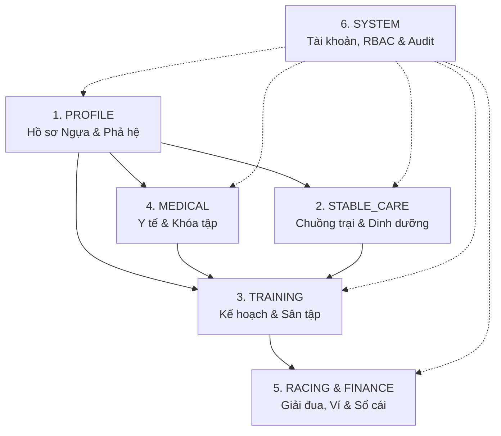

# Tổng Quan Hệ Thống & Ngữ Cảnh Dự Án (Project Context)
## Racehorse Training Management System (RTMS)

> **Mã phân hệ:** `00_PROJECT_CONTEXT`  
> **Thời điểm thẩm định:** 12/10/2026  
> **Nguồn bằng chứng:** Toàn bộ mã nguồn `BACKEND` (Spring Boot), `FRONTEND` (React 19), `DATABASE` (SQL Server) và các tài liệu lịch sử.

---

## 1. Mục Đích & Phạm Vi Dự Án

Hệ thống Quản lý Huấn luyện Ngựa đua (Racehorse Training Management System - RTMS) là nền tảng số hóa tập trung dành cho các câu lạc bộ đua ngựa chuyên nghiệp. Hệ thống quản lý toàn diện vòng đời hoạt động của ngựa, từ tiếp nhận ban đầu, chăm sóc chuồng trại, lập kế hoạch và thực thi huấn luyện thể lực, theo dõi y tế lâm sàng - chấn thương, quản lý giải đua, cho đến ví điện tử dịch vụ và sổ cái kế toán vận hành.

Hệ thống phục vụ **5 nhóm đối tượng người dùng chuyên biệt**:
1. **Quản lý Câu lạc bộ (`CLUB_MANAGER`):** Quản trị tối cao cơ sở vật chất, nhân sự, tài chính, phê duyệt danh mục và giải đua.
2. **Huấn luyện viên trưởng (`HEAD_TRAINER`):** Quản lý chuyên môn huấn luyện, kế hoạch tập luyện, xếp lịch chạy sân, đánh giá thể lực và đăng ký tham gia giải đua.
3. **Nhân viên chăm sóc chuồng (`STABLE_STAFF`):** Vận hành hiện trường, thực hiện nhiệm vụ chăm sóc hàng ngày, chuẩn bị ngựa trước buổi tập, theo dõi khẩu phần và báo cáo sự cố.
4. **Chủ sở hữu ngựa (`HORSE_OWNER`):** Theo dõi hồ sơ ngựa thuộc quyền sở hữu, chỉ số thể lực, nạp ví trả trước, phê duyệt đề xuất thi đấu và nhận báo cáo tài chính định kỳ.
5. **Bác sĩ thú y (`VETERINARIAN`):** Chẩn đoán lâm sàng, quản lý hồ sơ bệnh án, mô hình chấn thương 3D, ban hành lệnh khóa huấn luyện an toàn, tiêm phòng định kỳ và giám sát thể trạng sau buổi tập.

---

## 2. Các Phân Hệ Nghiệp Vụ Cốt Lõi (Core Business Modules)

Dựa trên cấu trúc mã nguồn và phân quyền hệ thống, RTMS được phân tách thành 6 phân hệ lớn:

### 2.1. Phân hệ Hồ sơ Ngựa & Danh tính (`PROFILE`)
- Quản lý mã nhận diện định danh (`code`), tên (`name`), ngày sinh, giống ngựa, giới tính (`STALLION`, `MARE`, `GELDING`).
- Quản lý phả hệ 3 đời: Phả hệ liên kết trong hệ thống (`sire_id`, `dam_id`) hoặc phả hệ thủ công nhập ngoài (`sire_manual_name`, `dam_manual_name`).
- Quản lý tỷ lệ sở hữu (`horse_ownerships`) với ràng buộc một chủ duy nhất (`ux_horse_ownerships_one_owner`).
- Quản lý lưu trữ (`archived_at`), ảnh chân dung đại diện và tài liệu pháp lý qua dịch vụ lưu trữ đám mây Cloudinary.

### 2.2. Phân hệ Vận hành Chuồng trại, Dinh dưỡng & Vật tư (`STABLE_CARE`)
- Quản lý cấu trúc cơ sở vật chất chuồng trại: Khu chuồng (`stables`) và từng ô chuồng (`stalls`).
- Quy tắc sức chứa cứng: **Mỗi khu chuồng tối đa 4 ô chuồng (tối đa 4 con ngựa)**.
- Phân bổ ô chuồng độc quyền: Chặn 2 ngựa vào cùng 1 ô hoặc 1 ngựa có 2 ô active đồng thời (Trigger `tr_module_records_stall_assignment_unique_active`).
- Quản lý lịch sinh hoạt hàng ngày (`daily-routines`) và khẩu phần dinh dưỡng định lượng (`nutrition_plans`, `daily-checklist`).
- Hệ thống danh sách công việc chăm sóc (`care_tasks`) hỗ trợ phân công nhân viên, đính kèm ảnh xác thực khi hoàn thành và tự động sinh việc hồi phục sau buổi tập.
- Quản lý vật tư tiêu hao (`inventory_items`), ghi nhận xuất dùng (`usage`) và quy trình đề xuất nhập kho (`replenishments`) do Quản lý phê duyệt.

### 2.3. Phân hệ Huấn luyện, Sân tập & Thể lực (`TRAINING`)
- Kế hoạch tập luyện nhiều giai đoạn (`training_plans`, `training_plan_phases`) với cường độ tải trọng (`LIGHT`, `MEDIUM`, `HIGH`) và ngày nghỉ phục hồi (`rest_days`).
- Lịch tập huấn luyện theo slot **1 giờ cố định từ 06:00 đến 23:00** (kết thúc muộn nhất 00:00 ngày hôm sau) theo múi giờ `Asia/Ho_Chi_Minh` (Trigger `tr_enforce_training_window`).
- Cơ sở sân tập gồm 10 sân tập, mỗi sân có đúng 4 làn chạy (`racetrack_lanes` 1..4); đặt làn độc quyền không trùng slot (Trigger `tr_trial_run_bookings_no_lane_overlap`).
- Vòng đời buổi tập chặt chẽ: `PREPARING` → `READY` (Nhân viên chuồng xác nhận) → `IN_PROGRESS` (HLV bắt đầu) → `COMPLETED` (HLV hoàn thành) hoặc `CANCELLED`.
- Thu thập dữ liệu sinh trắc học và đánh giá buổi tập: Đo tốc độ tối đa, tốc độ trung bình, nhịp tim đỉnh (`stopBpm`), nhịp tim hồi phục sau 1 phút (`oneMinuteBpm`), điểm cảm nhận gắng sức (`perceivedExertion` 1..10), đính kèm video chạy thử.

### 2.4. Phân hệ Y tế, Chấn thương 3D & Khóa Huấn luyện (`MEDICAL`)
- Bản đồ sức khỏe toàn chuồng (`barn-map`) hiển thị trực quan thể trạng của từng ngựa theo mã màu: Khỏe mạnh (`FIT`), Cần theo dõi (`MONITOR`), Chấn thương (`INJURED`), Cách ly (`QUARANTINED`).
- Hàng chờ y tế lâm sàng (`medical/queue`): Ngựa mới gia nhập cần được bác sĩ khám tổng quát trước khi tiếp nhận huấn luyện.
- Hồ sơ khám bệnh lâm sàng (`medical-examinations`): Bất biến, chỉ bổ sung qua phụ lục (`addenda`).
- Theo dõi chấn thương giải phẫu học 3D (`injuries`): Ánh xạ 31 vùng cơ thể ngựa với 4 mức độ nghiêm trọng (`LOW`, `MEDIUM`, `HIGH`, `CRITICAL`) kèm cập nhật tiến trình hồi phục (`recovery-updates`).
- Lệnh khóa huấn luyện an toàn (`training_locks`): Tự động hoặc thủ công ngăn xếp lịch tập cường độ cao khi ngựa chưa bình phục; chỉ Bác sĩ thú y có thẩm quyền giải phóng khóa (`release`).
- Lịch chăm sóc phòng ngừa định kỳ (`preventive-care`): Tiêm vắc-xin, tẩy giun, gọt móng định kỳ, tự động gửi cảnh báo trước hạn.

### 2.5. Phân hệ Giải đua, Ví điện tử & Sổ cái Tài chính (`RACING`, `REPORTING`, `FINANCE`)
- Quản lý sự kiện đua (`race_events`): Cự ly, hạng đua (`race_class`), điều kiện độ tuổi, cân nặng và thời hạn đăng ký.
- Quy trình đăng ký dự đua: HLV đăng ký (`SUBMITTED`) → Chủ sở hữu duyệt (`APPROVE`) hoặc từ chối (`REJECT`) → Quản lý/HLV xác nhận chính thức (`CONFIRMED`) → Rút đơn (`WITHDRAWN`). Ràng buộc lifecycle bằng trigger CSDL (`tr_module_records_race_registration_status_guard`).
- Ví điện tử chủ ngựa (`wallet`): Nạp tiền qua cổng thanh toán PayOS (hỗ trợ chế độ giả lập `fake` phục vụ kiểm thử cục bộ).
- Gói dịch vụ chăm sóc định kỳ (`P30` - 100k, `P90` - 300k, `P365` - 1.1M): Cơ chế tự động gia hạn (`WalletRenewalJob`), bảo lãnh câu lạc bộ (`service_override`), và khóa hạn quá cước (`OwnerOverdueFilter`).
- Sổ cái kế toán bất biến (`financial_transactions`): Ghi nhận thu/chi minh bạch bằng VND, xuất báo cáo tổng hợp và file CSV.
- Báo cáo định kỳ chủ ngựa (`owner_reports`): Job chạy tự động lúc 06:00 tổng hợp biến động thể lực và giao dịch trong ngày của từng chủ ngựa.

### 2.6. Phân hệ Quản trị Hệ thống, RBAC & Kiểm toán (`SYSTEM`)
- Quản lý tài khoản người dùng (`users`, `user_roles`) với mật khẩu mã hóa BCrypt.
- Cơ chế bảo vệ tài khoản hoạt động (`AccountActivityGuard`): Chặn vô hiệu hóa hoặc đổi vai trò của người dùng nếu họ đang là HLV phụ trách, nhân viên chăm sóc hoặc chủ sở hữu của bất kỳ ngựa nào đang hoạt động.
- Quản lý phiên đăng nhập (`login_sessions`) với xoay vòng Refresh Token.
- Ma trận phân quyền động (`role_permissions`): Cho phép Quản lý bật/tắt quyền xem (`VIEW`), chỉnh sửa (`EDIT`), phê duyệt (`APPROVE`) cho từng vai trò trên 8 module.
- Nhật ký kiểm toán hệ thống (`audit_logs`): Ghi nhận tự động mọi thao tác đột biến dữ liệu (POST, PUT, PATCH, DELETE) kèm IP, thiết bị và giá trị cũ/mới dạng JSON. Bảng bất biến, chặn hoàn toàn UPDATE/DELETE bằng trigger CSDL (`tr_audit_logs_append_only`).

---

## 3. Kiến Trúc Xác Thực & Phân Quyền Kép (Dual RBAC Model)

Hệ thống triển khai mô hình bảo mật kép ở cấp độ Backend:

1. **Role-Based Access Control (RBAC cứng):**
   - Ràng buộc 5 vai trò hệ thống trong bảng `dbo.user_roles`: `CLUB_MANAGER`, `HEAD_TRAINER`, `STABLE_STAFF`, `HORSE_OWNER`, `VETERINARIAN`.
   - Kiểm tra bằng chú thích `@PreAuthorize("hasRole('...')")` hoặc `hasAnyRole('...')`.
2. **Permission-Based Access Control (Quyền động):**
   - Bảng `dbo.role_permissions` lưu trữ 54 quyền hạn theo cặp `(role, module_code, permission_type)` với các cờ `is_granted`.
   - Khi người dùng đăng nhập, `JwtAuthenticationConverter` truy vấn trực tiếp các quyền được cấp và nạp vào danh sách GrantedAuthorities dưới định dạng `PERM_<MODULE>_<ACTION>` (ví dụ: `PERM_TRAINING_EDIT`, `PERM_STABLE_CARE_VIEW`).
   - Kiểm tra bằng chú thích `@PreAuthorize("hasAuthority('PERM_...')")`.
3. **Data-Scope Access Control (Bảo vệ phạm vi dữ liệu theo chủ thể):**
   - `HorseAccessService` và `OwnerHorseReadGuard`: Đảm bảo Chủ sở hữu (`HORSE_OWNER`) chỉ đọc và duyệt dữ liệu của các con ngựa thuộc quyền sở hữu của chính họ.
   - Nhân viên chuồng (`STABLE_STAFF`) chỉ được thao tác xác nhận chuẩn bị cho các con ngựa mà mình được chỉ định là người chăm sóc (`horses.caretaker_user_id`).
   - Huấn luyện viên trưởng (`HEAD_TRAINER`) chỉ lên lịch và đánh giá các con ngựa do mình quản lý (`horses.current_trainer_id`).

---

## 4. Các Quy Tắc Nghiệp Vụ Chia Sẻ Cốt Lõi (Core Shared Business Rules)

Các quy tắc sau được thực thi chặt chẽ xuyên suốt hệ thống:

1. **Điều kiện Tham gia Huấn luyện (Training Readiness Contract):**
   - Ngựa chỉ được xếp lịch huấn luyện và bắt đầu buổi tập khi thỏa mãn đồng thời 5 điều kiện:
     1. Chưa bị lưu trữ (`archived_at IS NULL`).
     2. Đã thanh toán dịch vụ hợp lệ (`service_override = 1` HOẶC `payment_status = 'PAID'` còn hạn).
     3. Đã hoàn tất nhập chuồng (`intake_status = 'STABLED'`).
     4. Thể trạng khỏe mạnh (`health_status = 'FIT'`) và không có khóa huấn luyện an toàn đang hiệu lực (`training_locks.released_at IS NULL`).
     5. Đã được Bác sĩ thú y khám chẩn đoán (`diagnosing_vet_user_id IS NOT NULL`) và Huấn luyện viên tiếp nhận (`current_trainer_id IS NOT NULL`).
2. **Quy tắc Khung giờ Huấn luyện & Đặt sân (Operating Hours & Slot Integrity):**
   - Buổi tập phải kéo dài đúng **1 giờ (60 phút)**, bắt đầu vào đầu giờ tròn (ví dụ: 06:00, 07:00,..., 23:00).
   - Không được xếp lịch vào ngày nghỉ (`rest_days`) của giai đoạn huấn luyện.
   - Một làn chạy chỉ thuộc về duy nhất một buổi tập trong cùng khung giờ.
3. **Quy tắc Bất biến Bệnh án & Kiểm toán (Immutability):**
   - Hồ sơ khám bệnh lâm sàng của Bác sĩ thú y không bao giờ được chỉnh sửa hay xóa; mọi cập nhật phải tạo bản ghi phụ lục (`addenda`).
   - Nhật ký kiểm toán `audit_logs` chỉ hỗ trợ thêm mới (append-only); cấm xóa/sửa bởi bất kỳ tài khoản nào.
4. **Quy tắc Trọng tài Đăng ký Đua (Racing Consent Triad):**
   - Huấn luyện viên/Quản lý đề xuất đăng ký (`register`).
   - Chủ sở hữu ngựa giữ quyền phủ quyết tối cao (`decide`: APPROVE / REJECT).
   - Chỉ khi Chủ sở hữu đồng ý (`APPROVE`), giải đua chưa diễn ra và chưa hết hạn đăng ký thì Quản lý hoặc Huấn luyện viên mới có thể chốt danh sách chính thức (`confirm`).
5. **Cơ chế Bảo lãnh Câu lạc bộ (`service_override`):**
   - Quản lý CLB có quyền kích hoạt bảo lãnh phí cho ngựa chưa đóng gói dịch vụ để ngựa vẫn được nhập chuồng và tập luyện vì mục đích thi đấu khẩn cấp.

---

## 5. Các Mối Phụ Thuộc Xuyên Vai Trò (Cross-Role Dependencies)

| Sự Kiện / Hành Động Gốc | Vai Trò Khởi Tạo | Vai Trò Tiếp Nhận / Chịu Ảnh Hưởng | Cơ Chế Tương Tác |
|:---|:---|:---|:---|
| **Lên lịch tập & Xuất bản** | `HEAD_TRAINER` | `STABLE_STAFF` (Caretaker) | Thông báo `TRAINING_SCHEDULE_PUBLISHED`; buổi tập hiện trong danh sách "Chuẩn bị huấn luyện". |
| **Báo cáo chuẩn bị xong** | `STABLE_STAFF` | `HEAD_TRAINER` | Trạng thái chuyển sang `READY`; HLV mở được nút "Bắt đầu tập". |
| **Kết thúc buổi tập** | `HEAD_TRAINER` | `STABLE_STAFF` | Backend tự động sinh nhiệm vụ chăm sóc phục hồi (`care_tasks` loại SPECIAL) gán cho nhân viên chăm sóc. |
| **Phát hiện chấn thương sau tập**| `HEAD_TRAINER` | `VETERINARIAN`, `STABLE_STAFF` | Cập nhật ngựa sang `INJURED`; thông báo khẩn cấp tới Bác sĩ chẩn đoán và Nhân viên chăm sóc. |
| **Báo cáo sự cố chuồng** | `STABLE_STAFF` | `VETERINARIAN`, `HEAD_TRAINER` | Tạo bản ghi `incident_reports`; đẩy cảnh báo ưu tiên cao tới Bác sĩ và Huấn luyện viên phụ trách. |
| **Đăng ký ngựa thi đấu** | `HEAD_TRAINER` | `HORSE_OWNER` | Bản ghi đăng ký đua ở trạng thái `SUBMITTED`; Chủ ngựa nhận thông báo để duyệt/từ chối. |
| **Duyệt đăng ký đua** | `HORSE_OWNER` | `CLUB_MANAGER`, `HEAD_TRAINER` | Trạng thái chuyển sang `APPROVE`; Quản lý CLB tiến hành xác nhận chính thức với ban tổ chức. |
| **Đề xuất mua vật tư** | `STABLE_STAFF` | `CLUB_MANAGER` | Đơn đề xuất `PENDING_APPROVAL` chuyển vào danh sách chờ duyệt của Quản lý CLB. |
| **Tự động hóa đầu ngày (06:00)**| Hệ thống (`DailyAutomationJob`)| `VETERINARIAN`, `HEAD_TRAINER`, `HORSE_OWNER` | Gửi nhắc nhở tiêm phòng đến Bác sĩ/HLV; tự động xuất báo cáo chi phí gửi đến Chủ ngựa. |

---

## 6. Phân Biệt Giữa Dữ Liệu Thực Tế & Suy Đoán Nghiệp Vụ

Nhằm phục vụ quá trình thẩm định của Chủ dự án, các nội dung trong bộ tài liệu được phân tách rõ ràng:

- `[FACT]` **Sự thật mã nguồn:** Những quy tắc được xác nhận trực tiếp bằng code Java, triggers SQL hoặc luồng gọi API đã chạy kiểm thử thành công (ví dụ: Slot tập 1 giờ, 4 ô chuồng/khu, trigger chống trùng đăng ký đua).
- `[OBSERVATION]` **Hiện tượng quan sát:** Các hành vi code ghi nhận nhưng chưa thể khẳng định là chủ ý thiết kế hay thiếu sót (ví dụ: `HorseIntakeController` đã có API nhưng Frontend chưa có màn hình giao diện riêng).
- `[INFERENCE]` **Suy luận kỹ thuật:** Logic được suy ra dựa trên dòng dữ liệu (ví dụ: Việc không bắt buộc Bác sĩ thú y tham gia buổi tập bình thường cho thấy vai trò của Bác sĩ là điều trị và giám sát lâm sàng độc lập, không phải nhân sự điều hành phiên chạy).
- `[UNKNOWN]` **Điểm chưa xác định:** Các bài toán chưa thể tìm thấy lời giải trong code (ví dụ: Tỷ lệ phân bổ chi phí khi một ngựa có nhiều chủ sở hữu; thời gian xóa định kỳ Audit Log).

Toàn bộ các điểm `[OBSERVATION]`, `[INFERENCE]` và `[UNKNOWN]` được tập hợp đầy đủ tại [CODE_BUSINESS_GAPS.md](file:///c:/DEV/RACE%20HORSE/HORSE-PROJECT/BUSINESS_DOCS/reviews/CODE_BUSINESS_GAPS.md) và [OPEN_QUESTIONS.md](file:///c:/DEV/RACE%20HORSE/HORSE-PROJECT/BUSINESS_DOCS/reviews/OPEN_QUESTIONS.md).
