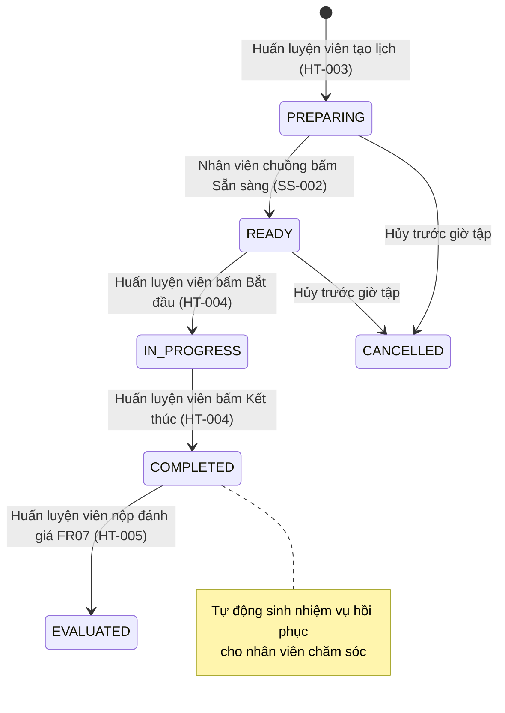
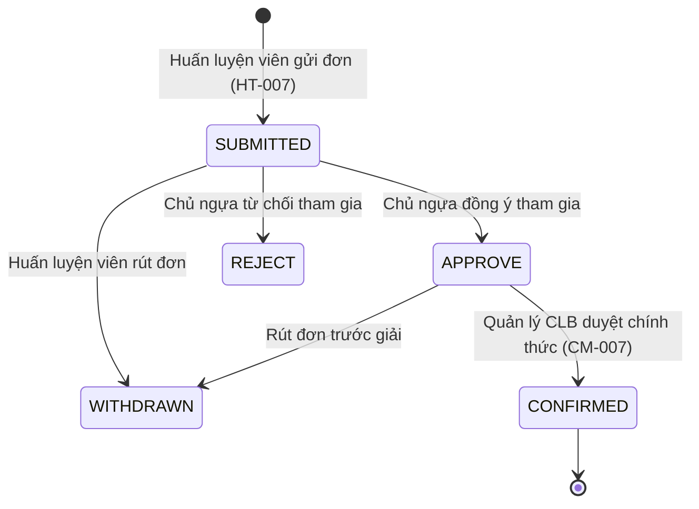

# Đặc Tả Vai Trò: Huấn Luyện Viên Trưởng (HEAD_TRAINER)
## Role Specification & Business Behavior

> **Vai trò:** `HEAD_TRAINER`  
> **Tên hiển thị:** Huấn luyện viên trưởng  
> **Tài khoản mẫu kiểm thử:** `headtrainer@gmail.com` / `Trainer123`  
> **Thư mục:** `BUSINESS_DOCS/roles/`  
> **Thời điểm thẩm định:** 12/10/2026  

---

## 1. Tổng Quan Vai Trò (Role Overview)

### 1.1. Mục Đích & Trách Nhiệm
`HEAD_TRAINER` là vai trò chuyên môn thể thao nòng cốt trong hệ thống RTMS, chịu trách nhiệm:
- Tiếp nhận bảo trợ và huấn luyện các con ngựa đủ điều kiện (đã hoàn thành đóng phí dịch vụ, đã kiểm tra y tế thú y ban đầu, đã phân bổ ô chuồng ổn định).
- Thiết lập kế hoạch huấn luyện đa giai đoạn (`training_plans`, `training_plan_phases`) kèm mục tiêu, lịch nghỉ ngơi và cường độ bài tập.
- Đặt lịch tập chi tiết từng buổi theo khung giờ tròn (06:00 đến 23:00) kèm đặt làn chạy thử (`racetrack_lanes`, `trial_run_bookings`).
- Trực tiếp kích hoạt bắt đầu (`start`) và kết thúc (`finish`) buổi huấn luyện thực địa; hệ thống tự động sinh nhiệm vụ hồi phục cho nhân viên chuồng.
- Ghi nhận đánh giá chi tiết buổi tập (FR07): nhịp tim đỉnh, nhịp tim hồi phục sau 1 phút, tốc độ tối đa, thời gian hoàn thành, phân loại thể lực (`GREEN`/`YELLOW`/`RED`) và báo cáo chấn thương phát sinh.
- Phát tín hiệu hỗ trợ khẩn cấp (`training_emergency`) ngay trong lúc tập tới nhân viên chăm sóc hoặc bác sĩ thú y chẩn đoán.
- Đăng ký ngựa tham gia giải đua (`race_registrations`), phối hợp lấy chấp thuận từ chủ ngựa (`HORSE_OWNER`) và quản lý CLB (`CLUB_MANAGER`).
- Theo dõi chỉ số sẵn sàng thi đấu (`race_readiness`) và giám sát chế độ chăm sóc chuồng (`stable-care`).

### 1.2. Quyền Hạn Hệ Thống (Permissions & Authorities)
- **Role Authority:** `ROLE_HEAD_TRAINER`.
- **Dynamic Authorities (cấu hình trong `dbo.role_permissions`):**
  - `PERM_PROFILE_VIEW` (Xem hồ sơ ngựa, phả hệ, thông tin y tế).
  - `PERM_TRAINING_VIEW`, `PERM_TRAINING_EDIT` (Toàn quyền lập kế hoạch, đặt lịch, vận hành buổi tập, chấm điểm đánh giá).
  - `PERM_RACING_VIEW`, `PERM_RACING_EDIT` (Xem sự kiện đua, đăng ký ngựa tham gia thi đấu).
  - `PERM_STABLE_CARE_VIEW` (Theo dõi nhật ký chăm sóc, khẩu phần dinh dưỡng của đàn ngựa được phân công).
  - `PERM_MEDICAL_VIEW` (Theo dõi lịch sử khám, khóa tập huấn luyện y tế của bác sĩ thú y).

### 1.3. Điểm Truy Cập Giao Diện & Backend (Entry Points)
- **Frontend Routes (`App.jsx`):**
  - `/training-reception`: Tiếp nhận huấn luyện ngựa đủ điều kiện (`TrainingReceptionPage.jsx`).
  - `/training-schedule`: Lập kế hoạch, đặt lịch tập, theo dõi lịch theo tuần/tháng, điều phối buổi tập (`TrainingSchedulePage.jsx`).
  - `/fitness`: Theo dõi chỉ số thể lực, nhịp tim hồi phục, đồ thị xu hướng (`TrainingMetricsPage.jsx`).
  - `/training-emergency`: Gửi điều phối hỗ trợ khẩn cấp trong buổi tập (`TrainingEmergencyPage.jsx`).
  - `/races`: Đăng ký thi đấu, theo dõi trạng thái đồng thuận đua (`TrainingRacePage.jsx`).
  - `/horses`, `/horses/:id`: Xem hồ sơ, chỉ số đo lường, phả hệ và lịch sử tập luyện.
  - `/stable-care`: Theo dõi bảng phân công chăm sóc chuồng.
- **Backend Controllers:**
  - `PaidHorseAssignmentController`, `TrainingPlanController`, `TrainingScheduleController`
  - `TrainingEvaluationController`, `IncidentReportController`
  - `RaceEventController`, `RaceResultController`, `RacetrackController`

---

## 2. Các Tính Năng Vai Trò Thực Hiện (Features Performed)

### HT-001: Tiếp Nhận Huấn Luyện Ngựa Đủ Điều Kiện (Training Reception)
- **Mục đích:** Huấn luyện viên trưởng chủ động tiếp nhận ngựa đạt chuẩn vào danh sách huấn luyện cá nhân của mình.
- **Tiền điều kiện:** 
  - Ngựa có `archived_at IS NULL`.
  - Phí dịch vụ hợp lệ: `service_override = 1` HOẶC (`payment_status = 'PAID'` và `paid_until >= CURRENT_DATE`).
  - Trạng thái tiếp nhận nhập chuồng: `intake_status = 'STABLED'`.
  - Trạng thái sức khỏe: `health_status = 'FIT'`.
  - Đã có bác sĩ thú y chẩn đoán gán kèm: `diagnosing_vet_user_id IS NOT NULL`.
  - Chưa có huấn luyện viên phụ trách: `current_trainer_id IS NULL`.
  - Đang có phân bổ ô chuồng hoạt động: `module_records` với `record_type = 'STALL_ASSIGNMENT'` và `status = 'ACTIVE'`.
  - Không bị áp khóa huấn luyện thú y: `training_locks` không có bản ghi nào chưa giải phóng (`released_at IS NULL`).
- **Điểm kích hoạt:** Màn hình **Tiếp nhận huấn luyện** (`/training-reception`).
- **Quy trình thực hiện:**
  1. Frontend gọi `GET /api/paid-horse-assignments/trainer/pending` tải danh sách ngựa chờ tiếp nhận.
  2. Huấn luyện viên kiểm tra thông tin định danh và bấm nút "Tiếp nhận".
  3. Frontend gọi `POST /api/paid-horse-assignments/trainer/{horseId}`.
  4. Backend cập nhật `horses.current_trainer_id = trainerId`, tăng `version`, ghi nhận thời gian `updated_at`.
- **Dữ liệu tác động:** Bảng `dbo.horses`.
- **Trạng thái triển khai:** `IMPLEMENTED`.
- **Bằng chứng:**
  - Backend: [`PaidHorseAssignmentController.java`](file:///c:/DEV/RACE%20HORSE/HORSE-PROJECT/BACKEND/src/main/java/com/racehorse/horse/controller/PaidHorseAssignmentController.java), [`PaidHorseAssignmentService.java`](file:///c:/DEV/RACE%20HORSE/HORSE-PROJECT/BACKEND/src/main/java/com/racehorse/horse/service/PaidHorseAssignmentService.java).
  - Frontend: [`TrainingReceptionPage.jsx`](file:///c:/DEV/RACE%20HORSE/HORSE-PROJECT/FRONTEND/src/TrainingReceptionPage.jsx).

---

### HT-002: Lập Kế Hoạch Huấn Luyện Đa Giai Đoạn (Multi-Phase Training Plan)
- **Mục đích:** Xây dựng khung giáo án dài hạn theo từng giai đoạn phát triển cho từng con ngựa, hoặc sao chép giáo án sang ngựa khác.
- **Tiền điều kiện:** Huấn luyện viên là người phụ trách ngựa (`current_trainer_id`), có quyền `PERM_TRAINING_EDIT`.
- **Điểm kích hoạt:** Màn hình **Lịch huấn luyện** (`/training-schedule`) -> Tab/Khu vực Kế hoạch.
- **Quy trình thực hiện:**
  1. Tạo mới kế hoạch: Nhập tên kế hoạch, mục tiêu huấn luyện, ngày bắt đầu - kết thúc.
  2. Khai báo các giai đoạn huấn luyện (`phases`): Tên giai đoạn (VD: Tăng sức bền, Tăng tốc độ nước rút), khoảng ngày bắt đầu - kết thúc, danh sách các ngày nghỉ cố định trong tuần (`restDays`).
  3. Bật kích hoạt (`active = true`): Mỗi con ngựa tại một thời điểm chỉ có tối đa một kế hoạch `ACTIVE` (ràng buộc kiểm tra trong `TrainingPlanService`).
  4. Tính năng Sao chép (`Copy Plan`): Cho phép chọn một kế hoạch mẫu đã có và nhân bản sang một con ngựa đích (`POST /api/training-plans/{planId}/copy`), tự động dịch chuyển mốc thời gian phù hợp.
- **Dữ liệu tác động:** Bảng `dbo.training_plans`, `dbo.training_plan_phases`.
- **Trạng thái triển khai:** `IMPLEMENTED`.
- **Bằng chứng:**
  - Backend: [`TrainingPlanController.java`](file:///c:/DEV/RACE%20HORSE/HORSE-PROJECT/BACKEND/src/main/java/com/racehorse/training/controller/TrainingPlanController.java), [`TrainingPlanService.java`](file:///c:/DEV/RACE%20HORSE/HORSE-PROJECT/BACKEND/src/main/java/com/racehorse/training/service/TrainingPlanService.java).
  - Frontend: [`TrainingSchedulePage.jsx`](file:///c:/DEV/RACE%20HORSE/HORSE-PROJECT/FRONTEND/src/TrainingSchedulePage.jsx).

---

### HT-003: Đặt Lịch Huấn Luyện & Khóa Làn Chạy Thử (Training Scheduling & Track Booking)
- **Mục đích:** Đặt lịch tập chi tiết từng buổi theo khung giờ chuẩn và giữ làn chạy trên sân tập.
- **Tiền điều kiện:** 
  - Kế hoạch huấn luyện của ngựa đang ở trạng thái `ACTIVE`.
  - Ngày tập phải nằm trong khoảng thời gian của một giai đoạn (`phase`), không trùng vào ngày nghỉ (`restDays`).
  - Ngựa không bị dính khóa tập y tế (`training_locks`).
- **Điểm kích hoạt:** Màn hình **Lịch huấn luyện** (`/training-schedule`) -> Dialog Đặt lịch tập.
- **Quy tắc khung giờ & Làn chạy cứng:**
  - `[FACT]` **Giờ tròn 06:00 đến 23:00:** Slot tập bắt đầu vào phút thứ 0, kéo dài đúng 60 phút (Ví dụ: 06:00, 07:00, ..., 22:00). Bị chặn bởi kiểm tra `slotStart` và Trigger `tr_enforce_training_window`.
  - `[FACT]` **Xung đột khung giờ:** Một con ngựa không thể có 2 buổi tập trùng giờ.
  - `[FACT]` **Khóa làn chạy (`trial_run_bookings`):** Làn chạy thuộc sân đua đã chọn (làn 1 đến làn 4). Một làn chạy trong cùng khung giờ chỉ phục vụ duy nhất 1 buổi tập.
- **Quy trình thực hiện:**
  1. Chọn ngựa, giai đoạn huấn luyện, ngày tập.
  2. Chọn sân đua (`racetrackId`), chọn khung giờ (`slotStart`). Frontend kiểm tra tình trạng trống làn qua `GET /api/racetracks/{trackId}/availability?date=...&slotStart=...`.
  3. Chọn làn chạy còn trống (`racetrackLaneId`).
  4. Nhập nội dung bài tập (`taskName`).
  5. Bấm "Tạo lịch": Backend ghi nhận `training_schedules` với trạng thái ban đầu `session_status = 'PREPARING'`, đồng thời tạo bản ghi đặt chỗ trong `trial_run_bookings`.
  6. Backend gửi thông báo tự động đến nhân viên chăm sóc phụ trách ngựa (`caretaker_user_id`).
- **Dữ liệu tác động:** Bảng `dbo.training_schedules`, `dbo.trial_run_bookings`, `dbo.notifications`.
- **Trạng thái triển khai:** `IMPLEMENTED`.
- **Bằng chứng:**
  - Backend: [`TrainingScheduleService.java`](file:///c:/DEV/RACE%20HORSE/HORSE-PROJECT/BACKEND/src/main/java/com/racehorse/training/service/TrainingScheduleService.java), Trigger `tr_enforce_training_window`.
  - Frontend: [`TrainingSchedulePage.jsx`](file:///c:/DEV/RACE%20HORSE/HORSE-PROJECT/FRONTEND/src/TrainingSchedulePage.jsx).

---

### HT-004: Bắt Đầu & Kết Thúc Buổi Huấn Luyện (Session Execution)
- **Mục đích:** Điều phối trạng thái thực thi buổi tập trên thực địa.
- **Quy tắc chuyển đổi trạng thái (State Transition):**
  - Buổi tập mới tạo: `PREPARING`.
  - Nhân viên chăm sóc dắt ngựa, chuẩn bị yên cương và xác nhận sẵn sàng: `READY` (qua `PATCH /api/training-schedules/{id}/ready`).
  - Huấn luyện viên chỉ được bấm **Bắt đầu** khi trạng thái ĐÃ LÀ `READY`:
    - Gọi `POST /api/training-schedules/{id}/start`.
    - Trạng thái chuyển thành `IN_PROGRESS`, ghi nhận `started_at`.
    - Kiểm tra điều kiện: Ngựa không bị thương (`health_status != 'INJURED'`), đã có bác sĩ thú y chẩn đoán, không có khóa y tế.
  - Sau khi bài tập hoàn tất, huấn luyện viên bấm **Kết thúc**:
    - Gọi `POST /api/training-schedules/{id}/finish`.
    - Trạng thái chuyển thành `COMPLETED`, ghi nhận `completed_at`.
    - `[FACT]` **Tự động sinh nhiệm vụ hồi phục:** Backend gọi `careTaskService.createRecoveryTask` để tự động tạo một nhiệm vụ chăm sóc hồi phục sau buổi tập cho nhân viên chăm sóc (`STABLE_STAFF`) của con ngựa đó.
- **Dữ liệu tác động:** Bảng `dbo.training_schedules`, `dbo.care_tasks`.
- **Trạng thái triển khai:** `IMPLEMENTED`.
- **Bằng chứng:**
  - Backend: [`TrainingScheduleService.java`](file:///c:/DEV/RACE%20HORSE/HORSE-PROJECT/BACKEND/src/main/java/com/racehorse/training/service/TrainingScheduleService.java#L313-L350).
  - Frontend: [`TrainingSchedulePage.jsx`](file:///c:/DEV/RACE%20HORSE/HORSE-PROJECT/FRONTEND/src/TrainingSchedulePage.jsx).

---

### HT-005: Đánh Giá Buổi Tập Huấn Luyện (FR07 Training Evaluation)
- **Mục đích:** Ghi nhận toàn diện các thông số thể lực sinh học và hiệu suất bài tập sau khi buổi tập kết thúc.
- **Tiền điều kiện:** 
  - Buổi tập phải có `session_status = 'COMPLETED'` và chưa có bản ghi đánh giá nào trước đó (`1:1` relationship).
  - Người thực hiện phải là huấn luyện viên phụ trách ngựa (`HEAD_TRAINER`).
- **Điểm kích hoạt:** Màn hình **Lịch huấn luyện** -> Bấm "Ghi nhận đánh giá" trên buổi tập đã hoàn thành.
- **Các thông số thu thập & Công thức tính tự động:**
  - Thời lượng (`durationMinutes`), cự ly chạy (`distanceMeters`).
  - Thời gian hoàn thành vòng chạy (`trackCompletionSeconds`).
  - Tốc độ tối đa (`maxSpeedKmh`).
  - **Tốc độ trung bình (tính tự động):** `averageSpeed = (distanceMeters * 3.6) / trackCompletionSeconds`.
  - **Cường độ vận động (%):** `intensity = (averageSpeed * 100) / maxSpeedKmh`.
  - Nhịp tim dừng (`stopBpm`) và nhịp tim sau nghỉ 1 phút (`oneMinuteBpm`) (0 - 300 BPM, `oneMinuteBpm <= stopBpm`).
  - **Nhịp tim hồi phục:** `recoveryBpm = stopBpm - oneMinuteBpm`.
  - **Phân loại thể lực (`FitnessStatusPolicy`):**
    - `GREEN`: Nhịp tim sau 1 phút `<= 115 BPM`.
    - `YELLOW`: Nhịp tim sau 1 phút từ `116` đến `129 BPM`.
    - `RED`: Nhịp tim sau 1 phút `>= 130 BPM`.
  - Mức độ gắng sức cảm nhận (`perceivedExertion`: thang 1-10), ghi chú chuyên môn (`trainerNotes`), đường dẫn video (`videoUrl`).
- **Xử lý sự cố chấn thương trong đánh giá:**
  - Nếu huấn luyện viên đánh dấu `injured = true`:
    - Ghi nhận vị trí tổn thương (`injuryLocation`) và mô tả (`injuryNotes`).
    - Backend tự động cập nhật hồ sơ ngựa: `status = 'INJURED'`, `health_status = 'INJURED'`, `health_source_type = 'TRAINING_EVALUATION'`.
    - Hệ thống phát thông báo cảnh báo ưu tiên cao tới Bác sĩ thú y và Chủ ngựa.
- **Dữ liệu tác động:** Bảng `dbo.training_evaluations`, `dbo.horses`, `dbo.notifications`.
- **Trạng thái triển khai:** `IMPLEMENTED`.
- **Bằng chứng:**
  - Backend: [`TrainingEvaluationService.java`](file:///c:/DEV/RACE%20HORSE/HORSE-PROJECT/BACKEND/src/main/java/com/racehorse/training/service/TrainingEvaluationService.java#L76-L143).
  - Frontend: [`TrainingSchedulePage.jsx`](file:///c:/DEV/RACE%20HORSE/HORSE-PROJECT/FRONTEND/src/TrainingSchedulePage.jsx#L1167-L1210).

---

### HT-006: Gửi Báo Động Khẩn Cấp Buổi Tập (Training Emergency Dispatch)
- **Mục đích:** Huấn luyện viên phát tín hiệu cấp cứu khi xảy ra tai nạn, ngựa quỵ ngã hoặc chấn thương đột ngột ngay trong lúc buổi tập đang diễn ra.
- **Tiền điều kiện:** Buổi tập đang ở trạng thái `IN_PROGRESS`.
- **Điểm kích hoạt:** Màn hình **Khẩn cấp** (`/training-emergency`).
- **Quy trình thực hiện:**
  1. Frontend tự động lọc các buổi tập đang diễn ra (`IN_PROGRESS`).
  2. Huấn luyện viên chọn buổi tập gặp sự cố.
  3. Chọn đối tượng tiếp nhận hỗ trợ:
     - `CARETAKER`: Nhân viên chăm sóc phụ trách ngựa.
     - `DIAGNOSING_VET`: Bác sĩ thú y chẩn đoán của ngựa.
     - Hoặc chọn cả hai.
  4. Nhập mô tả triệu chứng sự cố khẩn cấp (`description`).
  5. Bấm "Gửi yêu cầu": Gọi `POST /api/incidents/training-emergency`.
  6. Backend tạo bản ghi sự cố trong `module_records` (`module_code = 'INCIDENT'`), tạo thông báo ưu tiên cao `TRAINING_EMERGENCY` gửi lập tức tới tài khoản của nhân viên chuồng và bác sĩ thú y được chọn, đồng thời cho phép chủ ngựa theo dõi được sự cố qua màn hình chi tiết ngựa.
- **Dữ liệu tác động:** Bảng `dbo.module_records`, `dbo.notifications`.
- **Trạng thái triển khai:** `IMPLEMENTED`.
- **Bằng chứng:**
  - Backend: [`IncidentReportController.java`](file:///c:/DEV/RACE%20HORSE/HORSE-PROJECT/BACKEND/src/main/java/com/racehorse/incident/controller/IncidentReportController.java#L43-L56), [`IncidentReportService.java`](file:///c:/DEV/RACE%20HORSE/HORSE-PROJECT/BACKEND/src/main/java/com/racehorse/incident/service/IncidentReportService.java).
  - Frontend: [`TrainingEmergencyPage.jsx`](file:///c:/DEV/RACE%20HORSE/HORSE-PROJECT/FRONTEND/src/TrainingEmergencyPage.jsx).

---

### HT-007: Đăng Ký Tham Gia Giải Đua Ngựa (Race Registration)
- **Mục đích:** Đề cử ngựa đủ tiêu chuẩn thể lực tham gia các giải đua chính thức do câu lạc bộ tổ chức.
- **Tiền điều kiện:** Có quyền `PERM_RACING_EDIT`, giải đua đang mở tiếp nhận đăng ký (`active = true`, trước hạn chót `registrationDeadline`).
- **Điểm kích hoạt:** Màn hình **Đua ngựa** (`/races`) -> Tab Đăng ký thi đấu.
- **Quy trình & Bộ ba đồng thuận (Race Consent Triad):**
  1. Huấn luyện viên gửi đơn đăng ký: Gọi `POST /api/races/{eventId}/registrations` với `horseId`, `registeredWeightKg`.
  2. Trạng thái ban đầu: `SUBMITTED`.
  3. Chủ sở hữu ngựa (`HORSE_OWNER`) kiểm tra và phản hồi:
     - Bấm duyệt: Chuyển sang `APPROVE`.
     - Bấm từ chối: Chuyển sang `REJECT` kèm lý do.
  4. Quản lý câu lạc bộ (`CLUB_MANAGER`) phê duyệt cuối cùng: Gọi `POST /api/races/registrations/{id}/confirm`.
     - `[FACT]` Trigger `tr_module_records_race_registration_status_guard` NGĂN CHẶN xác nhận thi đấu nếu chủ ngựa chưa duyệt (`status != 'APPROVE'`).
     - Khi Manager xác nhận, trạng thái chuyển thành `CONFIRMED`.
  5. Rút lui thi đấu: Huấn luyện viên có thể chủ động rút đơn đăng ký trước giải (`withdraw`) nếu ngựa gặp chấn thương đột xuất.
- **Dữ liệu tác động:** Bảng `dbo.module_records` (`module_code = 'RACING'`, `record_type = 'RACE_REGISTRATION'`).
- **Trạng thái triển khai:** `IMPLEMENTED`.
- **Bằng chứng:**
  - Backend: [`RaceEventController.java`](file:///c:/DEV/RACE%20HORSE/HORSE-PROJECT/BACKEND/src/main/java/com/racehorse/racing/controller/RaceEventController.java), [`RaceEventService.java`](file:///c:/DEV/RACE%20HORSE/HORSE-PROJECT/BACKEND/src/main/java/com/racehorse/racing/service/RaceEventService.java), Trigger `tr_module_records_race_registration_status_guard`.
  - Frontend: [`TrainingRacePage.jsx`](file:///c:/DEV/RACE%20HORSE/HORSE-PROJECT/FRONTEND/src/TrainingRacePage.jsx).

---

### HT-008: Theo Dõi & Đánh Giá Chỉ Số Thể Lực (Fitness & Race Readiness Tracking)
- **Mục đích:** Theo dõi xu hướng phục hồi nhịp tim, tốc độ, cường độ tập luyện và đánh giá mức độ sẵn sàng đua (`Race Readiness`).
- **Điểm kích hoạt:** Màn hình **Chỉ số thể lực** (`/fitness`).
- **Chỉ tiêu đánh giá sẵn sàng thi đấu (`Race Readiness`):**
  - Backend cung cấp endpoint `GET /api/horses/{id}/race-readiness`.
  - Tính toán dựa trên:
    - Trạng thái sức khỏe thú y hiện tại (`FIT`).
    - Lịch sử nhịp tim hồi phục sau 1 phút trong các buổi tập gần nhất (`oneMinuteBpm <= 115`).
    - Tần suất tập luyện liên tục không bị gián đoạn bởi khóa chấn thương.
    - Không có khóa tập y tế nào đang hiệu lực.
- **Dữ liệu tác động:** Truy vấn tổng hợp từ `training_evaluations`, `horses`, `training_locks`.
- **Trạng thái triển khai:** `IMPLEMENTED`.
- **Bằng chứng:**
  - Backend: [`TrainingMetricsPage.jsx`](file:///c:/DEV/RACE%20HORSE/HORSE-PROJECT/FRONTEND/src/TrainingMetricsPage.jsx), [`HorseController.java`](file:///c:/DEV/RACE%20HORSE/HORSE-PROJECT/BACKEND/src/main/java/com/racehorse/horse/controller/HorseController.java).

---

## 3. Yêu Cầu Gửi Đi & Tiếp Nhận (Requests Sent & Received)

### 3.1. Dữ liệu Huấn Luyện Viên Gửi Đi (Outgoing Requests)
| Mã Yêu Cầu | Mục Đích | Người Nhận | Trạng Thái / Phản Hồi Kỳ Vọng |
|---|---|---|---|
| `REQ-HT-01` | Tiếp nhận ngựa huấn luyện (`POST /paid-horse-assignments/trainer/{id}`) | Hệ thống | Gán `current_trainer_id` thành công |
| `REQ-HT-02` | Công bố lịch tập (`publish`) | Nhân viên chăm sóc (`STABLE_STAFF`) | Nhận thông báo lịch tập để chuẩn bị ngựa |
| `REQ-HT-03` | Khởi động buổi tập (`start`) | Hệ thống / Nhân viên chuồng | Buổi tập chuyển `IN_PROGRESS` |
| `REQ-HT-04` | Kết thúc buổi tập (`finish`) | Nhân viên chăm sóc (`STABLE_STAFF`) | Tự động tạo task hồi phục sau buổi tập |
| `REQ-HT-05` | Ghi nhận đánh giá buổi tập (FR07) | Chủ sở hữu (`HORSE_OWNER`) | Nhận thông báo đánh giá thể lực buổi tập |
| `REQ-HT-06` | Báo động khẩn cấp buổi tập | Nhân viên chuồng & Bác sĩ thú y | Tiếp nhận hỗ trợ y tế khẩn cấp tại sân |
| `REQ-HT-07` | Đơn đăng ký thi đấu giải đua | Chủ sở hữu (`HORSE_OWNER`) | Chủ ngựa xem xét duyệt (`APPROVE`) hoặc từ chối |

### 3.2. Dữ liệu Huấn Luyện Viên Tiếp Nhận (Incoming Data)
| Nguồn Gửi | Loại Dữ Liệu | Mục Đích Đối Với Huấn Luyện Viên |
|---|---|---|
| `STABLE_STAFF` | Xác nhận sẵn sàng (`PATCH /ready`) | Báo hiệu ngựa đã được đóng yên, chuẩn bị xong, sẵn sàng bắt đầu |
| `VETERINARIAN` | Đánh giá lâm sàng buổi tập (`VET_TRAINING_ASSESSMENT`) | Bác sĩ gửi nhận xét sau buổi tập (nhịp thở, dáng đi, cơ bắp) |
| `VETERINARIAN` | Khóa tập y tế (`training_locks`) | Cấm huấn luyện viên đặt lịch hoặc cho ngựa tập khi ngựa bị bệnh |
| `HORSE_OWNER` | Quyết định đồng thuận đua (`APPROVE` / `REJECT`) | Cho phép hoặc chặn giải đua tiếp tục trình Manager xác nhận |

---

## 4. Vòng Đời & Máy Trạng Thái (Lifecycles & State Machines)

### 4.1. Vòng Đời Buổi Huấn Luyện (Training Schedule Lifecycle)

### 4.2. Vòng Đời Đăng Ký Đua (Race Registration Lifecycle)

---

## 5. Đánh Giá Hiện Trạng & Ghi Chú Rà Soát (Review Notes)

1. `[FACT]` **Tách biệt vai trò bác sĩ thú y khỏi luồng tập thông thường:** Trong phiên bản hiện tại, buổi tập bình thường chuyển trực tiếp từ `PREPARING` -> `READY` (do Caretaker xác nhận) -> `IN_PROGRESS` -> `COMPLETED` (do Trainer thực hiện), KHÔNG yêu cầu Bác sĩ thú y phải vào nhận ca hoặc giám sát trực tiếp. Bác sĩ thú y chỉ thực hiện đánh giá lâm sàng độc lập sau buổi tập (`VET_TRAINING_ASSESSMENT`) hoặc can thiệp khi có báo động khẩn cấp.
2. `[FACT]` **Tự động hóa nhiệm vụ hồi phục:** Khi Huấn luyện viên bấm `finish`, hệ thống backend tự động gọi `CareTaskService.createRecoveryTask` gán trực tiếp cho `caretaker_user_id` của con ngựa, giúp kết nối nhịp nhàng giữa Huấn luyện viên và Nhân viên chuồng.
3. `[OBSERVATION]` **Màn hình Đánh giá lâm sàng của Thú y:** Backend đã có endpoint `POST /api/training-evaluations/vet-assessment` và thông báo tới Huấn luyện viên (`VET_ASSESSMENT_COMPLETED`), nhưng giao diện Huấn luyện viên xem đánh giá lâm sàng này hiện tại chủ yếu đọc qua nhật ký chung chứ chưa có modal riêng biệt trên lịch tập.
