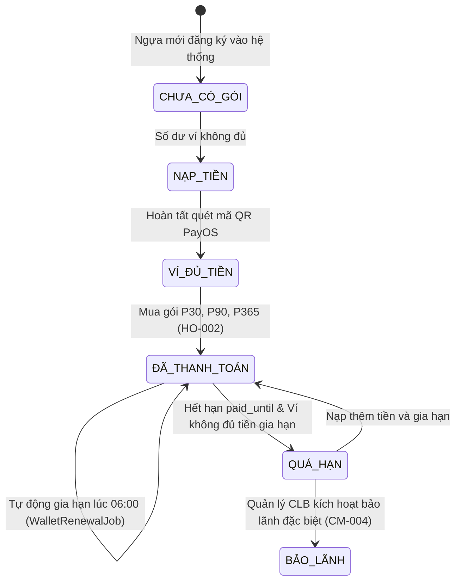

# Đặc Tả Vai Trò: Chủ Sở Hữu Ngựa (HORSE_OWNER)
## Role Specification & Business Behavior

> **Vai trò:** `HORSE_OWNER`  
> **Tên hiển thị:** Chủ sở hữu ngựa / Khách hàng hội viên  
> **Tài khoản mẫu kiểm thử:** `owner@gmail.com` / `Owner123`  
> **Thư mục:** `BUSINESS_DOCS/roles/`  
> **Thời điểm thẩm định:** 12/10/2026  

---

## 1. Tổng Quan Vai Trò (Role Overview)

### 1.1. Mục Đích & Trách Nhiệm
`HORSE_OWNER` là đối tượng khách hàng trọng tâm của hệ thống RTMS, sở hữu một hoặc nhiều con ngựa gửi nuôi tại câu lạc bộ:
- Quản lý tài chính cá nhân, số dư ví điện tử (`wallet`) và thanh toán các gói dịch vụ nuôi dưỡng, chăm sóc, huấn luyện theo từng con ngựa.
- Nạp tiền vào ví qua cổng thanh toán trực tuyến VietQR/PayOS hoặc kiểm thử mô phỏng.
- Theo dõi toàn diện hồ sơ định danh, gia phả 3 đời (`pedigree`), thành tích thi đấu và phân công nhân sự (Huấn luyện viên, Bác sĩ thú y, Nhân viên chăm sóc) cho đàn ngựa của mình.
- Thực hiện quyền quyết định tối cao trong việc cho phép hoặc từ chối (`APPROVE` / `REJECT`) đề xuất đăng ký tham gia giải đua của Huấn luyện viên trưởng.
- Giám sát tiến độ bài tập, lịch trình huấn luyện và chỉ số sinh học hồi phục thể lực sau tập (FR07).
- Tiếp nhận các cảnh báo y tế khẩn cấp (`training_emergency`) phát sinh từ sân tập.
- Đối soát chi phí và xem báo cáo tài chính/sức khỏe tổng hợp hàng ngày (`owner_reports`) được hệ thống tự sinh mỗi sáng.

### 1.2. Quyền Hạn Hệ Thống (Permissions & Authorities)
- **Role Authority:** `ROLE_HORSE_OWNER`.
- **Dynamic Authorities (cấu hình trong `dbo.role_permissions`):**
  - `PERM_PROFILE_VIEW` (Xem hồ sơ đàn ngựa thuộc quyền sở hữu của mình).
  - `PERM_PROFILE_EDIT` (Chỉnh sửa một số thông tin cơ bản: màu sắc nhận dạng, ảnh chân dung ngựa của mình).
  - `PERM_TRAINING_VIEW` (Xem lịch tập và kết quả đánh giá thể lực của ngựa thuộc quyền sở hữu).
  - `PERM_RACING_VIEW`, `PERM_RACING_APPROVE` (Xem các giải đua và thực thi quyền phê duyệt/từ chối đăng ký thi đấu).
  - `PERM_REPORTING_VIEW` (Xem báo cáo ngày và giao dịch tài chính liên quan đến ngựa của mình).

### 1.3. Điểm Truy Cập Giao Diện & Backend (Entry Points)
- **Frontend Routes (`App.jsx`):**
  - `/wallet`: Trang quản lý ví tiền, quét mã nạp tiền PayOS, mua gói và hẹn lịch gia hạn gói dịch vụ (`WalletPage.jsx`).
  - `/horses`, `/horses/:id`: Danh sách và trang chi tiết hồ sơ ngựa thuộc sở hữu của chủ ngựa (`Horses`, `HorseDetail`).
  - `/training-schedule`: Xem lịch huấn luyện đã công bố của đàn ngựa mình (`TrainingSchedulePage.jsx` với chế độ `isOwner={true}`).
  - `/fitness`: Theo dõi chỉ số sẵn sàng đua (`Race Readiness`) và biểu đồ thể lực (`TrainingMetricsPage.jsx`).
  - `/races`: Xem các giải đấu và duyệt/từ chối đơn đăng ký thi đấu của HLV (`TrainingRacePage.jsx`).
  - `/my-reports`: Báo cáo tài chính chi tiết của chủ ngựa và báo cáo định kỳ (`FinanceReportsPage.jsx`).
- **Backend Controllers:**
  - `WalletController`, `HorseController`, `RaceEventController`
  - `TrainingScheduleController`, `TrainingEvaluationController`, `IncidentReportController`, `FinanceController`

---

## 2. Các Tính Năng Vai Trò Thực Hiện (Features Performed)

### HO-001: Quản Lý Ví Điện Tử & Nạp Tiền Qua PayOS (Wallet Top-Up)
- **Mục đích:** Duy trì số dư tài khoản để chi trả phí dịch vụ nuôi nhốt, thức ăn và huấn luyện cho đàn ngựa.
- **Tiền điều kiện:** Đăng nhập với quyền `HORSE_OWNER`.
- **Điểm kích hoạt:** Màn hình **Ví của chủ ngựa** (`/wallet`).
- **Quy trình thực hiện:**
  1. Xem số dư hiện tại (`balanceVnd`), số lượng ngựa đang sở hữu, tổng tiền dự kiến cần cho kỳ gia hạn tiếp theo (`renewalAmountVnd`), và số tiền còn thiếu nếu tất cả cùng đến hạn (`shortage`).
  2. Nạp tiền vào ví: Nhập số tiền nạp (`amountVnd`, tối thiểu 100,000 VND).
  3. Bấm "Tạo lệnh nạp": Gọi `POST /api/wallet/top-ups`.
  4. Backend tạo đơn nạp (`wallet_top_up_orders`), sinh mã đơn hàng PayOS kèm đường dẫn mã thanh toán QR.
  5. Frontend hiển thị mã QR cùng đồng hồ đếm ngược thời gian hết hạn (polling `GET /api/wallet/top-ups/{orderId}` mỗi 4 giây).
  6. **Cơ chế xác nhận thanh toán:**
     - Môi trường thật: Cổng PayOS gửi tín hiệu Webhook tới `POST /api/wallet/payos/webhook`.
     - Môi trường kiểm thử / Demo cục bộ: Chủ ngựa bấm "Hoàn tất thanh toán mô phỏng" (`fake-complete` qua `POST /api/wallet/top-ups/{id}/fake-complete`).
  7. Backend ghi nhận trạng thái `PAID`, cộng trực tiếp `amount_vnd` vào số dư ví của chủ ngựa.
- **Dữ liệu tác động:** Bảng `dbo.users` (cột `wallet_balance_vnd`), bảng `dbo.wallet_top_up_orders`.
- **Trạng thái triển khai:** `IMPLEMENTED`.
- **Bằng chứng:**
  - Backend: [`WalletController.java`](file:///c:/DEV/RACE%20HORSE/HORSE-PROJECT/BACKEND/src/main/java/com/racehorse/wallet/WalletController.java#L29-L40), [`WalletService.java`](file:///c:/DEV/RACE%20HORSE/HORSE-PROJECT/BACKEND/src/main/java/com/racehorse/wallet/WalletService.java).
  - Frontend: [`WalletPage.jsx`](file:///c:/DEV/RACE%20HORSE/HORSE-PROJECT/FRONTEND/src/WalletPage.jsx#L61-L71).

---

### HO-002: Đăng Ký & Tự Động Gia Hạn Gói Dịch Vụ Theo Từng Ngựa (Service Plan Purchase & Renewal)
- **Mục đích:** Mua gói dịch vụ chăm sóc cho từng con ngựa cụ thể từ số dư ví chung.
- **Các gói dịch vụ tiêu chuẩn (`WalletPlan`):**
  - `P30`: Gói 30 ngày — Giá `100,000 VND`.
  - `P90`: Gói 90 ngày — Giá `300,000 VND`.
  - `P365`: Gói 365 ngày (1 năm) — Giá `1,100,000 VND`.
- **Quy trình thực hiện:**
  1. **Mua gói lần đầu cho ngựa:**
     - Chủ ngựa chọn con ngựa chưa có gói dịch vụ hoạt động (`activePlan == null`).
     - Chọn gói (`P30`, `P90`, `P365`), bấm "Thanh toán gói".
     - Frontend gọi `POST /api/wallet/plans` với `horseId` và `plan`.
     - Backend trừ tiền trong ví, cập nhật `horses.payment_status = 'PAID'`, tính toán hạn sử dụng `paid_until = CURRENT_DATE + N ngày`, gán `service_plan = plan`.
  2. **Lên lịch đổi gói cho kỳ kế tiếp (`Schedule Next Plan`):**
     - Với ngựa đã có gói đang hoạt động, chủ ngựa có thể chọn trước gói áp dụng cho lần gia hạn tới (`PUT /api/wallet/horses/{horseId}/next-plan`).
  3. **Chủ động gia hạn sớm (`Renew Now`):**
     - Bấm "Gia hạn ngay" (`POST /api/wallet/horses/{horseId}/renew`), hệ thống trừ tiền và cộng dồn thêm ngày vào `paid_until`.
  4. **Tự động gia hạn hàng ngày (`WalletRenewalJob`):**
     - Chạy định kỳ lúc 06:00 sáng mỗi ngày.
     - Tự động quét các con ngựa có `paid_until <= CURRENT_DATE`. Nếu ví của chủ ngựa đủ số dư, hệ thống tự động trừ tiền và gia hạn thêm kỳ hạn mới.
- **Dữ liệu tác động:** Bảng `dbo.horses`, `dbo.users`, `dbo.financial_transactions`.
- **Trạng thái triển khai:** `IMPLEMENTED`.
- **Bằng chứng:**
  - Backend: [`WalletController.java`](file:///c:/DEV/RACE%20HORSE/HORSE-PROJECT/BACKEND/src/main/java/com/racehorse/wallet/WalletController.java#L49-L67), [`WalletRenewalJob.java`](file:///c:/DEV/RACE%20HORSE/HORSE-PROJECT/BACKEND/src/main/java/com/racehorse/wallet/WalletRenewalJob.java).
  - Frontend: [`WalletPage.jsx`](file:///c:/DEV/RACE%20HORSE/HORSE-PROJECT/FRONTEND/src/WalletPage.jsx#L72-L84).

---

### HO-003: Quản Lý & Khai Báo Hồ Sơ Ngựa Sở Hữu (Owned Horses Management)
- **Mục đích:** Quản lý danh sách ngựa thuộc quyền sở hữu của mình và đăng ký ngựa mới vào câu lạc bộ.
- **Điểm kích hoạt:** Màn hình **Đàn ngựa** (`/horses`) và **Chi tiết hồ sơ ngựa** (`/horses/:id`).
- **Quy trình thực hiện:**
  1. Xem danh sách đàn ngựa cá nhân (`GET /api/horses/mine` hoặc `GET /api/horses`).
  2. Khai báo ngựa mới: Nhập tên ngựa, mã số chíp/hộ chiếu, ngày sinh, giống ngựa, giới tính, màu lông/dấu hiệu nhận dạng.
     - Khi tạo với vai trò chủ ngựa, backend tự động gán chủ sở hữu trong `dbo.horse_ownerships` là chính tài khoản đó.
  3. Xem chi tiết hồ sơ ngựa:
     - Phả hệ 3 thế hệ (`pedigree` cha, mẹ, ông, bà).
     - Nhân sự phụ trách: Huấn luyện viên (`currentTrainer`), Nhân viên chăm sóc (`caretaker`), Bác sĩ thú y chẩn đoán (`diagnosingVet`).
     - Tình trạng sức khỏe, vị trí chuồng trại, trạng thái thanh toán gói dịch vụ.
  4. Cập nhật hồ sơ: Chủ ngựa được phép sửa dấu vết màu lông và tải ảnh đại diện cho ngựa (`PUT /api/horses/{id}/mine`).
- **Dữ liệu tác động:** Bảng `dbo.horses`, `dbo.horse_ownerships`.
- **Trạng thái triển khai:** `IMPLEMENTED`.
- **Bằng chứng:**
  - Backend: [`HorseController.java`](file:///c:/DEV/RACE%20HORSE/HORSE-PROJECT/BACKEND/src/main/java/com/racehorse/horse/controller/HorseController.java).
  - Frontend: [`Horses` và `HorseDetail` trong `App.jsx`](file:///c:/DEV/RACE%20HORSE/HORSE-PROJECT/FRONTEND/src/App.jsx#L480-L620).

---

### HO-004: Quyết Định Đồng Thuận Tham Gia Giải Đua (Race Consent Decision)
- **Mục đích:** Chủ ngựa giữ quyền phủ quyết hoặc chấp thuận cho ngựa của mình tham gia một giải đấu cụ thể.
- **Tiền điều kiện:** Huấn luyện viên trưởng đã nộp đơn đăng ký thi đấu (`status = 'SUBMITTED'`).
- **Điểm kích hoạt:** Màn hình **Đua ngựa** (`/races`) -> Danh sách đăng ký giải.
- **Quy trình thực hiện:**
  1. Frontend gọi `GET /api/races/registrations` lọc theo các đăng ký của ngựa thuộc sở hữu chủ ngựa.
  2. Chủ ngựa xem thông tin giải đấu, tên ngựa, cân nặng đăng ký thi đấu (`registeredWeightKg`), hạn chót đăng ký.
  3. Đưa ra phản hồi:
     - **Chấp thuận (`Approve`):** Gọi `POST /api/races/registrations/{id}/decision` với `{ approve: true }`. Trạng thái chuyển sang `APPROVE`.
     - **Từ chối (`Reject`):** Gọi `POST /api/races/registrations/{id}/decision` với `{ approve: false, reason: "Lý do từ chối" }`. Trạng thái chuyển sang `REJECT`.
  4. `[FACT]` Nếu chủ ngựa từ chối hoặc chưa duyệt, Quản lý câu lạc bộ KHÔNG THỂ xác nhận thi đấu chính thức (bị chặn cứng bởi Trigger SQL Server `tr_module_records_race_registration_status_guard`).
- **Dữ liệu tác động:** Bảng `dbo.module_records` (`module_code = 'RACING'`, `record_type = 'RACE_REGISTRATION'`).
- **Trạng thái triển khai:** `IMPLEMENTED`.
- **Bằng chứng:**
  - Backend: [`RaceEventController.java`](file:///c:/DEV/RACE%20HORSE/HORSE-PROJECT/BACKEND/src/main/java/com/racehorse/racing/controller/RaceEventController.java#L72-L77), Trigger `tr_module_records_race_registration_status_guard`.
  - Frontend: [`TrainingRacePage.jsx`](file:///c:/DEV/RACE%20HORSE/HORSE-PROJECT/FRONTEND/src/TrainingRacePage.jsx).

---

### HO-005: Giám Sát Lịch Huấn Luyện & Chỉ Số Thể Lực Đánh Giá (Training & Fitness Supervision)
- **Mục đích:** Nắm bắt lịch tập luyện hàng tuần và kết quả bài tập của ngựa để an tâm về chất lượng chăm sóc.
- **Điểm kích hoạt:** Màn hình **Lịch huấn luyện** (`/training-schedule`) và **Chỉ số thể lực** (`/fitness`).
- **Nội dung hiển thị:**
  1. **Lịch tập:** Xem các buổi tập đã được công bố của ngựa mình theo tuần hoặc tháng (thông qua API `GET /api/training-schedules/{id}/owner-view`). Chủ ngựa có giao diện xem chuyên biệt, không có các nút thao tác nghiệp vụ điều phối của Huấn luyện viên.
  2. **Đánh giá thể lực (FR07):** Xem chi tiết từng buổi tập đã hoàn thành:
     - Nhịp tim dừng (`stopBpm`) và nhịp tim hồi phục sau 1 phút (`oneMinuteBpm`).
     - Tốc độ tối đa, tốc độ trung bình, thời gian chạy vòng.
     - Đánh giá phân loại thể lực: Xanh (`GREEN` - Tốt), Vàng (`YELLOW` - Lưu ý), Đỏ (`RED` - Cảnh báo kiệt sức).
     - Nhận xét của Huấn luyện viên và đường dẫn video ghi hình buổi tập (nếu có).
  3. **Chỉ số sẵn sàng đua (`Race Readiness`):** Theo dõi thanh đo mức độ sẵn sàng thi đấu được tính toán theo thời gian thực.
- **Dữ liệu tác động:** Bảng `dbo.training_schedules`, `dbo.training_evaluations`.
- **Trạng thái triển khai:** `IMPLEMENTED`.
- **Bằng chứng:**
  - Backend: [`TrainingScheduleController.java`](file:///c:/DEV/RACE%20HORSE/HORSE-PROJECT/BACKEND/src/main/java/com/racehorse/training/controller/TrainingScheduleController.java#L87-L93), [`TrainingEvaluationController.java`](file:///c:/DEV/RACE%20HORSE/HORSE-PROJECT/BACKEND/src/main/java/com/racehorse/training/controller/TrainingEvaluationController.java).
  - Frontend: [`TrainingSchedulePage.jsx`](file:///c:/DEV/RACE%20HORSE/HORSE-PROJECT/FRONTEND/src/TrainingSchedulePage.jsx#L815-L825), [`TrainingMetricsPage.jsx`](file:///c:/DEV/RACE%20HORSE/HORSE-PROJECT/FRONTEND/src/TrainingMetricsPage.jsx).

---

### HO-006: Tiếp Nhận Thông Báo Báo Động Khẩn Cấp Buổi Tập (Training Emergency Alerts)
- **Mục đích:** Nắm bắt kịp thời các sự cố chấn thương bất ngờ phát sinh trong quá trình huấn luyện ngựa.
- **Điểm kích hoạt:** Màn hình chi tiết ngựa (`/horses/:id`) -> Phần Lịch sử yêu cầu khẩn cấp.
- **Quy trình thực hiện:**
  1. Frontend gọi `GET /api/incidents/training-emergency/horses/{horseId}`.
  2. Hiển thị danh sách các lần báo động khẩn cấp xảy ra với ngựa trong lúc tập:
     - Tên bài tập, thời điểm phát tín hiệu khẩn cấp.
     - Mô tả triệu chứng ban đầu của HLV.
     - Người nhận điều phối cứu hộ (Nhân viên chăm sóc, Bác sĩ thú y).
     - Tên sân đua, số làn chạy.
     - Ghi chú kết quả xử lý và tình trạng can thiệp y tế sau đó (`resolutionNotes`).
- **Dữ liệu tác động:** Bảng `dbo.module_records` (`module_code = 'INCIDENT'`).
- **Trạng thái triển khai:** `IMPLEMENTED`.
- **Bằng chứng:**
  - Backend: [`IncidentReportController.java`](file:///c:/DEV/RACE%20HORSE/HORSE-PROJECT/BACKEND/src/main/java/com/racehorse/incident/controller/IncidentReportController.java#L58-L62).
  - Frontend: [`HorseDetail` trong `App.jsx`](file:///c:/DEV/RACE%20HORSE/HORSE-PROJECT/FRONTEND/src/App.jsx#L480-L550).

---

### HO-007: Đối Soát Tài Chính & Nhận Báo Cáo Định Kỳ (Financial History & Daily Owner Reports)
- **Mục đích:** Minh bạch toàn bộ dòng tiền chi tiêu và nắm bắt bản tóm tắt tình trạng sinh hoạt của đàn ngựa mỗi ngày.
- **Điểm kích hoạt:** Màn hình **Báo cáo của tôi** (`/my-reports`).
- **Quy trình thực hiện:**
  1. Xem sổ cái giao dịch tài chính (`financial_transactions`): ngày giao dịch, loại phí (nạp ví, mua gói, gia hạn, đăng ký thi đấu), số tiền, trạng thái.
  2. Báo cáo định kỳ hàng ngày (`owner_reports`):
     - Mỗi sáng lúc 06:00, job ngầm `DailyAutomationJob` tự động tổng hợp toàn bộ hoạt động của ngày hôm trước (danh sách ngựa, giao dịch phát sinh) và lưu vào bảng `dbo.owner_reports`.
     - Hệ thống tự động gửi thông báo chuông `OWNER_REPORT_READY` ("Báo cáo ngày mới đã sẵn sàng") tới tài khoản của chủ ngựa.
     - Chủ ngựa mở màn hình báo cáo để đọc tổng kết chi tiết.
- **Dữ liệu tác động:** Bảng `dbo.financial_transactions`, `dbo.owner_reports`, `dbo.notifications`.
- **Trạng thái triển khai:** `IMPLEMENTED`.
- **Bằng chứng:**
  - Backend: [`DailyAutomationJob.java`](file:///c:/DEV/RACE%20HORSE/HORSE-PROJECT/BACKEND/src/main/java/com/racehorse/automation/DailyAutomationJob.java#L38-L58), [`FinanceController.java`](file:///c:/DEV/RACE%20HORSE/HORSE-PROJECT/BACKEND/src/main/java/com/racehorse/finance/controller/FinanceController.java).
  - Frontend: [`FinanceReportsPage.jsx`](file:///c:/DEV/RACE%20HORSE/HORSE-PROJECT/FRONTEND/src/FinanceReportsPage.jsx).

---

## 3. Yêu Cầu Gửi Đi & Tiếp Nhận (Requests Sent & Received)

### 3.1. Dữ liệu Chủ Ngựa Gửi Đi (Outgoing Requests)
| Mã Yêu Cầu | Mục Đích | Người Nhận | Trạng Thái / Phản Hồi Kỳ Vọng |
|---|---|---|---|
| `REQ-HO-01` | Lệnh nạp ví PayOS (`POST /wallet/top-ups`) | Cổng PayOS / Hệ thống | Sinh mã QR và đơn hàng chờ thanh toán |
| `REQ-HO-02` | Mua gói / Hẹn kỳ gia hạn gói | Hệ thống | Trừ ví, kích hoạt `paid_until` cho ngựa |
| `REQ-HO-03` | Phản hồi đồng thuận đua (`APPROVE` / `REJECT`) | HLV & Quản lý CLB | Cho phép hoặc chặn giải đua tiếp tục |
| `REQ-HO-04` | Khai báo hồ sơ ngựa mới | Quản lý CLB / Bác sĩ thú y | Đưa ngựa vào phòng chờ nhập chuồng |

### 3.2. Dữ liệu Chủ Ngựa Tiếp Nhận (Incoming Data)
| Nguồn Gửi | Loại Dữ Liệu | Mục Đích Đối Với Chủ Ngựa |
|---|---|---|
| `HEAD_TRAINER` | Đơn đăng ký thi đấu (`SUBMITTED`) | Xem xét và quyết định chấp thuận hay từ chối |
| `HEAD_TRAINER` | Đánh giá buổi tập (FR07) | Theo dõi thể lực, sức khỏe và xem video tập |
| `HEAD_TRAINER` | Báo động khẩn cấp sân tập | Nắm bắt tình huống tai nạn trên sân đua |
| `CLUB_MANAGER` | Quyết định bảo lãnh thanh toán | Ngựa được kích hoạt dịch vụ khi chủ chưa kịp đóng phí |
| `AUTOMATION` | Báo cáo ngày định kỳ (`06:00`) | Đọc bản tổng hợp sinh hoạt và tài chính hàng ngày |

---

## 4. Vòng Đời & Máy Trạng Thái (Lifecycles & State Machines)

### 4.1. Vòng Đời Ví & Gói Dịch Vụ (Wallet & Plan Lifecycle)

---

## 5. Đánh Giá Hiện Trạng & Ghi Chú Rà Soát (Review Notes)

1. `[FACT]` **Bộ lọc chặn chủ ngựa quá hạn nợ phí (`OwnerOverdueFilter`):**
   - Lớp `OwnerOverdueFilter.java` đã được viết hoàn chỉnh trong backend: Nếu chủ ngựa quá hạn đóng phí `>= 2 ngày`, hệ thống sẽ chặn tất cả các endpoint ngoại trừ `/api/wallet/*` và xem hồ sơ ngựa cơ bản.
   - `[OBSERVATION]` Tuy nhiên, trong `SecurityConfiguration.java`, filter này đang bị cấu hình tắt qua dòng lệnh:
     `registration.setEnabled(false)`.
   - **Tác động:** Hiện tại trên môi trường chạy thực tế, chủ ngựa quá hạn nợ phí vẫn có thể truy cập các tính năng khác bình thường. Đây là một khoảng cách quan trọng giữa thiết kế nghiệp vụ và mã nguồn cần trình PO quyết định.
2. `[FACT]` **Tự động hóa báo cáo tổng hợp:** Hệ thống đã cài đặt cơ chế sinh tự động `DailyAutomationJob` vào 06:00 sáng hàng ngày để tạo `owner_reports` và gửi notification cho chủ ngựa, không cần thao tác bấm thủ công của Quản trị viên.
