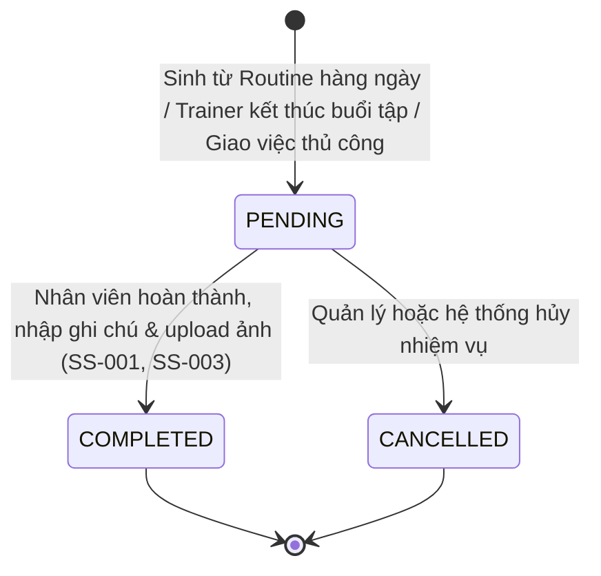
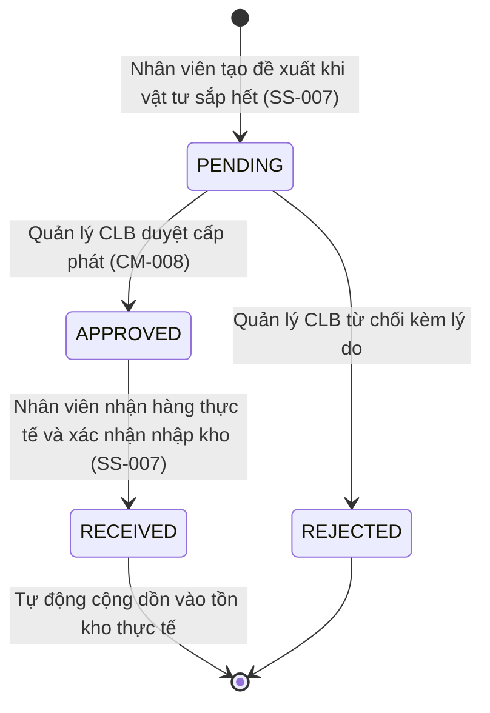

# Đặc Tả Vai Trò: Nhân Viên Chăm Sóc Chuồng (STABLE_STAFF)
## Role Specification & Business Behavior

> **Vai trò:** `STABLE_STAFF`  
> **Tên hiển thị:** Nhân viên chăm sóc chuồng / Người phụ trách ngựa  
> **Tài khoản mẫu kiểm thử:** `stablestaff@gmail.com` / `Staff123`  
> **Thư mục:** `BUSINESS_DOCS/roles/`  
> **Thời điểm thẩm định:** 12/10/2026  

---

## 1. Tổng Quan Vai Trò (Role Overview)

### 1.1. Mục Đích & Trách Nhiệm
`STABLE_STAFF` là vai trò vận hành hiện trường nòng cốt, trực tiếp chăm sóc đời sống hàng ngày của đàn ngựa trong câu lạc bộ RTMS:
- Phụ trách quản lý đàn ngựa được chỉ định theo ô chuồng (`horses.caretaker_user_id`).
- Thực thi danh mục công việc chăm sóc định kỳ hàng ngày (`care_tasks`): dọn phân chuồng (`MUCKING_OUT`), cho ăn/uống nước (`FEEDING`), tắm rửa (`BATHING`), ngâm chườm đá chân (`ICE_BOOTS`), chải lông (`GROOMING`), dắt dạo nhẹ (`WALKING`).
- Chuẩn bị yên cương, trang thiết bị và xác nhận trạng thái sẵn sàng (`READY`) trước giờ tập huấn luyện của Huấn luyện viên trưởng.
- Thực thi nhiệm vụ chăm sóc hồi phục đặc biệt (`createRecoveryTask`) ngay sau khi buổi tập kết thúc.
- Điểm danh và ghi nhận thực hiện các bữa ăn trong ngày theo thực đơn dinh dưỡng do Bác sĩ thú y chỉ định (`daily-checklist`).
- Phát hiện sớm và báo cáo các sự cố sức khỏe, an toàn chuồng trại (`incidents`): đau bụng cấp (`COLIC`), sốt cao (`FEVER`), bỏ ăn (`OFF_FEED`), trầy xước móng (`HOOF_INJURY`) kèm ảnh chụp thực tế.
- Ghi nhận tiêu hao vật tư, thức ăn tại chuồng và lập phiếu đề xuất bổ sung kho (`replenishments`) khi sắp hết hàng.

### 1.2. Quyền Hạn Hệ Thống (Permissions & Authorities)
- **Role Authority:** `ROLE_STABLE_STAFF`.
- **Dynamic Authorities (cấu hình trong `dbo.role_permissions`):**
  - `PERM_STABLE_CARE_VIEW`, `PERM_STABLE_CARE_EDIT` (Toàn quyền xem và cập nhật nhiệm vụ chăm sóc, ô chuồng, sinh hoạt, sự cố).
  - `PERM_INVENTORY_VIEW`, `PERM_INVENTORY_EDIT` (Xem tồn kho vật tư, ghi nhận sử dụng, tạo phiếu đề xuất vật tư, xác nhận nhận hàng).
  - `PERM_TRAINING_VIEW` (Xem lịch tập của ngựa được phân công để chuẩn bị trang thiết bị).
  - `PERM_PROFILE_VIEW` (Xem thông tin định danh, vị trí chuồng và tình trạng sức khỏe ngựa).

### 1.3. Điểm Truy Cập Giao Diện & Backend (Entry Points)
- **Frontend Routes (`App.jsx`):**
  - `/stable-care` hoặc `/stable-care/tasks`: Điều hướng mặc định cho nhân viên chuồng khi đăng nhập.
  - `/stable-care/training`: Màn hình chuẩn bị huấn luyện, lọc buổi tập của ngựa phụ trách (`TrainingPreparationView`).
  - `/stable-care/stables`: Sơ đồ ô chuồng và nhật ký sinh hoạt đàn ngựa (`StablesView`).
  - `/stable-care/nutrition`: Kế hoạch dinh dưỡng và checklist bữa ăn (`NutritionView`).
  - `/stable-care/incidents`: Danh sách và biểu mẫu báo cáo sự cố khẩn cấp (`IncidentsView`).
  - `/stable-care/inventory`: Quản lý vật tư, ghi tiêu hao và phiếu yêu cầu cấp phát (`InventoryView`).
- **Backend Controllers:**
  - `CareTaskController`, `StableController`, `NutritionPlanController`
  - `IncidentReportController`, `InventoryController`, `TrainingScheduleController`

---

## 2. Các Tính Năng Vai Trò Thực Hiện (Features Performed)

### SS-001: Thực Thi & Nghiệm Thu Nhiệm Vụ Chăm Sóc Hàng Ngày (Care Tasks Execution)
- **Mục đích:** Ghi nhận tiến độ và hoàn thành các công việc vệ sinh, chăm sóc theo ca trực cho từng con ngựa hoặc toàn khu chuồng.
- **Tiền điều kiện:** Nhân viên được phân công nhiệm vụ (`assigned_staff_id = staffId`) HOẶC nhiệm vụ định kỳ chung chưa có người nhận (`assigned_staff_id IS NULL` và `task_category = 'ROUTINE'`).
- **Điểm kích hoạt:** Màn hình **Nhiệm vụ trong ngày** (`/stable-care/tasks`).
- **Quy trình thực hiện:**
  1. Hệ thống tự động sinh nhiệm vụ định kỳ trong ngày thông qua cơ chế catch-up: `ensureRoutineInstancesForDate(today)` từ bảng `care_routine_definitions`.
  2. Nhân viên lọc công việc theo ngày (`scheduled_date`), theo trạng thái (`PENDING`, `COMPLETED`), hoặc theo loại việc (`MUCKING_OUT`, `FEEDING`, `BATHING`, `ICE_BOOTS`, `GROOMING`, `WALKING`, `OTHER`).
  3. Khi bắt tay làm hoặc hoàn tất, bấm "Hoàn thành" (`complete`):
     - Nhập ghi chú thực tế (`notes`).
     - Tùy chọn tải ảnh minh chứng thực tế (`file` hình ảnh JPG/PNG/WEBP `<= 10MB`).
  4. Frontend gọi `POST /api/care-tasks/{id}/complete` (hỗ trợ cả JSON hoặc `multipart/form-data`).
  5. Backend cập nhật `status = 'COMPLETED'`, ghi nhận `completed_at`, `completed_by_user_id`, lưu trữ ảnh (lưu byte trực tiếp hoặc đường dẫn tải `/api/care-tasks/{id}/photo`).
  6. Nếu nhiệm vụ là routine dùng chung chưa ai nhận, backend tự động gán `assigned_staff_id = staffId`.
- **Dữ liệu tác động:** Bảng `dbo.care_tasks`.
- **Trạng thái triển khai:** `IMPLEMENTED`.
- **Bằng chứng:**
  - Backend: [`CareTaskController.java`](file:///c:/DEV/RACE%20HORSE/HORSE-PROJECT/BACKEND/src/main/java/com/racehorse/caretask/controller/CareTaskController.java), [`CareTaskService.java`](file:///c:/DEV/RACE%20HORSE/HORSE-PROJECT/BACKEND/src/main/java/com/racehorse/caretask/service/CareTaskService.java).
  - Frontend: [`CareTasksView` trong `StableCarePage.jsx`](file:///c:/DEV/RACE%20HORSE/HORSE-PROJECT/FRONTEND/src/StableCarePage.jsx).

---

### SS-002: Chuẩn Bị & Xác Nhận Sẵn Sàng Huấn Luyện (Training Readiness Confirmation)
- **Mục đích:** Nhân viên chuồng theo dõi lịch huấn luyện đã công bố của đàn ngựa mình phụ trách, dắt ngựa ra bãi, thắng yên cương và xác nhận để Huấn luyện viên trưởng bắt đầu buổi tập.
- **Tiền điều kiện:** 
  - Nhân viên là người phụ trách con ngựa (`horses.caretaker_user_id = staffId`).
  - Buổi tập đã được Huấn luyện viên công bố (`published_at IS NOT NULL`).
  - Buổi tập đang ở trạng thái chuẩn bị: `session_status = 'PREPARING'`.
- **Điểm kích hoạt:** Màn hình **Chuẩn bị huấn luyện** (`/stable-care/training`).
- **Quy trình thực hiện:**
  1. Frontend gọi `GET /api/training-schedules/mine?from=YYYY-MM-DD&to=YYYY-MM-DD`. Backend lọc các buổi tập thuộc về các con ngựa mà nhân viên đang là `caretaker`.
  2. Nhân viên kiểm tra thời gian tập, sân chạy (`racetrack`), làn chạy (`racetrackLane`), nội dung bài tập.
  3. Tiến hành kiểm tra thể trạng sơ bộ của ngựa, đóng yên cương bảo hộ.
  4. Bấm nút **Xác nhận sẵn sàng** trên thẻ buổi tập.
  5. Frontend gửi request `PATCH /api/training-schedules/{scheduleId}/ready`.
  6. Backend kiểm tra quyền caretaker, kiểm tra trạng thái đang là `PREPARING`, cập nhật trạng thái buổi tập thành `READY`, ghi nhận `ready_by_user_id` và `ready_at`.
  7. Huấn luyện viên trưởng tại sân sẽ thấy nút "Bắt đầu huấn luyện" (`start`) sáng lên.
- **Dữ liệu tác động:** Bảng `dbo.training_schedules`.
- **Trạng thái triển khai:** `IMPLEMENTED`.
- **Bằng chứng:**
  - Backend: [`TrainingScheduleController.java`](file:///c:/DEV/RACE%20HORSE/HORSE-PROJECT/BACKEND/src/main/java/com/racehorse/training/controller/TrainingScheduleController.java#L112-L117), [`TrainingScheduleService.java`](file:///c:/DEV/RACE%20HORSE/HORSE-PROJECT/BACKEND/src/main/java/com/racehorse/training/service/TrainingScheduleService.java#L297-L310).
  - Frontend: [`TrainingPreparationView` trong `StableCarePage.jsx`](file:///c:/DEV/RACE%20HORSE/HORSE-PROJECT/FRONTEND/src/StableCarePage.jsx#L602-L730).

---

### SS-003: Thực Thi Nhiệm Vụ Hồi Phục Sau Buổi Huấn Luyện (Post-Workout Recovery Task)
- **Mục đích:** Tiếp nhận và chăm sóc ngựa ngay sau khi rời đường tập (tháo yên, xịt rửa hạ nhiệt, ngâm chân đá lạnh chống viêm gân, lau khô).
- **Cơ chế tự động sinh nhiệm vụ:**
  - Khi Huấn luyện viên trưởng bấm **Kết thúc** buổi tập (`POST /api/training-schedules/{id}/finish`), Backend tự động kích hoạt `CareTaskService.createRecoveryTask(schedule, caretakerId)`.
  - Nhiệm vụ được tạo với:
    - Loại nhiệm vụ: `task_category = 'SPECIAL'`, `task_type = 'HEALTH_CHECK'`.
    - Tiêu đề: `"Hồi phục sau buổi tập - <Tên Ngựa>"`.
    - Nội dung: `"Chăm sóc, làm mát gân chân và kiểm tra thể trạng sau phiên tập: <Tên Bài Tập>"`.
    - Gán trực tiếp: `assigned_staff_id = caretakerId`, ngày thực hiện = ngày buổi tập, giờ = giờ kết thúc buổi tập.
    - Trạng thái ban đầu: `PENDING`.
- **Quy trình thực thi:**
  1. Nhân viên nhận thông báo và thấy nhiệm vụ hồi phục xuất hiện trên tab **Nhiệm vụ trong ngày** (`/stable-care/tasks`).
  2. Tiến hành tắm hạ nhiệt, chườm đá chân cho ngựa.
  3. Bấm **Hoàn thành**, nhập ghi chú thể trạng hồi phục (ví dụ: "Chân trước bình thường, không sưng nóng, thở đều").
- **Dữ liệu tác động:** Bảng `dbo.care_tasks`.
- **Trạng thái triển khai:** `IMPLEMENTED`.
- **Bằng chứng:**
  - Backend: [`TrainingScheduleService.java`](file:///c:/DEV/RACE%20HORSE/HORSE-PROJECT/BACKEND/src/main/java/com/racehorse/training/service/TrainingScheduleService.java#L340-L350), [`CareTaskService.java`](file:///c:/DEV/RACE%20HORSE/HORSE-PROJECT/BACKEND/src/main/java/com/racehorse/caretask/service/CareTaskService.java#L62-L100).
  - Frontend: [`CareTasksView` trong `StableCarePage.jsx`](file:///c:/DEV/RACE%20HORSE/HORSE-PROJECT/FRONTEND/src/StableCarePage.jsx).

---

### SS-004: Điểm Danh Bữa Ăn Theo Khẩu Phần Dinh Dưỡng (Nutrition Feeding Checklist)
- **Mục đích:** Cho ngựa ăn đúng định lượng, đúng thành phần cám/cỏ/khoáng chất theo phác đồ của Bác sĩ thú y và điểm danh bữa ăn trong ngày.
- **Tiền điều kiện:** Bác sĩ thú y đã lập kế hoạch dinh dưỡng hoạt động (`ACTIVE`) cho ngựa.
- **Điểm kích hoạt:** Màn hình **Khẩu phần & Cho ăn** (`/stable-care/nutrition`).
- **Quy trình thực hiện:**
  1. Frontend gọi `GET /api/horses/{id}/nutrition-plan/daily-checklist?date=YYYY-MM-DD`.
  2. Nhân viên xem chi tiết từng bữa ăn trong ngày (Bữa sáng, Bữa trưa, Bữa tối, Bữa phụ), thành phần thức ăn, trọng lượng từng món (kg) và hướng dẫn pha trộn.
  3. Sau khi cho ngựa ăn xong, tích chọn hoàn thành bữa ăn.
  4. Hệ thống lưu trữ nhật ký cho ăn (`feeding_logs`) để đối soát định lượng tiêu hao.
- **Dữ liệu tác động:** Bảng `dbo.module_records` (`module_code = 'STABLE_CARE'`, `record_type = 'FEEDING_LOG'`).
- **Trạng thái triển khai:** `IMPLEMENTED`.
- **Bằng chứng:**
  - Backend: [`NutritionPlanController.java`](file:///c:/DEV/RACE%20HORSE/HORSE-PROJECT/BACKEND/src/main/java/com/racehorse/health/controller/NutritionPlanController.java).
  - Frontend: [`NutritionView` trong `StableCarePage.jsx`](file:///c:/DEV/RACE%20HORSE/HORSE-PROJECT/FRONTEND/src/StableCarePage.jsx#L900-L1250).

---

### SS-005: Báo Cáo Sự Cố Chuồng Trại & Đính Kèm Ảnh (Stable Incident Reporting)
- **Mục đích:** Ghi nhận và phát cảnh báo lập tức khi phát hiện bất thường về sức khỏe hoặc cơ sở vật chất chuồng.
- **Tiền điều kiện:** Có quyền `PERM_STABLE_CARE_EDIT`.
- **Điểm kích hoạt:** Màn hình **Báo cáo sự cố** (`/stable-care/incidents`) -> Nút "Báo cáo sự cố mới".
- **Quy trình thực hiện:**
  1. Chọn ngựa bị sự cố (hoặc sự cố chung toàn khu chuồng).
  2. Chọn phân loại sự cố:
     - `COLIC`: Đau bụng cấp (nguy hiểm tính mạng).
     - `FEVER`: Sốt cao (>38.5°C).
     - `OFF_FEED`: Bỏ ăn / Chán ăn liên tục.
     - `HOOF_INJURY`: Chấn thương móng, trầy xước.
     - `RESTLESSNESS`: Bất an, đập phá chuồng.
     - `OTHER`: Sự cố khác (hỏng máng ăn, rò rỉ nước,...).
  3. Chọn mức độ nghiêm trọng: `CRITICAL` (Nguy kịch), `HIGH` (Nghiêm trọng), `MEDIUM` (Trung bình), `LOW` (Nhẹ).
  4. Nhập mô tả triệu chứng chi tiết.
  5. Đính kèm ảnh chụp hiện trường (tải ảnh qua widget upload lên Cloudinary).
  6. Gửi báo cáo: Frontend gọi `POST /api/incidents`.
  7. Backend lưu vào `dbo.module_records` (`module_code = 'INCIDENT'`), tự động phát thông báo ưu tiên cao `STABLE_INCIDENT` tới Bác sĩ thú y và Quản lý CLB.
  8. Nhân viên chuồng có quyền cập nhật trạng thái xử lý sự cố (`PUT /api/incidents/{id}/status`) sang `UNDER_REVIEW` hoặc `RESOLVED`.
- **Dữ liệu tác động:** Bảng `dbo.module_records`, `dbo.notifications`.
- **Trạng thái triển khai:** `IMPLEMENTED`.
- **Bằng chứng:**
  - Backend: [`IncidentReportController.java`](file:///c:/DEV/RACE%20HORSE/HORSE-PROJECT/BACKEND/src/main/java/com/racehorse/incident/controller/IncidentReportController.java#L34-L41).
  - Frontend: [`IncidentsView` trong `StableCarePage.jsx`](file:///c:/DEV/RACE%20HORSE/HORSE-PROJECT/FRONTEND/src/StableCarePage.jsx#L1400-L1750).

---

### SS-006: Giám Sát Sơ Đồ Ô Chuồng & Sinh Hoạt Đàn Ngựa (Stall Map & Daily Routines)
- **Mục đích:** Nắm bắt vị trí từng con ngựa tại các khu chuồng và cập nhật thời gian biểu sinh hoạt hàng ngày.
- **Điểm kích hoạt:** Màn hình **Ô chuồng & Sinh hoạt** (`/stable-care/stables`).
- **Quy tắc cơ sở vật chất:**
  - Mỗi khu chuồng (`stables`) chỉ chứa tối đa 4 con ngựa đang hoạt động (ràng buộc Trigger DB).
  - Nhân viên xem được mã ô chuồng (`stalls.code`), con ngựa đang ở ô đó, hình ảnh, tình trạng sức khỏe hiện tại.
  - Xem và quản lý các mốc giờ sinh hoạt định kỳ (`daily-routines`): Giờ dọn chuồng sáng, giờ tắm nắng, giờ ăn các bữa, giờ thả bãi dạo.
- **Dữ liệu tác động:** Bảng `dbo.stables`, `dbo.stalls`, `dbo.module_records` (`record_type = 'STALL_ASSIGNMENT'`).
- **Trạng thái triển khai:** `IMPLEMENTED`.
- **Bằng chứng:**
  - Backend: [`StableController.java`](file:///c:/DEV/RACE%20HORSE/HORSE-PROJECT/BACKEND/src/main/java/com/racehorse/stable/controller/StableController.java).
  - Frontend: [`StablesView` trong `StableCarePage.jsx`](file:///c:/DEV/RACE%20HORSE/HORSE-PROJECT/FRONTEND/src/StableCarePage.jsx#L232-L590).

---

### SS-007: Ghi Nhận Tiêu Hao & Đề Xuất Bổ Sung Vật Tư Kho (Inventory & Replenishments)
- **Mục đích:** Theo dõi tồn kho vật tư tại chuồng (thức ăn tinh, cỏ khô, rơm lót chuồng, chất điện giải, băng quấn chân), ghi nhận lượng dùng và đề xuất nhập thêm.
- **Tiền điều kiện:** Có quyền `PERM_INVENTORY_EDIT` hoặc `PERM_STABLE_CARE_EDIT`.
- **Điểm kích hoạt:** Màn hình **Vật tư & Tồn kho** (`/stable-care/inventory`).
- **Quy trình thực hiện:**
  1. **Ghi nhận sử dụng vật tư:** 
     - Chọn mặt hàng trong danh mục, bấm "Ghi nhận sử dụng" (`Record Usage`).
     - Nhập số lượng xuất dùng (`quantityUsed`), ghi chú mục đích (VD: "Xuất 2 bao rơm lót chuồng dãy A").
     - Frontend gọi `POST /api/inventory/items/{id}/usage`.
     - Backend trừ trực tiếp số lượng tồn kho `quantity_in_stock` và ghi sổ nhật ký tiêu hao.
  2. **Tạo phiếu đề xuất bổ sung vật tư (`Replenishment`):**
     - Khi thấy mặt hàng chạm ngưỡng tối thiểu (`lowStockOnly`), nhân viên bấm "Tạo đề xuất bổ sung".
     - Chọn mặt hàng, nhập số lượng yêu cầu (`quantityRequested`), lý do cần cấp phát.
     - Frontend gọi `POST /api/inventory/replenishments`.
     - Phiếu tạo ở trạng thái ban đầu `PENDING`.
     - Quản lý câu lạc bộ (`CLUB_MANAGER`) sẽ xem xét duyệt (`APPROVED`) hoặc từ chối (`REJECTED`).
  3. **Xác nhận nhận hàng vào kho chuồng:**
     - Sau khi đơn đề xuất được Quản lý duyệt và hàng được giao đến khu chuồng, nhân viên bấm "Xác nhận nhận hàng" (`receive`).
     - Frontend gọi `POST /api/inventory/replenishments/{id}/receive` với `quantityReceived`.
     - Backend cập nhật trạng thái phiếu thành `RECEIVED` và tự động cộng dồn số lượng vào tồn kho thực tế của mặt hàng.
- **Dữ liệu tác động:** Bảng `dbo.inventory_items`, `dbo.inventory_usages`, `dbo.inventory_replenishments`.
- **Trạng thái triển khai:** `IMPLEMENTED`.
- **Bằng chứng:**
  - Backend: [`InventoryController.java`](file:///c:/DEV/RACE%20HORSE/HORSE-PROJECT/BACKEND/src/main/java/com/racehorse/inventory/controller/InventoryController.java), [`InventoryService.java`](file:///c:/DEV/RACE%20HORSE/HORSE-PROJECT/BACKEND/src/main/java/com/racehorse/inventory/service/InventoryService.java).
  - Frontend: [`InventoryView` trong `StableCarePage.jsx`](file:///c:/DEV/RACE%20HORSE/HORSE-PROJECT/FRONTEND/src/StableCarePage.jsx#L1800-L2400).

---

## 3. Yêu Cầu Gửi Đi & Tiếp Nhận (Requests Sent & Received)

### 3.1. Dữ liệu Nhân Viên Chuồng Gửi Đi (Outgoing Requests)
| Mã Yêu Cầu | Mục Đích | Người Nhận | Trạng Thái / Phản Hồi Kỳ Vọng |
|---|---|---|---|
| `REQ-SS-01` | Xác nhận sẵn sàng tập (`PATCH /ready`) | Huấn luyện viên trưởng | Buổi tập chuyển `READY`, cho phép bấm Bắt đầu |
| `REQ-SS-02` | Báo cáo sự cố khẩn cấp (`POST /incidents`) | Bác sĩ thú y & Quản lý CLB | Thông báo khẩn cấp, tiếp nhận can thiệp y tế |
| `REQ-SS-03` | Nghiệm thu nhiệm vụ kèm ảnh | Hệ thống / Quản lý | Task chuyển `COMPLETED`, lưu ảnh minh chứng |
| `REQ-SS-04` | Phiếu đề xuất vật tư (`replenishments`) | Quản lý câu lạc bộ | Quản lý phê duyệt cấp phát hàng vào kho |
| `REQ-SS-05` | Xác nhận nhận hàng (`receive`) | Hệ thống kho | Tự động cộng tồn kho mặt hàng |

### 3.2. Dữ liệu Nhân Viên Chuồng Tiếp Nhận (Incoming Data)
| Nguồn Gửi | Loại Dữ Liệu | Mục Đích Đối Với Nhân Viên Chuồng |
|---|---|---|
| `HEAD_TRAINER` | Lịch tập đã công bố (`PUBLISHED`) | Chuẩn bị đóng yên cương và dắt ngựa ra sân đúng giờ |
| `HEAD_TRAINER` | Hoàn thành buổi tập (`finish`) | Tiếp nhận nhiệm vụ hồi phục (`SPECIAL` care task) được sinh tự động |
| `HEAD_TRAINER` | Báo động khẩn cấp sân tập (`CARETAKER`) | Tiếp ứng khẩn cấp tại sân đua khi ngựa gặp sự cố |
| `VETERINARIAN` | Thực đơn dinh dưỡng hoạt động | Cho ăn đúng loại cám, cỏ và điểm danh các bữa |
| `VETERINARIAN` | Đơn thuốc / Phác đồ chăm sóc | Thực hiện nhiệm vụ bôi thuốc, chăm sóc vết thương |
| `CLUB_MANAGER` | Quyết định duyệt vật tư (`APPROVED`) | Nhận hàng và xác nhận nhập kho chuồng |

---

## 4. Vòng Đời & Máy Trạng Thái (Lifecycles & State Machines)

### 4.1. Vòng Đời Nhiệm Vụ Chăm Sóc (Care Task Lifecycle)

### 4.2. Vòng Đời Bổ Sung Vật Tư Kho (Replenishment Lifecycle)

---

## 5. Đánh Giá Hiện Trạng & Ghi Chú Rà Soát (Review Notes)

1. `[FACT]` **Không quản lý gán Caretaker:** Nhân viên chuồng không tự gán bản thân cho ngựa. Việc phân công `horses.caretaker_user_id` do Quản lý CLB thực hiện hoặc được hệ thống thiết lập từ đầu.
2. `[FACT]` **Cơ chế tải ảnh trực tiếp vào DB hoặc Cloudinary:** 
   - Nhiệm vụ chăm sóc (`CareTask`): Backend hỗ trợ lưu ảnh trực tiếp dưới dạng mảng byte (`photo_bytes`, `photo_content_type`) trong SQL Server thông qua API `/api/care-tasks/{id}/photo`.
   - Báo cáo sự cố (`Incidents`): Giao diện tải ảnh qua Cloudinary widget và gửi `photoUrl` trong payload sự cố.
3. `[FACT]` **Hội tụ đầy đủ 6 phân hệ hiện trường:** Phiên bản phát triển hiện tại trên `develop` đã tích hợp đầy đủ cả 6 phân hệ của nhân viên chuồng trong cùng một giao diện điều hành thống nhất (`StableCarePage.jsx`), bao gồm: Nhiệm vụ, Chuẩn bị tập, Ô chuồng, Dinh dưỡng, Sự cố và Kho vật tư.
