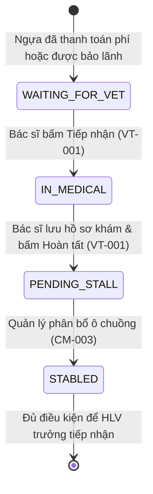
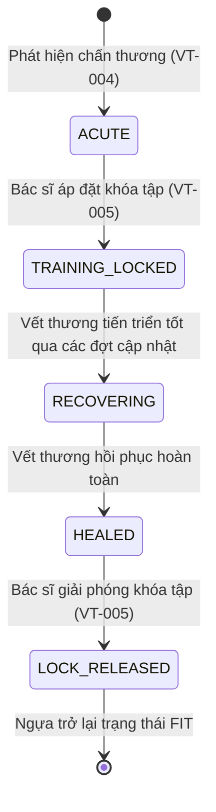

# Đặc Tả Vai Trò: Bác Sĩ Thú Y (VETERINARIAN)
## Role Specification & Business Behavior

> **Vai trò:** `VETERINARIAN`  
> **Tên hiển thị:** Bác sĩ thú y / Chuyên gia y tế câu lạc bộ  
> **Tài khoản mẫu kiểm thử:** `vet@gmail.com` / `Vet123`  
> **Thư mục:** `BUSINESS_DOCS/roles/`  
> **Thời điểm thẩm định:** 12/10/2026  

---

## 1. Tổng Quan Vai Trò (Role Overview)

### 1.1. Mục Đích & Trách Nhiệm
`VETERINARIAN` là vai trò chuyên môn y tế cao nhất trong hệ thống RTMS, chịu trách nhiệm bảo đảm an toàn sinh học và sức khỏe toàn diện cho đàn ngựa:
- Tiếp nhận ngựa mới nhập chuồng tại phòng chờ y tế (`medical/queue`), thực hiện khám sàng lọc ban đầu và phê duyệt chuyển sang bước phân ô chuồng.
- Giám sát tình trạng sức khỏe tổng thể toàn bộ các khu chuồng thông qua Sơ đồ sức khỏe chuồng trại (`Barn Health Map`).
- Khám bệnh, chẩn đoán, kê đơn và lập hồ sơ bệnh án lâm sàng (`medical_examinations`) tuân thủ tính bất biến y khoa (không sửa bản ghi gốc, cập nhật bằng phụ lục bổ sung `addenda`).
- Định vị trực quan các tổn thương thực thể trên mô hình cơ thể giải phẫu 3D (`HorseBodyModel3D`) với 42 vùng giải phẫu chuẩn y khoa, theo dõi tiến trình hồi phục vết thương.
- Quyền ban hành lệnh **Khóa tập y tế** (`training_locks`) chặn cứng mọi hoạt động lên lịch và chạy tập khi ngựa có nguy cơ chấn thương hoặc cần cách ly, và giải phóng khóa khi ngựa bình phục.
- Thiết lập và nghiệm thu lịch tiêm chủng vắc-xin (`VACCINATION`), tẩy giun (`DEWORMING`), cắt tỉa/đóng móng (`FARRIER`) định kỳ (`preventive_care_schedules`).
- Thực hiện đánh giá lâm sàng độc lập sau các buổi tập huấn luyện thể lực (`VET_TRAINING_ASSESSMENT`) gửi đến Huấn luyện viên trưởng.
- Xây dựng phác đồ dinh dưỡng và khẩu phần ăn chi tiết (`nutrition_plans`) cho từng con ngựa.
- Tiếp nhận và xử lý các báo cáo sự cố cấp tính (`COLIC`, `FEVER`, `HOOF_INJURY`) do Nhân viên chăm sóc gửi lên.

### 1.2. Quyền Hạn Hệ Thống (Permissions & Authorities)
- **Role Authority:** `ROLE_VETERINARIAN`.
- **Dynamic Authorities (cấu hình trong `dbo.role_permissions`):**
  - `PERM_MEDICAL_VIEW`, `PERM_MEDICAL_EDIT`, `PERM_MEDICAL_APPROVE` (Toàn quyền quản lý bệnh án, chấn thương, khóa tập y tế, phòng ngừa).
  - `PERM_PROFILE_VIEW` (Xem hồ sơ lý lịch, phả hệ và thông tin nhận dạng ngựa).
  - `PERM_STABLE_CARE_VIEW` (Xem tình trạng ô chuồng, sinh hoạt và báo cáo sự cố chuồng trại).
  - `PERM_TRAINING_VIEW` (Xem lịch tập và kết quả đánh giá thể lực để đối chiếu lâm sàng).

### 1.3. Điểm Truy Cập Giao Diện & Backend (Entry Points)
- **Frontend Routes (`App.jsx`):**
  - `/vet` hoặc `/vet/dashboard`: Bảng điều khiển lâm sàng tổng thể (`VetDashboard`).
  - `/vet/health-map`: Sơ đồ sức khỏe toàn chuồng trực quan (`BarnHealthMapView`).
  - `/vet/medical-records`: Hồ sơ bệnh án lâm sàng và lịch sử điều trị (`MedicalRecordsView`).
  - `/vet/injuries`: Bản đồ chấn thương 3D và tiến trình hồi phục (`HorseBodyModel3D`).
  - `/vet/training-locks`: Giám sát và quản lý các khóa tập y tế (`AutomatedLocksNotice`).
  - `/vet/nutrition`: Đề xuất và xây dựng khẩu phần dinh dưỡng (`NutritionProposalView`).
  - `/vet/training-assessment`: Đánh giá lâm sàng sau buổi tập (`TrainingAssessmentView`).
  - `/vet/horses`: Danh bạ hồ sơ ngựa theo góc nhìn chuyên môn thú y (`HorseProfileView`).
- **Backend Controllers:**
  - `MedicalQueueController`, `MedicalExaminationController`, `InjuryController`
  - `BarnHealthController`, `TrainingLockController`, `PreventiveCareController`
  - `NutritionPlanController`, `HorseMeasurementController`, `IncidentReportController`

---

## 2. Các Tính Năng Vai Trò Thực Hiện (Features Performed)

### VT-001: Tiếp Nhận Khám Sàng Lọc Ban Đầu (Medical Queue Intake)
- **Mục đích:** Khám kiểm tra thể trạng bắt buộc cho ngựa mới nhập chuồng hoặc sau khi chủ ngựa đóng phí, trước khi cho phép vào chuồng nuôi và tập luyện.
- **Tiền điều kiện:** Ngựa có `intake_status = 'WAITING_FOR_VET'` (hoặc được bảo lãnh/thanh toán hợp lệ).
- **Điểm kích hoạt:** Màn hình **Bảng điều khiển lâm sàng** (`/vet/dashboard`) -> Hàng chờ khám y tế ban đầu.
- **Quy trình thực hiện:**
  1. Frontend gọi `GET /api/medical/queue` tải danh sách ngựa trong phòng chờ khám.
  2. Bác sĩ thú y bấm **Tiếp nhận** (`receive`):
     - Gọi `POST /api/medical/queue/{horseId}/receive`.
     - Backend cập nhật `horses.intake_status = 'IN_MEDICAL'`, gán `horses.diagnosing_vet_user_id = vetId`, ghi bản ghi `MEDICAL_ASSIGNMENT`.
  3. Bác sĩ tiến hành khám tổng quát và lập phiếu khám bệnh ban đầu (VT-003).
  4. Sau khi có bệnh án, bấm **Hoàn tất khám** (`complete`):
     - Gọi `POST /api/medical/queue/{horseId}/complete`.
     - Backend cập nhật `horses.intake_status = 'PENDING_STALL'`.
     - Ngựa chuyển sang hàng chờ để Quản lý CLB hoặc Nhân viên phân bổ ô chuồng.
- **Dữ liệu tác động:** Bảng `dbo.horses`, `dbo.module_records`.
- **Trạng thái triển khai:** `IMPLEMENTED`.
- **Bằng chứng:**
  - Backend: [`MedicalQueueController.java`](file:///c:/DEV/RACE%20HORSE/HORSE-PROJECT/BACKEND/src/main/java/com/racehorse/medical/controller/MedicalQueueController.java#L36-L75), [`MedicalQueueService.java`](file:///c:/DEV/RACE%20HORSE/HORSE-PROJECT/BACKEND/src/main/java/com/racehorse/medical/service/MedicalQueueService.java).
  - Frontend: [`VetPage.jsx`](file:///c:/DEV/RACE%20HORSE/HORSE-PROJECT/FRONTEND/src/VetPage.jsx#L327-L351).

---

### VT-002: Giám Sát Sơ Đồ Sức Khỏe Toàn Chuồng (Barn Health Map)
- **Mục đích:** Cung cấp góc nhìn không gian trực quan về mức độ an toàn dịch tễ và tình trạng sức khỏe của đàn ngựa trên toàn bộ các khu chuồng.
- **Điểm kích hoạt:** Màn hình **Sơ đồ sức khỏe** (`/vet/health-map`).
- **Nội dung hiển thị & Mã màu trạng thái:**
  - Trực quan hóa cấu trúc phân cấp: Câu lạc bộ -> Khu chuồng (`stables`) -> Ô chuồng (`stalls`) -> Ngựa đang ở ô đó.
  - Phân loại màu cảnh báo:
    - `FIT` / `HEALTHY` (Xanh lá): Khỏe mạnh bình thường, đủ điều kiện tập luyện và thi đấu.
    - `MONITORING` (Vàng/Cam): Cần theo dõi (nghi ngờ sốt nhẹ, mới phục hồi chấn thương).
    - `INJURED` / `UNDER_TREATMENT` (Đỏ gạch): Đang chấn thương hoặc đang điều trị tích cực.
    - `QUARANTINED` (Đỏ sẫm): Đang cách ly y tế (bệnh truyền nhiễm hoặc sau phẫu thuật).
    - `RECOVERING` (Xanh dương): Đang trong giai đoạn tập dưỡng sức hồi phục.
  - Bác sĩ bấm vào từng ô chuồng để xem nhanh thông tin định danh ngựa, triệu chứng gần nhất, khóa tập hiệu lực và mở nhanh hồ sơ khám bệnh.
- **Dữ liệu tác động:** Truy vấn tổng hợp từ `stables`, `stalls`, `horses`, `training_locks`, `module_records`.
- **Trạng thái triển khai:** `IMPLEMENTED`.
- **Bằng chứng:**
  - Backend: [`BarnHealthController.java`](file:///c:/DEV/RACE%20HORSE/HORSE-PROJECT/BACKEND/src/main/java/com/racehorse/health/controller/BarnHealthController.java), [`BarnHealthService.java`](file:///c:/DEV/RACE%20HORSE/HORSE-PROJECT/BACKEND/src/main/java/com/racehorse/health/service/BarnHealthService.java).
  - Frontend: [`BarnHealthMapView` trong `VetPage.jsx`](file:///c:/DEV/RACE%20HORSE/HORSE-PROJECT/FRONTEND/src/VetPage.jsx).

---

### VT-003: Lập Hồ Sơ Bệnh Án Lâm Sàng & Phụ Lục Bổ Sung Bất Biến (Immutable Medical Records & Addenda)
- **Mục đích:** Ghi nhận chẩn đoán, phác đồ điều trị, đơn thuốc và theo dõi diễn tiến bệnh theo chuẩn lưu trữ y khoa pháp lý.
- **Tiền điều kiện:** Có quyền `PERM_MEDICAL_EDIT`.
- **Điểm kích hoạt:** Màn hình **Bệnh án & Điều trị** (`/vet/medical-records`).
- **Nguyên tắc bất biến y khoa (Medical Immutability Principle):**
  - `[FACT]` Bản ghi khám bệnh đã tạo (`medical_examinations`) **KHÔNG THỂ BỊ CHỈNH SỬA ĐÈ NỘI DUNG GỐC**. Mọi sửa đổi thông tin sau đó bắt buộc phải thực hiện thông qua việc thêm Phụ lục bổ sung (`addendum`).
- **Quy trình thực hiện:**
  1. **Tạo phiếu khám mới (`POST /api/horses/{id}/medical-examinations`):**
     - Nhập ngày khám (`examinationDate`), lý do khám (`reasonForExam`).
     - Triệu chứng lâm sàng (`symptoms`), chẩn đoán xác định (`diagnosis`), phác đồ điều trị (`treatmentPlan`).
     - Đơn thuốc chỉ định (`prescriptions`: tên thuốc, liều dùng, đường dùng, tần suất).
     - Kết luận trạng thái sức khỏe cập nhật cho ngựa (`FIT`, `MONITORING`, `INJURED`, `QUARANTINED`).
     - Backend cập nhật trạng thái đồng bộ sang bảng `dbo.horses` (`health_status`, `status`, `health_source_type = 'MEDICAL_EXAMINATION'`).
  2. **Thêm phụ lục bổ sung diễn tiến (`POST /api/medical-examinations/{id}/addenda`):**
     - Nhập nội dung bổ sung hoặc đính chính (`addendumNotes`).
     - Ghi nhận thời điểm và danh tính bác sĩ bổ sung.
- **Dữ liệu tác động:** Bảng `dbo.module_records` (`module_code = 'MEDICAL'`, `record_type = 'MEDICAL_EXAMINATION'`, `MEDICAL_EXAM_ADDENDUM`), `dbo.horses`.
- **Trạng thái triển khai:** `IMPLEMENTED`.
- **Bằng chứng:**
  - Backend: [`MedicalExaminationController.java`](file:///c:/DEV/RACE%20HORSE/HORSE-PROJECT/BACKEND/src/main/java/com/racehorse/health/controller/MedicalExaminationController.java), [`MedicalExaminationService.java`](file:///c:/DEV/RACE%20HORSE/HORSE-PROJECT/BACKEND/src/main/java/com/racehorse/health/service/MedicalExaminationService.java).
  - Frontend: [`MedicalRecordsView` trong `VetPage.jsx`](file:///c:/DEV/RACE%20HORSE/HORSE-PROJECT/FRONTEND/src/VetPage.jsx).

---

### VT-004: Định Vị Chấn Thương Trên Mô Hình 3D (3D Injury Mapping & Recovery Tracking)
- **Mục đích:** Trực quan hóa chính xác vị trí tổn thương thực thể trên mô hình cơ thể ngựa 3D và theo dõi tiến trình lành vết thương.
- **Điểm kích hoạt:** Màn hình **Bản đồ chấn thương 3D** (`/vet/injuries`).
- **Quy tắc phân vùng giải phẫu (42 Anatomical Regions):**
  - `Đầu & Cổ`: Đỉnh đầu (Poll), Trán, Mắt trái/phải, Gáy, Yết hầu.
  - `Thân mình`: Vai (Withers), Lưng (Saddle Region), Hông (Loin), Mông (Croup), Ngực, Bụng, Sườn.
  - `Chân trước (Forelimb)`: Vai trước, Khuỷu tay, Gối trước (Carpus), Ống chân trước (Cannon), Cổ chân trước (Fetlock), Móng trước trái/phải.
  - `Chân sau (Hindlimb)`: Háng, Gối sau (Stifle), Khoeo (Hock), Ống chân sau, Cổ chân sau, Móng sau trái/phải.
  - `Mô mềm / Khác`: Gân trái/phải, Dây chằng, Vết rách da, Khác.
- **Quy trình thực hiện:**
  1. Bác sĩ xoay mô hình ngựa 3D (`HorseBodyModel3D`) và chấm chọn vùng tổn thương (hoặc chọn từ danh mục dropdown).
  2. Chọn mức độ nghiêm trọng: `CRITICAL` (Nguy kịch), `SEVERE`/`HIGH` (Nghiêm trọng), `MODERATE`/`MEDIUM` (Trung bình), `MILD`/`LOW` (Nhẹ).
  3. Chọn trạng thái chấn thương: `ACUTE` (Cấp tính / Mới bị), `RECOVERING` (Đang hồi phục), `HEALED` / `RESOLVED` (Đã bình phục).
  4. Nhập mô tả chấn thương, phác đồ băng bó, nghỉ ngơi.
  5. Gọi `POST /api/horses/{id}/injuries`.
  6. Theo dõi tiến trình: Bác sĩ bổ sung các mốc cập nhật hồi phục (`POST /api/injuries/{id}/recovery-updates`) kèm hình ảnh vết thương cho đến khi vết thương lành hoàn toàn (`HEALED`).
- **Dữ liệu tác động:** Bảng `dbo.module_records` (`record_type = 'INJURY_RECORD'`, `INJURY_RECOVERY_UPDATE`).
- **Trạng thái triển khai:** `IMPLEMENTED`.
- **Bằng chứng:**
  - Backend: [`InjuryController.java`](file:///c:/DEV/RACE%20HORSE/HORSE-PROJECT/BACKEND/src/main/java/com/racehorse/health/controller/InjuryController.java), [`InjuryService.java`](file:///c:/DEV/RACE%20HORSE/HORSE-PROJECT/BACKEND/src/main/java/com/racehorse/health/service/InjuryService.java).
  - Frontend: [`HorseBodyModel3D.jsx`](file:///c:/DEV/RACE%20HORSE/HORSE-PROJECT/FRONTEND/src/components/horse3d/HorseBodyModel3D.jsx), [`VetPage.jsx`](file:///c:/DEV/RACE%20HORSE/HORSE-PROJECT/FRONTEND/src/VetPage.jsx).

---

### VT-005: Áp Đặt & Giải Phóng Khóa Huấn Luyện Y Tế (Medical Training Locks)
- **Mục đích:** Công cụ bảo vệ an toàn tối cao của Bác sĩ thú y: đình chỉ ngay lập tức các hoạt động tập luyện của ngựa khi phát hiện chấn thương hoặc bệnh lý.
- **Tiền điều kiện:** Quyền `PERM_MEDICAL_EDIT`.
- **Cơ chế khóa cứng (Hard Enforcement Mechanism):**
  - `[FACT]` Khi tồn tại một bản ghi trong bảng `dbo.training_locks` với `horse_id` và `released_at IS NULL`:
    - Huấn luyện viên KHÔNG THỂ tạo lịch tập mới (`POST /api/training-schedules` bị từ chối với lỗi khóa y tế).
    - Huấn luyện viên KHÔNG THỂ bấm bắt đầu buổi tập (`POST /api/training-schedules/{id}/start` bị từ chối).
    - Ngựa bị loại khỏi danh sách chờ tiếp nhận huấn luyện viên (`pendingTrainer`).
- **Quy trình thực hiện:**
  1. **Áp đặt khóa tập:**
     - Bác sĩ bấm "Khóa tập y tế" cho ngựa.
     - Nhập lý do khóa (`reason`: VD "Nghi ngờ rách gân chân trước trái, yêu cầu nghỉ ngơi tuyệt đối"), ngày dự kiến mở khóa.
     - Gọi `POST /api/horses/{id}/training-locks`.
     - Backend ghi nhận `training_locks`, gửi thông báo cảnh báo ưu tiên cao tới Huấn luyện viên trưởng và Chủ ngựa.
  2. **Giải phóng khóa tập (`Release Lock`):**
     - Sau khi khám tái định kỳ xác nhận ngựa đã bình phục hoàn toàn.
     - Bác sĩ bấm "Mở khóa tập", nhập ghi chú kết luận lâm sàng (`releaseNotes`).
     - Gọi `POST /api/training-locks/{id}/release`.
     - Backend cập nhật `released_at = CURRENT_TIMESTAMP`, `released_by_user_id = vetId`. Ngựa được phép quay lại lịch tập bình thường.
- **Dữ liệu tác động:** Bảng `dbo.training_locks`, `dbo.notifications`.
- **Trạng thái triển khai:** `IMPLEMENTED`.
- **Bằng chứng:**
  - Backend: [`TrainingLockController.java`](file:///c:/DEV/RACE%20HORSE/HORSE-PROJECT/BACKEND/src/main/java/com/racehorse/health/controller/TrainingLockController.java), [`TrainingLockService.java`](file:///c:/DEV/RACE%20HORSE/HORSE-PROJECT/BACKEND/src/main/java/com/racehorse/health/service/TrainingLockService.java).
  - Frontend: [`VetPage.jsx`](file:///c:/DEV/RACE%20HORSE/HORSE-PROJECT/FRONTEND/src/VetPage.jsx).

---

### VT-006: Quản Lý Lịch Chăm Sóc Phòng Ngừa Định Kỳ (Preventive Care Management)
- **Mục đích:** Thiết lập chu kỳ tiêm chủng, tẩy giun và chăm sóc móng để phòng tránh dịch bệnh lây lan trong khu nuôi.
- **Các loại chăm sóc phòng ngừa (`PreventiveCareType`):**
  - `VACCINATION`: Tiêm chủng vắc-xin (Cúm ngựa, Uốn ván, Dại,...).
  - `DEWORMING`: Tẩy giun sán định kỳ.
  - `FARRIER`: Cắt tỉa, chỉnh hình và đóng móng sắt.
- **Quy trình thực hiện:**
  1. Tạo lịch phòng ngừa: Chọn ngựa, loại chăm sóc, ngày đến hạn (`dueDate`), số ngày nhắc trước (`reminderLeadDays`, mặc định 7 ngày). Gọi `POST /api/horses/{id}/preventive-care`.
  2. Tự động hóa nhắc hẹn: Job ngầm `DailyAutomationJob` quét lúc 06:00 sáng mỗi ngày; nếu `dueDate - leadDays <= today`, hệ thống tự động sinh thông báo `PREVENTIVE_CARE_DUE` gửi tới Bác sĩ thú y và Huấn luyện viên trưởng.
  3. Nghiệm thu hoàn thành: Sau khi thực hiện tiêm hoặc đóng móng, Bác sĩ bấm "Hoàn tất" (`complete`), nhập ngày thực tế (`administeredDate`), số lô thuốc (`batchNumber`), người thực hiện (`administeredBy`), ngày khuyến nghị cho đợt tiếp theo (`nextDueDate`).
- **Dữ liệu tác động:** Bảng `dbo.preventive_care_schedules`, `dbo.notifications`.
- **Trạng thái triển khai:** `IMPLEMENTED`.
- **Bằng chứng:**
  - Backend: [`PreventiveCareController.java`](file:///c:/DEV/RACE%20HORSE/HORSE-PROJECT/BACKEND/src/main/java/com/racehorse/health/controller/PreventiveCareController.java), [`PreventiveCareService.java`](file:///c:/DEV/RACE%20HORSE/HORSE-PROJECT/BACKEND/src/main/java/com/racehorse/health/service/PreventiveCareService.java).
  - Frontend: [`VetPage.jsx`](file:///c:/DEV/RACE%20HORSE/HORSE-PROJECT/FRONTEND/src/VetPage.jsx).

---

### VT-007: Đánh Giá Lâm Sàng Sau Buổi Tập Huấn Luyện (Post-Training Clinical Assessment)
- **Mục đích:** Bác sĩ thú y thực hiện kiểm tra y tế độc lập sau các bài tập nặng của Huấn luyện viên trưởng để phát hiện sớm các dấu hiệu quá tải tim mạch hoặc tổn thương cơ xương khớp.
- **Tiền điều kiện:** Buổi tập đã hoàn thành trên thực địa (`session_status = 'COMPLETED'`).
- **Điểm kích hoạt:** Màn hình **Đánh giá sau tập** (`/vet/training-assessment`).
- **Các thông số kiểm tra lâm sàng:**
  - Thể trạng chung (`overallCondition`).
  - Nhịp tim hồi phục đo lâm sàng (`heartRateRecoveryBpm`).
  - Trạng thái hô hấp (`respiratoryStatus`: thở êm, thở dốc, ran ngực).
  - Tình trạng dáng đi (`gaitStatus`: dáng đi đều, khập khiễng, bước ngắn).
  - Tình trạng cơ bắp (`muscleCondition`: mềm mại, co cứng, sưng nhiệt).
  - Kết luận lâm sàng (`clinicalConclusion`) và kiến nghị chế độ tập (`recommendation`).
  - Đánh dấu có cần can thiệp y tế không (`requiresMedicalIntervention = true/false`).
- **Gửi và thông báo:**
  - Gọi `POST /api/training-evaluations/{scheduleId}/vet-assessment`.
  - Backend lưu vào `dbo.module_records` (`record_type = 'VET_TRAINING_ASSESSMENT'`).
  - Tự động phát thông báo `VET_ASSESSMENT_COMPLETED` tới tất cả các Huấn luyện viên trưởng.
- **Dữ liệu tác động:** Bảng `dbo.module_records`, `dbo.notifications`.
- **Trạng thái triển khai:** `IMPLEMENTED`.
- **Bằng chứng:**
  - Backend: [`TrainingEvaluationController.java`](file:///c:/DEV/RACE%20HORSE/HORSE-PROJECT/BACKEND/src/main/java/com/racehorse/training/controller/TrainingEvaluationController.java#L112-L135), [`TrainingEvaluationService.java`](file:///c:/DEV/RACE%20HORSE/HORSE-PROJECT/BACKEND/src/main/java/com/racehorse/training/service/TrainingEvaluationService.java#L350-L385).
  - Frontend: [`TrainingAssessmentView` trong `VetPage.jsx`](file:///c:/DEV/RACE%20HORSE/HORSE-PROJECT/FRONTEND/src/VetPage.jsx).

---

### VT-008: Xây Dựng Khẩu Phần & Phác Đồ Dinh Dưỡng (Nutrition Formulation)
- **Mục đích:** Kê toa thực đơn ăn uống khoa học theo từng giai đoạn thể lực của ngựa, làm căn cứ cho Nhân viên chuồng thực hiện.
- **Điểm kích hoạt:** Màn hình **Dinh dưỡng** (`/vet/nutrition`) hoặc tab Dinh dưỡng trong `StableCarePage.jsx`.
- **Quy trình thực hiện:**
  1. Chọn ngựa cần lên thực đơn.
  2. Khai báo mục tiêu dinh dưỡng: Tăng cân, Duy trì thể lực thi đấu, Phục hồi sau chấn thương.
  3. Thiết lập chi tiết từng bữa trong ngày: Bữa sáng, Bữa trưa, Bữa tối, Bữa phụ.
  4. Xác định định lượng chi tiết: Khối lượng cám viên hỗn hợp (kg), khối lượng cỏ khô Timothy/Alfalfa (kg), các loại vi chất bổ sung / điện giải (gram).
  5. Bấm "Lưu kế hoạch dinh dưỡng": Gọi `POST /api/horses/{id}/nutrition-plan`.
  6. Kế hoạch chuyển thành `ACTIVE`, xuất hiện trực tiếp trên màn hình **Khẩu phần & Cho ăn** của Nhân viên chăm sóc để thực hiện điểm danh bữa ăn hàng ngày.
- **Dữ liệu tác động:** Bảng `dbo.module_records` (`module_code = 'STABLE_CARE'`, `record_type = 'NUTRITION_PLAN'`).
- **Trạng thái triển khai:** `IMPLEMENTED`.
- **Bằng chứng:**
  - Backend: [`NutritionPlanController.java`](file:///c:/DEV/RACE%20HORSE/HORSE-PROJECT/BACKEND/src/main/java/com/racehorse/health/controller/NutritionPlanController.java).
  - Frontend: [`NutritionProposalView` trong `VetPage.jsx`](file:///c:/DEV/RACE%20HORSE/HORSE-PROJECT/FRONTEND/src/VetPage.jsx).

---

### VT-009: Tiếp Nhận & Can Thiệp Báo Cáo Sự Cố Chuồng Trại (Incident Acknowledgment)
- **Mục đích:** Phản ứng khẩn cấp trước các cảnh báo bệnh lý đột xuất do nhân viên chuồng phát hiện trong ca trực.
- **Điểm kích hoạt:** Màn hình **Bảng điều khiển lâm sàng** -> Khu vực Sự cố khẩn cấp từ chuồng trại.
- **Quy trình thực hiện:**
  1. Nhận thông báo chuông và danh sách sự cố có trạng thái `REPORTED` (ví dụ: đau bụng cấp Colic, sốt cao).
  2. Bác sĩ xem mô tả triệu chứng và ảnh chụp hiện trường do nhân viên chuồng gửi lên.
  3. Lựa chọn hướng xử lý:
     - **Tiếp nhận xử lý (`Acknowledge`):** Gọi `POST /api/incidents/{id}/acknowledge`. Sự cố chuyển sang `UNDER_REVIEW`, đồng thời mở nhanh màn hình tạo phiếu khám bệnh lâm sàng (`medical-records`).
     - **Bỏ qua / Đóng sự cố (`Dismiss`):** Gọi `POST /api/incidents/{id}/dismiss` nếu sau khi kiểm tra đánh giá đây là hiện tượng bình thường không cần can thiệp y tế.
- **Dữ liệu tác động:** Bảng `dbo.module_records` (`module_code = 'INCIDENT'`).
- **Trạng thái triển khai:** `IMPLEMENTED`.
- **Bằng chứng:**
  - Backend: [`IncidentReportController.java`](file:///c:/DEV/RACE%20HORSE/HORSE-PROJECT/BACKEND/src/main/java/com/racehorse/incident/controller/IncidentReportController.java#L95-L100).
  - Frontend: [`VetPage.jsx`](file:///c:/DEV/RACE%20HORSE/HORSE-PROJECT/FRONTEND/src/VetPage.jsx#L353-L390).

---

## 3. Yêu Cầu Gửi Đi & Tiếp Nhận (Requests Sent & Received)

### 3.1. Dữ liệu Bác Sĩ Thú Y Gửi Đi (Outgoing Requests)
| Mã Yêu Cầu | Mục Đích | Người Nhận | Trạng Thái / Phản Hồi Kỳ Vọng |
|---|---|---|---|
| `REQ-VT-01` | Hoàn tất khám ban đầu (`complete`) | Quản lý câu lạc bộ | Ngựa chuyển `PENDING_STALL` chờ xếp chuồng |
| `REQ-VT-02` | Áp đặt khóa tập y tế (`training_locks`) | HLV Trưởng & Chủ ngựa | Chặn cứng mọi hoạt động tập luyện |
| `REQ-VT-03` | Giải phóng khóa tập y tế (`release`) | HLV Trưởng & Chủ ngựa | Cho phép ngựa quay lại tập luyện |
| `REQ-VT-04` | Kế hoạch dinh dưỡng hoạt động | Nhân viên chăm sóc | Làm căn cứ cho ăn và điểm danh hàng ngày |
| `REQ-VT-05` | Đánh giá lâm sàng buổi tập | Huấn luyện viên trưởng | Gửi nhận xét hô hấp, dáng đi sau buổi tập |

### 3.2. Dữ liệu Bác Sĩ Thú Y Tiếp Nhận (Incoming Data)
| Nguồn Gửi | Loại Dữ Liệu | Mục Đích Đối Với Bác Sĩ Thú Y |
|---|---|---|
| `STABLE_STAFF` | Báo cáo sự cố khẩn cấp (`incidents`) | Tiếp nhận can thiệp y tế tức thời (Colic, sốt, chấn thương móng) |
| `HEAD_TRAINER` | Báo động khẩn cấp sân tập (`training_emergency`) | Tiếp ứng khẩn cấp tại sân đua khi xảy ra tai nạn lúc tập |
| `HEAD_TRAINER` | Đánh giá buổi tập có chấn thương (`injured=true`) | Nhận cảnh báo y tế khẩn cấp, tiếp nhận điều trị |
| `AUTOMATION` | Nhắc lịch chăm sóc phòng ngừa | Thực hiện tiêm vắc-xin, tẩy giun đến hạn |

---

## 4. Vòng Đời & Máy Trạng Thái (Lifecycles & State Machines)

### 4.1. Vòng Đời Tiếp Nhận Y Tế Ngựa Mới (Medical Intake Lifecycle)

### 4.2. Vòng Đời Chấn Thương & Khóa Tập (Injury & Lock Lifecycle)

---

## 5. Đánh Giá Hiện Trạng & Ghi Chú Rà Soát (Review Notes)

1. `[FACT]` **Tách biệt hoàn toàn khỏi quy trình tập luyện thông thường:** Trong thiết kế kiến trúc hiện tại, Bác sĩ thú y KHÔNG tham gia xác nhận chuẩn bị tập và KHÔNG nhận ca trong buổi tập bình thường. Thú y chỉ can thiệp thông qua Đánh giá lâm sàng độc lập sau tập (`VET_TRAINING_ASSESSMENT`), xử lý Báo động khẩn cấp (`training_emergency`), hoặc áp đặt Khóa tập y tế (`training_locks`).
2. `[FACT]` **Tính bất biến của bệnh án y khoa:** Backend và frontend triển khai nghiêm ngặt nguyên tắc lưu vết pháp lý y khoa: hồ sơ bệnh án không cho phép cập nhật ghi đè; mọi thông tin bổ sung bắt buộc phải tạo bản ghi phụ lục (`addenda`) với đầy đủ dấu vết thời gian và danh tính người tạo.
3. `[FACT]` **Bản đồ chấn thương 3D với 42 vùng cơ thể:** Giao diện sử dụng component `HorseBodyModel3D` phân tích chi tiết từng khớp, gân, móng của ngựa, mang lại khả năng chẩn đoán và theo dõi trực quan cao cho đội ngũ thú y.
