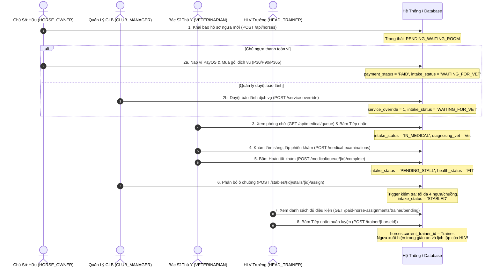
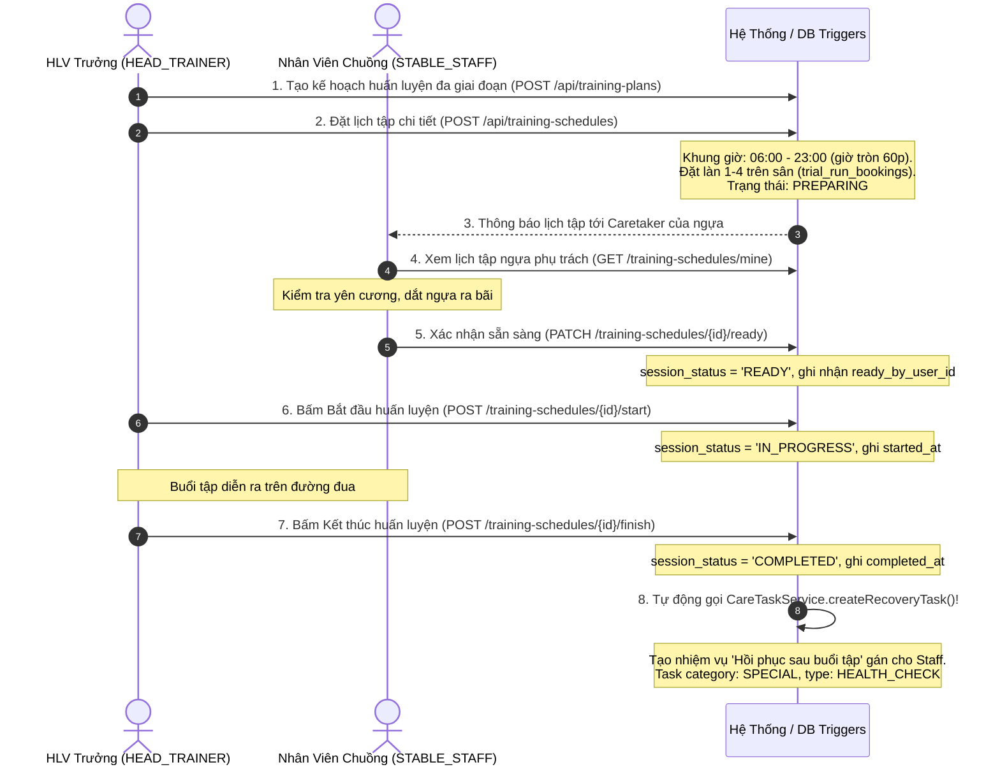
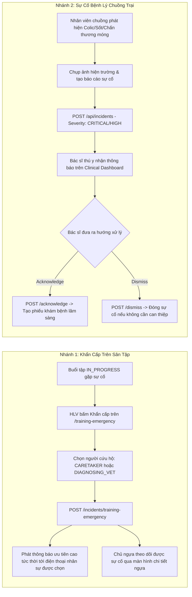
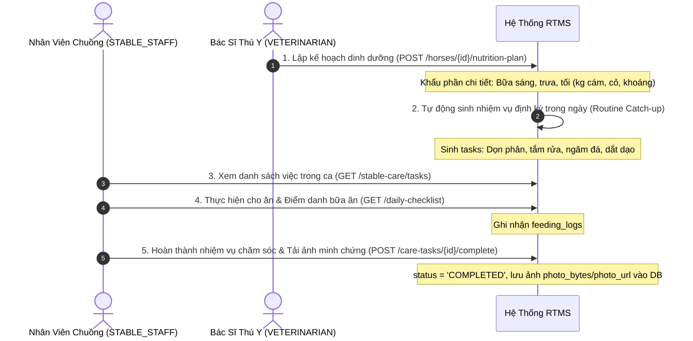
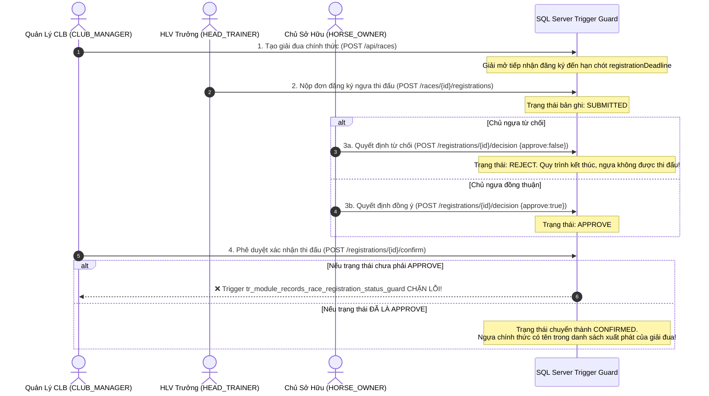
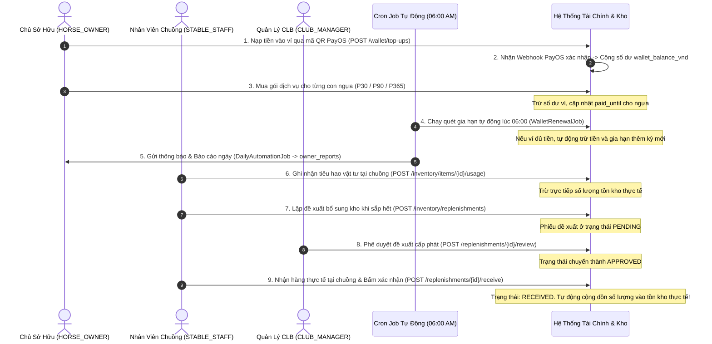

# Tài Liệu Quy Trình Nghiệp Vụ Liên Vai Trò (Cross-Role Business Workflows)
## End-to-End System Workflows & Orchestration

> **Thư mục:** `BUSINESS_DOCS/workflows/`  
> **Thời điểm thẩm định:** 12/10/2026  
> **Phạm vi:** 8 quy trình kinh doanh chuẩn hóa liên kết 5 vai trò (`CLUB_MANAGER`, `HEAD_TRAINER`, `STABLE_STAFF`, `HORSE_OWNER`, `VETERINARIAN`) và cơ chế tự động hóa hệ thống.

---

## Danh Mục Quy Trình Nghiệp Vụ Chuẩn (Workflow Catalog)

| Mã Quy Trình | Tên Quy Trình Nghiệp Vụ | Các Vai Trò Tham Gia | Mục Tiêu & Điểm Kết Thúc |
|---|---|---|---|
| **WF-01** | Nhập Chuồng & Tiếp Nhận Ngựa Toàn Diện | `HORSE_OWNER`, `VETERINARIAN`, `CLUB_MANAGER`, `HEAD_TRAINER` | Ngựa được thanh toán, khám thú y, xếp ô chuồng và HLV trưởng tiếp nhận vào danh sách huấn luyện |
| **WF-02** | Lập Kế Hoạch, Đặt Lịch & Điều Phối Buổi Huấn Luyện | `HEAD_TRAINER`, `STABLE_STAFF` | Bài tập hoàn tất đúng khung giờ, sinh nhiệm vụ hồi phục cho nhân viên chuồng |
| **WF-03** | Đánh Giá Thể Lực & Phản Hồi Lâm Sàng Sau Tập | `HEAD_TRAINER`, `HORSE_OWNER`, `VETERINARIAN`, `STABLE_STAFF` | Hoàn tất đánh giá FR07, đo nhịp tim hồi phục, ghi nhận chấn thương và bác sĩ gửi đánh giá lâm sàng |
| **WF-04** | Xử Lý Sự Cố Khẩn Cấp Trên Sân Tập & Chuồng Trại | `HEAD_TRAINER`, `STABLE_STAFF`, `VETERINARIAN`, `HORSE_OWNER` | Cứu hộ kịp thời tại sân đua và xử lý bệnh lý cấp tính tại chuồng nuôi |
| **WF-05** | Chăm Sóc Hàng Ngày & Phục Hồi Thể Trạng | `STABLE_STAFF`, `VETERINARIAN`, `CLUB_MANAGER` | Hoàn thành checklist nhiệm vụ chuồng, điểm danh bữa ăn và lưu ảnh minh chứng |
| **WF-06** | Đăng Ký Đua Ngựa & Bộ Ba Đồng Thuận (Consent Triad) | `CLUB_MANAGER`, `HEAD_TRAINER`, `HORSE_OWNER` | Đăng ký thi đấu hợp lệ khi đủ cả 3 bên đồng thuận theo ràng buộc Trigger DB |
| **WF-07** | Bệnh Án Bất Biến, Chấn Thương 3D & Khóa Huấn Luyện Y Tế | `VETERINARIAN`, `HEAD_TRAINER`, `HORSE_OWNER` | Bảo đảm an toàn sinh học: đình chỉ tập luyện khi chấn thương và giải phóng khi bình phục |
| **WF-08** | Tài Chính, Ví Điện Tử, Kho Vật Tư & Cung Ứng Chuồng | `HORSE_OWNER`, `STABLE_STAFF`, `CLUB_MANAGER`, `AUTOMATION` | Khép kín dòng tiền phí dịch vụ, kiểm soát tiêu hao và cấp phát vật tư chuồng |

---

## WF-01: Quy Trình Nhập Chuồng & Tiếp Nhận Ngựa Toàn Diện (Horse Onboarding Pipeline)

### 1. Mục Tiêu & Ý Nghĩa
Đảm bảo mọi con ngựa lưu trú tại câu lạc bộ đều phải trải qua quy trình kiểm soát nghiêm ngặt 4 bước: Pháp lý/Tài chính -> Kiểm dịch/Y tế thú y -> Cơ sở vật chất/Ô chuồng -> Tiếp nhận giáo án huấn luyện.

### 2. Sơ Đồ Tuần Tự (Sequence Diagram)



### 3. Các Điểm Kiểm Soát Nghiệp Vụ Cứng (Hard Business Rules)
- `[FACT]` HLV Trưởng chỉ nhìn thấy ngựa trong danh sách tiếp nhận khi thỏa mãn đồng thời:
  1. `intake_status = 'STABLED'`.
  2. `health_status = 'FIT'`.
  3. `diagnosing_vet_user_id IS NOT NULL`.
  4. Đã có ô chuồng `STALL_ASSIGNMENT` hoạt động.
  5. Đã thanh toán (`PAID`) hoặc có bảo lãnh (`service_override = 1`).
  6. Không có khóa tập y tế (`training_locks`) đang hiệu lực.

---

## WF-02: Quy Trình Lập Kế Hoạch, Đặt Lịch & Điều Phối Huấn Luyện (Training Workflow)

### 1. Mục Tiêu & Ý Nghĩa
Vận hành buổi tập thực địa kỷ luật, đúng khung giờ quy định của câu lạc bộ, phối hợp nhịp nhàng giữa Huấn luyện viên trưởng và Nhân viên chăm sóc chuồng.

### 2. Sơ Đồ Tuần Tự (Sequence Diagram)



### 3. Các Điểm Kiểm Soát Nghiệp Vụ Cứng
- `[FACT]` **Không có Vet can thiệp trong luồng tập bình thường:** Buổi tập chỉ diễn ra giữa HLV và Nhân viên chuồng phụ trách.
- `[FACT]` **Trigger DB `tr_enforce_training_window`:** Bắt buộc buổi tập nằm trong khung 06:00 đến 23:00, không cho phép đặt khung giờ lẻ phút.
- `[FACT]` **Tự động sinh nhiệm vụ hồi phục:** HLV không cần nhắn tin hay tạo việc thủ công; ngay khi bấm `finish`, nhân viên chuồng lập tức nhận được nhiệm vụ hồi phục trên app.

---

## WF-03: Quy Trình Đánh Giá Thể Lực & Phản Hồi Lâm Sàng Sau Tập (Evaluation Workflow)

### 1. Mục Tiêu & Ý Nghĩa
Thu thập dữ liệu thể lực sinh học sau bài tập (FR07) phục vụ tối ưu hóa thành tích thi đấu, đồng thời kết nối đánh giá lâm sàng từ Bác sĩ thú y để phòng ngừa quá tải cơ tim.

### 2. Sơ Đồ Quy Trình Chi Tiết

```mermaid
flowchart TD
    Start([Buổi tập hoàn thành - COMPLETED]) --> TrainerEval[HLV lập Đánh giá FR07<br/>POST /training-evaluations]
    TrainerEval --> CalcMetrics[Hệ thống tự động tính toán:<br/>- Tốc độ TB = Distance * 3.6 / Seconds<br/>- Cường độ = Speed TB * 100 / MaxSpeed<br/>- Nhịp tim hồi phục = StopBpm - 1MinBpm]
    
    CalcMetrics --> FitnessCheck{Phân loại thể lực theo nhịp tim 1 phút}
    FitnessCheck -->|<= 115 BPM| Green[GREEN - Thể lực Tốt]
    FitnessCheck -->|116 - 129 BPM| Yellow[YELLOW - Thể lực Cần Lưu Ý]
    FitnessCheck -->|>= 130 BPM| Red[RED - Nguy cơ Kiệt Sức / Quá Tải]

    Yellow --> NotifyStaff[Thông báo lưu ý tới Nhân viên chuồng]
    Red --> AlertVet[Phát cảnh báo tới Bác sĩ thú y]

    TrainerEval --> InjuryCheck{Ngựa có chấn thương không?}
    InjuryCheck -->|Có - injured=true| UpdateInjured[Cập nhật horses: status = INJURED<br/>health_source = TRAINING_EVALUATION<br/>Gửi cảnh báo ưu tiên cao tới Vet & Chủ ngựa]
    InjuryCheck -->|Không| NormalFlow[Lưu đánh giá bình thường]

    NormalFlow --> NotifyOwner[Gửi thông báo có đánh giá mới tới Chủ ngựa]
    
    NormalFlow --> VetExam[Bác sĩ thú y kiểm tra lâm sàng độc lập<br/>POST /training-evaluations/{id}/vet-assessment]
    VetExam --> VetNotify[Gửi nhận xét hô hấp, dáng đi, cơ bắp tới HLV Trưởng]
```

---

## WF-04: Quy Trình Xử Lý Sự Cố Khẩn Cấp (Emergency & Incidents Workflow)

### 1. Mục Tiêu & Ý Nghĩa
Cung cấp kênh phản ứng nhanh trong 2 tình huống sự cố: (1) Khẩn cấp trên sân tập khi đang chạy và (2) Sự cố bệnh lý cấp tính tại khu chuồng nuôi.

### 2. Sơ Đồ Phân Nhánh Xử Lý Sự Cố



---

## WF-05: Quy Trình Chăm Sóc Định Kỳ & Phục Hồi Thể Trạng (Stable Care Workflow)

### 1. Mục Tiêu & Ý Nghĩa
Chuẩn hóa các hoạt động vệ sinh chuồng trại, cho ăn theo chế độ dinh dưỡng và hoàn thành nhiệm vụ chăm sóc phục hồi thể lực sau tập luyện.

### 2. Sơ Đồ Tuần Tự (Sequence Diagram)



---

## WF-06: Quy Trình Đăng Ký Đua Ngựa & Bộ Ba Đồng Thuận (Race Consent Triad)

### 1. Mục Tiêu & Ý Nghĩa
Quy trình tam giác bắt buộc để một con ngựa được bước vào đường đua chính thức: Huấn luyện viên đề cử -> Chủ ngựa chấp thuận -> Quản lý câu lạc bộ xác nhận.

### 2. Sơ Đồ Tuần Tự & Ràng Buộc Trigger DB



---

## WF-07: Bệnh Án Bất Biến, Chấn Thương 3D & Khóa Huấn Luyện Y Tế (Medical & Safety Workflow)

### 1. Mục Tiêu & Ý Nghĩa
Thiết lập hàng rào pháp lý y khoa và cơ chế khóa cứng kỹ thuật nhằm bảo vệ tính mạng động vật, ngăn chặn triệt để tình trạng ép ngựa chấn thương ra sân tập.

### 2. Sơ Đồ Quy Trình Chi Tiết

```mermaid
flowchart TD
    Discovered[Phát hiện ngựa có triệu chứng tổn thương] --> VetExam[Bác sĩ thú y khám lâm sàng<br/>POST /horses/{id}/medical-examinations]
    VetExam --> Immutable[Tạo bản ghi bệnh án BẤT BIẾN<br/>Không cho phép ghi đè/sửa đổi nội dung gốc]
    Immutable --> Addendum[Bổ sung diễn tiến điều trị qua Phụ lục - Addenda]

    VetExam --> Pin3D[Chấm điểm tổn thương trên Mô hình ngựa 3D<br/>POST /horses/{id}/injuries]
    Pin3D --> SetSeverity[Xác định 1 trong 42 vùng cơ thể & Độ nghiêm trọng<br/>Trạng thái ban đầu: ACUTE]

    Pin3D --> ApplyLock[Bác sĩ ban hành Khóa Huấn Luyện Y Tế<br/>POST /horses/{id}/training-locks]
    
    subgraph HardEnforcement [Cơ Chế Khóa Cứng Kỹ Thuật]
        ApplyLock --> BlockSchedule[CHẶN TẠO LỊCH TẬP MỚI]
        ApplyLock --> BlockStart[CHẶN BẮT ĐẦU BUỔI TẬP]
        ApplyLock --> BlockIntake[CHẶN TIẾP NHẬN HLV TRƯỞNG]
    end

    HardEnforcement --> Recovering[Cập nhật tiến trình hồi phục vết thương<br/>POST /injuries/{id}/recovery-updates -> RECOVERING]
    Recovering --> Healed[Vết thương bình phục hoàn toàn - HEALED]
    Healed --> ReleaseLock[Bác sĩ giải phóng khóa tập y tế<br/>POST /training-locks/{id}/release]
    ReleaseLock --> Unblock[Ngựa trở lại trạng thái FIT - HLV được tập luyện bình thường]
```

---

## WF-08: Tài Chính, Ví Điện Tử, Kho Vật Tư & Cung Ứng Chuồng (Finance & Inventory Workflow)

### 1. Mục Tiêu & Ý Nghĩa
Quản lý khép kín dòng tiền của khách hàng và chuỗi cung ứng vật tư nội bộ, đảm bảo câu lạc bộ vận hành ổn định và minh bạch.

### 2. Sơ Đồ Tuần Tự (Sequence Diagram)



---

## 3. Tổng Hợp Ma Trận Chuyển Giao Trách Nhiệm (RACI Cross-Role Matrix)

| Quy Trình / Hoạt Động | CLUB_MANAGER | HEAD_TRAINER | STABLE_STAFF | HORSE_OWNER | VETERINARIAN |
|---|---|---|---|---|---|
| **WF-01: Nhập chuồng & Phân ô** | **A** (Phân ô chuồng) | **R** (Tiếp nhận tập) | **C** (Chuẩn bị ô) | **R** (Đóng phí/Khai báo) | **R** (Khám ban đầu) |
| **WF-02: Lịch & Buổi tập** | **I** (Giám sát) | **A / R** (Lập & Chạy tập) | **R** (Xác nhận Ready & Hồi phục) | **I** (Xem lịch) | **I** (Nhận báo động nếu có) |
| **WF-03: Đánh giá thể lực FR07** | **I** (Xem báo cáo) | **A / R** (Chấm điểm FR07) | **C** (Nhận lưu ý Yellow) | **I** (Xem kết quả) | **R** (Đánh giá lâm sàng) |
| **WF-04: Xử lý sự cố khẩn cấp** | **A** (Điều phối chung) | **R** (Phát báo động tập) | **R** (Báo cáo sự cố chuồng) | **I** (Nhận tin tức thời) | **R** (Can thiệp y tế) |
| **WF-05: Chăm sóc & Dinh dưỡng** | **I** (Kiểm tra) | **I** (Xem chế độ) | **A / R** (Cho ăn & Vệ sinh) | **I** (Xem nhật ký) | **R** (Kê thực đơn dinh dưỡng) |
| **WF-06: Đăng ký đua ngựa** | **A** (Xác nhận cuối) | **R** (Đề xuất thi đấu) | **I** (Hỗ trợ vận chuyển) | **R** (Duyệt đồng thuận) | **C** (Kiểm tra thể lực) |
| **WF-07: Bệnh án & Khóa tập** | **I** (Theo dõi) | **I** (Bị khóa tập) | **I** (Chăm sóc vết thương) | **I** (Theo dõi bệnh án) | **A / R** (Khám & Khóa/Mở khóa) |
| **WF-08: Ví, Tài chính & Vật tư** | **A** (Duyệt vật tư & Kế toán) | **I** | **R** (Dùng & Đề xuất kho) | **R** (Nạp tiền & Mua gói) | **C** (Yêu cầu thuốc men) |

*Chú thích viết tắt:*
- **R (Responsible):** Người trực tiếp thực hiện hành động.
- **A (Accountable):** Người chịu trách nhiệm phê duyệt cuối cùng.
- **C (Consulted):** Người được tham vấn chuyên môn hoặc phối hợp.
- **I (Informed):** Người được thông báo để nắm thông tin.
