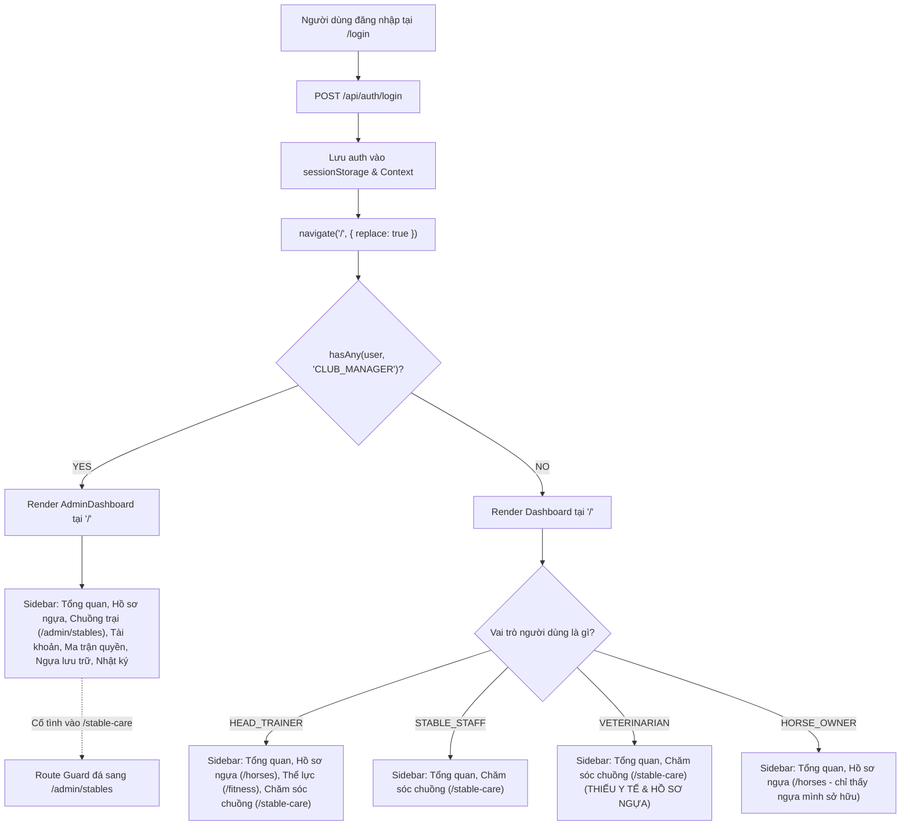

# FULL RBAC & ROLE-FLOW AUDIT REPORT
## HỆ THỐNG QUẢN LÝ HUẤN LUYỆN NGỰA ĐUA (RTMS)

> **Loại kiểm toán:** TOÀN DIỆN, ĐỘC LẬP & READ-ONLY  
> **Thời điểm thực hiện:** 28/09/2026 23:15 UTC+7  
> **Phạm vi đối chiếu:** 
> - **SRS:** Tài liệu Phạm vi Phần mềm RTMS v1.0 (09/09/2026)
> - **Backend:** 33 Spring Boot Controllers, 154 Endpoints, Spring Security, DB `dbo.role_permissions`
> - **Frontend:** React Router v6, Route Guards, Sidebar Navigation, UI Actions
> - **Git History:** Commit `374a12e` → `be02054` → `94912ad` → `e9343ab` → `7da3a60` (HEAD)

---

## 1. TỔNG QUAN ĐIỀU HÀNH (EXECUTIVE SUMMARY)

Hệ thống Quản lý Huấn luyện Ngựa đua (RTMS) được thiết kế theo SRS gồm **5 Vai trò (Roles)** và **5 Luồng nghiệp vụ (Flows)** trải rộng trên **23 Yêu cầu Chức năng (FR01 – FR23)**.

Qua kiểm toán độc lập đối chiếu giữa **SRS**, **Backend Authorization**, **Frontend Routing & UI**, và **Dữ liệu phân quyền Runtime (Azure SQL)**, nhóm kiểm toán ghi nhận các kết luận then chốt sau:

### 1.1. Kiến trúc phân quyền Backend (Dual Authorization Architecture)
Backend áp dụng mô hình bảo mật kép:
1. **Kiểm tra vai trò trực tiếp (Role-based):** `hasRole('...')` hoặc `hasAnyRole('...')`.
2. **Kiểm tra quyền động (Permission-based):** `hasAuthority('PERM_<MODULE>_<ACTION>')`, trong đó quyền hạn được nạp động từ bảng `dbo.role_permissions` trong Azure SQL runtime database.

### 1.2. Ba điểm nóng xung đột nghiêm trọng nhất (Top 3 Critical Conflicts)

1. **Xung đột Khóa luồng Chăm sóc chuồng đối với Quản lý CLB (`CLUB_MANAGER` ↔ Flow 4):**
   - **Backend:** Bắt buộc duy nhất `CLUB_MANAGER` mới có quyền phê duyệt đề xuất bổ sung vật tư tồn kho (`/api/inventory/replenishments/{id}/review` với `@PreAuthorize("hasRole('CLUB_MANAGER')")` theo FR17).
   - **Frontend (`App.jsx` dòng 111 & 127 trên commit `7da3a60`):** Cố tình ẩn menu Chăm sóc chuồng khỏi `CLUB_MANAGER` (`!hasAny(user, 'CLUB_MANAGER')`) và đặt Route Guard tự động chuyển hướng mọi truy cập của `CLUB_MANAGER` vào `/stable-care` sang trang `/admin/stables`!
   - **Hậu quả:** `CLUB_MANAGER` bị "đá văng" khỏi màn hình Flow 4, không thể thực hiện chức năng duyệt kho mà Backend giao cho họ.

2. **Xung đột quyền DB Runtime làm tê liệt quyền của `HEAD_TRAINER` và `VETERINARIAN` tại Flow 4:**
   - Trong bảng `dbo.role_permissions` trên Azure SQL runtime:
     - `HEAD_TRAINER | STABLE_CARE | EDIT` có giá trị `granted = False`.
     - `VETERINARIAN | STABLE_CARE | EDIT` có giá trị `granted = False`.
   - Trong Backend API:
     - Tạo nhiệm vụ chuồng (`POST /api/care-tasks`) yêu cầu: `hasAuthority('PERM_STABLE_CARE_EDIT')`.
     - Tạo lịch sinh hoạt chuồng (`POST /api/stables/.../daily-routines`) yêu cầu: `hasAuthority('PERM_STABLE_CARE_EDIT')`.
     - Tạo khẩu phần ăn (`POST /api/horses/.../nutrition-plan`) yêu cầu: `hasAuthority('PERM_STABLE_CARE_EDIT')`.
   - **Hậu quả:** Dù SRS và Backend Controller cho phép `HEAD_TRAINER` tạo task chuồng/routine và `VETERINARIAN` tạo khẩu phần dinh dưỡng (FR14), khi họ gọi API thì Spring Security sẽ ném lỗi **`403 FORBIDDEN`** do cờ phân quyền động trong database bị tắt!

3. **Khoảng trống giao diện Frontend (Frontend Gaps) tại Flow 3 và Flow 5:**
   - **Flow 3 (Y tế & Chấn thương - FR08 đến FR12):** Backend đã có đầy đủ 100% API (Bản đồ chuồng y tế, Khám bệnh, Chấn thương 3D, Lệnh khóa huấn luyện, Lịch chăm sóc phòng ngừa). Tuy nhiên, trên branch `main` hiện tại **HOÀN TOÀN CHƯA CÓ GIAO DIỆN (UI)** cho các chức năng này. Bác sĩ thú y (`VETERINARIAN`) sau khi đăng nhập chỉ nhìn thấy Dashboard rỗng và mục Chăm sóc chuồng.
   - **Flow 5 (Đua & Báo cáo Chủ sở hữu - FR18 & FR19):** Backend đã có API Đăng ký đua và Báo cáo chủ sở hữu, nhưng Frontend chưa xây dựng trang giao diện cho `HORSE_OWNER` và `HEAD_TRAINER` để thao tác.

---

## 2. MA TRẬN PHÂN QUYỀN THEO SRS (SRS ROLE/FLOW MATRIX)

*Ghi chú quy ước:*
- `YES`: SRS quy định rõ ràng vai trò này được phép thực hiện.
- `NO`: SRS cấm rõ ràng vai trò này thực hiện.
- `PRIMARY ACTOR / NOT SPECIFIED`: SRS chỉ định vai trò này là actor chính xử lý, các vai trò khác không được nhắc tới.
- `NOT SPECIFIED`: SRS không đề cập đến quyền của vai trò này đối với chức năng đó.

| Flow | FR | Tên Yêu cầu Chức năng | Role | View | Create | Edit | Delete | Approve | Special Action | Trích dẫn bằng chứng từ SRS |
| :--- | :--- | :--- | :--- | :---: | :---: | :---: | :---: | :---: | :---: | :--- |
| **Flow 1** | **FR01** | Hồ sơ Gốc của Ngựa | `CLUB_MANAGER` | YES | YES | YES | NO | NOT SPECIFIED | Lưu trữ (Archive) | Dòng 52: "Hệ thống cho phép Quản lý Câu lạc bộ và Huấn luyện viên trưởng tạo, chỉnh sửa, và lưu trữ hồ sơ ngựa." |
| | | | `HEAD_TRAINER` | YES | YES | YES | NO | NOT SPECIFIED | Lưu trữ (Archive) | Dòng 52: "Hệ thống cho phép Quản lý Câu lạc bộ và Huấn luyện viên trưởng tạo, chỉnh sửa, và lưu trữ hồ sơ ngựa." |
| | | | `VETERINARIAN` | NOT SPECIFIED | NOT SPECIFIED | NOT SPECIFIED | NOT SPECIFIED | NOT SPECIFIED | — | SRS không đề cập quyền hạn của Vet tại FR01 (chỉ xuất hiện tại Flow 3). |
| | | | `STABLE_STAFF` | NOT SPECIFIED | NOT SPECIFIED | NOT SPECIFIED | NOT SPECIFIED | NOT SPECIFIED | — | SRS không đề cập quyền hạn của Staff tại FR01. |
| | | | `HORSE_OWNER` | YES | NOT SPECIFIED | NOT SPECIFIED | NOT SPECIFIED | NOT SPECIFIED | Liên kết sở hữu | Dòng 54: "liên kết một con ngựa với một hoặc nhiều tài khoản Chủ sở hữu Ngựa kèm theo tỷ lệ sở hữu xác định." |
| | **FR02** | Phả hệ & Thành tích Đua | `CLUB_MANAGER` | NOT SPECIFIED | YES | YES | NOT SPECIFIED | NOT SPECIFIED | — | Dòng 67: "chỉ Huấn luyện viên trưởng hoặc Quản lý Câu lạc bộ mới có thể thêm hoặc chỉnh sửa các bản ghi đua lịch sử." |
| | | | `HEAD_TRAINER` | YES | YES | YES | NOT SPECIFIED | NOT SPECIFIED | — | Dòng 67: "Chủ sở hữu Ngựa và Huấn luyện viên trưởng có thể xem dữ liệu này; chỉ Huấn luyện viên trưởng hoặc Quản lý Câu lạc bộ mới có thể thêm hoặc chỉnh sửa..." |
| | | | `VETERINARIAN` | NOT SPECIFIED | NOT SPECIFIED | NOT SPECIFIED | NOT SPECIFIED | NOT SPECIFIED | — | SRS không nhắc tới. |
| | | | `STABLE_STAFF` | NOT SPECIFIED | NOT SPECIFIED | NOT SPECIFIED | NOT SPECIFIED | NOT SPECIFIED | — | SRS không nhắc tới. |
| | | | `HORSE_OWNER` | YES | NOT SPECIFIED | NOT SPECIFIED | NOT SPECIFIED | NOT SPECIFIED | — | Dòng 67: "Vai trò Chủ sở hữu Ngựa và Huấn luyện viên trưởng có thể xem dữ liệu này..." |
| **Flow 2** | **FR03** | Biểu đồ Thể lực Toàn CLB | `HEAD_TRAINER` | PRIMARY ACTOR | NOT SPECIFIED | NOT SPECIFIED | NOT SPECIFIED | NOT SPECIFIED | Xuất PDF | Dòng 74: "Cung cấp cho Huấn luyện viên trưởng một bảng điều khiển tổng hợp về xu hướng thể lực..." |
| | | *(FR03)* | Các role khác | NOT SPECIFIED | NOT SPECIFIED | NOT SPECIFIED | NOT SPECIFIED | NOT SPECIFIED | — | SRS không nhắc tới quyền của 4 role còn lại. |
| | **FR04** | Kế hoạch Huấn luyện Giai đoạn | `HEAD_TRAINER` | PRIMARY ACTOR | YES | YES | NOT SPECIFIED | NOT SPECIFIED | Nhân bản mẫu | Dòng 90: "Huấn luyện viên trưởng xác định các giai đoạn... cho phép sao chép kế hoạch hiện có làm mẫu..." |
| | | *(FR04)* | Các role khác | NOT SPECIFIED | NOT SPECIFIED | NOT SPECIFIED | NOT SPECIFIED | NOT SPECIFIED | — | SRS chỉ giao cho Huấn luyện viên trưởng. |
| | **FR05** | Phân công Lịch trình & Lượt chạy | `HEAD_TRAINER` | YES | YES | YES | NOT SPECIFIED | NOT SPECIFIED | Đặt lịch làn chạy | Dòng 102: "Huấn luyện viên trưởng tạo lịch trình hằng ngày... phân công mỗi buổi tập cho một Người chăm sóc/Nhân viên chuồng cụ thể." |
| | | | `STABLE_STAFF` | YES | NOT SPECIFIED | NOT SPECIFIED | NOT SPECIFIED | NOT SPECIFIED | Nhận thông báo | Dòng 104: "Hệ thống gửi thông báo cho nhân viên được phân công khi có nhiệm vụ mới được lên lịch." |
| | | *(FR05)* | Các role khác | NOT SPECIFIED | NOT SPECIFIED | NOT SPECIFIED | NOT SPECIFIED | NOT SPECIFIED | — | SRS không nhắc tới. |
| | **FR06** | Cảnh báo Quá tải Thể lực | `HEAD_TRAINER` | PRIMARY ACTOR | NOT SPECIFIED | NOT SPECIFIED | NOT SPECIFIED | NOT SPECIFIED | Nhận cảnh báo realtime | Dòng 116: "Hệ thống đẩy thông báo thời gian thực đến bảng điều khiển và thiết bị di động của Huấn luyện viên trưởng..." |
| | | *(FR06)* | Các role khác | NOT SPECIFIED | NOT SPECIFIED | NOT SPECIFIED | NOT SPECIFIED | NOT SPECIFIED | — | SRS không giao cảnh báo cho role khác. |
| | **FR07** | Đánh giá Buổi tập & Phản hồi | `HEAD_TRAINER` | YES | YES | YES | NOT SPECIFIED | NOT SPECIFIED | Đính kèm video | Dòng 127: "cung cấp biểu mẫu sau buổi tập... Ghi chú của Huấn luyện viên... đính kèm video chạy thử..." |
| | | | `HORSE_OWNER` | YES | NOT SPECIFIED | NOT SPECIFIED | NOT SPECIFIED | NOT SPECIFIED | Xem video & đánh giá | Dòng 129: "Hệ thống hiển thị đánh giá đã hoàn tất cho Chủ sở hữu Ngựa liên kết." |
| | | *(FR07)* | Các role khác | NOT SPECIFIED | NOT SPECIFIED | NOT SPECIFIED | NOT SPECIFIED | NOT SPECIFIED | — | SRS không nhắc tới. |
| **Flow 3** | **FR08** | Bản đồ Sức khỏe Toàn Chuồng | `VETERINARIAN` | PRIMARY ACTOR | NOT SPECIFIED | NOT SPECIFIED | NOT SPECIFIED | NOT SPECIFIED | Lọc theo trạng thái | Dòng 136: "Cung cấp cho Bác sĩ thú y một cái nhìn tổng quan trực quan, toàn chuồng về phân loại sức khỏe hiện tại..." |
| | | *(FR08)* | Các role khác | NOT SPECIFIED | NOT SPECIFIED | NOT SPECIFIED | NOT SPECIFIED | NOT SPECIFIED | — | SRS không nhắc tới. |
| | **FR09** | Khám bệnh, Chẩn đoán & Điều trị | `VETERINARIAN` | PRIMARY ACTOR | YES | YES (Phụ lục) | NO | NOT SPECIFIED | Đổi trạng thái sức khỏe | Dòng 154, 156: "Bác sĩ thú y cập nhật trạng thái sức khỏe... không thể bị xóa (chỉ có thể bổ sung/chỉnh sửa qua phụ lục)." |
| | | *(FR09)* | Các role khác | NOT SPECIFIED | NOT SPECIFIED | NOT SPECIFIED | NOT SPECIFIED | NOT SPECIFIED | — | Hồ sơ lâm sàng chỉ do Bác sĩ thú y xử lý. |
| | **FR10** | Đánh dấu Chấn thương 3D | `VETERINARIAN` | PRIMARY ACTOR | YES | YES | NOT SPECIFIED | NOT SPECIFIED | Đính kèm X-quang/ảnh | Dòng 164: "Bác sĩ thú y có thể đặt điểm đánh dấu chỉ vị trí và mức độ nghiêm trọng của chấn thương... đính kèm ghi chú, ảnh..." |
| | | *(FR10)* | Các role khác | NOT SPECIFIED | NOT SPECIFIED | NOT SPECIFIED | NOT SPECIFIED | NOT SPECIFIED | — | Chỉ dành cho Bác sĩ thú y. |
| | **FR11** | Lệnh Khóa Huấn luyện Khẩn cấp | `VETERINARIAN` | YES | YES | YES | NOT SPECIFIED | NOT SPECIFIED | Khóa / Gỡ Khóa | Dòng 176: "thao tác 'Khóa Huấn luyện' chỉ với một lần nhấp... chỉ dành cho vai trò Bác sĩ thú y và Quản lý Câu lạc bộ." |
| | | | `CLUB_MANAGER` | YES | YES | YES | NOT SPECIFIED | NOT SPECIFIED | Khóa huấn luyện | Dòng 176: "chỉ dành cho vai trò Bác sĩ thú y và Quản lý Câu lạc bộ." |
| | | | `HEAD_TRAINER` | YES (Bị chặn) | NO | NO | NO | NO | BỊ CHẶN LÊN LỊCH | Dòng 177: "ngăn Huấn luyện viên trưởng phân công con ngựa đó vào bất kỳ buổi tập cường độ cao nào..." |
| | | *(FR11)* | Các role khác | NOT SPECIFIED | NOT SPECIFIED | NOT SPECIFIED | NOT SPECIFIED | NOT SPECIFIED | — | — |
| | **FR12** | Lên lịch Chăm sóc Phòng ngừa | `VETERINARIAN` | YES | YES | YES | NOT SPECIFIED | NOT SPECIFIED | Ghi nhận hoàn thành | Dòng 188: "Bác sĩ thú y xác định lịch chăm sóc phòng ngừa định kỳ hoặc một lần cho từng con ngựa..." |
| | | | `HEAD_TRAINER` | YES | NOT SPECIFIED | NOT SPECIFIED | NOT SPECIFIED | NOT SPECIFIED | Nhận thông báo | Dòng 189: "gửi thông báo tự động cho Bác sĩ thú y và Huấn luyện viên trưởng trước ngày đến hạn sắp tới..." |
| | | *(FR12)* | Các role khác | NOT SPECIFIED | NOT SPECIFIED | NOT SPECIFIED | NOT SPECIFIED | NOT SPECIFIED | — | — |
| **Flow 4** | **FR13** | Phân bổ Chuồng & Sinh hoạt | `HEAD_TRAINER` | YES | YES | YES | NOT SPECIFIED | NOT SPECIFIED | Soạn lịch sinh hoạt | Dòng 202: "lịch trình sinh hoạt hằng ngày cho từng con ngựa... có thể chỉnh sửa bởi Huấn luyện viên trưởng." |
| | | | `STABLE_STAFF` | YES | NO | NO | NO | NO | Xem bản đồ & lịch | Dòng 203: "Người chăm sóc/Nhân viên chuồng có thể xem nhưng không thể chỉnh sửa lịch trình." |
| | | *(FR13)* | Các role khác | NOT SPECIFIED | NOT SPECIFIED | NOT SPECIFIED | NOT SPECIFIED | NOT SPECIFIED | — | — |
| | **FR14** | Khẩu phần Dinh dưỡng | `VETERINARIAN` | YES | YES | YES | NOT SPECIFIED | NOT SPECIFIED | Soạn khẩu phần ăn | Dòng 213: "Hệ thống cho phép Bác sĩ thú y hoặc Huấn luyện viên trưởng xác định kế hoạch khẩu phần cho từng con ngựa..." |
| | | | `HEAD_TRAINER` | YES | YES | YES | NOT SPECIFIED | NOT SPECIFIED | Soạn khẩu phần ăn | Dòng 213: "Hệ thống cho phép Bác sĩ thú y hoặc Huấn luyện viên trưởng xác định kế hoạch khẩu phần cho từng con ngựa..." |
| | | | `STABLE_STAFF` | YES | NO | NO | NO | NO | Xem checklist ăn | Dòng 214: "hiển thị chi tiết khẩu phần của ngày hiện tại cho Người chăm sóc/Nhân viên chuồng dưới dạng danh sách kiểm tra đơn giản." |
| | | *(FR14)* | Các role khác | NOT SPECIFIED | NOT SPECIFIED | NOT SPECIFIED | NOT SPECIFIED | NOT SPECIFIED | — | — |
| | **FR15** | Nhiệm vụ Hằng ngày | `STABLE_STAFF` | PRIMARY ACTOR | NOT SPECIFIED | YES | NOT SPECIFIED | NOT SPECIFIED | Đánh dấu hoàn tất & chụp ảnh | Dòng 225, 226: "hiển thị danh sách kiểm tra hằng ngày... cho phép đánh dấu mỗi nhiệm vụ là Đã hoàn thành... đính kèm ghi chú/ảnh." |
| | | | `HEAD_TRAINER` | YES | NOT SPECIFIED | NOT SPECIFIED | NOT SPECIFIED | NOT SPECIFIED | Giám sát tiến độ | Dòng 229: "Một nhiệm vụ đã hoàn thành cập nhật trạng thái ngay lập tức và được phản ánh trên bảng điều khiển của Huấn luyện viên trưởng." |
| | | *(FR15)* | Các role khác | NOT SPECIFIED | NOT SPECIFIED | NOT SPECIFIED | NOT SPECIFIED | NOT SPECIFIED | — | — |
| | **FR16** | Báo cáo Sự cố Khẩn cấp | `STABLE_STAFF` | PRIMARY ACTOR | YES | NOT SPECIFIED | NOT SPECIFIED | NOT SPECIFIED | Báo cáo 1 chạm kèm ảnh | Dòng 237: "Người chăm sóc/Nhân viên chuồng... thao tác 'Báo cáo Sự cố' chỉ với một lần chạm... Ảnh đính kèm." |
| | | | `VETERINARIAN` | YES | NOT SPECIFIED | NOT SPECIFIED | NOT SPECIFIED | NOT SPECIFIED | Nhận cảnh báo <30s | Dòng 238: "đẩy thông báo ưu tiên cao đến Bác sĩ thú y và Huấn luyện viên trưởng được phân công khi gửi báo cáo." |
| | | | `HEAD_TRAINER` | YES | NOT SPECIFIED | NOT SPECIFIED | NOT SPECIFIED | NOT SPECIFIED | Nhận cảnh báo <30s | Dòng 238: "đẩy thông báo ưu tiên cao đến Bác sĩ thú y và Huấn luyện viên trưởng được phân công khi gửi báo cáo." |
| | | *(FR16)* | Các role khác | NOT SPECIFIED | NOT SPECIFIED | NOT SPECIFIED | NOT SPECIFIED | NOT SPECIFIED | — | — |
| | **FR17** | Tồn kho & Đề xuất Bổ sung | `STABLE_STAFF` | YES | YES (Đề xuất) | NOT SPECIFIED | NOT SPECIFIED | NO | Gửi đề xuất vật tư | Dòng 250: "cho phép Người chăm sóc/Nhân viên chuồng gửi đề xuất bổ sung, chỉ rõ mặt hàng, số lượng, và mức độ khẩn cấp." |
| | | | `CLUB_MANAGER` | YES | NOT SPECIFIED | NOT SPECIFIED | NOT SPECIFIED | YES (Duyệt đề xuất) | Duyệt / Phê duyệt đề xuất | Dòng 251, 254: "chuyển đề xuất bổ sung đến Quản lý Câu lạc bộ để xem xét... xuất hiện ngay trong hàng đợi phê duyệt của Quản lý Câu lạc bộ." |
| | | *(FR17)* | Các role khác | NOT SPECIFIED | NOT SPECIFIED | NOT SPECIFIED | NOT SPECIFIED | NOT SPECIFIED | — | — |
| **Flow 5** | **FR18** | Đăng ký Đua | `HEAD_TRAINER` | PRIMARY ACTOR | YES | YES | YES (Rút đơn) | NOT SPECIFIED | Kiểm tra điều kiện sức khỏe/khóa | Dòng 258, 264: "Huấn luyện viên trưởng chọn những con ngựa đủ điều kiện... gửi và sau đó rút đơn đăng ký đua..." |
| | | *(FR18)* | Các role khác | NOT SPECIFIED | NOT SPECIFIED | NOT SPECIFIED | NOT SPECIFIED | NOT SPECIFIED | — | — |
| | **FR19** | Báo cáo cho Chủ sở hữu | `HORSE_OWNER` | PRIMARY ACTOR | NOT SPECIFIED | NOT SPECIFIED | NOT SPECIFIED | NOT SPECIFIED | Lọc chi phí & Xuất PDF | Dòng 274, 275: "Hệ thống tạo báo cáo định kỳ cho từng chủ sở hữu... cho phép Chủ sở hữu Ngựa xuất báo cáo dưới dạng PDF." |
| | | *(FR19)* | Các role khác | NOT SPECIFIED | NOT SPECIFIED | NOT SPECIFIED | NOT SPECIFIED | NOT SPECIFIED | — | — |
| | **FR20** | Quản lý Danh mục Gốc | `CLUB_MANAGER` | PRIMARY ACTOR | YES | YES | CẤM XÓA CÓ THAM CHIẾU | NOT SPECIFIED | Vô hiệu hóa danh mục | Dòng 286, 287: "Quản trị viên tạo, chỉnh sửa, và vô hiệu hóa... ngăn việc xóa một mục danh mục đang được tham chiếu tích cực..." |
| | | *(FR20)* | Các role khác | NOT SPECIFIED | NOT SPECIFIED | NOT SPECIFIED | NOT SPECIFIED | NOT SPECIFIED | — | — |
| | **FR21** | Quản trị Phân quyền (RBAC) | `CLUB_MANAGER` | PRIMARY ACTOR | YES | YES | NOT SPECIFIED | NOT SPECIFIED | Bật/tắt ma trận Xem/Sửa/Duyệt | Dòng 297, 298: "Quản lý Câu lạc bộ xác định và gán quyền... ma trận phân quyền liệt kê mỗi mô-đun theo từng vai trò..." |
| | | *(FR21)* | Các role khác | NOT SPECIFIED | NOT SPECIFIED | NOT SPECIFIED | NOT SPECIFIED | NOT SPECIFIED | — | — |
| | **FR22** | Báo cáo Vận hành & Tài chính | `CLUB_MANAGER` | PRIMARY ACTOR | NOT SPECIFIED | NOT SPECIFIED | NOT SPECIFIED | NOT SPECIFIED | KPI CLB & Truy sâu giao dịch | Dòng 309, 310: "Bảng điều khiển KPI: tuân thủ huấn luyện, tổng chi phí vận hành, doanh thu giải đấu... truy sâu vào bản ghi chi tiết..." |
| | | *(FR22)* | Các role khác | NOT SPECIFIED | NOT SPECIFIED | NOT SPECIFIED | NOT SPECIFIED | NOT SPECIFIED | — | — |
| | **FR23** | Nhật ký Kiểm toán Hệ thống | `CLUB_MANAGER` | YES | NO | NO | NO | NOT SPECIFIED | Tìm kiếm, lọc kiểm toán | Dòng 322, 326: "màn hình Nhật ký Kiểm toán... chỉ dành riêng cho vai trò Quản lý Câu lạc bộ... không thể bị chỉnh sửa hoặc xóa bởi bất kỳ vai trò nào..." |
| | | *(FR23)* | Toàn bộ 4 role còn lại | CẤM TRUY CẬP | NO | NO | NO | NO | — | Dòng 322: "chỉ dành riêng cho vai trò Quản lý Câu lạc bộ." |

---

## 3. MA TRẬN PHÂN QUYỀN BACKEND (BACKEND RBAC AUDIT)

Backend triển khai 33 RestControllers với 154 endpoints. Dưới đây là phân tích chi tiết các điểm bảo vệ theo từng Flow và FR.

### 3.1. Flow 1: Hồ sơ Ngựa & Phả hệ (FR01, FR02)
- `GET /api/horses`: `@PreAuthorize("hasAuthority('PERM_PROFILE_VIEW') and hasAnyRole('CLUB_MANAGER','HEAD_TRAINER','VETERINARIAN','HORSE_OWNER')")`
- `GET /api/horses/mine`: `@PreAuthorize("hasAuthority('PERM_PROFILE_VIEW') and hasRole('HORSE_OWNER')")`
- `POST /api/horses`: `@PreAuthorize("hasAuthority('PERM_PROFILE_EDIT') and hasAnyRole('CLUB_MANAGER','HEAD_TRAINER')")`
- `PUT /api/horses/{id}`: `@PreAuthorize("hasAuthority('PERM_PROFILE_EDIT') and hasAnyRole('CLUB_MANAGER','HEAD_TRAINER')")`
- `PUT /api/horses/{id}/ownership`: `@PreAuthorize("hasAuthority('PERM_PROFILE_EDIT') and hasAnyRole('CLUB_MANAGER','HEAD_TRAINER')")`
- `PATCH /api/horses/{id}/archive`: `@PreAuthorize("hasAuthority('PERM_PROFILE_EDIT') and hasAnyRole('CLUB_MANAGER','HEAD_TRAINER')")`
- `GET /api/horses/{id}/pedigree`: `@PreAuthorize("hasAuthority('PERM_PROFILE_VIEW') and hasAnyRole('CLUB_MANAGER','HEAD_TRAINER','HORSE_OWNER')")`
- `GET /api/horses/{id}/race-results`: `@PreAuthorize("hasAuthority('PERM_RACING_VIEW') and hasAnyRole('CLUB_MANAGER','HEAD_TRAINER','HORSE_OWNER')")`
- `POST/PUT/DELETE /api/horses/{id}/race-results`: `@PreAuthorize("hasAuthority('PERM_RACING_EDIT') and hasAnyRole('CLUB_MANAGER','HEAD_TRAINER')")`
- `POST /api/horses/{id}/main-file/proposals`: `@PreAuthorize("hasAuthority('PERM_PROFILE_VIEW') and hasRole('HORSE_OWNER')")`
- `POST /api/horses/{id}/main-file/proposals/{proposalId}/approve`: `@PreAuthorize("hasAuthority('PERM_PROFILE_APPROVE') and hasAnyRole('CLUB_MANAGER','HEAD_TRAINER')")`

### 3.2. Flow 2: Huấn luyện & Thể lực (FR03 – FR07)
- `GET /api/fitness/dashboard`: `@PreAuthorize("hasAuthority('PERM_TRAINING_VIEW') and hasAnyRole('CLUB_MANAGER','HEAD_TRAINER')")`
- `POST/PUT /api/training-plans`: `@PreAuthorize("hasAuthority('PERM_TRAINING_EDIT') and hasAnyRole('CLUB_MANAGER','HEAD_TRAINER')")`
- `GET /api/training-plans/{id}`: `@PreAuthorize("hasAuthority('PERM_TRAINING_VIEW')")`
- `POST /api/training-schedules`: `@PreAuthorize("hasAuthority('PERM_TRAINING_EDIT') and hasAnyRole('CLUB_MANAGER','HEAD_TRAINER')")`
- `GET /api/training-schedules/mine`: `@PreAuthorize("hasAuthority('PERM_TRAINING_VIEW') and hasRole('STABLE_STAFF')")`
- `POST /api/trial-run-bookings`: `@PreAuthorize("hasAuthority('PERM_TRAINING_EDIT') and hasAnyRole('CLUB_MANAGER','HEAD_TRAINER')")`
- `POST /api/training-evaluations`: `@PreAuthorize("hasAuthority('PERM_TRAINING_EDIT') and hasAnyRole('CLUB_MANAGER','HEAD_TRAINER')")`
- `GET /api/horses/{id}/training-evaluations`: `@PreAuthorize("hasAuthority('PERM_TRAINING_VIEW') and hasAnyRole('CLUB_MANAGER','HEAD_TRAINER','HORSE_OWNER')")`
- `POST /api/horses/{id}/metric-thresholds`: `@PreAuthorize("hasAuthority('PERM_TRAINING_EDIT') and hasAnyRole('CLUB_MANAGER','HEAD_TRAINER')")`
- `GET /api/horses/{id}/alerts`: `@PreAuthorize("hasAuthority('PERM_TRAINING_VIEW')")`

### 3.3. Flow 3: Y tế & Xử lý Chấn thương (FR08 – FR12)
- `GET /api/health/barn-map`: `@PreAuthorize("hasAuthority('PERM_MEDICAL_VIEW') and hasAnyRole('VETERINARIAN','CLUB_MANAGER','HEAD_TRAINER','STABLE_STAFF')")`
- `POST /api/horses/{id}/medical-examinations`: `@PreAuthorize("hasRole('VETERINARIAN') and hasAuthority('PERM_MEDICAL_EDIT')")`
- `POST /api/medical-examinations/{id}/addenda`: `@PreAuthorize("hasRole('VETERINARIAN') and hasAuthority('PERM_MEDICAL_EDIT')")`
- `GET /api/horses/{id}/medical-examinations`: `@PreAuthorize("hasAuthority('PERM_MEDICAL_VIEW') and hasAnyRole('CLUB_MANAGER','HEAD_TRAINER','VETERINARIAN','HORSE_OWNER')")`
- `POST /api/horses/{id}/injuries`: `@PreAuthorize("hasRole('VETERINARIAN') and hasAuthority('PERM_MEDICAL_EDIT')")`
- `POST /api/injuries/{id}/recovery-updates`: `@PreAuthorize("hasRole('VETERINARIAN') and hasAuthority('PERM_MEDICAL_EDIT')")`
- `POST /api/horses/{id}/training-locks`: `@PreAuthorize("hasAuthority('PERM_MEDICAL_EDIT') and hasAnyRole('VETERINARIAN','CLUB_MANAGER')")`
- `POST /api/training-locks/{id}/release`: `@PreAuthorize("hasAuthority('PERM_MEDICAL_EDIT') and hasRole('VETERINARIAN')")`
- `POST /api/horses/{id}/preventive-care`: `@PreAuthorize("hasRole('VETERINARIAN') and hasAuthority('PERM_MEDICAL_EDIT')")`
- `POST /api/preventive-care/{id}/complete`: `@PreAuthorize("hasRole('VETERINARIAN') and hasAuthority('PERM_MEDICAL_EDIT')")`
- `GET /api/preventive-care/due`: `@PreAuthorize("hasAuthority('PERM_MEDICAL_VIEW') and hasAnyRole('VETERINARIAN','CLUB_MANAGER','HEAD_TRAINER')")`

### 3.4. Flow 4: Chăm sóc Chuồng & Dinh dưỡng (FR13 – FR17)
- `GET /api/stables`: `@PreAuthorize("hasAuthority('PERM_STABLE_CARE_VIEW')")`
- `POST /api/stables`: `@PreAuthorize("hasRole('CLUB_MANAGER') and hasAuthority('PERM_STABLE_CARE_EDIT')")`
- `POST /api/stables/{id}/stalls`: `@PreAuthorize("hasRole('CLUB_MANAGER') and hasAuthority('PERM_STABLE_CARE_EDIT')")`
- `POST /api/stables/{id}/stalls/{stallId}/assign`: `@PreAuthorize("hasRole('CLUB_MANAGER') and hasAuthority('PERM_STABLE_CARE_EDIT')")`
- `POST /api/stables/horses/{id}/daily-routines`: `@PreAuthorize("hasAnyRole('HEAD_TRAINER','CLUB_MANAGER') and hasAuthority('PERM_STABLE_CARE_EDIT')")`
- `GET /api/horses/{id}/nutrition-plan`: `@PreAuthorize("hasAuthority('PERM_STABLE_CARE_VIEW')")`
- `POST /api/horses/{id}/nutrition-plan`: `@PreAuthorize("hasAnyRole('VETERINARIAN','HEAD_TRAINER','CLUB_MANAGER') and hasAuthority('PERM_STABLE_CARE_EDIT')")`
- `GET /api/care-tasks`: `@PreAuthorize("hasAuthority('PERM_STABLE_CARE_VIEW')")`
- `POST /api/care-tasks`: `@PreAuthorize("hasAnyRole('HEAD_TRAINER','CLUB_MANAGER') and hasAuthority('PERM_STABLE_CARE_EDIT')")`
- `POST /api/care-tasks/{id}/complete`: `@PreAuthorize("hasAnyRole('STABLE_STAFF','HEAD_TRAINER','CLUB_MANAGER') and hasAuthority('PERM_STABLE_CARE_EDIT')")`
- `POST /api/incidents`: `@PreAuthorize("hasAuthority('PERM_STABLE_CARE_EDIT')")`
- `GET /api/inventory/items`: `@PreAuthorize("hasAuthority('PERM_STABLE_CARE_VIEW')")`
- `POST /api/inventory/replenishments`: `@PreAuthorize("hasAuthority('PERM_STABLE_CARE_EDIT')")`
- `POST /api/inventory/replenishments/{id}/review`: `@PreAuthorize("hasRole('CLUB_MANAGER') and (hasAuthority('PERM_STABLE_CARE_EDIT') or hasAuthority('PERM_STABLE_CARE_APPROVE'))")`

### 3.5. Flow 5: Đua & Quản trị (FR18 – FR23)
- `POST /api/races/{id}/registrations`: `@PreAuthorize("hasAnyRole('HEAD_TRAINER','CLUB_MANAGER') and hasAuthority('PERM_RACING_EDIT')")`
- `POST /api/races/registrations/{id}/withdraw`: `@PreAuthorize("hasAnyRole('HEAD_TRAINER','CLUB_MANAGER') and hasAuthority('PERM_RACING_APPROVE')")`
- `GET /api/owner-reports`: `@PreAuthorize("hasAuthority('PERM_REPORTING_VIEW')")`
- `POST /api/owner-reports`: `@PreAuthorize("hasRole('CLUB_MANAGER') and hasAuthority('PERM_REPORTING_EDIT')")`
- `GET /api/admin/accounts`: `@PreAuthorize("hasRole('CLUB_MANAGER')")`
- `GET /api/admin/role-permissions`: `@PreAuthorize("hasRole('CLUB_MANAGER')")`
- `PUT /api/admin/role-permissions/{role}`: `@PreAuthorize("hasRole('CLUB_MANAGER')")`
- `GET /api/admin/dashboard`: `@PreAuthorize("hasRole('CLUB_MANAGER') and hasAuthority('PERM_REPORTING_VIEW')")`
- `GET /api/admin/audit-logs`: `@PreAuthorize("hasRole('CLUB_MANAGER')")`

---

## 4. MA TRẬN ĐIỀU HƯỚNG VÀ GIAO DIỆN FRONTEND (FRONTEND ROUTE & ACTION MATRIX)

| Role | Menu Sidebar Expose | Accessible Routes (Guard Cho Phép) | Blocked / Redirected Routes | UI Action Visibility | API Endpoints Gọi Tương Ứng |
| :--- | :--- | :--- | :--- | :--- | :--- |
| **`CLUB_MANAGER`** | - Tổng quan (`/`) - Hồ sơ ngựa (`/horses`) - Chuồng trại (`/admin/stables`) - Tài khoản (`/admin/accounts`) - Ma trận quyền (`/admin/permissions`) - Ngựa lưu trữ (`/admin/archived-horses`) - Nhật ký (`/admin/audit-logs`) | `/` `/horses`, `/horses/:id` `/fitness` `/admin/stables` `/admin/accounts` `/admin/permissions` `/admin/archived-horses` `/admin/audit-logs` | **`/stable-care`** (Bị redirect sang `/admin/stables`) **`/stable-care/:tab`** (Bị redirect sang `/admin/stables`) | - Tạo/Sửa/Lưu trữ ngựa - Bảo lãnh phí dịch vụ - Tạo/Xóa khu chuồng & ô chuồng - Xếp ngựa vào ô chuồng - Tạo/khóa tài khoản nhân sự - Bật/tắt ma trận quyền - Xem nhật ký kiểm toán | `/api/admin/dashboard` `/api/horses` `/api/admin/horses/...` `/api/stables` `/api/admin/accounts` `/api/admin/role-permissions` `/api/admin/audit-logs` |
| **`HEAD_TRAINER`** | - Tổng quan (`/`) - Hồ sơ ngựa (`/horses`) - Thể lực & buổi tập (`/fitness`) - Chăm sóc chuồng (`/stable-care`) | `/` `/horses`, `/horses/:id` `/fitness` `/stable-care` `/stable-care/:tab` | `/admin/*` (Redirect về `/`) `/stables` (Redirect về `/admin/stables` $\rightarrow$ về `/`) | - Tạo/sửa ngựa - Tạo/sửa kế hoạch tập - Lên lịch tập & book làn chạy - Nhập đánh giá buổi tập - Sửa lịch sinh hoạt chuồng - Xem tồn kho/sự cố/nhiệm vụ | `/api/horses` `/api/fitness/dashboard` `/api/training-plans` `/api/training-schedules` `/api/training-evaluations` `/api/care-tasks` `/api/stables` |
| **`VETERINARIAN`** | - Tổng quan (`/`) - Chăm sóc chuồng (`/stable-care`) | `/` `/stable-care` `/stable-care/:tab` | `/horses`, `/horses/:id` (Redirect về `/`) `/fitness` (Redirect về `/`) `/admin/*` (Redirect về `/`) | - Xem checklist chăm sóc chuồng - Xem tồn kho vật tư - *(Các nút khám bệnh, 3D, khóa huấn luyện chưa có UI trên Frontend)* | `/api/care-tasks` `/api/horses/.../nutrition-plan` `/api/inventory/...` `/api/incidents` |
| **`STABLE_STAFF`** | - Tổng quan (`/`) - Chăm sóc chuồng (`/stable-care`) | `/` `/stable-care` `/stable-care/:tab` | `/horses`, `/horses/:id` (Redirect về `/`) `/fitness` (Redirect về `/`) `/admin/*` (Redirect về `/`) | - Đánh dấu hoàn tất task kèm ghi chú/ảnh - Gửi báo cáo sự cố 1 chạm - Gửi đề xuất bổ sung kho - Xem checklist khẩu phần ăn - Xem bản đồ chuồng | `/api/care-tasks/{id}/complete` `/api/incidents` `/api/inventory/replenishments` `/api/horses/.../nutrition-plan/daily-checklist` |
| **`HORSE_OWNER`** | - Tổng quan (`/`) - Hồ sơ ngựa (`/horses`) | `/` `/horses`, `/horses/:id` | `/fitness` (Redirect về `/`) `/stable-care` (Redirect về `/`) `/admin/*` (Redirect về `/`) | - Xem danh sách ngựa mình sở hữu (`/api/horses/mine`) - Xem chi tiết, phả hệ, thành tích đua, đánh giá tập - Gửi đề xuất ảnh hồ sơ (`/proposals`) | `/api/horses/mine` `/api/horses/{id}` `/api/horses/{id}/pedigree` `/api/horses/{id}/race-results` `/api/horses/{id}/training-evaluations` `/api/horses/{id}/main-file/proposals` |

---

## 5. SO SÁNH ĐỐI CHIẾU SRS vs BACKEND vs FRONTEND

| Flow | FR | Role | SRS Requirement | Backend Implementation | Frontend Implementation | Result Classification |
| :--- | :--- | :--- | :--- | :--- | :--- | :--- |
| **Flow 1** | **FR01** | `CLUB_MANAGER` | Create, Edit, Archive | Cho phép (`PERM_PROFILE_EDIT`) | Cho phép (Modal Thêm/Sửa, Nút Lưu trữ) | **COMPLIANT** |
| | | `HEAD_TRAINER` | Create, Edit, Archive | Cho phép (`PERM_PROFILE_EDIT`) | Cho phép (Modal Thêm/Sửa, Nút Lưu trữ) | **COMPLIANT** |
| | | `HORSE_OWNER` | View ngựa mình sở hữu | Cho phép (`/api/horses/mine`) | Cho phép (Chỉ load ngựa của mình) | **COMPLIANT** |
| | | `VETERINARIAN` | NOT SPECIFIED | Cho phép View (`/api/horses`) | Bị chặn (Redirect về `/`) | **FRONTEND GAP** |
| | | `STABLE_STAFF` | NOT SPECIFIED | Bị chặn (`PERM_PROFILE_VIEW` chỉ cho 4 role) | Bị chặn (Redirect về `/`) | **SRS NOT SPECIFIED** |
| | **FR02** | `HEAD_TRAINER` | View, Create, Edit kết quả đua | Cho phép View & Edit | View trong `HorseDetail`, thiếu form Edit | **FRONTEND GAP** |
| | | `CLUB_MANAGER` | Create, Edit kết quả đua | Cho phép View & Edit | View trong `HorseDetail`, thiếu form Edit | **FRONTEND GAP** |
| | | `HORSE_OWNER` | View thành tích lịch sử | Cho phép View | Cho phép View trong `HorseDetail` | **COMPLIANT** |
| **Flow 2** | **FR03** | `HEAD_TRAINER` | View bảng thể lực toàn CLB | Cho phép (`/api/fitness/dashboard`) | Cho phép (`FitnessPage.jsx`) | **COMPLIANT** |
| | | `CLUB_MANAGER` | NOT SPECIFIED | Cho phép (`/api/fitness/dashboard`) | Cho phép (`FitnessPage.jsx`) | **SRS NOT SPECIFIED** |
| | **FR04** | `HEAD_TRAINER` | Tạo kế hoạch theo giai đoạn | Cho phép (`/api/training-plans`) | Cho phép trong `FitnessPage` | **COMPLIANT** |
| | | `CLUB_MANAGER` | NOT SPECIFIED | Cho phép (`/api/training-plans`) | Cho phép trong `FitnessPage` | **SRS NOT SPECIFIED** |
| | **FR05** | `HEAD_TRAINER` | Lên lịch tập & book làn chạy | Cho phép (`/api/training-schedules`) | Cho phép trong `FitnessPage` | **COMPLIANT** |
| | | `STABLE_STAFF` | Nhận thông báo / Xem lịch của mình | Cho phép (`/api/training-schedules/mine`) | Không có UI riêng cho lịch tập của Staff | **FRONTEND GAP** |
| | **FR06** | `HEAD_TRAINER` | Nhận cảnh báo realtime | Cho phép qua Notification & Telemetry | Có `NotificationBell`, thiếu stream realtime | **COMPLIANT** |
| | **FR07** | `HEAD_TRAINER` | Nhập đánh giá buổi tập | Cho phép (`POST /api/training-evaluations`) | Cho phép trong `FitnessPage` | **COMPLIANT** |
| | | `HORSE_OWNER` | Xem đánh giá buổi tập & video | Cho phép (`GET .../training-evaluations`) | Cho phép trong `HorseDetail` | **COMPLIANT** |
| **Flow 3** | **FR08** | `VETERINARIAN` | Xem bản đồ y tế toàn chuồng | Cho phép (`/api/health/barn-map`) | **CHƯA CÓ UI TRÊN FRONTEND** | **FRONTEND GAP** |
| | **FR09** | `VETERINARIAN` | Khám bệnh, chẩn đoán, điều trị | Cho phép (`/api/.../medical-examinations`) | **CHƯA CÓ UI TRÊN FRONTEND** | **FRONTEND GAP** |
| | **FR10** | `VETERINARIAN` | Đánh dấu chấn thương 3D | Cho phép (`/api/.../injuries`) | **CHƯA CÓ UI TRÊN FRONTEND** | **FRONTEND GAP** |
| | **FR11** | `VETERINARIAN` | Khóa huấn luyện khẩn cấp | Cho phép (`POST /api/.../training-locks`) | **CHƯA CÓ UI TRÊN FRONTEND** | **FRONTEND GAP** |
| | | `CLUB_MANAGER` | Khóa huấn luyện khẩn cấp | Cho phép (`POST /api/.../training-locks`) | **CHƯA CÓ UI TRÊN FRONTEND** | **FRONTEND GAP** |
| | | `HEAD_TRAINER` | BỊ CHẶN lên lịch ngựa bị khóa | BE chặn khi tạo schedule (`ScheduleService`) | FE chưa chặn form tạo schedule khi bị khóa | **FRONTEND GAP** |
| | **FR12** | `VETERINARIAN` | Lên lịch vắc-xin, tẩy giun | Cho phép (`/api/.../preventive-care`) | **CHƯA CÓ UI TRÊN FRONTEND** | **FRONTEND GAP** |
| | | `HEAD_TRAINER` | Nhận thông báo đến hạn | Cho phép qua Notification API | Chỉ có `NotificationBell` chung | **COMPLIANT** |
| **Flow 4** | **FR13** | `HEAD_TRAINER` | Sửa lịch sinh hoạt ô chuồng | BE yêu cầu `PERM_STABLE_CARE_EDIT` (DB tắt) | UI có form, gọi API bị **403 Forbidden** | **BACKEND/FE MISMATCH** |
| | | `STABLE_STAFF` | Xem bản đồ chuồng & lịch sinh hoạt | Cho phép View | Cho phép trong `StableCarePage` tab Stables | **COMPLIANT** |
| | | `CLUB_MANAGER` | NOT SPECIFIED | Cho phép Quản lý ô chuồng (`AdminPages`) | Cho phép tại `/admin/stables` | **COMPLIANT** |
| | **FR14** | `VETERINARIAN` | Xác định kế hoạch khẩu phần | BE yêu cầu `PERM_STABLE_CARE_EDIT` (DB tắt) | UI có form, gọi API bị **403 Forbidden** | **BACKEND/FE MISMATCH** |
| | | `HEAD_TRAINER` | Xác định kế hoạch khẩu phần | BE yêu cầu `PERM_STABLE_CARE_EDIT` (DB tắt) | UI có form, gọi API bị **403 Forbidden** | **BACKEND/FE MISMATCH** |
| | | `STABLE_STAFF` | Xem checklist ăn hằng ngày | Cho phép View checklist | Cho phép trong `StableCarePage` tab Nutrition | **COMPLIANT** |
| | **FR15** | `STABLE_STAFF` | Đánh dấu hoàn thành task, ghi chú/ảnh | Cho phép (`POST .../complete`) | Cho phép trong `StableCarePage` tab Tasks | **COMPLIANT** |
| | | `HEAD_TRAINER` | Tạo task chăm sóc chuồng | BE yêu cầu `PERM_STABLE_CARE_EDIT` (DB tắt) | UI có nút tạo task, gọi API bị **403** | **BACKEND/FE MISMATCH** |
| | **FR16** | `STABLE_STAFF` | Báo cáo sự cố 1 chạm kèm ảnh | Cho phép (`POST /api/incidents`) | Cho phép trong `StableCarePage` tab Incidents | **COMPLIANT** |
| | | `VETERINARIAN` | Nhận thông báo sự cố <30s | Cho phép qua Notification API | Nhận qua `NotificationBell` | **COMPLIANT** |
| | | `HEAD_TRAINER` | Nhận thông báo sự cố <30s | Cho phép qua Notification API | Nhận qua `NotificationBell` | **COMPLIANT** |
| | **FR17** | `STABLE_STAFF` | Xem tồn kho, gửi đề xuất bổ sung | Cho phép View & Create Replenishment | Cho phép trong `StableCarePage` tab Inventory | **COMPLIANT** |
| | | `CLUB_MANAGER` | Xem xét, phê duyệt đề xuất bổ sung | **BE BẮT BUỘC `CLUB_MANAGER` DUYỆT** | **FE CHẶN CLUB_MANAGER KHÔNG CHO VÀO** | **POTENTIAL BUSINESS CONFLICT** |
| **Flow 5** | **FR18** | `HEAD_TRAINER` | Chọn ngựa đủ điều kiện & đăng ký đua | Cho phép (`POST /api/races/.../registrations`)| **CHƯA CÓ UI TRÊN FRONTEND** | **FRONTEND GAP** |
| | **FR19** | `HORSE_OWNER` | Báo cáo định kỳ chi phí & doanh thu | Cho phép (`GET /api/owner-reports`) | **CHƯA CÓ UI TRÊN FRONTEND** | **FRONTEND GAP** |
| | **FR20** | `CLUB_MANAGER` | Quản lý danh mục gốc (Ngựa, User) | Cho phép (`AdminManagementController`) | Cho phép (`AdminPages.jsx`) | **COMPLIANT** |
| | **FR21** | `CLUB_MANAGER` | Quản trị ma trận phân quyền (RBAC) | Cho phép (`RolePermissionController`) | Cho phép (`PermissionsPage` trong Admin) | **COMPLIANT** |
| | **FR22** | `CLUB_MANAGER` | Báo cáo tổng quan vận hành, tài chính | Cho phép (`ManagementDashboardController`) | Cho phép (`AdminDashboard` trong Admin) | **COMPLIANT** |
| | **FR23** | `CLUB_MANAGER` | Xem nhật ký kiểm toán hệ thống | Cho phép View, cấm Sửa/Xóa | Cho phép (`AuditLogs` trong Admin), cấm Sửa | **COMPLIANT** |

---

## 6. CHI TIẾT CÁC ROLE CONFLICTS ĐƯỢC PHÁT HIỆN

### Conflict 1: `CLUB_MANAGER` bị Frontend chặn truy cập màn hình duyệt kho Flow 4 (Pattern C & Pattern E)
- **Flow:** Flow 4 (Chăm sóc Chuồng & Dinh dưỡng)
- **FR:** FR17 (Theo dõi Tồn kho & Đề xuất Bổ sung)
- **Role:** `CLUB_MANAGER`
- **File & Line:** 
  - Frontend: [FRONTEND/src/App.jsx#L111](file:///C:/DEV/RACE%20HORSE/HORSE-PROJECT/FRONTEND/src/App.jsx#L111), [FRONTEND/src/App.jsx#L127](file:///C:/DEV/RACE%20HORSE/HORSE-PROJECT/FRONTEND/src/App.jsx#L127)
  - Backend: [InventoryController.java#L87](file:///C:/DEV/RACE%20HORSE/HORSE-PROJECT/BACKEND/src/main/java/com/racehorse/inventory/controller/InventoryController.java#L87)
  - UI Component: [FRONTEND/src/StableCarePage.jsx#L72-L76](file:///C:/DEV/RACE%20HORSE/HORSE-PROJECT/FRONTEND/src/StableCarePage.jsx#L72-L76)
- **Git Commit:** Commit `7da3a60` (HEAD)
- **SRS Evidence:** SRS dòng 251, 254: *"Hệ thống chuyển đề xuất bổ sung đến Quản lý Câu lạc bộ để xem xét... xuất hiện ngay trong hàng đợi phê duyệt của Quản lý Câu lạc bộ."*
- **Current Behavior:**
  - Backend `InventoryController`: `@PreAuthorize("hasRole('CLUB_MANAGER') and (hasAuthority('PERM_STABLE_CARE_EDIT') or hasAuthority('PERM_STABLE_CARE_APPROVE'))")` tại endpoint `/api/inventory/replenishments/{id}/review`.
  - Frontend `StableCarePage.jsx` có code: `const canApproveInventory = isManager`.
  - Nhưng trong `App.jsx` dòng 111: `&& !hasAny(user, 'CLUB_MANAGER')` (loại bỏ khỏi menu Sidebar), và dòng 127: `hasAny(user, 'CLUB_MANAGER') ? <Navigate to="/admin/stables" replace />` (đá văng sang trang Quản lý chuồng trại).
- **Classification:** `[CONFLICT]` (Mâu thuẫn trực tiếp giữa Route Guard Frontend và Nghiệp vụ Backend).

### Conflict 2: Runtime Role-Permission tắt quyền `PERM_STABLE_CARE_EDIT` của `HEAD_TRAINER` và `VETERINARIAN` (Pattern D)
- **Flow:** Flow 4 (FR13, FR14, FR15)
- **FR:** FR13 (Daily Routine), FR14 (Nutrition Plan), FR15 (Care Tasks)
- **Role:** `HEAD_TRAINER`, `VETERINARIAN`
- **File & Line:** 
  - Database: Bảng `dbo.role_permissions` trên Azure SQL runtime
  - Backend: [CareTaskController.java#L47](file:///C:/DEV/RACE%20HORSE/HORSE-PROJECT/BACKEND/src/main/java/com/racehorse/caretask/controller/CareTaskController.java#L47), [NutritionPlanController.java#L44](file:///C:/DEV/RACE%20HORSE/HORSE-PROJECT/BACKEND/src/main/java/com/racehorse/nutrition/controller/NutritionPlanController.java#L44), [StableController.java#L78](file:///C:/DEV/RACE%20HORSE/HORSE-PROJECT/BACKEND/src/main/java/com/racehorse/stable/controller/StableController.java#L78)
- **Git Commit:** Commit `3edf309` / `12_compact_schema.sql` (khi seed dữ liệu ban đầu)
- **SRS Evidence:**
  - SRS dòng 202: Lịch sinh hoạt ô chuồng *"có thể chỉnh sửa bởi Huấn luyện viên trưởng"*.
  - SRS dòng 213: *"Bác sĩ thú y hoặc Huấn luyện viên trưởng xác định kế hoạch khẩu phần"*.
- **Current Behavior:**
  - Trong Azure SQL runtime: `HEAD_TRAINER | STABLE_CARE | EDIT | granted = False`, `VETERINARIAN | STABLE_CARE | EDIT | granted = False`.
  - Controller yêu cầu: `hasAuthority('PERM_STABLE_CARE_EDIT')`.
  - Khi `HEAD_TRAINER` hoặc `VETERINARIAN` thao tác tạo task, sửa routine, hoặc tạo khẩu phần ăn, Backend ném lỗi **403 Forbidden**.
- **Classification:** `[CONFLICT]` (Mâu thuẫn giữa Database Seed Data và Controller PreAuthorize).

### Conflict 3: Thiếu hụt toàn bộ giao diện Frontend cho Bác sĩ thú y tại Flow 3 (Pattern A & Pattern G)
- **Flow:** Flow 3 (Y tế & Xử lý Chấn thương)
- **FR:** FR08, FR09, FR10, FR11, FR12
- **Role:** `VETERINARIAN`
- **File & Line:** [FRONTEND/src/App.jsx#L107-L127](file:///C:/DEV/RACE%20HORSE/HORSE-PROJECT/FRONTEND/src/App.jsx#L107-L127)
- **Git Commit:** Commit `e9343ab` và `7da3a60`
- **SRS Evidence:** Toàn bộ Luồng 3 (dòng 133 – 193) xác định `VETERINARIAN` là Primary Actor.
- **Current Behavior:**
  - Backend đã hoàn thiện đầy đủ các API Flow 3: `BarnHealthController`, `MedicalExaminationController`, `InjuryController`, `TrainingLockController`, `PreventiveCareController`.
  - Nhưng trên Frontend: Sidebar của `VETERINARIAN` chỉ có mục "Tổng quan" (`/`) và "Chăm sóc chuồng" (`/stable-care`). Không có trang Y tế, không có Bản đồ sức khỏe, không có Form khám bệnh, không có Giao diện 3D.
  - VET bị chặn không cho vào cả trang Hồ sơ ngựa (`/horses` chỉ cho Manager, Trainer, Owner).
- **Classification:** `[CONFLICT]` (Frontend Gap nghiêm trọng khiến role VET không thể thực hiện chức năng chính).

### Conflict 4: Quyền View Hồ sơ gốc Ngựa (FR01) của `VETERINARIAN` bị chặn ở Frontend (Pattern C)
- **Flow:** Flow 1 (Hồ sơ Gốc)
- **FR:** FR01
- **Role:** `VETERINARIAN`
- **File & Line:** [FRONTEND/src/App.jsx#L109](file:///C:/DEV/RACE%20HORSE/HORSE-PROJECT/FRONTEND/src/App.jsx#L109), [BACKEND/src/main/java/com/racehorse/horse/controller/HorseController.java#L52](file:///C:/DEV/RACE%20HORSE/HORSE-PROJECT/BACKEND/src/main/java/com/racehorse/horse/controller/HorseController.java#L52)
- **SRS Evidence:** Dòng 144: "Chọn một con ngựa trên bản đồ sẽ mở tóm tắt y tế của nó..." Bác sĩ thú y bắt buộc phải xem được hồ sơ ngựa để thực hiện khám chữa bệnh.
- **Current Behavior:**
  - Backend `HorseController`: Cho phép role `VETERINARIAN` xem hồ sơ (`hasAnyRole('CLUB_MANAGER','HEAD_TRAINER','VETERINARIAN')`).
  - Frontend `App.jsx` dòng 109: `hasAny(user, 'CLUB_MANAGER', 'HEAD_TRAINER', 'HORSE_OWNER')` (không có `VETERINARIAN`). Nếu VET gõ `/horses`, bị chuyển hướng về `/`.
- **Classification:** `[CONFLICT]` (Frontend chặn quyền mà Backend và nghiệp vụ cho phép).

### Conflict 5: Quyền Rút đơn đăng ký đua (FR18) phân quyền `APPROVE` thay vì `EDIT` (Pattern I)
- **Flow:** Flow 5 (Đăng ký Đua)
- **FR:** FR18
- **Role:** `HEAD_TRAINER`
- **File & Line:** [BACKEND/src/main/java/com/racehorse/racing/controller/RaceEventController.java#L70](file:///C:/DEV/RACE%20HORSE/HORSE-PROJECT/BACKEND/src/main/java/com/racehorse/racing/controller/RaceEventController.java#L70)
- **SRS Evidence:** Dòng 264: "Hệ thống cho phép Huấn luyện viên trưởng gửi và sau đó rút đơn đăng ký đua trước hạn chót đăng ký."
- **Current Behavior:** Endpoint `withdraw` yêu cầu `hasAuthority('PERM_RACING_APPROVE')`. Dù `HEAD_TRAINER` được cấp `PERM_RACING_APPROVE`, việc dùng mã quyền APPROVE cho thao tác rút đơn của huấn luyện viên là bất thường so với cấu trúc nghiệp vụ.
- **Classification:** `[IMPLEMENTATION]` (Lựa chọn thiết kế của lập trình viên Backend).

---

## 7. XUNG ĐỘT LIÊN PHÂN HỆ (CROSS-FLOW CONFLICTS)

### 7.1. Training Lock (FR11) ↔ Training Scheduling (FR05) ↔ Race Registration (FR18)
- **Mối quan hệ nghiệp vụ:**
  - Khi Bác sĩ thú y (`VETERINARIAN`) hoặc Quản lý CLB (`CLUB_MANAGER`) đặt lệnh Khóa huấn luyện (FR11), hệ thống **bắt buộc phải ngăn chặn** Huấn luyện viên trưởng (`HEAD_TRAINER`) lên lịch buổi tập cường độ cao (FR05) và đăng ký đua (FR18).
- **Trạng thái thực tế:**
  - `[COMPLIANT IN BACKEND]`: Backend thực thi kiểm tra chặt chẽ:
    - Trong `TrainingScheduleService.java`: Ném lỗi `BusinessException` nếu `trainingLockService.isLocked(horseId)` khi tạo lịch tập.
    - Trong `RaceEventService.java`: Kiểm tra `trainingLockService.isLocked(horseId)` và ném lỗi từ chối đăng ký cuộc đua.
  - `[FRONTEND GAP]`: Trên Frontend, khi Trainer ở màn hình `FitnessPage`, form lên lịch tập không hiển thị nhãn cảnh báo trực quan về việc ngựa đang bị khóa trước khi submit, dẫn đến việc Trainer chỉ biết bị khóa khi Backend trả về lỗi.

### 7.2. Tình trạng Sức khỏe Lâm sàng (FR08/FR09) ↔ Trạng thái Vận hành Ngựa (FR01)
- **Mối quan hệ nghiệp vụ:**
  - SRS quy định: Thay đổi trạng thái tại FR09 (Khám bệnh) hoặc FR11 (Khóa huấn luyện) phải đồng bộ sang trạng thái hoạt động của ngựa.
- **Trạng thái thực tế:**
  - Bảng `horses` lưu `status` (`ACTIVE`, `RESTING`, `INJURED`, `RETIRED`).
  - Trong `HorseMeasurementController.java`, endpoint `PUT /api/horses/{id}/health-status` cho phép VET đổi trạng thái, đồng thời đồng bộ cột `status` của ngựa thành `INJURED` nếu chẩn đoán chấn thương.
  - Tuy nhiên, Frontend `HorseDetail` chưa hiển thị lịch sử khám lâm sàng từ Flow 3.

### 7.3. Đề xuất Bổ sung Tồn kho (FR17) ↔ Chi phí Vận hành CLB (FR22)
- **Mối quan hệ nghiệp vụ:**
  - Khi Staff đề xuất bổ sung vật tư (FR17) và Quản lý CLB duyệt, chi phí mua sắm cần được phản ánh vào chi phí vận hành chuồng trại trong báo cáo tài chính của CLB (FR22).
- **Trạng thái thực tế:**
  - `FinanceController` quản lý các bản ghi `financial_transactions` (`FEED`, `MEDICAL`, `OPERATING`, `PRIZE`).
  - Hiện tại, việc duyệt đề xuất vật tư trong `InventoryService.java` mới chỉ cập nhật trạng thái đề xuất thành `APPROVED`, chưa tự động sinh bản ghi `financial_transactions` tương ứng.

---

## 8. PHÂN TÍCH LỊCH SỬ GIT (GIT HISTORY FINDINGS)

Dựa trên việc rà soát `git log` và `git diff` qua các commit, nguồn gốc các xung đột được xác định cụ thể:

1. **Commit `3edf309` (16/09/2026):**
   - *Tác giả:* David Nguyễn
   - *Nội dung:* Tạo `12_compact_schema.sql`, chuyển từ mô hình 63 bảng sang 30 bảng, tạo bảng `dbo.role_permissions`.
   - *Nguồn gốc phát sinh lỗi:* Dữ liệu seed mặc định cho `role_permissions` đã đặt `STABLE_CARE | EDIT` của `HEAD_TRAINER` và `VETERINARIAN` bằng `0` (False). Đây là nguyên nhân gốc rễ gây ra lỗi 403 Forbidden khi 2 role này gọi API Flow 4.

2. **Commit `94912ad` (25/09/2026 03:13 UTC+7 trên `full-flow-4`):**
   - *Tác giả:* Thắng Nguyễn
   - *Nội dung:* Xây dựng Flow 4 Backend và Frontend ban đầu.
   - *Đặc điểm:* Thêm logic `isGroomOnly` trong `AuthShell` để tự động redirect role `STABLE_STAFF` vào `/stable-care`. Cho phép cả `CLUB_MANAGER` truy cập `/stable-care`.

3. **Commit `e9343ab` (25/09/2026 23:06 UTC+7 trên `main`):**
   - *Tác giả:* David Nguyễn (Lead)
   - *Nội dung:* Xây dựng Admin Dashboard và Quản lý Chuồng trại (`/admin/stables`).
   - *Đặc điểm:* Tạo ra trang `/admin/stables` ("Chuồng trại" dành cho Manager quản lý hạ tầng), độc lập với trang `/stable-care` ("Chăm sóc chuồng" dành cho Staff của Flow 4).

4. **Commit `7da3a60` (28/09/2026 22:24 UTC+7 trên `main` - HEAD):**
   - *Tác giả:* David Nguyễn
   - *Nội dung:* Tích hợp Flow 4 từ branch `full-flow-4` lên `main`.
   - *Nguồn gốc phát sinh xung đột hiện tại:* Khi tích hợp vào `App.jsx`, tác giả đã thêm điều kiện:
     - Dòng 111: `&& !hasAny(user, 'CLUB_MANAGER')` (loại bỏ menu Chăm sóc chuồng của Manager).
     - Dòng 127: `hasAny(user, 'CLUB_MANAGER') ? <Navigate to="/admin/stables" replace />` (chặn Manager vào `/stable-care`).
     Điều này trực tiếp tạo ra **Conflict 1**.

---

## 9. HIỆN TƯỢNG ĐĂNG NHẬP & ĐIỀU HƯỚNG CỦA 5 ROLES TRÊN CODE HIỆN TẠI

Dưới đây là bảng trace hành trình thực tế của từng tài khoản sau khi đăng nhập trên commit `7da3a60`:

---

## 10. DANH MỤC VẤN ĐỀ CẦN LÀM RÕ NGHIỆP VỤ (REQUIRING BUSINESS CLARIFICATION)

1. **Phạm vi hiển thị giữa "Chuồng trại" (`/admin/stables`) và "Chăm sóc chuồng" (`/stable-care`):**
   - Hiện tại hệ thống có 2 trang liên quan đến chuồng:
     - `/admin/stables`: Quản lý hạ tầng khu chuồng, ô chuồng, xếp ngựa vào chuồng (dành riêng cho `CLUB_MANAGER`).
     - `/stable-care`: Quản lý sinh hoạt, phân công chăm sóc, cho ăn, sự cố, kho vật tư (dành cho `STABLE_STAFF`, `HEAD_TRAINER`).
   - *Cần làm rõ:* Quản lý CLB (`CLUB_MANAGER`) có nên được cấp quyền truy cập vào `/stable-care` (tab Tồn kho & Sự cố) để duyệt vật tư trực tiếp hay sẽ đưa tính năng duyệt vật tư về giao diện Admin?

2. **Quyền hạn của Bác sĩ thú y đối với Danh mục Hồ sơ ngựa:**
   - Trong SRS, Bác sĩ thú y cần theo dõi sức khỏe và chẩn đoán cho ngựa toàn trại.
   - *Cần làm rõ:* Có nên mở route `/horses` ở chế độ Read-only cho `VETERINARIAN` hay chỉ cho phép xem thông qua Bản đồ sức khỏe chuồng trại (FR08)?

---

## 11. DANH MỤC VẤN ĐỀ MÂU THUẪN RÕ RÀNG VỚI SRS (CLEARLY CONTRADICTING SRS)

1. **`CLUB_MANAGER` bị cấm duyệt tồn kho tại Flow 4:**
   - *SRS (FR17):* Đề xuất bổ sung chuyển đến Quản lý CLB để xem xét/phê duyệt.
   - *Thực tế:* Frontend chặn `CLUB_MANAGER` không cho vào trang Chăm sóc chuồng.

2. **`HEAD_TRAINER` và `VETERINARIAN` bị lỗi 403 khi thao tác Flow 4:**
   - *SRS (FR13, FR14):* Trainer được sửa lịch sinh hoạt chuồng, VET và Trainer được tạo kế hoạch khẩu phần dinh dưỡng.
   - *Thực tế:* Cờ `PERM_STABLE_CARE_EDIT` trong database `role_permissions` bị set bằng `0`, dẫn đến Backend chặn bằng 403 Forbidden.

3. **`VETERINARIAN` hoàn toàn thiếu giao diện làm việc theo SRS Luồng 3:**
   - *SRS (FR08 – FR12):* VET là actor chính của toàn bộ Luồng 3.
   - *Thực tế:* Không có bất kỳ trang nào trên Frontend cho các chức năng y tế này.

---

## 12. DANH MỤC LỰA CHỌN THIẾT KẾ TRIỂN KHAI (IMPLEMENTATION CHOICES)

1. **Áp dụng mô hình bảo mật kép (Role + Permission):**
   - SRS chỉ mô tả vai trò (Role-based). Nhóm phát triển đã mở rộng thêm bảng `dbo.role_permissions` và quyền hạn động dạng `PERM_<MODULE>_<ACTION>`. Đây là cải tiến kiến trúc tốt cho phép tùy biến quyền hạn động mà không cần sửa code.
2. **Quy trình Đề xuất Ảnh Hồ sơ cho Chủ sở hữu Ngựa (FR01):**
   - Backend và Frontend bổ sung cơ chế Owner gửi đề xuất ảnh (`POST /proposals`) và Trainer/Manager duyệt (`POST /approve`), giúp bảo vệ tính toàn vẹn dữ liệu hồ sơ ngựa mà vẫn cho phép Owner đóng góp ảnh.
3. **Phân tách Dashboard riêng cho Quản lý CLB (`AdminDashboard`):**
   - Lead đã tạo riêng một màn hình `AdminDashboard` chuyên biệt tại route index `'/'` cho `CLUB_MANAGER` với các chỉ số tài chính, hạ tầng chuồng trại và kiểm toán hệ thống.

---

## 13. KẾT LUẬN & ĐỀ XUẤT HƯỚNG XỬ LÝ (RECOMMENDATIONS)

| Bước | Nội dung xử lý đề xuất | Mục tiêu khắc phục |
| :---: | :--- | :--- |
| **1** | Mở route `/stable-care` cho `CLUB_MANAGER` trong `App.jsx`: - Bỏ `!hasAny(user, 'CLUB_MANAGER')` tại danh sách `navItems`. - Bỏ chuyển hướng `hasAny(user, 'CLUB_MANAGER') ? <Navigate to="/admin/stables" replace />` tại thẻ `<Route path="stable-care">`. | Khắc phục ngay **Conflict 1**, cho phép Quản lý CLB vào duyệt kho theo đúng FR17. |
| **2** | Cập nhật bảng `dbo.role_permissions` trong cơ sở dữ liệu runtime: - `UPDATE dbo.role_permissions SET granted = 1 WHERE role_code IN ('HEAD_TRAINER', 'VETERINARIAN') AND module_code = 'STABLE_CARE' AND action_code = 'EDIT';` | Khắc phục ngay **Conflict 2** (hết lỗi 403 Forbidden cho Trainer và Vet khi thao tác Flow 4). |
| **3** | Mở quyền xem danh mục ngựa (`/horses`) cho `VETERINARIAN` trong `App.jsx` dòng 109. | Khắc phục **Conflict 4**. |
| **4** | Tích hợp các trang giao diện Y tế của Luồng 3 (đã được xây dựng trên branch `origin/frontend-pages`) vào `main` để Bác sĩ thú y có giao diện làm việc. | Khắc phục **Conflict 3**. |
