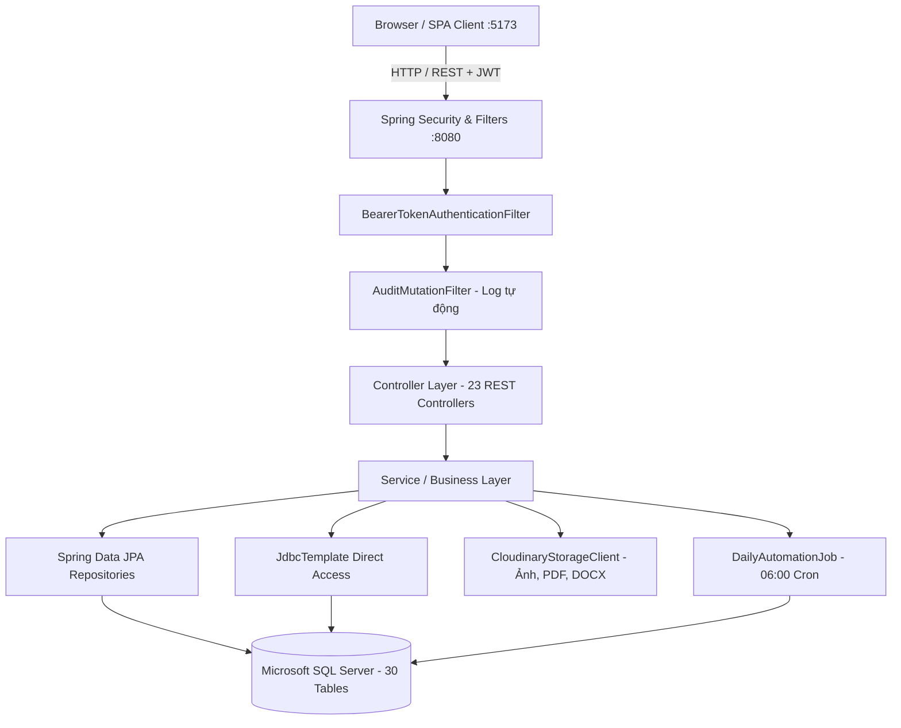

# BÁO CÁO TOÀN DIỆN HIỆN TRẠNG DỰ ÁN SWP RACEHORSE (PROJECT RECONNAISSANCE AUDIT)

---

## 1. Project Overview

Dự án **SWP Racehorse** (Racehorse Training Management System) là một hệ thống monorepo quản lý quy trình vận hành, nuôi dưỡng, huấn luyện, y tế và thành tích cho câu lạc bộ ngựa đua chuyên nghiệp.

- **Mô hình kiến trúc tổng thể:** Monorepo gồm 3 phân hệ chính:
  1. `BACKEND/`: RESTful API modular monolith xây dựng trên Java 21 / Spring Boot 4.1.1 (tương thích Spring Framework 6.x/7.x).
  2. `FRONTEND/`: Single Page Application (SPA) xây dựng trên React 19 / Vite 8, phục vụ giao diện vận hành và kiểm thử các tính năng cốt lõi.
  3. `DATABASE/`: Tập hợp script DDL/DML cho Microsoft SQL Server, quản lý schema 30 bảng thông qua script migration có kiểm soát (`spring.jpa.hibernate.ddl-auto=none`).
- **Tài liệu nghiệp vụ & định hướng:**
  - Quy tắc nghiệp vụ và các đầu mối chưa chốt được ghi nhận tại [`BUSINESS_DECISIONS_PENDING.md`](BUSINESS_DECISIONS_PENDING.md).
  - Yêu cầu chức năng đối chiếu theo SRS baseline gồm 23 Functional Requirements (**FR01 – FR23**).

---

## 2. Project Structure

Cấu trúc thư mục tại root `HORSE-PROJECT`:

```text
HORSE-PROJECT/
├── .vscode/                               # Cấu hình tasks, launch và settings môi trường VS Code
│   ├── extensions.json
│   ├── launch.json                        # Cấu hình debug "Full Stack (Local)"
│   ├── settings.json
│   └── tasks.json                         # Tasks: build, test, db init, frontend install
├── BACKEND/                               # Mã nguồn máy chủ Spring Boot
│   ├── .dockerignore
│   ├── .env.example
│   ├── Dockerfile                         # Base image eclipse-temurin:21-jre
│   ├── pom.xml                            # Maven dependencies & build config
│   ├── README.md                          # Tài liệu kỹ thuật chi tiết của Backend
│   └── src/
│       ├── main/java/com/racehorse/       # 161 source files Java (modular packages)
│       ├── main/resources/
│       │   └── application.properties     # Cấu hình Spring, Datasource, JWT, Cloudinary, Quartz/Jobs
│       └── test/java/com/racehorse/       # 15 test files (Unit & Slice tests)
├── DATABASE/                              # Database scripts Microsoft SQL Server
│   ├── 00_create_database.sql
│   ├── 01_create_schema.sql
│   ├── 02_seed_data.sql                   # Khởi tạo admin@gmail.com / Admin123 (CLUB_MANAGER)
│   ├── 03_horse_role_features.sql
│   ├── 04_cloudinary_profile_files.sql
│   ├── 05_training_evaluations.sql
│   ├── 06_training_plans_scheduling_monitoring.sql
│   ├── 07_health_medical.sql
│   ├── 08_stable_care_inventory.sql
│   ├── 09_racing_reporting_rbac_audit.sql
│   ├── 10_confirmed_business_rules.sql
│   ├── 11_confirmed_automation_and_governance.sql
│   ├── 12_compact_schema.sql              # Script nén/gộp schema xuống đúng 30 bảng vận hành
│   ├── build-full-database.ps1            # Script sinh racehorse_database_full.sql
│   ├── racehorse_database_full.sql        # File DDL/DML tổng hợp toàn vẹn
│   ├── README.md                          # Tài liệu kiến trúc và giải thích schema database
│   └── setup-local.ps1                    # Script khởi tạo SQL Server local
├── FRONTEND/                              # Giao diện SPA React/Vite
│   ├── .env.example
│   ├── index.html
│   ├── package.json                       # Dependencies: react 19, recharts, lucide-react, html2canvas, jspdf
│   ├── package-lock.json
│   ├── README.md
│   ├── vite.config.js                     # Proxy cấu hình chuyển hướng /api và /actuator về :8080
│   └── src/
│       ├── api.js                         # HTTP client wrapper, fetch token refresh, auto retry
│       ├── App.jsx                        # Routing, Auth Provider, Dashboard, Horses, Users
│       ├── FitnessPage.jsx                # FR03 Dashboard, Recharts, Export PNG/PDF, Modal FR07
│       ├── main.jsx                       # Entrypoint React 19
│       └── styles.css                     # Toàn bộ stylesheet giao diện
├── BUSINESS_DECISIONS_PENDING.md          # 8 điểm quyết định nghiệp vụ chờ chủ dự án chốt
└── README.md                              # Hướng dẫn chạy và cấu hình toàn hệ thống
```

---

## 3. Architecture

Hệ thống được tổ chức theo kiến trúc **Modular Monolith** kết hợp **Package-by-Feature**:



- **Data Access Pattern:** Tồn tại mô hình kết hợp song song:
  - Các module nghiệp vụ cốt lõi có giao dịch thường xuyên (`auth`, `horse`, `training-plans`, `training-evaluations`, `training-schedules`, `locks`) sử dụng **Spring Data JPA** với các Entity kế thừa `BaseEntity` (optimistic locking với trường `@Version`).
  - Các module quản trị, sổ cái tài chính, báo cáo, lịch chăm sóc, audit và các bảng compact (`finance`, `reporting`, `stable`, `telemetry`, `preventive-care`, `races`, `audit`, `module_records`) sử dụng trực tiếp **JdbcTemplate** với native SQL và hàm JSON của SQL Server (`JSON_VALUE`, `JSON_MODIFY`).

---

## 4. Backend

- **Technology Stack:**
  - Java 21, Spring Boot 4.1.1.
  - Spring Web MVC, Spring Data JPA, Spring Security (OAuth2 Resource Server JWT), Spring Validation, Spring Boot Actuator.
  - Microsoft SQL Server JDBC Driver (`mssql-jdbc`).
  - Cloudinary HTTP5 (`cloudinary-http5:2.4.0`).
  - Jackson 3 (`tools.jackson.*`).
- **Layers Phân chia:**
  - **Controller Layer (23 controllers):** Tiếp nhận HTTP request, `@Valid` DTO, `@PreAuthorize` kiểm tra role và authority dạng `hasAuthority('PERM_{MODULE}_{ACTION}')`.
  - **Service Layer (23 services):** Xử lý nghiệp vụ, transaction boundary (`@Transactional`), kiểm tra quyền dữ liệu sở hữu qua `HorseAccessService`.
  - **Repository Layer:** 11 Spring Data JPA Interfaces và hàng loạt câu truy vấn native thông qua `JdbcTemplate`.
  - **Exception Handling Layer:** `GlobalExceptionHandler` chuẩn hóa lỗi trả về theo schema `ApiErrorResponse` (HTTP 400 cho validation, 401 cho authentication, 404 cho not found, 409 cho business conflict, 502 cho external services).
- **Mức độ hoàn thiện giữa các module backend:**
  - **Hoàn chỉnh logic & API:** `auth` (JWT + Session rotation), `horse` (hồ sơ, phả hệ, lịch sử đua), `media` (Cloudinary file chính & đề xuất), `training` (kế hoạch, lịch tập, đường đua, đánh giá FR07, dashboard FR03, telemetry nhập tay & cảnh báo FR06), `health` (training lock FR11, preventive care FR12, cân nặng & sẵn sàng thi đấu, trạng thái sức khỏe), `racing` (race events & đăng ký), `reporting` (owner report json), `finance` (sổ cái VND), `audit` (audit log filter tự động).
  - **Mới có schema trong `module_records` nhưng chưa có Service/API:** Khám bệnh y tế chi tiết (FR09), điều trị/đơn thuốc (FR09), mô hình 3D đánh dấu chấn thương (FR10), khẩu phần dinh dưỡng (FR14), nhiệm vụ chăm sóc ngày (FR15), báo cáo sự cố chuồng (FR16), quản lý kho/vật tư (FR17).

---

## 5. Frontend

- **Technology Stack:**
  - React 19.3.0, React Router DOM 7.18.3, Vite 8.2.2.
  - Recharts 3.3.0 (biểu đồ thể lực FR03).
  - Lucide React 1.44.0 (icon system).
  - html2canvas 1.4.1 và jspdf 4.2.1 (xuất ảnh PNG và PDF client-side).
- **Cấu trúc & Luồng giao diện:**
  - File `api.js`: Quản lý token trong `sessionStorage`, tự động gọi `/api/auth/refresh` khi gặp HTTP 401, đồng bộ header Authorization Bearer.
  - File `App.jsx`:
    - `AuthProvider`: Route guard gọi `/api/auth/me` mỗi khi focus tab hoặc định kỳ 30s.
    - `AuthShell`: Form Login và Register theo 4 role tự do.
    - `AppLayout`: Sidebar linh hoạt theo role, Topbar với `NotificationBell` (polling unread notifications mỗi 30s).
    - `Dashboard`: Thống kê tổng số ngựa theo trạng thái (`ACTIVE`, `INJURED`), danh sách hồ sơ gần nhất.
    - `Horses`: Tìm kiếm tên/mã/chip, lọc trạng thái, modal thêm ngựa mới.
    - `HorseDetail`: Chi tiết định danh, chủ sở hữu và %, cây phả hệ 3 đời, thành tích đua, lịch sử đánh giá thể lực FR07, upload/thay thế/đề xuất file Cloudinary, lưu trữ hồ sơ.
    - `Users`: Màn hình quản lý tài khoản dành riêng cho `CLUB_MANAGER`, modal cập nhật role.
  - File `FitnessPage.jsx`:
    - FR03 Dashboard: Lọc theo ngựa, thể trạng (GREEN, YELLOW, RED), khoảng ngày.
    - 3 biểu đồ Recharts: Khối lượng tập, tốc độ trung bình, hồi phục nhịp tim.
    - Bảng đối chiếu ID gốc.
    - Xuất ảnh PNG & PDF báo cáo thể lực ngay trên giao diện.
    - `EvaluationModal`: Form nhập dữ liệu buổi tập hoàn tất cho FR07.
- **[FACT] Đánh giá độ phủ giao diện:**
  Frontend hiện tại được thiết kế như một **bản UI kiểm thử tập trung (Proof-of-Concept / Test Console)** cho FR01, FR02, FR03, FR07 và User/Role Management. Frontend **chưa có trang giao diện** cho FR04 (Kế hoạch), FR05 (Lịch & Racetrack), FR06 (Telemetry & Alerts), FR08 (Health Map), FR11 (Khóa huấn luyện), FR12 (Chăm sóc phòng ngừa), FR13 (Chuồng), FR18 (Đăng ký đua), FR19 (Báo cáo chủ sở hữu), FR22 (Sổ cái thu chi), FR23 (Xem Audit log).

---

## 6. Database

- **Hệ quản trị:** Microsoft SQL Server (T-SQL).
- **Cơ chế quản lý Schema:**
  - Quản lý thủ công/bằng script thông qua thư mục `DATABASE/`. Hibernate cấu hình `ddl-auto=none`.
  - Có 13 file migration đánh số từ `00_create_database.sql` đến `12_compact_schema.sql`.
  - File tổng hợp chuẩn: `DATABASE/racehorse_database_full.sql` (tái lập bởi `build-full-database.ps1`).
- **[FACT] Cấu trúc 30 bảng sau Migration 12 (Compact Schema):**

| STT | Tên bảng | Khóa chính | Mục đích / Nghiệp vụ |
|:---:|---|---|---|
| 1 | `dbo.horses` | `id` (UUID) | Hồ sơ gốc ngựa, phả hệ, vị trí chuồng, trạng thái vận hành & sức khỏe (`health_status`). |
| 2 | `dbo.users` | `id` (UUID) | Tài khoản người dùng hệ thống. |
| 3 | `dbo.user_roles` | `(user_id, role)` | Bảng gán role (5 role cố định). |
| 4 | `dbo.login_sessions` | `id` (UUID) | Phiên đăng nhập, refresh token SHA-256 hash, IP, User-Agent, thu hồi. |
| 5 | `dbo.horse_ownerships` | `id` (UUID) | Liên kết chủ sở hữu và tỷ lệ % sở hữu (tổng = 100%). |
| 6 | `dbo.race_results` | `id` (UUID) | Lịch sử kết quả thi đấu quá khứ. |
| 7 | `dbo.horse_profile_files` | `id` (UUID) | File hồ sơ chính Cloudinary (active, pending đề xuất, replaced, deleted). |
| 8 | `dbo.training_evaluations` | `id` (UUID) | Chỉ số buổi tập FR07 (duration, distance, speed, load, recovery bpm, rpe, status). |
| 9 | `dbo.notifications` | `id` (UUID) | Thông báo in-app, có `deduplication_key` chống gửi trùng. |
| 10 | `dbo.training_plans` | `id` (UUID) | Kế hoạch huấn luyện. |
| 11 | `dbo.training_plan_phases` | `id` (UUID) | Giai đoạn huấn luyện (có trigger chặn trùng ngày). |
| 12 | `dbo.training_schedules` | `id` (UUID) | Lịch huấn luyện chi tiết gán nhân viên (có trigger chặn trùng nhân viên & khóa y tế). |
| 13 | `dbo.racetracks` | `id` (UUID) | Danh mục đường đua câu lạc bộ (giờ mở 06:00-24:00, slot 60p). |
| 14 | `dbo.racetrack_lanes` | `id` (UUID) | Các làn chạy của từng đường đua. |
| 15 | `dbo.trial_run_bookings` | `id` (UUID) | Đặt chỗ slot chạy thử (trigger chặn trùng làn). |
| 16 | `dbo.horse_metric_thresholds` | `id` (UUID) | Ngưỡng HEART_RATE và SPEED theo từng ngựa. |
| 17 | `dbo.telemetry_sessions` | `id` (UUID) | Phiên đo chỉ số (MANUAL, RESTING/TRAINING/RECOVERY). |
| 18 | `dbo.telemetry_readings` | `id` (BIGINT IDENTITY) | Điểm đo nhịp tim / tốc độ chi tiết theo thời gian. |
| 19 | `dbo.alert_events` | `id` (UUID) | Sự kiện cảnh báo vượt ngưỡng thể lực. |
| 20 | `dbo.stored_files` | `id` (UUID) | Quản lý file Cloudinary dùng chung. |
| 21 | `dbo.training_locks` | `id` (UUID) | Lệnh khóa huấn luyện khẩn cấp FR11. |
| 22 | `dbo.preventive_care_schedules` | `id` (UUID) | Lịch chăm sóc phòng ngừa FR12 (tiêm phòng, tẩy giun, móng). |
| 23 | `dbo.stables` | `id` (UUID) | Danh mục khu chuồng. |
| 24 | `dbo.race_events` | `id` (UUID) | Danh mục giải đua mở đăng ký. |
| 25 | `dbo.financial_transactions` | `id` (UUID) | Sổ cái giao dịch tài chính (EXPENSE / REVENUE, tiền tệ VND). |
| 26 | `dbo.owner_reports` | `id` (UUID) | Báo cáo đóng băng định kỳ cho chủ sở hữu (`horse_ids_json`, `transaction_ids_json`). |
| 27 | `dbo.audit_logs` | `id` (BIGINT IDENTITY) | Nhật ký kiểm toán append-only (trigger cấm UPDATE/DELETE). |
| 28 | `dbo.horse_weight_records` | `id` (UUID) | Lịch sử cân nặng do bác sĩ thú y nhập. |
| 29 | `dbo.role_permissions` | `(role_code, module_code, action_code)` | Ma trận quyền động (VIEW/EDIT/APPROVE) cho 5 role trên 6 module. |
| 30 | `dbo.module_records` | `id` (UUID) | Bảng đa năng lưu trữ dữ liệu dạng JSON cho các module chưa có API riêng biệt. |

- **[FACT] Triggers toàn vẹn dữ liệu trong Database:**
  1. `tr_training_plan_phases_no_overlap`: Chặn các giai đoạn trùng thời gian trong cùng một kế hoạch.
  2. `tr_training_schedules_no_staff_overlap`: Chặn nhân viên bị xếp trùng giờ làm.
  3. `tr_trial_run_bookings_no_lane_overlap`: Chặn đặt trùng làn chạy cùng thời điểm.
  4. `tr_training_schedules_plan_and_lock`: Chặn xếp lịch cường độ cao khi ngựa bị khóa huấn luyện hoặc kế hoạch không active.
  5. `tr_audit_logs_append_only`: Chặn tuyệt đối mọi lệnh `UPDATE` hoặc `DELETE` trên bảng `audit_logs`.

---

## 7. Authentication & RBAC

### 5 Role Cố Định của Hệ Thống
Hệ thống quản lý đúng 5 role định danh chuẩn theo SRS:
1. `CLUB_MANAGER`: Quản trị viên câu lạc bộ, quản lý người dùng, phân quyền, cấu hình đường đua/chuồng, tài chính.
2. `HEAD_TRAINER`: Huấn luyện viên trưởng, quản lý hồ sơ ngựa, kế hoạch, lịch tập, đánh giá FR07, cấu hình ngưỡng và nhập telemetry FR06, đăng ký giải đua.
3. `VETERINARIAN`: Bác sĩ thú y, cập nhật sức khỏe (`health_status`), tạo và gỡ khóa huấn luyện FR11, nhập cân nặng, quản lý chăm sóc phòng ngừa FR12.
4. `STABLE_STAFF`: Nhân viên chăm sóc chuồng, xem lịch làm việc được giao (`/api/training-schedules/mine`), nhận thông báo.
5. `HORSE_OWNER`: Chủ sở hữu, chỉ xem ngựa thuộc quyền sở hữu thực tế (`dbo.horse_ownerships`), đề xuất đổi file ảnh/hồ sơ chính, xem báo cáo chủ sở hữu.

### Cơ Chế Xác Thực (Authentication Flow)
1. **Đăng nhập (`POST /api/auth/login`):** Xác thực email/password qua BCrypt. Sinh access token JWT (thời hạn 15 phút) và refresh token (30 ngày, lưu dạng SHA-256 hash trong bảng `login_sessions`).
2. **Kiểm tra phiên đăng nhập trên mỗi request:**
   - JWT mang claim `sub` (User ID) và `sid` (Session ID).
   - [FACT] Trong `SecurityConfiguration.java`, `JwtAuthenticationConverter` thực hiện truy vấn DB: `userRepository.findById(userId)` và kiểm tra `user.isEnabled()`.
   - Đồng thời nạp quyền động từ câu truy vấn SQL:
     ```sql
     select concat('PERM_', rp.module_code, '_', rp.action_code)
     from user_roles ur
     join role_permissions rp on rp.role_code = ur.role and rp.granted = 1
     where ur.user_id = :userId
     ```
   - **Hệ quả kiến trúc:** Khi `CLUB_MANAGER` sửa quyền hoặc đổi role của user, quyền có hiệu lực ngay lập tức ở request kế tiếp mà không cần chờ token hết hạn.
3. **Đăng xuất (`POST /api/auth/logout`):** Thu hồi phiên đăng nhập (`revoked_at` trong `login_sessions`), vô hiệu hóa refresh token và access token gắn với session đó.

### Ma Trận Phân Quyền (RBAC Flow)
- Ma trận phân quyền kiểm soát 3 hành động: `VIEW`, `EDIT`, `APPROVE` trên 6 module: `PROFILE`, `TRAINING`, `MEDICAL`, `STABLE_CARE`, `RACING`, `REPORTING`.
- Endpoint quản trị: `GET /api/admin/role-permissions` và `PUT /api/admin/role-permissions/{role}`.
- Có ràng buộc chặn không cho phép hạ quyền của role `CLUB_MANAGER` để tránh lockout hệ thống.

---

## 8. API Inventory

Tổng hợp 23 Controllers với 46 endpoints đang hoạt động trên Backend:

| STT | HTTP Method | Endpoint | Controller | Chức năng | Phân quyền (Security) | Trạng thái |
|:---:|---|---|---|---|---|:---:|
| 1 | `GET` | `/api/auth/register-roles` | `AuthController` | Lấy danh sách role cho phép tự đăng ký | Public (`permitAll`) | Implemented |
| 2 | `POST` | `/api/auth/register` | `AuthController` | Đăng ký tài khoản mới | Public (`permitAll`) | Implemented |
| 3 | `POST` | `/api/auth/login` | `AuthController` | Đăng nhập lấy access/refresh token | Public (`permitAll`) | Implemented |
| 4 | `POST` | `/api/auth/refresh` | `AuthController` | Xoay vòng refresh token | Public (`permitAll`) | Implemented |
| 5 | `POST` | `/api/auth/logout` | `AuthController` | Đăng xuất, hủy session | Public (`permitAll`) | Implemented |
| 6 | `GET` | `/api/auth/me` | `AuthController` | Lấy thông tin user hiện tại | `isAuthenticated()` | Implemented |
| 7 | `POST` | `/api/users` | `UserController` | Tạo tài khoản kèm role | `CLUB_MANAGER` | Implemented |
| 8 | `GET` | `/api/users/roles` | `UserController` | Lấy danh sách toàn bộ 5 role | `CLUB_MANAGER` | Implemented |
| 9 | `GET` | `/api/users` | `UserController` | Tìm kiếm & phân trang người dùng | `CLUB_MANAGER` | Implemented |
| 10 | `GET` | `/api/users/{id}` | `UserController` | Chi tiết người dùng | `CLUB_MANAGER` | Implemented |
| 11 | `PUT` | `/api/users/{id}/roles` | `UserController` | Đổi role tài khoản khác | `CLUB_MANAGER` | Implemented |
| 12 | `GET` | `/api/admin/role-permissions` | `RolePermissionController` | Xem ma trận quyền động | `CLUB_MANAGER` | Implemented |
| 13 | `PUT` | `/api/admin/role-permissions/{role}` | `RolePermissionController` | Sửa quyền động VIEW/EDIT/APPROVE | `CLUB_MANAGER` | Implemented |
| 14 | `GET` | `/api/admin/audit-logs` | `AuditLogController` | Lọc và tra cứu nhật ký kiểm toán | `CLUB_MANAGER` | Implemented |
| 15 | `POST` | `/api/horses` | `HorseController` | Tạo hồ sơ ngựa mới | `PERM_PROFILE_EDIT` & (`CLUB_MANAGER`, `HEAD_TRAINER`) | Implemented |
| 16 | `GET` | `/api/horses/{id}` | `HorseController` | Xem chi tiết hồ sơ ngựa | `PERM_PROFILE_VIEW` & (`CLUB_MANAGER`, `HEAD_TRAINER`, `HORSE_OWNER`) | Implemented |
| 17 | `GET` | `/api/horses` | `HorseController` | Tìm kiếm, lọc trạng thái ngựa | `PERM_PROFILE_VIEW` & (`CLUB_MANAGER`, `HEAD_TRAINER`) | Implemented |
| 18 | `GET` | `/api/horses/mine` | `HorseController` | Chủ sở hữu xem ngựa của mình | `PERM_PROFILE_VIEW` & `HORSE_OWNER` | Implemented |
| 19 | `PUT` | `/api/horses/{id}` | `HorseController` | Cập nhật hồ sơ ngựa | `PERM_PROFILE_EDIT` & (`CLUB_MANAGER`, `HEAD_TRAINER`) | Implemented |
| 20 | `PUT` | `/api/horses/{id}/ownership` | `HorseController` | Cập nhật toàn bộ tỷ lệ sở hữu | `PERM_PROFILE_EDIT` & (`CLUB_MANAGER`, `HEAD_TRAINER`) | Implemented |
| 21 | `PATCH` | `/api/horses/{id}/archive` | `HorseController` | Lưu trữ hồ sơ ngựa | `PERM_PROFILE_EDIT` & (`CLUB_MANAGER`, `HEAD_TRAINER`) | Implemented |
| 22 | `GET` | `/api/horses/{id}/pedigree` | `PedigreeController` | Xem phả hệ 3 thế hệ | `PERM_PROFILE_VIEW` & (`CLUB_MANAGER`, `HEAD_TRAINER`, `HORSE_OWNER`) | Implemented |
| 23 | `GET` | `/api/horses/{id}/race-results` | `RaceResultController` | Lịch sử kết quả đua quá khứ | `PERM_RACING_VIEW` & (`CLUB_MANAGER`, `HEAD_TRAINER`, `HORSE_OWNER`) | Implemented |
| 24 | `POST` | `/api/horses/{id}/race-results` | `RaceResultController` | Thêm kết quả đua lịch sử | `PERM_RACING_EDIT` & (`CLUB_MANAGER`, `HEAD_TRAINER`) | Implemented |
| 25 | `PUT` | `/api/horses/{id}/race-results/{resId}` | `RaceResultController` | Sửa kết quả đua lịch sử | `PERM_RACING_EDIT` & (`CLUB_MANAGER`, `HEAD_TRAINER`) | Implemented |
| 26 | `GET` | `/api/horses/{id}/main-file` | `HorseProfileFileController` | Lấy file hồ sơ chính Cloudinary | `PERM_PROFILE_VIEW` | Implemented |
| 27 | `PUT` | `/api/horses/{id}/main-file` | `HorseProfileFileController` | Thay trực tiếp file hồ sơ chính | `PERM_PROFILE_EDIT` & (`CLUB_MANAGER`, `HEAD_TRAINER`) | Implemented |
| 28 | `DELETE` | `/api/horses/{id}/main-file` | `HorseProfileFileController` | Xóa file chính (xóa Cloudinary) | `PERM_PROFILE_EDIT` & (`CLUB_MANAGER`, `HEAD_TRAINER`) | Implemented |
| 29 | `POST` | `/api/horses/{id}/main-file/proposals` | `HorseProfileFileController` | Chủ sở hữu đề xuất file mới | `PERM_PROFILE_VIEW` & `HORSE_OWNER` | Implemented |
| 30 | `GET` | `/api/horses/{id}/main-file/proposals` | `HorseProfileFileController` | Xem danh sách đề xuất đang chờ | `PERM_PROFILE_APPROVE` & (`CLUB_MANAGER`, `HEAD_TRAINER`) | Implemented |
| 31 | `POST` | `/api/horses/{id}/main-file/proposals/{pId}/approve` | `HorseProfileFileController` | Phê duyệt đề xuất file | `PERM_PROFILE_EDIT` & (`CLUB_MANAGER`, `HEAD_TRAINER`) | Implemented |
| 32 | `POST` | `/api/files` | `StoredFileController` | Upload file dùng chung lên Cloudinary | `PERM_*_EDIT` | Implemented |
| 33 | `GET` | `/api/files` | `StoredFileController` | Danh sách file lưu trữ | `isAuthenticated()` | Implemented |
| 34 | `GET` | `/api/files/{id}` | `StoredFileController` | Xem chi tiết metadata file | `isAuthenticated()` | Implemented |
| 35 | `DELETE` | `/api/files/{id}` | `StoredFileController` | Xóa file Cloudinary | `CLUB_MANAGER` | Implemented |
| 36 | `GET` | `/api/notifications` | `NotificationController` | Danh sách thông báo cá nhân | `isAuthenticated()` | Implemented |
| 37 | `PATCH` | `/api/notifications/{id}/read` | `NotificationController` | Đánh dấu thông báo đã đọc | `isAuthenticated()` | Implemented |
| 38 | `GET` | `/api/fitness/dashboard` | `FitnessDashboardController` | Lấy dữ liệu dashboard thể lực FR03 | `PERM_TRAINING_VIEW` & (`CLUB_MANAGER`, `HEAD_TRAINER`) | Implemented |
| 39 | `POST` | `/api/training-evaluations` | `TrainingEvaluationController` | Nhập chỉ số đánh giá buổi tập FR07 | `PERM_TRAINING_EDIT` & (`CLUB_MANAGER`, `HEAD_TRAINER`) | Implemented |
| 40 | `GET` | `/api/training-evaluations/{id}` | `TrainingEvaluationController` | Đối chiếu một bản ghi đánh giá gốc | `PERM_TRAINING_VIEW` & (`CLUB_MANAGER`, `HEAD_TRAINER`, `HORSE_OWNER`) | Implemented |
| 41 | `GET` | `/api/horses/{id}/training-evaluations` | `TrainingEvaluationController` | Lịch sử đánh giá buổi tập của ngựa | `PERM_TRAINING_VIEW` & (`CLUB_MANAGER`, `HEAD_TRAINER`, `HORSE_OWNER`) | Implemented |
| 42 | `POST` | `/api/training-plans` | `TrainingPlanController` | Tạo kế hoạch huấn luyện nhiều giai đoạn FR04 | `PERM_TRAINING_EDIT` & (`CLUB_MANAGER`, `HEAD_TRAINER`) | Implemented |
| 43 | `PUT` | `/api/training-plans/{id}` | `TrainingPlanController` | Cập nhật kế hoạch chưa có lịch | `PERM_TRAINING_EDIT` & (`CLUB_MANAGER`, `HEAD_TRAINER`) | Implemented |
| 44 | `POST` | `/api/training-plans/{id}/copy` | `TrainingPlanController` | Sao chép kế hoạch sang ngựa khác | `PERM_TRAINING_EDIT` & (`CLUB_MANAGER`, `HEAD_TRAINER`) | Implemented |
| 45 | `GET` | `/api/training-plans/{id}` | `TrainingPlanController` | Xem chi tiết kế hoạch | `PERM_TRAINING_EDIT` & (`CLUB_MANAGER`, `HEAD_TRAINER`) *(Inconsistency)* | Implemented |
| 46 | `GET` | `/api/horses/{id}/training-plans` | `TrainingPlanController` | Danh sách kế hoạch của ngựa | `PERM_TRAINING_EDIT` & (`CLUB_MANAGER`, `HEAD_TRAINER`) *(Inconsistency)* | Implemented |
| 47 | `POST` | `/api/training-schedules` | `TrainingScheduleController` | Tạo lịch huấn luyện từ phase active FR05 | `PERM_TRAINING_EDIT` & (`CLUB_MANAGER`, `HEAD_TRAINER`) | Implemented |
| 48 | `POST` | `/api/training-schedules/{id}/publish` | `TrainingScheduleController` | Công bố lịch & gửi thông báo staff | `PERM_TRAINING_EDIT` & (`CLUB_MANAGER`, `HEAD_TRAINER`) | Implemented |
| 49 | `GET` | `/api/training-schedules/{id}` | `TrainingScheduleController` | Xem chi tiết một buổi lịch | `PERM_TRAINING_VIEW` & (`CLUB_MANAGER`, `HEAD_TRAINER`, `STABLE_STAFF`) | Implemented |
| 50 | `GET` | `/api/training-schedules` | `TrainingScheduleController` | Xem calendar toàn bộ lịch | `PERM_TRAINING_VIEW` & (`CLUB_MANAGER`, `HEAD_TRAINER`) | Implemented |
| 51 | `GET` | `/api/training-schedules/mine` | `TrainingScheduleController` | Nhân viên xem lịch được phân công | `PERM_TRAINING_VIEW` & `STABLE_STAFF` | Implemented |
| 52 | `POST` | `/api/racetracks` | `RacetrackController` | Tạo đường đua và số làn | `PERM_TRAINING_EDIT` & `CLUB_MANAGER` | Implemented |
| 53 | `GET` | `/api/racetracks` | `RacetrackController` | Danh sách đường đua | `PERM_TRAINING_VIEW` & (`CLUB_MANAGER`, `HEAD_TRAINER`) | Implemented |
| 54 | `GET` | `/api/racetracks/{id}/slots` | `RacetrackController` | Tra cứu slot trống/đã đặt theo ngày | `PERM_TRAINING_VIEW` & (`CLUB_MANAGER`, `HEAD_TRAINER`) | Implemented |
| 55 | `POST` | `/api/trial-run-bookings` | `RacetrackController` | Đặt chỗ slot chạy thử | `PERM_TRAINING_EDIT` & (`CLUB_MANAGER`, `HEAD_TRAINER`) | Implemented |
| 56 | `GET` | `/api/trial-run-bookings` | `RacetrackController` | Danh sách đặt chỗ chạy thử | `PERM_TRAINING_VIEW` & (`CLUB_MANAGER`, `HEAD_TRAINER`) | Implemented |
| 57 | `DELETE` | `/api/trial-run-bookings/{id}` | `RacetrackController` | Hủy đặt chỗ chạy thử | `PERM_TRAINING_EDIT` & (`CLUB_MANAGER`, `HEAD_TRAINER`) | Implemented |
| 58 | `POST` | `/api/horses/{id}/metric-thresholds` | `TelemetryController` | Thiết lập ngưỡng chỉ số theo ngựa | `PERM_TRAINING_EDIT` & (`CLUB_MANAGER`, `HEAD_TRAINER`) | Implemented |
| 59 | `GET` | `/api/horses/{id}/metric-thresholds` | `TelemetryController` | Xem danh sách ngưỡng chỉ số | `PERM_TRAINING_VIEW` | Implemented |
| 60 | `PUT` | `/api/horses/{id}/metric-thresholds/{tId}` | `TelemetryController` | Sửa ngưỡng chỉ số | `PERM_TRAINING_EDIT` & (`CLUB_MANAGER`, `HEAD_TRAINER`) | Implemented |
| 61 | `DELETE` | `/api/horses/{id}/metric-thresholds/{tId}` | `TelemetryController` | Kết thúc hiệu lực ngưỡng | `PERM_TRAINING_EDIT` & (`CLUB_MANAGER`, `HEAD_TRAINER`) | Implemented |
| 62 | `POST` | `/api/horses/{id}/telemetry` | `TelemetryController` | Nhập telemetry thủ công & kích hoạt cảnh báo | `PERM_TRAINING_EDIT` & (`CLUB_MANAGER`, `HEAD_TRAINER`) | Implemented |
| 63 | `GET` | `/api/horses/{id}/telemetry` | `TelemetryController` | Tra cứu lịch sử phiên telemetry | `PERM_TRAINING_VIEW` | Implemented |
| 64 | `GET` | `/api/horses/{id}/alerts` | `TelemetryController` | Danh sách cảnh báo thể lực FR06 | `PERM_TRAINING_VIEW` | Implemented |
| 65 | `POST` | `/api/horses/{id}/alerts/{aId}/acknowledge` | `TelemetryController` | Xác nhận cảnh báo | `PERM_TRAINING_EDIT` & (`CLUB_MANAGER`, `HEAD_TRAINER`) | Implemented |
| 66 | `POST` | `/api/horses/{id}/training-locks` | `TrainingLockController` | Khóa huấn luyện khẩn cấp FR11 | `PERM_MEDICAL_EDIT` & (`VETERINARIAN`, `CLUB_MANAGER`) | Implemented |
| 67 | `POST` | `/api/training-locks/{id}/release` | `TrainingLockController` | Gỡ khóa sau ngày tái khám | `PERM_MEDICAL_EDIT` & `VETERINARIAN` | Implemented |
| 68 | `GET` | `/api/horses/{id}/training-locks/current` | `TrainingLockController` | Xem khóa huấn luyện đang active | `PERM_MEDICAL_VIEW` & (`VETERINARIAN`, `CLUB_MANAGER`, `HEAD_TRAINER`) | Implemented |
| 69 | `GET` | `/api/horses/{id}/training-locks` | `TrainingLockController` | Lịch sử các đợt khóa huấn luyện | `PERM_MEDICAL_VIEW` & (`VETERINARIAN`, `CLUB_MANAGER`, `HEAD_TRAINER`) | Implemented |
| 70 | `POST` | `/api/horses/{id}/weights` | `HorseMeasurementController` | Bác sĩ thú y nhập cân nặng ngựa | `PERM_MEDICAL_EDIT` & `VETERINARIAN` | Implemented |
| 71 | `GET` | `/api/horses/{id}/weights` | `HorseMeasurementController` | Lịch sử cân nặng của ngựa | `PERM_MEDICAL_VIEW` & (`CLUB_MANAGER`, `HEAD_TRAINER`, `VETERINARIAN`, `HORSE_OWNER`) | Implemented |
| 72 | `GET` | `/api/horses/{id}/race-readiness` | `HorseMeasurementController` | Kiểm tra điều kiện sẵn sàng dự đua | `PERM_MEDICAL_VIEW` & (`CLUB_MANAGER`, `HEAD_TRAINER`, `VETERINARIAN`, `HORSE_OWNER`) | Implemented |
| 73 | `PUT` | `/api/horses/{id}/health-status` | `HorseMeasurementController` | Cập nhật FIT, MONITOR, INJURED, QUARANTINED | `PERM_MEDICAL_EDIT` & `VETERINARIAN` | Implemented |
| 74 | `GET` | `/api/horses/{id}/health-status` | `HorseMeasurementController` | Xem trạng thái sức khỏe hiện tại | `PERM_MEDICAL_VIEW` | Implemented |
| 75 | `POST` | `/api/horses/{id}/preventive-care` | `PreventiveCareController` | Tạo lịch tiêm phòng/tẩy giun/móng FR12 | `PERM_MEDICAL_EDIT` & `VETERINARIAN` | Implemented |
| 76 | `POST` | `/api/preventive-care/{id}/complete` | `PreventiveCareController` | Xác nhận hoàn tất chăm sóc (tự sinh kỳ kế) | `PERM_MEDICAL_EDIT` & `VETERINARIAN` | Implemented |
| 77 | `GET` | `/api/horses/{id}/preventive-care` | `PreventiveCareController` | Xem danh sách lịch chăm sóc phòng ngừa | `PERM_MEDICAL_VIEW` | Implemented |
| 78 | `PUT` | `/api/preventive-care/{id}` | `PreventiveCareController` | Sửa lịch chăm sóc chưa hoàn thành | `PERM_MEDICAL_EDIT` & `VETERINARIAN` | Implemented |
| 79 | `DELETE` | `/api/preventive-care/{id}` | `PreventiveCareController` | Hủy lịch chăm sóc | `PERM_MEDICAL_EDIT` & `VETERINARIAN` | Implemented |
| 80 | `GET` | `/api/stables` | `StableController` | Danh mục chuồng và ô chuồng | `PERM_STABLE_CARE_VIEW` | Implemented |
| 81 | `GET` | `/api/stables/{id}` | `StableController` | Chi tiết chuồng và các ô chuồng | `PERM_STABLE_CARE_VIEW` | Implemented |
| 82 | `POST` | `/api/stables` | `StableController` | Tạo chuồng mới | `PERM_STABLE_CARE_EDIT` & `CLUB_MANAGER` | Implemented |
| 83 | `PUT` | `/api/stables/{id}` | `StableController` | Sửa thông tin chuồng | `PERM_STABLE_CARE_EDIT` & `CLUB_MANAGER` | Implemented |
| 84 | `POST` | `/api/stables/{id}/stalls` | `StableController` | Thêm ô chuồng vào khu chuồng | `PERM_STABLE_CARE_EDIT` & `CLUB_MANAGER` | Implemented |
| 85 | `DELETE` | `/api/stables/{id}/stalls/{sId}` | `StableController` | Ngừng ô chuồng (nếu không có ngựa) | `PERM_STABLE_CARE_EDIT` & `CLUB_MANAGER` | Implemented |
| 86 | `POST` | `/api/stables/{id}/stalls/{sId}/assign` | `StableController` | Phân bổ ngựa vào ô chuồng FR13 | `PERM_STABLE_CARE_EDIT` & `CLUB_MANAGER` | Implemented |
| 87 | `POST` | `/api/stables/assignments/{id}/end` | `StableController` | Kết thúc phân bổ ô chuồng | `PERM_STABLE_CARE_EDIT` & `CLUB_MANAGER` | Implemented |
| 88 | `GET` | `/api/races` | `RaceEventController` | Danh sách giải đua | `PERM_RACING_VIEW` | Implemented |
| 89 | `GET` | `/api/races/{id}` | `RaceEventController` | Chi tiết giải đua | `PERM_RACING_VIEW` | Implemented |
| 90 | `POST` | `/api/races` | `RaceEventController` | Tạo giải đua mới | `PERM_RACING_EDIT` & `CLUB_MANAGER` | Implemented |
| 91 | `PUT` | `/api/races/{id}` | `RaceEventController` | Cập nhật giải đua | `PERM_RACING_EDIT` & `CLUB_MANAGER` | Implemented |
| 92 | `DELETE` | `/api/races/{id}` | `RaceEventController` | Ngừng kích hoạt giải đua | `PERM_RACING_EDIT` & `CLUB_MANAGER` | Implemented |
| 93 | `POST` | `/api/races/{id}/registrations` | `RaceEventController` | Đăng ký ngựa dự đua FR18 (kiểm tra readiness) | `PERM_RACING_EDIT` & (`HEAD_TRAINER`, `CLUB_MANAGER`) | Implemented |
| 94 | `GET` | `/api/races/registrations` | `RaceEventController` | Danh sách đăng ký giải đua | `PERM_RACING_VIEW` & (`CLUB_MANAGER`, `HEAD_TRAINER`) | Implemented |
| 95 | `POST` | `/api/races/registrations/{id}/confirm` | `RaceEventController` | Xác nhận đăng ký đua | `PERM_RACING_APPROVE` & (`HEAD_TRAINER`, `CLUB_MANAGER`) | Implemented |
| 96 | `POST` | `/api/races/registrations/{id}/withdraw` | `RaceEventController` | Rút đăng ký đua | `PERM_RACING_EDIT` & (`HEAD_TRAINER`, `CLUB_MANAGER`) | Implemented |
| 97 | `POST` | `/api/financial-transactions` | `FinanceController` | Ghi nhận thu/chi VND | `PERM_REPORTING_EDIT` & `CLUB_MANAGER` | Implemented |
| 98 | `GET` | `/api/financial-transactions` | `FinanceController` | Tra cứu sổ cái tài chính | `PERM_REPORTING_VIEW` | Implemented |
| 99 | `GET` | `/api/financial-transactions/summary` | `FinanceController` | Tổng hợp thu, chi, net VND | `PERM_REPORTING_VIEW` | Implemented |
| 100 | `GET` | `/api/financial-transactions/{id}` | `FinanceController` | Chi tiết một giao dịch tài chính | `PERM_REPORTING_VIEW` | Implemented |
| 101 | `GET` | `/api/owner-reports` | `OwnerReportController` | Danh sách báo cáo chủ sở hữu | `PERM_REPORTING_VIEW` | Implemented |
| 102 | `GET` | `/api/owner-reports/{id}` | `OwnerReportController` | Xem chi tiết báo cáo chủ sở hữu | `PERM_REPORTING_VIEW` | Implemented |
| 103 | `GET` | `/api/owner-reports/{id}/download` | `OwnerReportController` | Tải file JSON báo cáo chủ sở hữu | `PERM_REPORTING_VIEW` | Implemented |
| 104 | `POST` | `/api/owner-reports` | `OwnerReportController` | Sinh báo cáo kỳ cho chủ sở hữu | `PERM_REPORTING_EDIT` & `CLUB_MANAGER` | Implemented |

---

## 9. Feature/Module Inventory

| Feature / Module | Trạng thái | Backend Controller & Service | Entity / DB Storage | Frontend View | Đánh giá thực tế |
|---|:---:|---|---|---|---|
| **Identity & Authentication** | **A. Implemented** | `AuthController`, `AuthService`, `LoginSessionService` | `dbo.users`, `dbo.login_sessions` | `AuthShell` (Login, Register), `AuthProvider` | Hoàn chỉnh luồng JWT, xoay refresh token, logout thu hồi session. |
| **User & Role Administration** | **A. Implemented** | `UserController`, `UserManagementService`, `RolePermissionController` | `dbo.users`, `dbo.user_roles`, `dbo.role_permissions` | `Users`, `RoleModal` trong `App.jsx` | Quản lý người dùng, đổi role, phân quyền động VIEW/EDIT/APPROVE. |
| **Horse Master Profile** | **A. Implemented** | `HorseController`, `HorseProfileFileController`, `HorseService` | `dbo.horses`, `dbo.horse_ownerships`, `dbo.horse_profile_files` | `Horses`, `HorseDetail`, `HorseModal` | CRUD, tìm kiếm, lưu trữ, tỷ lệ sở hữu, file chính Cloudinary. |
| **Pedigree & Racing History** | **A. Implemented** | `PedigreeController`, `RaceResultController`, `PedigreeService`, `RaceResultService` | `dbo.horses` (sire/dam), `dbo.race_results` | Component `Pedigree` 3 đời, bảng thành tích trong `HorseDetail` | Cây phả hệ 3 đời, ngăn chặn vòng lặp gia phả, kết quả đua lịch sử. |
| **Fitness Dashboard (FR03)** | **A. Implemented** | `FitnessDashboardController`, `FitnessDashboardService` | `dbo.training_evaluations`, `dbo.horses` | `FitnessPage.jsx` | 3 biểu đồ Recharts, lọc theo ngày/ngựa/thể trạng, xuất PNG/PDF, đối chiếu ID gốc. |
| **Training Session Evaluation (FR07)** | **A. Implemented** | `TrainingEvaluationController`, `TrainingEvaluationService` | `dbo.training_evaluations` | `EvaluationModal` trong `FitnessPage.jsx`, lịch sử tại `HorseDetail` | Nhập chỉ số hoàn tất buổi tập, validation nghiêm ngặt, video URL. Không cho sửa/xóa. |
| **Training Plans (FR04)** | **B. Partially Implemented** | `TrainingPlanController`, `TrainingPlanService` | `dbo.training_plans`, `dbo.training_plan_phases` | **Chưa có UI** | Backend CRUD, nhiều giai đoạn, trigger chặn trùng thời gian, copy plan. Thiếu frontend. |
| **Training Scheduling & Racetrack (FR05)** | **B. Partially Implemented** | `TrainingScheduleController`, `RacetrackController`, `TrainingScheduleService`, `RacetrackService` | `dbo.training_schedules`, `dbo.racetracks`, `dbo.racetrack_lanes`, `dbo.trial_run_bookings` | **Chưa có UI** | Xếp lịch, trigger chặn trùng nhân viên & chặn khi có khóa y tế, slot 06:00-24:00, đặt chỗ chạy thử. Thiếu frontend. |
| **Telemetry & Alerts (FR06)** | **B. Partially Implemented** | `TelemetryController`, `TelemetryService` | `dbo.horse_metric_thresholds`, `dbo.telemetry_sessions`, `dbo.telemetry_readings`, `dbo.alert_events` | **Chưa có UI** | Cấu hình ngưỡng theo ngựa, nhập manual telemetry, tự sinh cảnh báo và thông báo. Thiếu frontend. |
| **Training Lock (FR11)** | **B. Partially Implemented** | `TrainingLockController`, `TrainingLockService` | `dbo.training_locks` | **Chưa có UI** | Bác sĩ/Quản lý khóa, bác sĩ gỡ sau ngày tái khám, ràng buộc với lịch tập & dự đua. Thiếu frontend. |
| **Preventive Care (FR12)** | **B. Partially Implemented** | `PreventiveCareController`, `PreventiveCareService`, `DailyAutomationJob` | `dbo.preventive_care_schedules` | **Chưa có UI** | CRUD lịch tiêm phòng/tẩy giun/móng, tự sinh kỳ tiếp theo, job 06:00 gửi thông báo nhắc lịch. Thiếu frontend. |
| **Health Status & Weight** | **B. Partially Implemented** | `HorseMeasurementController`, `HorseMeasurementService` | `dbo.horses` (`health_*`), `dbo.horse_weight_records` | Huy hiệu trạng thái trên `App.jsx`, thiếu trang y tế chuyên biệt | Cập nhật FIT/MONITOR/INJURED/QUARANTINED, nhập cân nặng, kiểm tra race-readiness. |
| **Stables & Stall Allocation (FR13)** | **B. Partially Implemented** | `StableController`, `StableService` | `dbo.stables`, `dbo.module_records` | **Chưa có UI** | CRUD chuồng, quản lý ô chuồng, phân bổ ngựa vào ô chuồng. Thiếu frontend. |
| **Race Events & Registration (FR18)** | **B. Partially Implemented** | `RaceEventController`, `RaceEventService` | `dbo.race_events`, `dbo.module_records` | **Chưa có UI** | Tạo giải đua, đăng ký ngựa, kiểm tra tuổi & readiness (sức khỏe, cân nặng, nhịp tim nghỉ). Thiếu frontend. |
| **Owner Report (FR19)** | **B. Partially Implemented** | `OwnerReportController`, `OwnerReportService`, `DailyAutomationJob` | `dbo.owner_reports` | **Chưa có UI** | Tổng hợp thu/chi VND của các ngựa thuộc owner, xuất JSON, job 06:00 sinh báo cáo tự động. Thiếu frontend. |
| **Financial Ledger (FR22)** | **B. Partially Implemented** | `FinanceController`, `FinanceService` | `dbo.financial_transactions` | **Chưa có UI** | Sổ cái chỉ ghi thêm thu/chi theo ngựa/chuồng, tiền tệ VND. Thiếu frontend. |
| **Audit Log (FR23)** | **B. Partially Implemented** | `AuditLogController`, `AuditService`, `AuditMutationFilter` | `dbo.audit_logs` | **Chưa có UI** | Tự động ghi log mọi mutation thành công và login, trigger cấm sửa/xóa DB. Thiếu frontend. |
| **Medical Exams & Treatment (FR09)** | **C. Skeleton** | Chưa có Controller/Service | `dbo.module_records` (`module_code='MEDICAL'`) | **Chưa có UI** | Schema chi tiết trước đây bị gộp vào `module_records`. Chưa có API. |
| **3D Injury Tracking (FR10)** | **C. Skeleton** | Chưa có Controller/Service | `dbo.module_records` (`record_type='INJURY_MARKERS'`) | **Chưa có UI** | Dữ liệu cũ chuyển vào `module_records`. Định dạng mô hình 3D chưa được chốt. Chưa có API. |
| **Nutrition & Feeding Plan (FR14)** | **C. Skeleton** | Chưa có Controller/Service | `dbo.module_records` (`record_type='NUTRITION_PLANS'`) | **Chưa có UI** | Đã được định nghĩa trong migration 08 nhưng chuyển vào `module_records` ở migration 12. Chưa có API. |
| **Daily Tasks (FR15)** | **C. Skeleton** | Chưa có Controller/Service | `dbo.module_records` (`record_type='DAILY_TASKS'`) | **Chưa có UI** | Đã định nghĩa trong DB nhưng chuyển vào `module_records`. Chưa có API. |
| **Incident Reports (FR16)** | **C. Skeleton** | Chưa có Controller/Service | `dbo.module_records` (`record_type='INCIDENT_REPORTS'`) | **Chưa có UI** | Lưu trữ trong `module_records`. Chưa có API. |
| **Inventory & Replenishment (FR17)**| **C. Skeleton** | Chưa có Controller/Service | `dbo.module_records` (`module_code='INVENTORY'`) | **Chưa có UI** | Lưu trữ trong `module_records`. Chưa có API. |

---

## 10. SRS FR01–FR23 Traceability

```text
FR01 – Horse Master Profile
Status: Implemented (Partial frontend/features for additional photos)
Current implementation:
- Quản lý hồ sơ định danh, thông tin giống, giới tính, số chip/hộ chiếu, màu sắc, vị trí chuồng, trạng thái vận hành.
- Phân bổ tỷ lệ sở hữu (%) cho nhiều chủ sở hữu, tổng tỷ lệ bắt buộc bằng 100.00%.
- Tích hợp Cloudinary lưu trữ file hồ sơ chính (hỗ trợ Image, PDF, DOCX tối đa 50MB).
- Chủ sở hữu chỉ được đề xuất file chính (PENDING); Club Manager hoặc Head Trainer phê duyệt (ACTIVE).
- Tính năng lưu trữ hồ sơ (archive) ẩn ngựa khỏi tìm kiếm thường mà không xóa file Cloudinary.
Relevant files:
- Backend: HorseController.java, HorseProfileFileController.java, HorseService.java, HorseProfileFileService.java, Horse.java, HorseOwnership.java, HorseProfileFile.java
- Database: dbo.horses, dbo.horse_ownerships, dbo.horse_profile_files
- Frontend: App.jsx (Horses, HorseDetail, HorseModal)
What is already working:
- Tạo, sửa, tìm kiếm, lọc theo trạng thái, xem chi tiết, phân quyền truy cập theo sở hữu thực tế, lưu trữ, đổi tỷ lệ sở hữu, tải/thay/xóa/đề xuất/duyệt file chính.
What appears incomplete:
- Chưa có API và giao diện quản lý danh sách tối đa 10 ảnh bổ sung (additional photos).
- Chưa có quy tắc và API từ chối đề xuất (reject proposal) file chính của chủ sở hữu.
SRS requirements not currently represented:
- Quản lý gallery ảnh phụ (tối đa 10 ảnh) kèm mô tả từng ảnh.
Potential discrepancy:
- Database ban đầu có bảng horse_additional_files, nhưng ở script 12 đã được gộp vào module_records và chưa xây dựng REST API.
```

```text
FR02 – Pedigree & Racing History
Status: Implemented
Current implementation:
- Phả hệ tự tham chiếu (sireId, damId) truy hồi 3 thế hệ tổ tiên (bố mẹ, ông bà nội/ngoại, cụ).
- Kiểm tra hợp lệ: không cho ngựa tự làm cha/mẹ chính mình, cha mẹ khác nhau, thuật toán DFS phát hiện và chặn vòng lặp gia phả.
- Lưu trữ lịch sử kết quả thi đấu (ngày đua, tên giải, trường đua, cự ly, thứ hạng, thời gian về đích, nài ngựa, tiền thưởng).
- Tự động thống kê tổng số trận đua và tổng số trận thắng (finishPosition = 1).
Relevant files:
- Backend: PedigreeController.java, RaceResultController.java, PedigreeService.java, RaceResultService.java, RaceResult.java
- Database: dbo.horses (sire_id, dam_id), dbo.race_results
- Frontend: App.jsx (Component Pedigree hiển thị nhánh cây 3 thế hệ; Component RaceTotals, RaceRow)
What is already working:
- Xem phả hệ 3 đời có bảo vệ quyền sở hữu, thêm/sửa kết quả đua, thống kê trận thắng/tổng trận, hiển thị cây phả hệ trực quan trên frontend.
What appears incomplete:
- Form thêm/sửa kết quả đua lịch sử hiện mới có API backend, chưa dựng modal form trên giao diện frontend (frontend chỉ mới hiển thị danh sách).
SRS requirements not currently represented:
- Các trường cự ly, thời gian về đích, tiền thưởng hiện đang lưu dạng hiển thị (String), chưa có module quy đổi chuẩn hóa đơn vị quốc tế.
Potential discrepancy:
- Không có khác biệt đáng kể với yêu cầu cốt lõi của FR02.
```

```text
FR03 – Club-wide Fitness Dashboard
Status: Implemented
Current implementation:
- Dashboard tổng hợp thể lực toàn câu lạc bộ dựa trên các bản ghi buổi tập hoàn tất của FR07.
- API GET /api/fitness/dashboard hỗ trợ lọc theo khoảng ngày (mặc định 30 ngày gần nhất), lọc theo trạng thái (GREEN, YELLOW, RED), lọc theo mã/tên ngựa.
- Trả về danh sách ngựa kèm trạng thái mới nhất và mảng dataPoints thô liên kết trực tiếp tới evaluationId gốc.
- Frontend dựng 3 biểu đồ Recharts (Khối lượng, Tốc độ trung bình, Hồi phục nhịp tim) kèm bảng đối chiếu ID gốc.
- Tích hợp xuất file ảnh PNG (html2canvas) và xuất file PDF (jspdf) chạy trực tiếp tại trình duyệt.
Relevant files:
- Backend: FitnessDashboardController.java, FitnessDashboardService.java, TrainingEvaluationRepository.java
- Database: dbo.training_evaluations, dbo.horses
- Frontend: FitnessPage.jsx, App.jsx
What is already working:
- Toàn bộ flow lọc, hiển thị biểu đồ, đối chiếu ID đánh giá gốc, xuất ảnh PNG, xuất PDF.
What appears incomplete:
- Chưa có bộ lọc theo giai đoạn kế hoạch huấn luyện (Training Phase) vì request FR07 hiện chưa liên kết trực tiếp trainingScheduleId/phaseId.
SRS requirements not currently represented:
- So sánh chỉ số giữa các cá thể ngựa trực tiếp trên cùng một đồ thị đa đường (hiện tại hiển thị chuỗi điểm theo dòng thời gian chung).
Potential discrepancy:
- Backend kiên định nguyên tắc không tự tính toán lại dữ liệu huấn luyện viên đã nhập, xuất PDF/PNG được giao cho frontend đảm nhiệm.
```

```text
FR04 – Phased Training Plan
Status: Partial (Backend Implemented, Frontend Missing)
Current implementation:
- Quản lý kế hoạch huấn luyện gồm nhiều giai đoạn (phases) liên tiếp.
- Mỗi giai đoạn xác định thứ tự, tên, ngày bắt đầu, ngày kết thúc, cự ly mục tiêu, cường độ (LOW, MEDIUM, HIGH) và loại mặt sân (TURF, DIRT, SYNTHETIC).
- Ràng buộc ngày bắt đầu <= ngày kết thúc; các giai đoạn trong cùng kế hoạch không được trùng đè thời gian (kiểm tra ở Service và Database Trigger).
- Hỗ trợ sao chép kế hoạch (copy) từ một kế hoạch mẫu sang ngựa khác.
- Chặn sửa giai đoạn đối với kế hoạch đã phát sinh lịch huấn luyện chi tiết.
Relevant files:
- Backend: TrainingPlanController.java, TrainingPlanService.java, TrainingPlan.java, TrainingPlanPhase.java, TrainingPlanRepository.java
- Database: dbo.training_plans, dbo.training_plan_phases, trigger tr_training_plan_phases_no_overlap
- Frontend: Chưa có file nào
What is already working:
- Toàn bộ CRUD backend, sao chép kế hoạch, kiểm tra toàn vẹn thời gian giữa các giai đoạn, ràng buộc khóa sửa đổi khi đã có lịch.
What appears incomplete:
- Chưa có giao diện người dùng trên Frontend.
- Vòng đời đầy đủ của giáo án (Nháp, Chờ duyệt, Đang áp dụng, Hoàn thành, Hủy) chưa triển khai vì đang là quyết định nghiệp vụ chờ chốt (mục 6 trong BUSINESS_DECISIONS_PENDING.md). Hiện tại chỉ có cờ is_active.
SRS requirements not currently represented:
- Quy trình phê duyệt giáo án giữa Head Trainer và Club Manager.
Potential discrepancy:
- [FACT] Trong TrainingPlanController.java, phân quyền mức class đặt nhầm @PreAuthorize("hasAuthority('PERM_TRAINING_EDIT') ..."), khiến các API đọc (GET) kế hoạch cũng đòi hỏi quyền EDIT thay vì VIEW.
```

```text
FR05 – Daily Schedule & Trial Run
Status: Partial (Backend Implemented, Frontend Missing)
Current implementation:
- Tạo lịch tập chi tiết từ giai đoạn của kế hoạch huấn luyện đang active, phân công cụ thể cho nhân viên chuồng (STABLE_STAFF).
- Kiểm tra nhân viên không bị trùng lịch (Service & Trigger tr_training_schedules_no_staff_overlap).
- Kiểm tra không xếp lịch cường độ HIGH khi ngựa đang có lệnh khóa y tế hoạt động (Service & Trigger tr_training_schedules_plan_and_lock).
- Công bố lịch (publish) tự động tạo thông báo in-app cho nhân viên được phân công.
- Quản lý đường đua (racetracks), làn chạy (lanes) với khung giờ 06:00–24:00, chia cố định 18 slot 60 phút mỗi ngày.
- Đặt chỗ lượt chạy thử (trial-run booking) gắn với lịch tập, chặn đặt trùng làn cùng khung giờ (Service & Trigger tr_trial_run_bookings_no_lane_overlap).
Relevant files:
- Backend: TrainingScheduleController.java, RacetrackController.java, TrainingScheduleService.java, RacetrackService.java, TrainingSchedule.java, Racetrack.java, RacetrackLane.java, TrialRunBooking.java
- Database: dbo.training_schedules, dbo.racetracks, dbo.racetrack_lanes, dbo.trial_run_bookings
- Frontend: Chưa có giao diện lịch hay đặt chỗ (chỉ có nhận thông báo tại NotificationBell)
What is already working:
- Đầy đủ API tạo lịch, công bố lịch, xem lịch theo nhân viên, quản lý đường đua, tra cứu slot trống theo ngày, đặt chỗ và hủy đặt chỗ chạy thử.
What appears incomplete:
- Hoàn toàn chưa có giao diện Calendar/Lịch tập và giao diện đặt chỗ đường đua trên Frontend.
SRS requirements not currently represented:
- Gửi thông báo qua kênh ngoài (SMS, Email, Mobile push) – hiện chỉ có in-app web notification.
Potential discrepancy:
- Không có khác biệt so với các quyết định kỹ thuật đã chốt.
```

```text
FR06 – Fitness Overload / Injury Risk Alert
Status: Partial (Backend Implemented, Frontend Missing)
Current implementation:
- Cấu hình ngưỡng chỉ số (HEART_RATE, SPEED) linh hoạt theo từng ngựa cụ thể (không áp đặt một ngưỡng cứng chung cho mọi cá thể).
- Head Trainer nhập dữ liệu telemetry thủ công (MANUAL) theo phiên đo (RESTING, TRAINING, RECOVERY).
- Hệ thống tự động so khớp từng điểm đo với ngưỡng đang hiệu lực tại thời điểm đo: nếu vượt MINIMUM hoặc MAXIMUM, tự động tạo bản ghi alert_events và gửi thông báo HIGH priority tới toàn bộ HEAD_TRAINER.
- API xác nhận cảnh báo (acknowledge) lưu vết người xác nhận và thời điểm xác nhận.
Relevant files:
- Backend: TelemetryController.java, TelemetryService.java
- Database: dbo.horse_metric_thresholds, dbo.telemetry_sessions, dbo.telemetry_readings, dbo.alert_events
- Frontend: Chưa có file nào
What is already working:
- Thiết lập/sửa/hủy hiệu lực ngưỡng, nhập danh sách điểm đo telemetry, tự động đánh giá và phát sinh cảnh báo, xác nhận cảnh báo.
What appears incomplete:
- Chưa có giao diện đồ thị theo dõi telemetry và màn hình quản lý cảnh báo trên Frontend.
- Chưa có module kết nối thiết bị IoT / streaming realtime (tạm hoãn theo BUSINESS_DECISIONS_PENDING.md mục 2).
SRS requirements not currently represented:
- Thuật toán AI/ML dự đoán nguy cơ chấn thương trước buổi tập (hiện tại là so khớp ngưỡng rule-based).
Potential discrepancy:
- Telemetry được nhập tay thay vì nhận qua giao thức IoT tự động.
```

```text
FR07 – Training Session Evaluation
Status: Implemented
Current implementation:
- Huấn luyện viên trưởng hoặc Quản lý nhập kết quả đánh giá sau buổi tập.
- Thu thập đầy đủ các chỉ số: thời lượng (phút), cự ly chạy (m), tốc độ trung bình (km/h), khối lượng tập luyện (training load), nhịp tim hồi phục (bpm), mức gắng sức cảm nhận (perceived exertion 1-10), trạng thái thể lực (GREEN, YELLOW, RED), ghi chú của HLV, đường dẫn URL video buổi tập.
- Ràng buộc tính bất biến: bản ghi sau khi hoàn tất không có API sửa/xóa nhằm đảm bảo tính toàn vẹn dữ liệu cho dashboard thể lực và audit.
Relevant files:
- Backend: TrainingEvaluationController.java, TrainingEvaluationService.java, TrainingEvaluation.java
- Database: dbo.training_evaluations
- Frontend: FitnessPage.jsx (EvaluationModal), App.jsx (Training History Card)
What is already working:
- Tạo đánh giá, kiểm tra validation nghiêm ngặt, xem chi tiết đánh giá gốc, xem lịch sử đánh giá của ngựa (có bảo vệ quyền sở hữu của HORSE_OWNER).
What appears incomplete:
- Chưa hỗ trợ upload file video trực tiếp (mới chỉ nhận đường dẫn video URL dạng HTTP/HTTPS).
SRS requirements not currently represented:
- Phân tích video tự động hoặc đánh dấu timestamp sự kiện trên video.
Potential discrepancy:
- Bản ghi FR07 hiện chưa có trường khóa ngoại trỏ về training_schedule_id, do đó chưa gắn kết trực tiếp với một buổi lịch cụ thể của FR05.
```

```text
FR08 – Health Status Map
Status: Skeleton / Partial
Current implementation:
- Thuộc tính sức khỏe hiện tại được lưu trực tiếp trên bảng horses: health_status nhận 1 trong 4 giá trị: FIT, MONITOR, INJURED, QUARANTINED.
- Chỉ Bác sĩ thú y (VETERINARIAN) mới có quyền cập nhật health_status qua API PUT /api/horses/{id}/health-status.
- Bác sĩ nhập lịch sử cân nặng qua API POST /api/horses/{id}/weights.
- Endpoint GET /api/horses/{id}/race-readiness kiểm tra toàn diện điều kiện sức khỏe (FIT, không bị khóa huấn luyện, đánh giá gần nhất GREEN, nhịp tim nghỉ 30-42 bpm, có cân nặng hợp lệ).
Relevant files:
- Backend: HorseMeasurementController.java, HorseMeasurementService.java
- Database: dbo.horses (health_status, health_changed_by_user_id, health_changed_at), dbo.horse_weight_records
- Frontend: App.jsx (hiển thị status pill)
What is already working:
- Cập nhật và truy vấn trạng thái sức khỏe, lưu trữ lịch sử cân nặng, thuật toán kiểm tra đủ điều kiện thi đấu.
What appears incomplete:
- Chưa có giao diện "Bản đồ sức khỏe" (Health Status Map) trực quan trên Frontend cho đội ngũ thú y theo dõi toàn đàn.
SRS requirements not currently represented:
- Bản đồ trực quan phân vùng chuồng theo trạng thái y tế (cách ly, theo dõi, khỏe mạnh).
Potential discrepancy:
- Bảng lịch sử thay đổi trạng thái y tế chi tiết trước đây (horse_health_status_history) đã bị gộp vào module_records trong migration 12.
```

```text
FR09 – Examination / Diagnosis / Treatment
Status: Skeleton / Missing API
Current implementation:
- Trong database, migration 07 từng định nghĩa bảng medical_examinations và medical_examination_addenda (có trigger cấm xóa hồ sơ khám, chỉ cho thêm phụ lục).
- Tuy nhiên, trong migration 12 (compact schema), dữ liệu y tế đã bị gộp vào bảng dbo.module_records với module_code='MEDICAL'.
- Chưa có bất kỳ Controller hoặc Service nào trong mã nguồn Java xử lý nghiệp vụ khám bệnh, chẩn đoán, toa thuốc hay liệu trình điều trị.
Relevant files:
- Database: dbo.module_records (record_type='MEDICAL_EXAMINATIONS')
- Backend: Chưa có file nào
- Frontend: Chưa có file nào
What is already working:
- Cấu trúc lưu trữ dữ liệu dạng JSON trong module_records.
What appears incomplete:
- Hoàn toàn chưa có API và nghiệp vụ xử lý khám/chẩn đoán/điều trị.
SRS requirements not currently represented:
- Quản lý phác đồ điều trị, quản lý thuốc, nhật ký tái khám, cảnh báo thời gian cách ly doping thuốc.
Potential discrepancy:
- README Backend xác nhận rõ: "backend khám/điều trị/thuốc ... chưa triển khai vì thiếu đặc tả".
```

```text
FR10 – 3D Injury Tracking
Status: Skeleton / Missing API
Current implementation:
- Schema cũ trong migration 07 có injury_markers và injury_recovery_updates. Ở migration 12 đã gộp toàn bộ vào dbo.module_records.
- Chưa có API backend và chưa có frontend component hiển thị mô hình 3D.
- BUSINESS_DECISIONS_PENDING.md (mục 3) ghi nhận: "Định dạng mô hình 3D và hệ tọa độ dùng để đánh dấu vị trí chấn thương chưa được chốt."
Relevant files:
- Database: dbo.module_records (record_type='INJURY_MARKERS')
- Backend: Chưa có file nào
- Frontend: Chưa có file nào
What is already working:
- Bảng module_records sẵn sàng lưu trữ tọa độ JSON khi có dữ liệu.
What appears incomplete:
- Toàn bộ backend API và frontend 3D viewport.
SRS requirements not currently represented:
- Tương tác xoay mô hình 3D giải phẫu ngựa, chấm điểm chấn thương và theo dõi tiến độ phục hồi theo màu sắc.
Potential discrepancy:
- Không có mẫu mô hình (glTF/OBJ) hay tọa độ chuẩn được quy ước.
```

```text
FR11 – Emergency Training Lock
Status: Partial (Backend Implemented, Frontend Missing)
Current implementation:
- Khóa huấn luyện khẩn cấp bảo vệ ngựa khi có rủi ro sức khỏe.
- Bác sĩ thú y hoặc Quản lý câu lạc bộ có quyền tạo lệnh khóa (bắt buộc nhập lý do và ngày hẹn tái khám review_date).
- Mỗi ngựa tại một thời điểm chỉ được phép có duy nhất 1 lệnh khóa đang hoạt động.
- Chỉ Bác sĩ thú y mới được gỡ khóa và bắt buộc phải từ ngày review_date trở đi.
- Tích hợp chặt chẽ vào quy trình huấn luyện: Chặn xếp lịch tập cường độ cao (FR05) và chặn đăng ký thi đấu (FR18).
Relevant files:
- Backend: TrainingLockController.java, TrainingLockService.java, TrainingLock.java, TrainingLockRepository.java
- Database: dbo.training_locks
- Frontend: Chưa có file nào
What is already working:
- Tạo khóa, gỡ khóa có kiểm tra ngày tái khám, truy vấn khóa hiện tại, xem lịch sử các đợt khóa.
What appears incomplete:
- Chưa có giao diện nút bấm hoặc modal khóa khẩn cấp trên Frontend.
SRS requirements not currently represented:
- Tự động kích hoạt khóa khi có cảnh báo nhịp tim/tốc độ ở mức nguy kịch (hiện tại là thao tác thủ công của Bác sĩ/Quản lý).
Potential discrepancy:
- Đúng theo thiết kế kỹ thuật đã duyệt.
```

```text
FR12 – Preventive Care
Status: Partial (Backend Implemented, Frontend Missing)
Current implementation:
- Lập lịch chăm sóc phòng ngừa định kỳ gồm 3 loại: Tiêm phòng (VACCINATION), Tẩy giun (DEWORMING), Chăm sóc móng (FARRIER).
- Cho phép cấu hình chu kỳ lặp lại (recurrence_days) và số ngày thông báo trước (reminder_lead_days).
- Khi Bác sĩ thú y xác nhận hoàn thành một đợt chăm sóc, nếu có cấu hình chu kỳ thì hệ thống tự động sinh ra lịch kế tiếp.
- Background Job (DailyAutomationJob) chạy tự động lúc 06:00 mỗi ngày: Quét các lịch sắp đến hạn dựa theo reminder_lead_days và gửi thông báo in-app nhắc nhở cho toàn bộ tài khoản mang role VETERINARIAN (sử dụng deduplication_key chống spam lặp).
Relevant files:
- Backend: PreventiveCareController.java, PreventiveCareService.java, DailyAutomationJob.java
- Database: dbo.preventive_care_schedules, dbo.notifications
- Frontend: Chưa có file nào
What is already working:
- Tạo lịch, hoàn thành lịch, tự sinh kỳ tiếp theo, sửa/hủy lịch chờ, cron job quét nhắc lịch tự động.
What appears incomplete:
- Chưa có giao diện quản lý lịch tiêm phòng/chăm sóc trên Frontend.
SRS requirements not currently represented:
- Theo dõi chứng chỉ vắc-xin số hoặc mã lô vắc-xin của nhà sản xuất.
Potential discrepancy:
- Bảng preventive_care_completions riêng trước đây đã được gộp thành các cột hoàn thành trực tiếp trên preventive_care_schedules ở migration 12.
```

```text
FR13 – Stable Allocation / Daily Routine
Status: Partial (Stable Allocation Implemented, Daily Routine Missing, Frontend Missing)
Current implementation:
- Phân bổ chuồng (Stable Allocation):
  - CRUD khu chuồng (stables).
  - Quản lý ô chuồng (stalls) trong module_records.
  - Phân bổ ngựa vào ô chuồng: Kiểm tra ô chuồng không có ngựa khác, kết thúc phân bổ cũ của ngựa nếu có, cập nhật thuộc tính stable_location trên bảng horses.
  - Hỗ trợ kết thúc phân bổ (unassign) và ngừng ô chuồng khi ô chuồng trống.
- Lịch sinh hoạt hàng ngày (Daily Routine):
  - Migration 08 từng có horse_daily_routines, hiện được gộp vào module_records.
  - Chưa có Controller/Service cho Daily Routine.
Relevant files:
- Backend: StableController.java, StableService.java
- Database: dbo.stables, dbo.module_records (record_type='STALL', 'STALL_ASSIGNMENT')
- Frontend: Chưa có file nào
What is already working:
- Quản lý chuồng, ô chuồng, phân bổ ngựa vào ô chuồng, đồng bộ vị trí chuồng vào hồ sơ ngựa.
What appears incomplete:
- Chưa có API cấu hình lịch sinh hoạt hàng ngày (Daily Routine) như giờ tắm, giờ phơi nắng, giờ dọn chuồng.
- Chưa có giao diện quản lý chuồng trên Frontend.
SRS requirements not currently represented:
- Sơ đồ mặt bằng chuồng trại trực quan (Visual Stable Floor Plan).
Potential discrepancy:
- Ô chuồng và phân bổ chuồng được quản lý qua bảng module_records thay vì các bảng quan hệ riêng biệt.
```

```text
FR14 – Nutrition / Feeding Plan
Status: Skeleton (Missing API, Data in module_records)
Current implementation:
- Migration 08 từng thiết kế cấu trúc chi tiết: nutrition_plans, nutrition_plan_meals, nutrition_meal_items (lưu phiên bản khẩu phần, các bữa ăn sáng/trưa/chiều/tối, khối lượng thức ăn, chất bổ sung).
- Migration 12 đã gộp toàn bộ vào dbo.module_records (module_code='STABLE_CARE', record_type='NUTRITION_PLANS').
- Backend hoàn toàn chưa xây dựng Controller, DTO, Service để quản lý khẩu phần dinh dưỡng.
Relevant files:
- Database: dbo.module_records
- Backend: Chưa có file nào
- Frontend: Chưa có file nào
What is already working:
- Cấu trúc dữ liệu lịch sử trong database.
What appears incomplete:
- Chưa có API và Frontend.
SRS requirements not currently represented:
- Cảnh báo dị ứng thức ăn, tính toán lượng calo/dinh dưỡng tự động theo cường độ tập luyện.
Potential discrepancy:
- Chưa triển khai tầng ứng dụng.
```

```text
FR15 – Daily Task Completion
Status: Skeleton (Missing API, Data in module_records)
Current implementation:
- Migration 08 từng thiết kế daily_tasks và daily_task_files (phân công việc dọn chuồng, cho ăn, chải lông cho nhân viên chuồng; check-in hoàn thành và đính kèm ảnh bằng chứng).
- Migration 12 đã chuyển vào dbo.module_records (record_type='DAILY_TASKS').
- Backend chưa có API giao việc, nhận việc, đánh dấu hoàn tất task.
Relevant files:
- Database: dbo.module_records
- Backend: Chưa có file nào
- Frontend: Chưa có file nào
What is already working:
- Lưu vết cấu trúc bảng trong migration.
What appears incomplete:
- Toàn bộ API và giao diện thực thi nhiệm vụ hàng ngày của nhân viên chuồng (STABLE_STAFF).
SRS requirements not currently represented:
- Danh sách công việc dạng checklist trên mobile/web cho nhân viên chuồng xác nhận từng hạng mục.
Potential discrepancy:
- Chưa triển khai tầng ứng dụng.
```

```text
FR16 – Emergency Incident Report
Status: Skeleton (Missing API, Data in module_records)
Current implementation:
- Migration 08 định nghĩa incident_reports và incident_report_files (báo cáo sự cố khẩn cấp tại chuồng như ngựa đau bụng colic, kẹt chân, chuồng hư hỏng).
- Migration 12 gộp vào dbo.module_records (record_type='INCIDENT_REPORTS').
- Chưa có API báo cáo sự cố hoặc broadcast cảnh báo khẩn cấp tới Bác sĩ/Quản lý.
Relevant files:
- Database: dbo.module_records
- Backend: Chưa có file nào
- Frontend: Chưa có file nào
What is already working:
- Cấu trúc schema lưu trữ.
What appears incomplete:
- Toàn bộ flow báo cáo sự cố, upload ảnh hiện trường và điều phối xử lý.
SRS requirements not currently represented:
- Quy trình xử lý sự cố khẩn cấp (SOP workflow), ghi nhận thời gian phản ứng xử lý của bác sĩ.
Potential discrepancy:
- Chưa triển khai tầng ứng dụng.
```

```text
FR17 – Inventory
Status: Skeleton (Missing API, Data in module_records)
Current implementation:
- Migration 08 & 11 định nghĩa quản lý kho hoàn chỉnh: danh mục (inventory_categories), vật tư (inventory_items), kho lưu trữ (storage_areas), phân quyền thủ kho (storage_area_staff), số dư tồn kho (inventory_balances), giao dịch xuất/nhập/điều chỉnh (inventory_transactions), yêu cầu bổ sung hàng (replenishment_requests với 4 trạng thái: PENDING, APPROVED, REJECTED, FULFILLED).
- Migration 12 đã chuyển toàn bộ vào dbo.module_records (module_code='INVENTORY').
- Backend chưa triển khai Controller/Service cho nghiệp vụ kho.
Relevant files:
- Database: dbo.module_records
- Backend: Chưa có file nào
- Frontend: Chưa có file nào
What is already working:
- Cơ sở dữ liệu và ràng buộc trạng thái duyệt vật tư đã được kiểm thử ở mức SQL.
What appears incomplete:
- Toàn bộ tầng Business Logic và API kiểm kê kho, xuất/nhập, đề xuất vật tư.
SRS requirements not currently represented:
- Cảnh báo tồn kho dưới định mức tối thiểu (low stock alert), quét mã vạch vật tư.
Potential discrepancy:
- Chưa triển khai tầng ứng dụng.
```

```text
FR18 – Race Registration
Status: Partial (Backend Implemented, Frontend Missing)
Current implementation:
- Quản lý giải đua (race_events): Tên giải, trường đua, ngày đua, hạn chót đăng ký, cự ly, hạng giải (class), giới hạn tuổi (min/max), giới hạn cân nặng (min/max).
- Đăng ký ngựa tham gia giải đua (race_registrations trong module_records):
  - Chặn đăng ký khi giải đã đóng hoặc quá hạn chót (registration_deadline).
  - Chặn đăng ký trùng giải cho cùng một ngựa.
  - Kiểm tra độ tuổi thực tế của ngựa (tính theo ngày sinh) so với giới hạn tuổi của giải.
  - Tự động gọi module kiểm tra điều kiện y tế và thể lực (HorseMeasurementService.readiness): Bắt buộc sức khỏe FIT, không có khóa y tế, buổi tập gần nhất GREEN, nhịp tim nghỉ 30-42 bpm, có cân nặng gần nhất nằm trong khoảng min/max của giải đua.
  - Quy trình xác nhận đăng ký (confirm) và rút đăng ký (withdraw).
Relevant files:
- Backend: RaceEventController.java, RaceEventService.java, HorseMeasurementService.java
- Database: dbo.race_events, dbo.module_records (record_type='RACE_REGISTRATION')
- Frontend: Chưa có file nào
What is already working:
- Toàn bộ flow logic đăng ký đua, kiểm tra toàn diện điều kiện thể lực và y tế, xác nhận và hủy đăng ký trên backend.
What appears incomplete:
- Chưa có giao diện tra cứu giải đua và form đăng ký dự giải trên Frontend.
SRS requirements not currently represented:
- Quản lý lệ phí tham gia giải đua liên kết tự động vào sổ cái tài chính.
Potential discrepancy:
- Đăng ký giải đua được lưu trữ trong module_records thay vì bảng riêng biệt race_registrations.
```

```text
FR19 – Owner Report
Status: Partial (Backend Implemented, Frontend Missing)
Current implementation:
- Báo cáo định kỳ đóng băng dành riêng cho chủ sở hữu ngựa (HORSE_OWNER).
- Thu thập danh sách ngựa thuộc sở hữu và toàn bộ các giao dịch tài chính phát sinh trong kỳ của các ngựa đó.
- Tính toán tổng chi phí (EXPENSE), tổng doanh thu (REVENUE, ví dụ tiền thưởng) và chênh lệch ròng (NET) bằng tiền tệ VND.
- Đóng băng danh sách ID ngựa và ID giao dịch dưới dạng JSON trong 2 cột horse_ids_json và transaction_ids_json của bảng owner_reports.
- Cho phép tải báo cáo định dạng JSON chuẩn hóa (/download).
- DailyAutomationJob chạy lúc 06:00 tự động sinh báo cáo ngày hôm trước cho tất cả chủ sở hữu và gửi thông báo in-app.
Relevant files:
- Backend: OwnerReportController.java, OwnerReportService.java, DailyAutomationJob.java
- Database: dbo.owner_reports, dbo.financial_transactions, dbo.horse_ownerships
- Frontend: Chưa có file nào
What is already working:
- Tạo báo cáo thủ công và tự động, tính tổng tài chính VND, xuất file JSON, bảo vệ quyền riêng tư chỉ chủ sở hữu được xem báo cáo của mình.
What appears incomplete:
- Chưa có chức năng xuất file PDF/Ảnh trên Backend (chờ duyệt mẫu theo BUSINESS_DECISIONS_PENDING.md mục 5).
- Chưa có thuật toán phân bổ chi phí theo % đồng sở hữu (mục 1 trong BUSINESS_DECISIONS_PENDING.md; hiện liệt kê toàn bộ giao dịch của ngựa).
- Chưa có giao diện xem báo cáo trên Frontend.
SRS requirements not currently represented:
- Xuất báo cáo PDF đồ họa chuyên nghiệp gửi qua email định kỳ.
Potential discrepancy:
- Tải về ở dạng file JSON thay vì file PDF.
```

```text
FR20 – Master Data
Status: Partial
Current implementation:
- Quản lý các danh mục nền tảng:
  - Danh mục đường đua & làn chạy (RacetrackController).
  - Danh mục khu chuồng & ô chuồng (StableController).
  - Cấu hình ngưỡng nhịp tim & tốc độ (TelemetryController).
  - Danh mục 5 role cố định hệ thống (UserController).
- Các danh mục khác như loại vật tư, khu lưu trữ hiện đang nằm ở mức dữ liệu schema module_records.
Relevant files:
- Backend: RacetrackController.java, StableController.java, TelemetryController.java, UserController.java
- Database: dbo.racetracks, dbo.racetrack_lanes, dbo.stables, dbo.horse_metric_thresholds, dbo.role_permissions
- Frontend: Chưa có màn hình quản trị Master Data tập trung
What is already working:
- API CRUD cho đường đua, chuồng, ngưỡng chỉ số và tài khoản.
What appears incomplete:
- Chưa có trang giao diện quản trị cấu hình chung dành cho Quản lý câu lạc bộ.
SRS requirements not currently represented:
- Quản trị danh mục giống ngựa (Breed), màu lông, các loại vắc-xin qua giao diện (hiện đang nhập chuỗi tự do có kiểm soát độ dài).
Potential discrepancy:
- Không có module Master Data tổng quát duy nhất; được chia về từng controller nghiệp vụ tương ứng.
```

```text
FR21 – RBAC (Role-Based Access Control)
Status: Implemented
Current implementation:
- Kiểm soát phân quyền dựa trên 5 role cố định.
- Kết hợp quyền tĩnh theo Role (`hasRole`) và quyền động theo Module/Action (`hasAuthority('PERM_{MODULE}_{ACTION}')`).
- Quyền động lưu trong bảng role_permissions, gồm 6 module (PROFILE, TRAINING, MEDICAL, STABLE_CARE, RACING, REPORTING) và 3 action (VIEW, EDIT, APPROVE).
- Club Manager có API bật/tắt quyền của từng role; quyền có hiệu lực tức thì ở request kế tiếp.
- Frontend có trang Quản lý người dùng và modal cấp/hủy role cho tài khoản.
Relevant files:
- Backend: RolePermissionController.java, UserController.java, RolePermissionService.java, UserManagementService.java, SecurityConfiguration.java, Role.java
- Database: dbo.user_roles, dbo.role_permissions
- Frontend: App.jsx (Users, RoleModal)
What is already working:
- Hoạt động đầy đủ end-to-end trên cả backend và frontend.
What appears incomplete:
- Frontend mới có UI gán Role cho user; chưa dựng bảng ma trận để Club Manager chỉnh sửa quyền VIEW/EDIT/APPROVE trực tiếp trên giao diện web (mới có API).
SRS requirements not currently represented:
- Khả năng tạo thêm vai trò tùy biến mới (hệ thống cố ý khóa cứng đúng 5 role theo thiết kế bảo mật).
Potential discrepancy:
- Phù hợp hoàn toàn với thiết kế hệ thống.
```

```text
FR22 – Operation / Financial Dashboard
Status: Partial (Financial Ledger Implemented, Operations Dashboard Partial, Frontend Missing)
Current implementation:
- Quản lý sổ cái giao dịch tài chính (dbo.financial_transactions):
  - Phân loại: EXPENSE (Chi phí) hoặc REVENUE (Doanh thu).
  - Danh mục hợp lệ: FEED_COST, MEDICAL_COST, OPERATING_COST, PRIZE_REVENUE.
  - Bắt buộc gắn với một con ngựa hoặc một khu chuồng; chi phí y tế và tiền thưởng bắt buộc gắn với ngựa.
  - Tiền tệ đồng nhất: VND.
  - Sổ cái ghi nhận chỉ thêm mới (append-only), không cho sửa hoặc xóa.
  - API summary tính tổng chi, tổng thu và lợi nhuận ròng.
- Dashboard vận hành câu lạc bộ:
  - Hiện tại trang Dashboard trên frontend chỉ hiển thị tổng số ngựa, số ngựa hoạt động, số ngựa chấn thương.
Relevant files:
- Backend: FinanceController.java, FinanceService.java
- Database: dbo.financial_transactions
- Frontend: App.jsx (Dashboard tổng quan số lượng ngựa cơ bản)
What is already working:
- Ghi sổ thu/chi, tra cứu, tính tổng hợp tài chính VND, lọc theo ngựa/chuồng/khoảng ngày/danh mục.
What appears incomplete:
- Chưa có giao diện sổ cái tài chính và biểu đồ doanh thu/chi phí câu lạc bộ trên Frontend.
SRS requirements not currently represented:
- Báo cáo phân bổ chi phí đa chủ sở hữu, dự báo chi phí thức ăn/thuốc men tương lai.
Potential discrepancy:
- Chưa có dashboard tài chính hiển thị trên giao diện người dùng.
```

```text
FR23 – Audit Log
Status: Partial (Backend Implemented, Frontend Missing)
Current implementation:
- Hệ thống ghi nhật ký kiểm toán bất biến (append-only):
  - Database trigger tr_audit_logs_append_only chặn tuyệt đối mọi hành vi UPDATE hoặc DELETE trên bảng audit_logs.
  - Bộ lọc tự động AuditMutationFilter chặn các request POST, PUT, PATCH, DELETE: Khi HTTP response thành công (2xx), tự động ghi nhận Actor User ID, module, action, entity type, entity ID, đường dẫn, IP và User-Agent vào audit_logs.
  - AuthService tự động ghi log sự kiện LOGIN thành công.
  - Club Manager có API tra cứu, lọc nhật ký theo actor, module, action, entity, ngày giờ.
Relevant files:
- Backend: AuditMutationFilter.java, AuditService.java, AuditLogController.java
- Database: dbo.audit_logs, trigger tr_audit_logs_append_only
- Frontend: Chưa có file nào
What is already working:
- Tự động ghi vết toàn bộ thay đổi hệ thống, chống giả mạo bằng database trigger, API lọc và tra cứu kiểm toán.
What appears incomplete:
- Chưa có giao diện tra cứu Audit Log dành cho Quản lý câu lạc bộ trên Frontend.
- Thời gian lưu giữ nhật ký kiểm toán (retention policy) chưa được cấu hình tự động (chờ quyết định nghiệp vụ mục 4 trong BUSINESS_DECISIONS_PENDING.md).
SRS requirements not currently represented:
- Xuất nhật ký kiểm toán ra định dạng file nén lưu trữ tuân thủ quy chuẩn pháp lý.
Potential discrepancy:
- Không có bất cập kỹ thuật.
```

---

## 11. End-to-End Business Flows

### 1. Luồng Hồ Sơ Ngựa & Phả Hệ (FR01, FR02) — **[KẾT NỐI END-TO-END]**
```text
[Frontend: /horses] 
  → Nhập form tạo ngựa (HorseModal)
  → POST /api/horses
  → HorseController 
  → HorseService (Validate mã, chip, kiểm tra quan hệ cha mẹ, chu kỳ phả hệ)
  → HorseRepository 
  → Database: dbo.horses
  → Phản hồi HorseResponse hiển thị trên danh sách

[Frontend: /horses/:id]
  → Tải song song: chi tiết hồ sơ, phả hệ 3 đời, kết quả đua quá khứ, file Cloudinary, đánh giá thể lực
  → Cây gia phả dựng đệ quy 3 thế hệ tổ tiên
  → Upload file chính trực tiếp (HLV/Quản lý) hoặc Đề xuất (Chủ sở hữu)
  → Lưu trữ (Archive) hồ sơ ngựa
```
*Đánh giá:* Hoạt động thông suốt từ Frontend → Backend → Database → Cloudinary.

---

### 2. Luồng Đánh Giá & Theo Dõi Thể Lực (FR07, FR03) — **[KẾT NỐI END-TO-END]**
```text
[Frontend: /fitness]
  → Mở Modal "Nhập buổi tập" (EvaluationModal)
  → POST /api/training-evaluations
  → TrainingEvaluationController
  → TrainingEvaluationService (Validate ngưỡng, nhịp tim 0-300, URL video)
  → TrainingEvaluationRepository
  → Database: dbo.training_evaluations
  → Tự động kích hoạt tải lại Dashboard
  → GET /api/fitness/dashboard
  → Dựng 3 đồ thị Recharts (Khối lượng, Tốc độ, Hồi phục)
  → Bảng đối chiếu mã đánh giá gốc
  → Xuất ảnh PNG / PDF ngay trên trình duyệt
```
*Đánh giá:* Hoạt động thông suốt từ Frontend → Backend → Database.

---

### 3. Luồng Kế Hoạch & Xếp Lịch Huấn Luyện (FR04, FR05) — **[ĐỨT ĐOẠN Ở FRONTEND]**
```text
[Training Plan Backend]
  → POST /api/training-plans (Nhiều giai đoạn, chống trùng đè ngày)
  → Lưu dbo.training_plans & dbo.training_plan_phases
  → Hỗ trợ copy sang ngựa khác

[Daily Schedule Backend]
  → POST /api/training-schedules (Chọn giai đoạn, gán nhân viên chuồng)
  → Kiểm tra trùng giờ nhân viên & kiểm tra khóa y tế FR11
  → POST /api/training-schedules/{id}/publish
  → Tự động sinh thông báo dbo.notifications cho nhân viên chuồng

[Racetrack Booking Backend]
  → POST /api/racetracks & /api/trial-run-bookings
  → Đặt slot chạy thử 60 phút, kiểm tra trùng làn
```
*Đánh giá:* Luồng backend logic rất chặt chẽ và đã được kiểm chứng bằng unit test, nhưng **hoàn toàn đứt đoạn với người dùng cuối** do Frontend chưa có giao diện Calendar, lập giáo án hay đặt lịch đường đua.

---

### 4. Luồng Y Tế, Khóa Khẩn Cấp & Sẵn Sàng Thi Đấu (FR08, FR11, FR12, FR18) — **[ĐỨT ĐOẠN Ở FRONTEND]**
```text
[Khóa Y Tế Khẩn Cấp FR11]
  → POST /api/horses/{id}/training-locks (Bác sĩ/Quản lý tạo khóa, đặt ngày tái khám)
  → Ngựa rơi vào trạng thái LOCKED
  → Hệ thống tự động:
      - Chặn xếp lịch tập cường độ cao (FR05)
      - Chặn đăng ký thi đấu giải đua (FR18)
  → POST /api/training-locks/{id}/release (Bác sĩ gỡ khóa sau ngày tái khám)

[Chăm Sóc Phòng Ngừa FR12]
  → Bác sĩ tạo lịch tiêm/tẩy giun/móng
  → DailyAutomationJob chạy 06:00 quét lịch đến hạn và gửi thông báo cho bác sĩ
  → Bác sĩ hoàn thành → Hệ thống tự động kích hoạt tạo lịch cho chu kỳ tiếp theo

[Kiểm Tra Sẵn Sàng Thi Đấu FR18]
  → GET /api/horses/{id}/race-readiness
  → So khớp: health_status = FIT + Không bị khóa y tế + Đánh giá thể lực gần nhất GREEN + Nhịp tim nghỉ 30-42 bpm + Cân nặng nằm trong giới hạn của giải đua
  → Đạt: Cho phép POST /api/races/{id}/registrations
```
*Đánh giá:* Chuỗi liên kết nghiệp vụ giữa các module y tế, thể lực và thi đấu được thiết kế có chiều sâu, tính toàn vẹn cao, nhưng **chưa có màn hình y tế trên Frontend**.

---

## 12. Testing Status

- **Automated Tests Hiện Có:**
  - Nằm tại thư mục `BACKEND/src/test/java/com/racehorse/`.
  - Gồm 15 test classes với **35 unit/slice tests**.
  - Bao phủ các khu vực:
    - Validation đăng ký tài khoản (`RegisterRequestValidationTest`).
    - Xoay vòng session đăng nhập (`LoginSessionServiceTest`).
    - Quản lý người dùng & phân quyền (`UserManagementServiceTest`).
    - Cấu hình Spring Security (`SecurityConfigurationTest`).
    - Nghiệp vụ hồ sơ & phả hệ (`HorseServiceTest`, `PedigreeServiceTest`).
    - Upload & validate file Cloudinary (`HorseProfileFileServiceTest`, `ProfileFileValidatorTest`).
    - Kết quả đua quá khứ (`RaceResultServiceTest`).
    - Khóa y tế khẩn cấp (`TrainingLockServiceTest`).
    - Dashboard thể lực & đánh giá buổi tập (`FitnessDashboardServiceTest`, `TrainingEvaluationServiceTest`).
    - Kế hoạch, lịch tập & slot đường đua (`TrainingPlanServiceTest`, `TrainingScheduleServiceTest`, `RacetrackServiceTest`).
- **[FACT] Kết quả chạy thực tế lệnh `mvn test`:**
  - **Kết quả:** `BUILD SUCCESS`.
  - **Số lượng:** 35/35 tests PASS, 0 Failures, 0 Errors, 0 Skipped.
  - **Thời gian thực thi:** 14.757s.
- **Testing trên Frontend:**
  - [FACT] `FRONTEND/package.json` hoàn toàn không có test framework (không có Jest, Vitest hay Cypress/Playwright). Không có test script.

---

## 13. Implemented (Các phần đã có và hoạt động tốt)

1. **Authentication & Session:** JWT stateless kết hợp phiên đăng nhập trong DB, refresh token SHA-256 rotation, thu hồi phiên ngay lập tức khi logout, chống quay lại trang cũ qua nút Back.
2. **RBAC:** 5 role cố định, ma trận phân quyền động VIEW/EDIT/APPROVE trên 6 module, nạp quyền trực tiếp trên mỗi request.
3. **Horse Master Profile (FR01):** CRUD hồ sơ định danh, chia tỷ lệ sở hữu nhiều chủ (100%), lưu trữ hồ sơ, upload/thay thế/đề xuất/phê duyệt file chính trên Cloudinary (Image, PDF, DOCX).
4. **Pedigree & Race History (FR02):** Gia phả 3 thế hệ kèm thuật toán phát hiện và chặn vòng lặp cha mẹ, kết quả thi đấu lịch sử, thống kê thắng/tổng trận.
5. **Fitness Dashboard (FR03):** Lọc theo khoảng ngày, ngựa, trạng thái; biểu đồ khối lượng, tốc độ, nhịp tim hồi phục; đối chiếu ID bản ghi gốc; xuất ảnh PNG và PDF.
6. **Training Evaluation (FR07):** Nhập chỉ số chi tiết buổi tập, validation nghiêm ngặt, bất biến chống chỉnh sửa/xóa.
7. **Audit Log System (FR23 Backend):** Tự động ghi nhật ký mọi HTTP mutation và login thành công, trigger SQL Server cấm sửa/xóa bảng audit_logs.

---

## 14. Partially Implemented (Các phần đang làm dở / thiếu Frontend hoặc mảnh ghép)

1. **Training Plans (FR04):** Backend có CRUD kế hoạch nhiều giai đoạn, chống trùng ngày, copy kế hoạch; **thiếu UI frontend** và chưa có vòng đời giáo án đầy đủ.
2. **Daily Schedule & Racetracks (FR05):** Backend có xếp lịch, publish, gửi thông báo staff, chống trùng giờ, cấu hình đường đua 06:00-24:00, đặt chỗ chạy thử; **thiếu UI frontend**.
3. **Telemetry & Alerts (FR06):** Backend có cấu hình ngưỡng theo ngựa, nhập telemetry thủ công, tự sinh cảnh báo và thông báo; **thiếu UI frontend**, chưa có kết nối IoT tự động.
4. **Emergency Training Lock (FR11):** Backend có tạo khóa, kiểm tra ngày tái khám mới cho gỡ, liên kết chặn xếp lịch và chặn thi đấu; **thiếu UI frontend**.
5. **Preventive Care (FR12):** Backend có lập lịch tiêm/tẩy giun/móng, tự sinh chu kỳ tiếp theo, job 06:00 gửi thông báo; **thiếu UI frontend**.
6. **Health Status & Weights (FR08):** Cập nhật FIT/MONITOR/INJURED/QUARANTINED, nhập cân nặng, kiểm tra race-readiness; **thiếu giao diện Health Status Map**.
7. **Stables Allocation (FR13):** Backend có quản lý chuồng, ô chuồng, phân bổ ngựa vào ô chuồng; **thiếu Daily Routine API và thiếu UI frontend**.
8. **Race Events & Registration (FR18):** Backend có quản lý giải đua, đăng ký ngựa kèm kiểm tra điều kiện y tế & thể lực; **thiếu UI frontend**.
9. **Owner Report (FR19):** Backend có tổng hợp giao dịch VND theo ngựa của owner, đóng băng JSON, tải file JSON, job 06:00 tạo báo cáo; **chưa có PDF backend, chưa có quy tắc phân bổ chi phí đồng sở hữu, thiếu UI frontend**.
10. **Financial Ledger (FR22):** Backend có sổ cái thu/chi VND chỉ thêm mới, tính tổng hợp; **thiếu UI frontend**.
11. **RBAC Matrix UI:** Giao diện web mới chỉ cho phép tick chọn Role của tài khoản, chưa có bảng ma trận để Club Manager chỉnh sửa quyền VIEW/EDIT/APPROVE trực tiếp.

---

## 15. Missing / Not Found (Chưa thấy implementation)

1. **FR09 – Medical Examination / Diagnosis / Treatment:** Không có API khám bệnh, chẩn đoán hay đơn thuốc (dữ liệu đang là skeleton trong `module_records`).
2. **FR10 – 3D Injury Tracking:** Không có component 3D, không có định dạng file mô hình 3D, không có API chấm điểm chấn thương.
3. **FR14 – Nutrition / Feeding Plan:** Chưa có API và Frontend quản lý khẩu phần ăn/bữa ăn (dữ liệu skeleton trong `module_records`).
4. **FR15 – Daily Tasks Completion:** Chưa có API và giao diện giao việc/check-in hoàn thành công việc của nhân viên chuồng.
5. **FR16 – Emergency Incident Reports:** Chưa có API báo cáo sự cố tại chuồng.
6. **FR17 – Inventory & Replenishment:** Chưa có API quản lý xuất/nhập/tồn kho và duyệt yêu cầu bổ sung vật tư.
7. **FR01 – Additional Photos Gallery:** Chưa có API và giao diện quản lý 10 ảnh bổ sung kèm mô tả.
8. **Automated Tests trên Frontend:** Không có bất kỳ test suite nào trên Frontend.
9. **Docker Compose:** Chưa có file `docker-compose.yml` để khởi chạy đồng bộ toàn bộ hệ thống (chỉ có Dockerfile đơn lẻ cho Backend).

---

## 16. Potential Issues / Inconsistencies (Bất cập có bằng chứng từ code)

1. **[FACT] Lỗi phân quyền trong `TrainingPlanController.java`:**
   - Tại dòng 26 của `TrainingPlanController.java`:
     ```java
     @RestController
     @RequestMapping("/api")
     @PreAuthorize("hasAuthority('PERM_TRAINING_EDIT') and hasAnyRole('CLUB_MANAGER','HEAD_TRAINER')")
     public class TrainingPlanController
     ```
   - Anotation `@PreAuthorize` với quyền `PERM_TRAINING_EDIT` được gắn ở cấp độ Class.
   - **Hệ quả:** Người dùng chỉ có quyền `PERM_TRAINING_VIEW` sẽ bị từ chối truy cập (HTTP 403) ngay cả khi gọi API đọc: `GET /api/training-plans/{planId}` hoặc `GET /api/horses/{horseId}/training-plans`.
2. **[FACT] Hiệu năng kiểm tra quyền JWT trên mỗi Request:**
   - Trong `SecurityConfiguration.java`, `jwtAuthenticationConverter` thực hiện:
     - `userRepository.findById(userId)`
     - `userRepository.findGrantedPermissionCodes(userId)` (câu native SQL join 2 bảng).
   - **Hệ quả:** Mặc dù kiến trúc sử dụng JWT (vốn là stateless token), nhưng mỗi request gửi đến backend đều phát sinh ít nhất 2 câu truy vấn SQL Server để xác minh user còn enabled và nạp lại quyền động.
3. **[FACT] Đứt gãy tham chiếu giữa Đánh Giá Buổi Tập (FR07) và Lịch Tập (FR05):**
   - Trong `CreateTrainingEvaluationRequest.java`, DTO chỉ nhận `horseId`, `sessionDate`, mà không nhận `trainingScheduleId` hay `trainingPlanPhaseId`.
   - **Hệ quả:** Bảng `training_evaluations` không có khóa ngoại nối về `training_schedules`. Do đó, Dashboard thể lực (FR03) không thể cung cấp bộ lọc chỉ số theo từng Giai đoạn huấn luyện (Phase).
4. **[FACT] Thiếu module xử lý file PDF trên Backend:**
   - Cả Báo cáo chủ sở hữu (FR19) và Báo cáo tài chính (FR22) đều không có mã nguồn Java tạo file PDF/ảnh.
   - Hiện tại, việc xuất PDF/PNG chỉ diễn ra trên Frontend của trang Thể lực (FR03) thông qua `html2canvas` và `jspdf`. Báo cáo chủ sở hữu chỉ tải về file JSON thô.
5. **[FACT] Môi trường Frontend chưa cài đặt dependencies:**
   - Thư mục `FRONTEND/node_modules` hiện chưa tồn tại. Người dùng mở project lần đầu bắt buộc phải chạy lệnh `npm install` trước khi dev/build.
6. **[FACT] Cấu hình Datasource mặc định trỏ Azure Cloud:**
   - Trong `application.properties`, kết nối database mặc định trỏ về URL Azure SQL Server (`racehorse-training-management.database.windows.net`) và yêu cầu biến môi trường `DB_PASSWORD`.
   - Nếu chạy local mà không truyền biến môi trường ghi đè `DB_URL=jdbc:sqlserver://localhost:1433...`, backend sẽ cố gắng kết nối Internet ra Azure và fail nếu không có credential.

---

## 17. Unknown / Need Verification (Các điểm cần xác minh thêm)

1. **[UNKNOWN] Quyền phân bổ chi phí đồng sở hữu (Co-ownership cost allocation):**
   - Khi một con ngựa có 2 chủ sở hữu (ví dụ 60% - 40%), giao dịch chi phí 10.000.000 VND sẽ được phân bổ chia đôi hay hiển thị nguyên giá trị trên báo cáo của từng người? Hiện tại code đang hiển thị 100% chi phí cho mọi co-owner.
2. **[UNKNOWN] Thiết kế mô hình 3D cho chấn thương (FR10):**
   - Định dạng 3D nào sẽ được sử dụng (glTF, OBJ, FBX) và hệ trục tọa độ giải phẫu ngựa được định nghĩa ra sao?
3. **[UNKNOWN] Chính sách thời gian lưu giữ Audit Log (FR23):**
   - Nhật ký kiểm toán được lưu giữ trong bao nhiêu ngày/năm trước khi lưu trữ lạnh (archive/purge)?
4. **[UNKNOWN] Quy trình duyệt giáo án (FR04 lifecycle):**
   - Vòng đời giáo án chính thức có những bước duyệt nào giữa HLV trưởng và Quản lý câu lạc bộ?
5. **[REQUIRES EXTERNAL VERIFICATION] Hoạt động của Cloudinary Storage:**
   - Cần cấu hình biến môi trường thật (`CLOUDINARY_CLOUD_NAME`, `CLOUDINARY_API_KEY`, `CLOUDINARY_API_SECRET`) để xác minh luồng upload ảnh/PDF thật lên cloud bên ngoài môi trường kiểm thử mock.

---

## 18. Overall Current State Summary

- **Backend:** `Tương đối hoàn thiện về mặt Core Business Logic (161 Java files)`. 13/23 FR đã có API và service hoạt động tốt, 35/35 unit test pass. 7 FR còn lại (`FR09, FR10, FR14, FR15, FR16, FR17`) mới dừng lại ở cấu hình schema database compact `module_records`.
- **Frontend:** `Mới ở mức Proof-of-Concept / Test Console (5 files)`. Giao diện hoạt động trơn tru cho FR01 (Hồ sơ), FR02 (Phả hệ), FR03 (Dashboard thể lực), FR07 (Nhập buổi tập) và Phân quyền tài khoản cơ bản. Còn thiếu toàn bộ giao diện cho các module Calendar, Racetrack, Telemetry, Y tế, Chuồng, Đăng ký đua, Sổ cái tài chính và Audit log.
- **Database:** `Đã chuẩn hóa hoàn thiện (30 bảng)`. Toàn vẹn dữ liệu được bảo vệ chặt chẽ thông qua các T-SQL Triggers ngăn chặn chồng chéo thời gian, khóa lịch tập khi có chỉ định y tế và chống sửa/xóa audit log.
- **Authentication & RBAC:** `Rất tốt`. Mô hình JWT + Database Session + Dynamic Matrix Permissions hoạt động chính xác, an toàn và có tính thực tế cao.
- **Testing:** Backend đạt 35 tests pass trên các nghiệp vụ trọng yếu. Frontend hoàn toàn chưa có test suite tự động.

---

## Recommended next inspection

Nếu cần xác nhận thêm về trạng thái dự án, khuyến nghị người dùng / team leader thực hiện kiểm tra thêm các nội dung sau:
1. **Kiểm tra kết nối Database thực tế:** Xác định xem môi trường phát triển đang ưu tiên kết nối SQL Server Local (`localhost:1433`) hay Azure Cloud Database để thống nhất file cấu hình biến môi trường (`.env` / VS Code environment).
2. **Rà soát 8 quyết định nghiệp vụ tồn đọng tại `BUSINESS_DECISIONS_PENDING.md`:** Đặc biệt là quy tắc phân bổ chi phí đồng sở hữu (mục 1), vòng đời giáo án (mục 6) và mô hình 3D (mục 3) trước khi bước vào giai đoạn implementation.
3. **Định hướng chiến lược cho các module dạng `module_records`:** Thống nhất xem 7 module y tế/chuồng/kho chưa có API sẽ được phát triển thành các bảng quan hệ độc lập (bóc tách từ migration 07, 08) hay tiếp tục giữ mô hình JSON-backed `module_records`.
