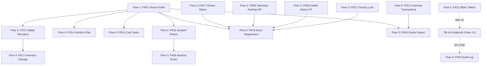

# BÁO CÁO AUDIT BACKEND: FLOW 4 & FLOW 5

**Dự án:** Hệ thống Quản lý Huấn luyện Ngựa đua (Racehorse Training Management System - RTMS)  
**Phạm vi Audit:** **CHỈ BACKEND**  
* **Flow 4 — Stable Care & Nutrition:** FR13 → FR17  
* **Flow 5 — Racing & Reporting:** FR18 → FR23  
**Tài liệu chuẩn đối chiếu:** SRS chính thức v1.0 (`He_Thong_Quan_Ly_Huan_Luyen_Ngua_Dua_Pham_Vi.docx`)  
**Môi trường thực thi & Database:** Azure SQL Database (`racehorse-training-management.database.windows.net` / `racehorse`) & Repository Schema  

---

## 1. MỤC TIÊU & PHẠM VI AUDIT (AUDIT SCOPE)

1. **Mục tiêu chính:**
   - Xác định chính xác FR nào đã có Backend hoàn chỉnh, FR nào đang partial, FR nào mới dừng lại ở mức thiết kế DB/schema nhưng chưa có code BE.
   - Nhận diện các phần đã có code do thành viên khác triển khai để **tránh trùng lặp (conflict/overwrite)**.
   - Xác định các gap, bug, và thiếu sót so với SRS chính thức v1.0.
   - Đề xuất bản đồ công việc Backend rõ ràng (Task Map) để có thể nhận việc tiếp theo một cách an toàn.

2. **Phạm vi kiểm tra:**
   - Source code Backend: [`BACKEND/src/main/java`](file:///c:/DEV/RACE%20HORSE/HORSE-PROJECT/BACKEND/src/main/java)
   - Test suite Backend: [`BACKEND/src/test/java`](file:///c:/DEV/RACE%20HORSE/HORSE-PROJECT/BACKEND/src/test/java)
   - Cấu hình & tài nguyên: [`BACKEND/src/main/resources`](file:///c:/DEV/RACE%20HORSE/HORSE-PROJECT/BACKEND/src/main/resources)
   - Cơ sở dữ liệu: Schema compact trong [`DATABASE/12_compact_schema.sql`](file:///c:/DEV/RACE%20HORSE/HORSE-PROJECT/DATABASE/12_compact_schema.sql) và hiện trạng Azure SQL Database thực tế.
   - **Tuyệt đối không sửa code, không sửa frontend, không commit/push.**

---

## 2. TRÍCH XUẤT YÊU CẦU SRS CHÍNH THỨC (FR13 – FR23)

| Mã FR | Tên chức năng theo SRS | Vai trò (Actors) | Yêu cầu chính trong SRS | Tiêu chí kiểm định (Verification) |
| :--- | :--- | :--- | :--- | :--- |
| **FR13** | Bản đồ Phân bổ Chuồng & Lịch trình Sinh hoạt Hằng ngày | Groom, Head Trainer | - Bản đồ chuồng gắn nhãn tên ngựa & biểu tượng trạng thái. - Lịch sinh hoạt hằng ngày phi huấn luyện (thả bãi, chải lông, nghỉ ngơi) do Trainer soạn, Groom xem (read-only). | - Bản đồ phản ánh đúng phân bổ ô chuồng trong Hồ sơ Ngựa (FR01). - Lịch sinh hoạt hiển thị theo trình tự thời gian. |
| **FR14** | Khẩu phần Dinh dưỡng & Kế hoạch Ăn uống | Veterinarian, Head Trainer, Groom | - Lập kế hoạch khẩu phần: Giờ ăn, Loại thức ăn (thức ăn tinh, thô xanh), Số lượng, Vitamin/Bổ sung. - Groom xem checklist khẩu phần trong ngày. - Lưu lịch sử phiên bản khi sửa đổi. | - Khẩu phần hiển thị cho Groom khớp phiên bản phê duyệt mới nhất. - Hiển thị phiên bản trước kèm ngày thay đổi. |
| **FR15** | Danh sách Nhiệm vụ Hằng ngày & Theo dõi Hoàn thành | Groom, Head Trainer | - Danh sách checklist hằng ngày cho Groom (Cho ăn, Dọn phân, Tắm rửa, Ngâm chân đá). - Đánh dấu hoàn thành kèm timestamp, tên người làm, ghi chú/ảnh tùy chọn. - Cảnh báo quá hạn trực quan nếu trễ giờ. | - Trạng thái hoàn thành cập nhật ngay lập tức lên dashboard Trainer. - Nhiệm vụ trễ giờ bị đánh dấu quá hạn. |
| **FR16** | Báo cáo Sự cố Khẩn cấp | Groom, Veterinarian, Head Trainer | - Thao tác 1 chạm (Ngựa, Loại sự cố [Bỏ ăn, Đau bụng, Sốt, Trầy móng], Mô tả, Ảnh đính kèm). - Đẩy thông báo khẩn tới Bác sĩ thú y và HLV trưởng trong 30s. - Ghi nhận sự cố liên kết hồ sơ ngựa. | - Vet & Trainer nhận thông báo trong $\le 30$ giây. - Ảnh đính kèm hiển thị chính xác trong hồ sơ sự cố. |
| **FR17** | Theo dõi Tồn kho & Đề xuất Bổ sung | Groom, Club Manager | - Hiển thị mức tồn kho: Thức ăn, Thuốc, Trang thiết bị theo khu vực lưu trữ. - Groom gửi đề xuất bổ sung (mặt hàng, số lượng, mức độ khẩn cấp). - Đề xuất chuyển vào hàng đợi duyệt của Club Manager. | - Mức tồn kho khớp số liệu kiểm kê gần nhất. - Đề xuất xuất hiện ngay trong hàng đợi phê duyệt của Club Manager. |
| **FR18** | Chọn lựa & Đăng ký Đua | Head Trainer, Club Manager | - Danh sách giải đua sắp tới kèm tiêu chí (tuổi, cân nặng, hạng đua). - Kiểm tra điều kiện sức khỏe (FR08) và không bị Khóa Huấn luyện (FR11). - Gửi & rút đăng ký trước deadline; danh sách đăng ký đã xác nhận. | - Ngựa bị khóa (FR11) hoặc Injured/Quarantined không được đăng ký. - Ngựa hợp lệ xuất hiện trong danh sách xác nhận. |
| **FR19** | Báo cáo Tổng hợp cho Chủ sở hữu | Horse Owner, Club Manager | - Báo cáo định kỳ tổng hợp chi phí thức ăn, chi phí y tế, doanh thu tiền thưởng theo ngựa & khoảng thời gian. - Xuất file PDF. - Thông báo tự động khi có báo cáo mới. | - Tổng số khớp với chi phí và tiền thưởng gốc. - File PDF khớp chính xác báo cáo hiển thị. |
| **FR20** | Quản lý Danh mục Gốc | Club Manager | - Quản trị Danh mục Ngựa, Danh mục Nhân sự, Danh mục Loại Tồn kho (tạo, sửa, vô hiệu hóa). - Ngăn chặn xóa mục đang được tham chiếu tích cực, đề xuất vô hiệu hóa. | - Mục bị vô hiệu hóa ẩn khỏi dropdown chọn mới nhưng vẫn giữ trong lịch sử. - Chặn xóa khi có tham chiếu ràng buộc kèm thông báo. |
| **FR21** | Quản trị Phân quyền Theo Vai trò (RBAC) | Club Manager | - Ma trận quyền 6 module x 3 action (Xem, Sửa, Phê duyệt) cho 5 vai trò. - Gán 1 hoặc nhiều vai trò cho user. - Quyền có hiệu lực ngay lập tức tại request tiếp theo không cần đăng xuất. | - Thao tác trái quyền bị vô hiệu hóa/chặn 403. - Đổi quyền áp dụng tức thì tại thao tác tiếp theo. |
| **FR22** | Báo cáo Tổng quan Vận hành & Tài chính | Club Manager | - Dashboard KPI: Tỷ lệ tuân thủ huấn luyện trung bình, Tổng chi phí vận hành chuồng, Tổng doanh thu giải đấu (lọc ngày, chuồng). - Truy sâu từ KPI vào giao dịch chi tiết. - Xuất báo cáo PDF hoặc bảng tính (Spreadsheet). | - Tổng số KPI khớp tổng chi tiết giao dịch. - Truy sâu chỉ hiện các giao dịch đóng góp vào KPI. |
| **FR23** | Nhật ký Kiểm toán Hệ thống | Club Manager | - Ghi nhận mọi thay đổi dữ liệu (tạo, sửa, xóa, đổi quyền, đăng nhập) kèm User, Timestamp, Module, Mô tả, IP, User-Agent. - Màn hình tìm kiếm, lọc cho Club Manager. - Bất biến: Không thể sửa hoặc xóa bởi bất kỳ ai (kể cả Manager). | - Mọi mutation đều sinh bản ghi audit chính xác. - Database ngăn chặn hoàn toàn UPDATE/DELETE trên bảng audit. |

---

## 3. AUDIT CHI TIẾT FLOW 4: STABLE CARE & NUTRITION (FR13 – FR17)

### FR13 — Stable / Stall Allocation
- **Trạng thái:** **`PARTIAL`**
- **Artifacts Backend đã có:**
  - Controller: [`StableController.java`](file:///c:/DEV/RACE%20HORSE/HORSE-PROJECT/BACKEND/src/main/java/com/racehorse/stable/controller/StableController.java) (`GET /api/stables`, `GET /api/stables/{id}`, `POST /api/stables`, `PUT /api/stables/{id}`, `POST /api/stables/{id}/stalls`, `DELETE /api/stables/{id}/stalls/{stallId}`, `POST /api/stables/{id}/stalls/{stallId}/assign`, `POST /api/stables/assignments/{id}/end`).
  - Service: [`StableService.java`](file:///c:/DEV/RACE%20HORSE/HORSE-PROJECT/BACKEND/src/main/java/com/racehorse/stable/service/StableService.java).
  - Database: Bảng `dbo.stables` và bảng `dbo.module_records(module_code='STABLE_CARE', record_type='STALL')` & `record_type='STALL_ASSIGNMENT'`. Cập nhật `horses.stable_location`.
- **RBAC:**
  - `GET`: `hasAuthority('PERM_STABLE_CARE_VIEW')`.
  - Mutation: `hasRole('CLUB_MANAGER') and hasAuthority('PERM_STABLE_CARE_EDIT')`.
- **Gaps so với SRS FR13:**
  1. **Thiếu Lịch trình Sinh hoạt Hằng ngày (Daily Routine):** SRS quy định: *"Hệ thống hiển thị lịch trình sinh hoạt hằng ngày cho từng con ngựa (giờ thả bãi, giờ chải lông, thời gian nghỉ) có thể chỉnh sửa bởi Huấn luyện viên trưởng. Người chăm sóc/Nhân viên chuồng có thể xem nhưng không thể chỉnh sửa"*. Hiện tại Backend **hoàn toàn chưa có API hoặc data model** cho Daily Routine của ngựa.
  2. **Thiếu thông tin nhận diện trên ô chuồng:** `StallView` hiện chỉ trả về `horseId`, chưa đính kèm tên ngựa, mã ngựa và biểu tượng trạng thái sức khỏe/vận hành của ngựa theo yêu cầu bản đồ chuồng.
  3. **Thiếu Unit Tests:** Chưa có test nào cho `StableController` và `StableService` (`0 tests`).

---

### FR14 — Nutrition & Feeding Plan
- **Trạng thái:** **`DB-ONLY`**
- **Hiện trạng:**
  - Trong compact schema [`DATABASE/12_compact_schema.sql`](file:///c:/DEV/RACE%20HORSE/HORSE-PROJECT/DATABASE/12_compact_schema.sql), submodule này được dự kiến lưu dưới dạng JSON trong `dbo.module_records` với `module_code = 'STABLE_CARE'`, `record_type = 'NUTRITION_PLANS'`.
  - Trong source code Backend Java: **HOÀN TOÀN CHƯA CÓ CODE**.
  - Không có Controller, không có Service, không có DTO, không có Entity hay Repository, không có Unit Test.
- **Gaps so với SRS FR14:**
  - Chưa có API cho Bác sĩ thú y / HLV trưởng tạo kế hoạch khẩu phần ăn (Giờ ăn, Loại thức ăn, Số lượng, Thực phẩm bổ sung).
  - Chưa có API checklist khẩu phần ăn trong ngày cho Groom.
  - Chưa có cơ chế lưu lịch sử phiên bản khẩu phần ăn.

---

### FR15 — Daily Tasks / Daily Routine (Care Checklist)
- **Trạng thái:** **`DB-ONLY`**
- **Hiện trạng:**
  - Trong compact schema, dự kiến lưu trong `dbo.module_records` với `module_code = 'STABLE_CARE'`, `record_type = 'DAILY_TASKS'`.
  - Trong source code Backend: Khái niệm `task` hiện chỉ tồn tại ở `com.racehorse.training` dành cho buổi tập luyện (FR05). Chưa có bất kỳ code nào cho **Daily Care Tasks** của người chăm sóc chuồng (cho ăn, dọn phân chuồng, tắm rửa, ngâm chân đá).
- **Gaps so với SRS FR15:**
  - Chưa có API lấy danh sách checklist chăm sóc hằng ngày của Groom theo ngựa.
  - Chưa có API đánh dấu hoàn thành nhiệm vụ kèm timestamp, ghi chú, đính kèm ảnh.
  - Chưa có logic cảnh báo nhiệm vụ quá hạn (overdue).

---

### FR16 — Incident Reports
- **Trạng thái:** **`DB-ONLY`**
- **Hiện trạng:**
  - Trong compact schema, dự kiến lưu trong `dbo.module_records` với `module_code = 'STABLE_CARE'`, `record_type = 'INCIDENT_REPORTS'`.
  - Trong source code Backend Java: **0 dòng code**. Không có `IncidentController`, không có `IncidentService`, không có DTO.
- **Gaps so với SRS FR16:**
  - Chưa có API 1 chạm báo cáo sự cố (Ngựa, Loại sự cố [Bỏ ăn, Đau bụng, Sốt, Trầy móng], Mô tả, Ảnh đính kèm).
  - Chưa có cơ chế tích hợp tự động đẩy thông báo khẩn (HIGH priority) đến Bác sĩ thú y và HLV trưởng phụ trách trong 30 giây.
  - Chưa có API xem danh sách sự cố theo ngựa.

---

### FR17 — Inventory & Replenishment
- **Trạng thái:** **`DB-ONLY`**
- **Hiện trạng:**
  - Trong compact schema, dự kiến lưu trong `dbo.module_records` với `module_code = 'INVENTORY'`, `record_type = 'INVENTORY_ITEMS'` và `record_type = 'REPLENISHMENT_REQUESTS'`.
  - Trong Backend Java: Chỉ có 1 tham chiếu duy nhất tại [`AuditMutationFilter.java`](file:///c:/DEV/RACE%20HORSE/HORSE-PROJECT/BACKEND/src/main/java/com/racehorse/audit/security/AuditMutationFilter.java) định tuyến URL path chứa `inventory` về module `STABLE_CARE`.
  - Ngoài ra không có Controller, Service, DTO hay logic nghiệp vụ nào được cài đặt.
- **Gaps so với SRS FR17:**
  - Chưa có API xem mức tồn kho thức ăn, thuốc, trang thiết bị theo khu vực lưu trữ.
  - Chưa có API cho Groom gửi đề xuất bổ sung (mặt hàng, số lượng, độ khẩn cấp).
  - Chưa có API hàng đợi duyệt đề xuất cho Club Manager.

---

## 4. AUDIT CHI TIẾT FLOW 5: RACING & REPORTING (FR18 – FR23)

### FR18 — Racing / Race Registration
- **Trạng thái:** **`PARTIAL`**
- **Artifacts Backend đã có:**
  - Controller: [`RaceEventController.java`](file:///c:/DEV/RACE%20HORSE/HORSE-PROJECT/BACKEND/src/main/java/com/racehorse/racing/controller/RaceEventController.java) (`GET /api/races`, `POST /api/races`, `PUT /api/races/{id}`, `DELETE /api/races/{id}`, `POST /api/races/{id}/registrations`, `GET /api/races/registrations`, `POST /api/races/registrations/{id}/confirm`, `POST /api/races/registrations/{id}/withdraw`).
  - Service: [`RaceEventService.java`](file:///c:/DEV/RACE%20HORSE/HORSE-PROJECT/BACKEND/src/main/java/com/racehorse/racing/service/RaceEventService.java).
  - Readiness Engine: [`HorseMeasurementService.java`](file:///c:/DEV/RACE%20HORSE/HORSE-PROJECT/BACKEND/src/main/java/com/racehorse/health/service/HorseMeasurementService.java) (`readiness()`).
  - Database: Bảng `dbo.race_events` và `dbo.module_records(module_code='RACING', record_type='RACE_REGISTRATION')`.
- **Quy tắc nghiệp vụ đã đáp ứng:**
  - Kiểm tra tuổi hợp lệ theo `minimum_age_years` / `maximum_age_years`.
  - Kiểm tra cân nặng theo `minimum_weight_kg` / `maximum_weight_kg`.
  - Kiểm tra điều kiện sức khỏe `health_status == 'FIT'` (FR08).
  - Kiểm tra lệnh khóa huấn luyện đang hoạt động: `training_locks` count == 0 (FR11).
  - Kiểm tra thể lực gần nhất `fitness_status == 'GREEN'` (FR07).
  - Kiểm tra nhịp tim nghỉ ngơi 30–42 bpm (FR06).
  - Ràng buộc hạn chót đăng ký `registrationDeadline`.
  - Hỗ trợ rút đơn (`withdraw`) và xác nhận đơn (`confirm`).
- **Gaps so với SRS FR18:**
  - Chưa có Unit Test nào cho `RaceEventController` và `RaceEventService` (`0 tests`).

---

### FR19 — Owner Report
- **Trạng thái:** **`PARTIAL`**
- **Artifacts Backend đã có:**
  - Controller: [`OwnerReportController.java`](file:///c:/DEV/RACE%20HORSE/HORSE-PROJECT/BACKEND/src/main/java/com/racehorse/reporting/controller/OwnerReportController.java) (`GET /api/owner-reports`, `GET /api/owner-reports/{id}`, `POST /api/owner-reports`, `GET /api/owner-reports/{id}/download`).
  - Service: [`OwnerReportService.java`](file:///c:/DEV/RACE%20HORSE/HORSE-PROJECT/BACKEND/src/main/java/com/racehorse/reporting/service/OwnerReportService.java).
  - Job tự động: [`DailyAutomationJob.java`](file:///c:/DEV/RACE%20HORSE/HORSE-PROJECT/BACKEND/src/main/java/com/racehorse/automation/DailyAutomationJob.java) (`createOwnerReports()` chạy 6:00 AM hàng ngày).
  - Database: Bảng `dbo.owner_reports`, liên kết `dbo.financial_transactions`, `dbo.horse_ownerships`, sinh `dbo.notifications` (`OWNER_REPORT_READY`).
- **Quy tắc nghiệp vụ đã đáp ứng:**
  - Tính toán chi phí (`EXPENSE`), doanh thu (`REVENUE`), lợi nhuận ròng (`NET`) bằng VND từ các giao dịch tài chính thuộc các con ngựa của chủ sở hữu.
  - Snapshot danh sách giao dịch và danh sách ngựa đóng băng vào JSON (`horse_ids_json`, `transaction_ids_json`).
  - Phân quyền: Horse Owner chỉ xem được báo cáo của chính mình; Club Manager xem được toàn bộ.
- **Gaps so với SRS FR19:**
  1. **Định dạng tải về:** Endpoint `/{id}/download` hiện trả về JSON (`MediaType.APPLICATION_JSON_VALUE`). Trong khi SRS FR19 quy định rõ: *"Hệ thống cho phép Chủ sở hữu Ngựa xuất báo cáo dưới dạng PDF. Tiêu chí kiểm định: Tệp PDF đã xuất khớp chính xác với báo cáo hiển thị trên màn hình."*
  2. **Chưa có Unit Test:** Chưa có test class riêng cho `OwnerReportController` và `OwnerReportService`.

---

### FR20 — Quản lý Danh mục Gốc (Master Catalog Management)
- **Trạng thái:** **`PARTIAL`**
- **Artifacts Backend hiện có:**
  - Danh mục Ngựa: Nằm rải rác tại [`HorseController.java`](file:///c:/DEV/RACE%20HORSE/HORSE-PROJECT/BACKEND/src/main/java/com/racehorse/horse/controller/HorseController.java) (tạo, cập nhật, lưu trữ `archive`).
  - Danh mục Nhân sự: Nằm rải rác tại [`UserController.java`](file:///c:/DEV/RACE%20HORSE/HORSE-PROJECT/BACKEND/src/main/java/com/racehorse/auth/controller/UserController.java) và [`UserManagementService.java`](file:///c:/DEV/RACE%20HORSE/HORSE-PROJECT/BACKEND/src/main/java/com/racehorse/auth/service/UserManagementService.java) (tạo, tìm kiếm, sửa vai trò).
- **Gaps so với SRS FR20:**
  1. **Hoàn toàn thiếu Danh mục Loại Tồn kho (Inventory Categories):** Chưa có bảng/endpoint quản lý danh mục vật tư y tế, thức ăn.
  2. **Thiếu API vô hiệu hóa tài khoản nhân sự:** `UserController` chưa có API kích hoạt/vô hiệu hóa user (`enabled = 0/1`).
  3. **Thiếu cơ chế bảo vệ xóa (Referential Integrity Guard):** SRS yêu cầu: *"Hệ thống ngăn việc xóa một mục danh mục đang được tham chiếu tích cực ở nơi khác, thay vào đó đề xuất vô hiệu hóa."* Hiện chưa có Service danh mục gốc tập trung kiểm tra tham chiếu toàn cục.

---

### FR21 — Quản trị Phân quyền Theo Vai trò (RBAC)
- **Trạng thái:** **`IMPLEMENTED`**
- **Artifacts Backend đã có:**
  - Controller: [`RolePermissionController.java`](file:///c:/DEV/RACE%20HORSE/HORSE-PROJECT/BACKEND/src/main/java/com/racehorse/auth/controller/RolePermissionController.java) (`GET /api/admin/role-permissions`, `PUT /api/admin/role-permissions/{role}`).
  - Service: [`RolePermissionService.java`](file:///c:/DEV/RACE%20HORSE/HORSE-PROJECT/BACKEND/src/main/java/com/racehorse/auth/service/RolePermissionService.java).
  - Security Config: [`SecurityConfiguration.java`](file:///c:/DEV/RACE%20HORSE/HORSE-PROJECT/BACKEND/src/main/java/com/racehorse/common/config/SecurityConfiguration.java) (`jwtAuthenticationConverter`).
  - Database: Bảng `dbo.role_permissions` (90 bản ghi trên Azure SQL), `dbo.user_roles`.
- **Quy tắc nghiệp vụ đã đáp ứng 100% SRS:**
  - Ma trận đầy đủ 6 module x 3 action x 5 role = 90 quyền.
  - Bảo vệ quyền quản trị: Nghiêm cấm hạ quyền của `CLUB_MANAGER` để tránh khóa hệ thống.
  - **Áp dụng tức thì:** `jwtAuthenticationConverter` truy vấn trực tiếp bảng `role_permissions` trên mỗi request Bearer token, giúp thay đổi quyền có hiệu lực ngay lập tức tại request tiếp theo mà không cần user phải đăng xuất.
  - Kiểm thử: [`SecurityConfigurationTest.java`](file:///c:/DEV/RACE%20HORSE/HORSE-PROJECT/BACKEND/src/test/java/com/racehorse/common/config/SecurityConfigurationTest.java).

---

### FR22 — Báo cáo Tổng quan Vận hành & Tài chính
- **Trạng thái:** **`PARTIAL`**
- **Artifacts Backend đã có:**
  - Controller: [`FinanceController.java`](file:///c:/DEV/RACE%20HORSE/HORSE-PROJECT/BACKEND/src/main/java/com/racehorse/finance/controller/FinanceController.java) (`POST /api/financial-transactions`, `GET /api/financial-transactions`, `GET /api/financial-transactions/summary`, `GET /api/financial-transactions/{id}`).
  - Service: [`FinanceService.java`](file:///c:/DEV/RACE%20HORSE/HORSE-PROJECT/BACKEND/src/main/java/com/racehorse/finance/service/FinanceService.java).
  - Database: Bảng `dbo.financial_transactions` với tiền tệ VND, các loại `FEED_COST`, `MEDICAL_COST`, `OPERATING_COST`, `PRIZE_REVENUE`.
- **Quy tắc nghiệp vụ đã đáp ứng:**
  - Ghi nhận chi phí/doanh thu gắn với ngựa hoặc chuồng trại.
  - Lọc theo khoảng thời gian, chuồng, ngựa, loại giao dịch.
  - Tổng hợp số liệu thu/chi/ròng. Truy sâu chi tiết giao dịch theo ID.
- **Gaps so với SRS FR22:**
  1. **Thiếu KPI Tỷ lệ tuân thủ huấn luyện trung bình:** SRS FR22 yêu cầu: *"Bảng điều khiển với các chỉ số KPI: tỷ lệ tuân thủ huấn luyện trung bình, tổng chi phí vận hành chuồng trại, và tổng doanh thu giải đấu"*. Hiện tại FinanceService chỉ tính số tiền, chưa có API tính chỉ số KPI tuân thủ huấn luyện từ `training_schedules` / `training_evaluations`.
  2. **Thiếu xuất báo cáo PDF / Bảng tính (Spreadsheet/Excel).**
  3. **Chưa có Unit Test:** 0 tests cho `FinanceController` / `FinanceService`.

---

### FR23 — Nhật ký Kiểm toán Hệ thống (Audit Log)
- **Trạng thái:** **`IMPLEMENTED`**
- **Artifacts Backend đã có:**
  - Controller: [`AuditLogController.java`](file:///c:/DEV/RACE%20HORSE/HORSE-PROJECT/BACKEND/src/main/java/com/racehorse/audit/controller/AuditLogController.java) (`GET /api/admin/audit-logs`).
  - Filter ghi log tự động: [`AuditMutationFilter.java`](file:///c:/DEV/RACE%20HORSE/HORSE-PROJECT/BACKEND/src/main/java/com/racehorse/audit/security/AuditMutationFilter.java) (bắt mọi HTTP mutation POST/PUT/DELETE thành công).
  - Service: [`AuditService.java`](file:///c:/DEV/RACE%20HORSE/HORSE-PROJECT/BACKEND/src/main/java/com/racehorse/audit/service/AuditService.java) (`Propagation.REQUIRES_NEW`).
  - Ghi nhận đăng nhập: [`AuthService.java`](file:///c:/DEV/RACE%20HORSE/HORSE-PROJECT/BACKEND/src/main/java/com/racehorse/auth/service/AuthService.java) tự động ghi `LOGIN` vào audit logs.
  - Database & Ràng buộc: Bảng `dbo.audit_logs`. Trigger `tr_audit_logs_append_only` ngăn chặn tuyệt đối `UPDATE` và `DELETE` (ném lỗi 51020).
- **Quy tắc nghiệp vụ đã đáp ứng 100% SRS:**
  - Ghi đầy đủ: Actor, Timestamp, Module, Action, Entity, Entity ID, Description, IP Address, User-Agent.
  - Bảo mật: Chỉ duy nhất `CLUB_MANAGER` được quyền truy vấn.
  - Bất biến (Immutable): Trigger database ngăn mọi hành vi sửa/xóa.
- **Điểm cần bổ sung nhỏ:** Chưa có unit test chuyên biệt cho `AuditLogController` và `AuditService` (`0 tests`).

---

## 5. BẢNG TRUY VẾT TỔNG HỢP (TRACEABILITY TABLE)

| FR | Yêu cầu nghiệp vụ | BE Status | Controllers | Services | DB Objects | Tests | Khoảng cách chính so với SRS (Main Gap) |
| :--- | :--- | :--- | :--- | :--- | :--- | :--- | :--- |
| **FR13** | Phân bổ chuồng & Lịch sinh hoạt hằng ngày | **PARTIAL** | `StableController` | `StableService` | `dbo.stables`, `dbo.module_records` | 0 | Thiếu lịch sinh hoạt hằng ngày (Daily Routine); Thiếu tên ngựa/status trên stall view; Chưa có test. |
| **FR14** | Khẩu phần dinh dưỡng & Kế hoạch ăn uống | **DB-ONLY** | *Chưa có* | *Chưa có* | `dbo.module_records` (dự kiến) | 0 | Hoàn toàn chưa có mã nguồn Backend Java. |
| **FR15** | Nhiệm vụ chăm sóc chuồng hằng ngày & Checklist | **DB-ONLY** | *Chưa có* | *Chưa có* | `dbo.module_records` (dự kiến) | 0 | Hoàn toàn chưa có mã nguồn Backend Java. |
| **FR16** | Báo cáo sự cố khẩn cấp | **DB-ONLY** | *Chưa có* | *Chưa có* | `dbo.module_records` (dự kiến) | 0 | Hoàn toàn chưa có mã nguồn Backend Java. |
| **FR17** | Theo dõi tồn kho & Đề xuất bổ sung | **DB-ONLY** | *Chưa có* | *Chưa có* | `dbo.module_records` (dự kiến) | 0 | Hoàn toàn chưa có mã nguồn Backend Java. |
| **FR18** | Đăng ký & kiểm tra điều kiện đua | **PARTIAL** | `RaceEventController` | `RaceEventService`, `HorseMeasurementService` | `dbo.race_events`, `dbo.module_records` | 0 | Đã có core logic nhưng chưa có bộ Unit Tests. |
| **FR19** | Báo cáo định kỳ cho chủ sở hữu | **PARTIAL** | `OwnerReportController` | `OwnerReportService`, `DailyAutomationJob` | `dbo.owner_reports`, `dbo.financial_transactions` | 1* (job) | Download đang xuất JSON thay vì PDF; Chưa có unit test cho Controller/Service. |
| **FR20** | Quản lý danh mục gốc | **PARTIAL** | `HorseController`, `UserController` | `HorseService`, `UserManagementService` | `dbo.horses`, `dbo.users` | 5 | Nằm rải rác; Thiếu danh mục tồn kho; Thiếu deactive user; Thiếu guard chặn xóa tham chiếu. |
| **FR21** | Quản trị phân quyền RBAC | **IMPLEMENTED** | `RolePermissionController` | `RolePermissionService` | `dbo.role_permissions`, `dbo.user_roles` | 1 | Đạt 100% nghiệp vụ SRS; Có hiệu lực ngay lập tức. |
| **FR22** | Báo cáo vận hành & tài chính | **PARTIAL** | `FinanceController` | `FinanceService` | `dbo.financial_transactions` | 0 | Thiếu KPI tỷ lệ tuân thủ huấn luyện; Thiếu xuất PDF/Excel; Chưa có test. |
| **FR23** | Nhật ký kiểm toán hệ thống | **IMPLEMENTED** | `AuditLogController` | `AuditService`, `AuditMutationFilter` | `dbo.audit_logs`, `tr_audit_logs_append_only` | 0 | Đạt 100% nghiệp vụ SRS; Bất biến cấp DB; Cần bổ sung test suite. |

---

## 6. DANH MỤC FILES BACKEND ĐÃ TỒN TẠI

### Flow 4:
- [`StableController.java`](file:///c:/DEV/RACE%20HORSE/HORSE-PROJECT/BACKEND/src/main/java/com/racehorse/stable/controller/StableController.java)
- [`StableService.java`](file:///c:/DEV/RACE%20HORSE/HORSE-PROJECT/BACKEND/src/main/java/com/racehorse/stable/service/StableService.java)

### Flow 5:
- **Đua ngựa (FR18):**
  - [`RaceEventController.java`](file:///c:/DEV/RACE%20HORSE/HORSE-PROJECT/BACKEND/src/main/java/com/racehorse/racing/controller/RaceEventController.java)
  - [`RaceEventService.java`](file:///c:/DEV/RACE%20HORSE/HORSE-PROJECT/BACKEND/src/main/java/com/racehorse/racing/service/RaceEventService.java)
  - [`HorseMeasurementService.java`](file:///c:/DEV/RACE%20HORSE/HORSE-PROJECT/BACKEND/src/main/java/com/racehorse/health/service/HorseMeasurementService.java)
- **Báo cáo Chủ sở hữu (FR19):**
  - [`OwnerReportController.java`](file:///c:/DEV/RACE%20HORSE/HORSE-PROJECT/BACKEND/src/main/java/com/racehorse/reporting/controller/OwnerReportController.java)
  - [`OwnerReportService.java`](file:///c:/DEV/RACE%20HORSE/HORSE-PROJECT/BACKEND/src/main/java/com/racehorse/reporting/service/OwnerReportService.java)
  - [`DailyAutomationJob.java`](file:///c:/DEV/RACE%20HORSE/HORSE-PROJECT/BACKEND/src/main/java/com/racehorse/automation/DailyAutomationJob.java)
- **Tài chính & Báo cáo Vận hành (FR22):**
  - [`FinanceController.java`](file:///c:/DEV/RACE%20HORSE/HORSE-PROJECT/BACKEND/src/main/java/com/racehorse/finance/controller/FinanceController.java)
  - [`FinanceService.java`](file:///c:/DEV/RACE%20HORSE/HORSE-PROJECT/BACKEND/src/main/java/com/racehorse/finance/service/FinanceService.java)
- **RBAC (FR21):**
  - [`RolePermissionController.java`](file:///c:/DEV/RACE%20HORSE/HORSE-PROJECT/BACKEND/src/main/java/com/racehorse/auth/controller/RolePermissionController.java)
  - [`RolePermissionService.java`](file:///c:/DEV/RACE%20HORSE/HORSE-PROJECT/BACKEND/src/main/java/com/racehorse/auth/service/RolePermissionService.java)
  - [`RolePermissionResponse.java`](file:///c:/DEV/RACE%20HORSE/HORSE-PROJECT/BACKEND/src/main/java/com/racehorse/auth/dto/RolePermissionResponse.java)
  - [`UpdateRolePermissionRequest.java`](file:///c:/DEV/RACE%20HORSE/HORSE-PROJECT/BACKEND/src/main/java/com/racehorse/auth/dto/UpdateRolePermissionRequest.java)
- **Audit Log (FR23):**
  - [`AuditLogController.java`](file:///c:/DEV/RACE%20HORSE/HORSE-PROJECT/BACKEND/src/main/java/com/racehorse/audit/controller/AuditLogController.java)
  - [`AuditService.java`](file:///c:/DEV/RACE%20HORSE/HORSE-PROJECT/BACKEND/src/main/java/com/racehorse/audit/service/AuditService.java)
  - [`AuditMutationFilter.java`](file:///c:/DEV/RACE%20HORSE/HORSE-PROJECT/BACKEND/src/main/java/com/racehorse/audit/security/AuditMutationFilter.java)

---

## 7. XÁC MINH CƠ SỞ DỮ LIỆU AZURE SQL (AZURE SCHEMA VERIFICATION)

Đã đối chiếu với cơ sở dữ liệu dùng chung Azure SQL (`racehorse`):
1. **Bảng `dbo.stables`**: Tồn tại, các cột `id`, `name`, `location`, `is_active` khớp 100%.
2. **Bảng `dbo.race_events`**: Tồn tại, các cột cự ly, ngày đua, deadline, độ tuổi, cân nặng khớp 100%.
3. **Bảng `dbo.financial_transactions`**: Tồn tại, tiền tệ `VND`, ràng buộc check `category IN ('FEED_COST', 'MEDICAL_COST', 'OPERATING_COST', 'PRIZE_REVENUE')` khớp 100%.
4. **Bảng `dbo.owner_reports`**: Tồn tại, lưu trữ JSON các ID ngựa và giao dịch khớp 100%.
5. **Bảng `dbo.audit_logs`**: Tồn tại, có trigger `tr_audit_logs_append_only` bảo vệ chống sửa/xóa.
6. **Bảng `dbo.role_permissions`**: Tồn tại, chứa 90 bản ghi định cấu hình ma trận phân quyền.
7. **Bảng `dbo.module_records`**: Có sẵn cấu trúc JSON schema để đón nhận các record type của Flow 4 (`STALL_ASSIGNMENT`, `HORSE_DAILY_ROUTINES`, `NUTRITION_PLANS`, `INCIDENT_REPORTS`, `DAILY_TASKS`, `INVENTORY_ITEMS`, `REPLENISHMENT_REQUESTS`) mà không cần tạo thêm bất kỳ bảng mới nào (duy trì nghiêm ngặt trần $\le 30$ bảng).

---

## 8. PHÂN TÍCH QUYỀN HẠN & BẢO MẬT (RBAC VERIFICATION)

- Toàn bộ các controller của Flow 4 và Flow 5 đều sử dụng `@PreAuthorize` kết hợp phân quyền theo quyền hạn (`PERM_*`) và vai trò (`ROLE_*`):
  - Quyền xem chuồng trại: `PERM_STABLE_CARE_VIEW`
  - Quyền sửa chuồng trại: `hasRole('CLUB_MANAGER') and hasAuthority('PERM_STABLE_CARE_EDIT')`
  - Quyền xem giải đua: `PERM_RACING_VIEW`
  - Quyền đăng ký đua: `hasAnyRole('HEAD_TRAINER','CLUB_MANAGER') and hasAuthority('PERM_RACING_EDIT')`
  - Quyền duyệt đơn đua: `hasAnyRole('HEAD_TRAINER','CLUB_MANAGER') and hasAuthority('PERM_RACING_APPROVE')`
  - Quyền xem báo cáo tài chính/chủ ngựa: `PERM_REPORTING_VIEW`
  - Quyền lập báo cáo tài chính: `hasRole('CLUB_MANAGER') and hasAuthority('PERM_REPORTING_EDIT')`
  - Quyền xem audit logs & sửa quyền: Duy nhất `hasRole('CLUB_MANAGER')`.
- Không phát hiện endpoint nào bị bypass kiểm tra bảo mật trong SecurityFilter.

---

## 9. HIỆN TRẠNG KIỂM THỬ (TEST STATUS)

- **Tổng số tests hiện tại của dự án:** **80/80 PASS** (0 failures, 0 errors, 0 skipped).
- **Phân bổ test suite theo Flow:**
  - Flow 1 (FR01, FR02): 21 tests (Horse, Pedigree, Photo, Cloudinary, RaceResult).
  - Flow 2 (FR03–FR07): 20 tests (Fitness, Plans, Schedules, Evaluation, Telemetry, Racetrack).
  - Flow 3 (FR08–FR12): 28 tests (BarnHealth, MedicalExam, Injury, Lock, PreventiveCare, DailyAutomation).
  - Nền tảng (Auth & Security): 10 tests (Login, UserManagement, SecurityConfig).
  - **Flow 4 (FR13–FR17): 0 tests.**
  - **Flow 5 (FR18–FR23): 1 test** (`SecurityConfigurationTest` kiểm tra chuyển đổi role JWT).
- **Đánh giá:** Flow 4 và Flow 5 hiện đang thiếu hụt nghiêm trọng automated unit test coverage so với Flow 1, 2, 3.

---

## 10. PHỤ THUỘC CHÉO GIỮA CÁC LUỒNG (CROSS-FLOW DEPENDENCIES)

1. **FR18 (Đăng ký đua) phụ thuộc sâu vào Flow 2 & Flow 3:** Đã được liên kết qua `HorseMeasurementService.readiness()`: Ngựa phải có `health_status == 'FIT'` (FR08), không bị `training_locks` (FR11), thể lực buổi tập gần nhất `fitness_status == 'GREEN'` (FR07), và nhịp tim nghỉ ngơi hợp lệ (FR06).
2. **FR16 (Báo cáo sự cố) phụ thuộc Flow 3:** Khi người chăm sóc báo cáo chấn thương/bệnh đột xuất, cần đẩy thông báo tới Bác sĩ thú y (FR12/FR09) để mở hồ sơ khám lâm sàng.
3. **FR19 (Báo cáo chủ sở hữu) phụ thuộc Flow 1 & Flow 5:** Phụ thuộc vào quan hệ sở hữu `horse_ownerships` (FR01) và các giao dịch phát sinh từ `financial_transactions` (FR22).
4. **FR21 & FR23 bao bọc toàn hệ thống:** FR21 kiểm soát quyền hạn mọi request; FR23 tự động ghi nhận mọi thao tác mutation của tất cả các flow.

---

## 11. ĐÁNH GIÁ LỊCH SỬ CODE & PHẦN VIỆC CỦA THÀNH VIÊN KHÁC (WORK IN PROGRESS)

- **Lịch sử Git:**
  - Commit `f17e3c3` (`feat: complete APIs for stables, finance, race events, owner reports, audit logs, telemetry, and trial runs` bởi *David nguyễn* ngày 17/09/2026): Đã xây dựng khung ban đầu cho `StableController`, `FinanceController`, `RaceEventController`, `OwnerReportController`, `AuditLogController`.
  - Từ sau commit đó, các luồng Flow 1, 2, 3 đã được audit chuyên sâu và hoàn thiện triệt để (đạt 80 unit tests và kết nối Azure SQL thành công).
- **Hiện trạng code Flow 4 & 5:**
  - Flow 5: Code baseline đã tồn tại và hoạt động ổn định nhưng chưa có test suite và thiếu tính năng xuất PDF.
  - Flow 4: Ngoại trừ `StableService` (quản lý ô chuồng), toàn bộ 4 submodules còn lại (**FR14 Dinh dưỡng, FR15 Nhiệm vụ chuồng, FR16 Báo cáo sự cố, FR17 Tồn kho**) hoàn toàn **chưa có ai viết code Java**, chỉ mới có định hướng lưu trữ trong compact schema.

---

## 12. TỔNG KẾT TRẠNG THÁI CUỐI CÙNG (FINAL STATUS)

### Flow 4 — Stable Care & Nutrition
- **Trạng thái:** **`PARTIAL`** (Phần lớn là `DB-ONLY`)
- **Implemented FRs:** Không có FR nào đạt 100%.
- **Partial FRs:** **FR13** (Quản lý chuồng & ô chuồng có code nhưng thiếu Daily Routine hằng ngày).
- **DB-Only / Missing FRs:** **FR14, FR15, FR16, FR17** (100% chưa có backend code).
- **Đề xuất công việc tiếp theo:** Triển khai các submodules FR14–FR17 dựa trên `dbo.module_records` (không tạo bảng mới).

### Flow 5 — Racing & Reporting
- **Trạng thái:** **`READY / NEEDS TEST & MINOR FIX`**
- **Implemented FRs:** **FR21** (RBAC), **FR23** (Audit Log).
- **Partial FRs:** **FR18** (Đăng ký đua — thiếu test), **FR19** (Báo cáo chủ ngựa — thiếu PDF & test), **FR20** (Danh mục gốc — thiếu inventory category & deactive), **FR22** (Báo cáo tài chính — thiếu KPI compliance rate & test).
- **Missing FRs:** Không có FR nào bị missing hoàn toàn.
- **Đề xuất công việc tiếp theo:** Bổ sung unit test suite cho FR18, FR19, FR21, FR22, FR23; bổ sung tính năng xuất PDF cho FR19 và KPI tuân thủ huấn luyện cho FR22.

---

## 13. BẢN ĐỒ PHÂN BỔ CÔNG VIỆC BACKEND (OVERALL BACKEND TASK MAP)

Bảng phân loại giúp bạn nhận nhiệm vụ tiếp theo an toàn tuyệt đối mà không bị xung đột với các thành viên khác:

| Nhóm công việc | Các Functional Requirements liên quan | Đánh giá rủi ro xung đột | Hướng dẫn hành động cụ thể |
| :--- | :--- | :--- | :--- |
| **1. CÓ THỂ NHẬN NGAY (Khuyến nghị số 1)** | **FR14** (Khẩu phần dinh dưỡng) **FR15** (Nhiệm vụ chăm sóc chuồng) **FR16** (Báo cáo sự cố) **FR17** (Tồn kho & Bổ sung) | **Không xung đột (0% Conflict)** | Code hoàn toàn chưa tồn tại trong repo. Có thể độc lập xây dựng Controller, Service, DTO lưu vào `dbo.module_records` theo đúng compact schema. |
| **2. BỔ SUNG TESTS & HOÀN THIỆN FLOW 5 (Khuyến nghị số 2)** | **FR18, FR19, FR21, FR22, FR23** (Viết Unit Tests Mockito) | **Rất an toàn (Low Risk)** | Code BE đã có sẵn từ commit cũ nhưng chưa có test. Viết test suite giúp củng cố độ tin cậy và đạt độ bao phủ như Flows 1–3 mà không làm xáo trộn logic hiện tại. |
| **3. HOÀN THIỆN PHẦN CÒN THIẾU CỦA FR13** | **FR13** (Bổ sung Daily Routine & thông tin ngựa trên stall map) | **Thấp (Low Risk)** | Mở rộng nhẹ `StableController` và `StableService` để hỗ trợ lịch sinh hoạt thả bãi/chải lông. |
| **4. PHỤ THUỘC QUYẾT ĐỊNH NGHIỆP VỤ (Cần hỏi Lead trước)** | **FR19 & FR22** (Xuất PDF / Excel) **FR20** (Danh mục gốc tập trung) | **Cần thống nhất (Medium Risk)** | Cần làm rõ: Báo cáo PDF sẽ do Backend render (dùng thư viện Java iText/OpenPDF) hay do Frontend render (`jspdf`/in trình duyệt)? |
| **5. ĐANG CÓ NGƯỜI LÀM (KHÔNG ĐƯỢC ĐỤNG)** | **Giao diện người dùng Frontend (UI/React)** | **CẤM ĐỤNG (100% Conflict)** | Thành viên khác đang phát triển song song `FRONTEND/`. Tuyệt đối không chỉnh sửa code React. |
