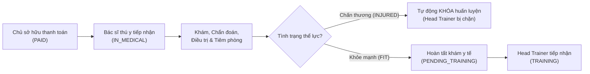

# Báo Cáo Hoàn Thành Triển Khai & Nâng Cấp Bảng Điều Khiển Bác Sĩ Thú Y (Vet Dashboard Revamp)

**Ngày hoàn tất:** 02/10/2026  
**Nhánh Git:** `bacsithuy`  
**Kế hoạch thực hiện:** [VetDashboard_Revamp_Plan.md](file:///c:/Users/admin/OneDrive/Documents/GitHub/HORSE-PROJECT/VetDashboard_Revamp_Plan.md)  
**Tài khoản kiểm thử Bác sĩ Thú y:** `bacsithuy@gmail.com` / `12345678` (Vai trò: `VETERINARIAN`)

---

## 1. Tổng Quan Kết Quả Nâng Cấp (Revamp Highlights)

Hệ thống Bảng điều khiển Bác sĩ Thú y đã được tái cấu trúc và hoàn thiện toàn diện cả ở Backend (Spring Boot / SQL Server) và Frontend (React / Vite), giải quyết triệt để 8 hạng mục yêu cầu theo kế hoạch:



---

## 2. Chi Tiết Các Hạng Mục Đã Hoàn Thành

### 2.1. Loại Bỏ Thanh Điều Hướng Thừa (Xóa `flow4-tabs` Header)
- **Hiện trạng cũ:** Thanh tab dài `flow4-tabs` nằm ngay trên đầu trang gây tràn dòng và trùng lặp với thanh điều hướng chính.
- **Giải pháp hoàn thiện:**
  - Xóa 100% thanh `flow4-tabs` trong [FRONTEND/src/VetPage.jsx](file:///c:/Users/admin/OneDrive/Documents/GitHub/HORSE-PROJECT/FRONTEND/src/VetPage.jsx).
  - Tinh gọn Sidebar tại [FRONTEND/src/App.jsx](file:///c:/Users/admin/OneDrive/Documents/GitHub/HORSE-PROJECT/FRONTEND/src/App.jsx) thành 6 mục rõ ràng:
    1. `HeartPulse` **Bảng điều khiển y tế** (`/vet`) - Thống kê + Hàng chờ tiếp nhận khám y tế.
    2. `Home` **Bản đồ chuồng & Thể trạng** (`/vet/health-map`) - Sơ đồ ô chuồng trực quan theo khu.
    3. `FileText` **Hồ sơ bệnh án & Chấn thương** (`/vet/medical-records`) - Khám bệnh, điều trị và theo dõi chấn thương tích hợp.
    4. `Calendar` **Lịch tiêm phòng & Phòng ngừa** (`/vet/preventive`) - Lên lịch tiêm/tẩy giun định kỳ.
    5. `Utensils` **Đề xuất khẩu phần ăn** (`/vet/nutrition`) - Đề xuất dinh dưỡng ngắn gọn gửi nhân viên chuồng.
    6. `Activity` **Hồ sơ ngựa** (`/horses`) - Danh mục hồ sơ ngựa toàn CLB.

---

### 2.2. Điều Kiện Chăm Sóc Y Tế: Kiểm Tra Thanh Toán & Hàng Chờ Tiếp Nhận
- **Điều kiện:** Ngựa chỉ được thực hiện dịch vụ y tế khi `paymentStatus` thuộc nhóm hợp lệ (`PAID`, `IN_MEDICAL`, `PENDING_TRAINING`, `TRAINING`) hoặc có bảo lãnh CLB (`serviceOverride = true`). Ngựa `UNPAID` bị khóa tính năng tạo phiếu khám, tiêm phòng, đề xuất dinh dưỡng kèm cảnh báo nổi bật.
- **Backend:**
  - Tích hợp package `com.racehorse.medical` với `MedicalQueueController` và `MedicalQueueService`:
    - `GET /api/medical/queue`: Hàng chờ các ngựa đã đóng phí (`PAID`) cần tiếp nhận.
    - `POST /api/medical/queue/{horseId}/receive`: Bác sĩ bấm *"Tiếp nhận khám"* -> Ngựa chuyển thành `IN_MEDICAL`.
    - `POST /api/medical/queue/{horseId}/complete`: Bác sĩ hoàn tất khám -> Ngựa chuyển thành `PENDING_TRAINING` để bàn giao cho HLV Trưởng.
    - `GET /api/medical/queue/my-assignments`: Danh sách ngựa đang phụ trách khám.
- **Frontend:**
  - Bổ sung helper `isMedicalEligible(horse)` và component hiển thị `renderPaymentBadge(horse)`.
  - Tích hợp 2 bảng trực quan vào trang Dashboard `/vet`:
    - **Hàng chờ tiếp nhận khám y tế ban đầu (PAID)** kèm nút Tiếp nhận khám.
    - **Ngựa đang phụ trách khám (IN_MEDICAL)** kèm nút Hoàn tất khám y tế.

---

### 2.3. Bản Đồ Chuồng Theo Sơ Đồ Ô Chuồng (Stables & Stalls Grid)
- Rebuild toàn bộ `BarnHealthMapView`:
  - **4 Thẻ thống kê (KPIs):** Tổng số khu chuồng, Tổng số ô chuồng, Số ô đang nuôi (kèm tỷ lệ lấp đầy %), Số ô trống.
  - **Thanh Sub-tabs chọn khu chuồng:** Chuyển đổi linh hoạt giữa các khu chuồng (`Chuồng A`, `Chuồng B`...).
  - **Lưới ô chuồng (`stalls-grid`):** Hiển thị từng ô chuồng gồm: Mã ô, trạng thái ô (Đang nuôi / Trống), Tên ngựa, Mã ngựa, Badge thanh toán phí và Badge sức khỏe mã màu (`FIT`, `MONITOR`, `INJURED`, `QUARANTINED`).
  - **Side Panel tương tác lâm sàng:** Khi click vào ô có ngựa sẽ mở bảng chi tiết bên phải cho phép:
    - Xem thể trạng và chẩn đoán gần nhất.
    - Cập nhật nhanh thể trạng qua `PUT /api/horses/{id}/health-status`.
    - Nút truy cập nhanh tới tạo phiếu khám bệnh.

---

### 2.4. Tự Động Khóa Huấn Luyện Khi Chấn Thương (Loại Bỏ Trang Riêng FR11)
- **Tự động hóa hoàn toàn:**
  - Khi thể trạng ngựa chuyển sang **`INJURED`**: Backend `HorseMeasurementService` tự động kiểm tra và tạo lệnh khóa huấn luyện trong bảng `training_locks`.
  - Khi thể trạng ngựa chuyển về **`FIT`**: Backend tự động gỡ bỏ (release) lệnh khóa huấn luyện đang hoạt động.
- **Frontend:**
  - Thay thế trang thủ công cũ bằng thông báo tự động hóa `AutomatedLocksNotice`.

---

### 2.5. Bổ Sung Đầy Đủ Thao Tác XÓA (Delete Operations)
Đã triển khai các endpoint `@DeleteMapping` ở Backend và nút thùng rác `Trash2` kèm hộp thoại xác nhận (Confirm dialog) ở Frontend:
1. **Xóa phiếu khám bệnh:** `DELETE /api/medical-examinations/{id}`
2. **Xóa phụ lục bệnh án (Addendum):** `DELETE /api/medical-examinations/addenda/{addendumId}`
3. **Xóa chấn thương:** `DELETE /api/injuries/{id}`
4. **Xóa lịch tiêm phòng:** `DELETE /api/preventive-care/{id}`
5. **Xóa đề xuất khẩu phần dinh dưỡng:** `DELETE /api/horses/{id}/nutrition-plan`

---

### 2.6. Đề Xuất Khẩu Phần Dinh Dưỡng Ngắn Gọn (FR14 `/vet/nutrition`)
- Giao diện chuyên nghiệp cho phép Bác sĩ Thú y:
  - Chọn ngựa cần chỉ định (kiểm tra điều kiện đóng phí).
  - Xem khẩu phần đang áp dụng (phiên bản, ngày bắt đầu, ghi chú lâm sàng, bảng phân bổ bữa ăn) kèm nút Xóa kế hoạch.
  - Form tạo đề xuất dinh dưỡng với:
    - Ngày áp dụng (`effectiveDate`).
    - Chỉ định lâm sàng / Ghi chú cho nhân viên chuồng (`notes`).
    - 4 bữa ăn phân bổ chuẩn: Sáng (07:00), Trưa (11:30), Chiều (15:30), Tối (19:00).
    - Định lượng chi tiết: Cám tinh (kg), Loại cám, Cỏ thô (kg), Loại cỏ, Thực phẩm bổ sung / Thuốc kèm.
    - Tự động tính tổng định lượng Cám và Cỏ trong ngày.
    - Gửi đề xuất tới nhân viên chuồng qua `POST /api/horses/{id}/nutrition-plan`.

---

### 2.7. Chăm Sóc Phòng Ngừa Định Kỳ (FR12 `/vet/preventive`)
- Bác sĩ thú y lên lịch tiêm vắc-xin, tẩy giun, kiểm tra móng tự động lặp chu kỳ.
- Bổ sung nút **Xóa lịch** `Trash2` trên từng hạng mục.
- Backend phân quyền mở rộng: Cả `STABLE_STAFF` và `VETERINARIAN` đều có thể bấm **Đánh dấu hoàn thành** (`POST /api/preventive-care/{id}/complete`).
- Tự động sinh lịch tiếp theo dựa trên chu kỳ lặp lại (`recurrenceDays`).

---

### 2.8. Chuẩn Hóa Dropdown Select & Design System
- Đồng bộ toàn bộ dropdown `<select>` trong `FRONTEND/src/styles.css`:
  - Chiều cao chuẩn `min-height: 42px`, border-radius `11px`, border `1px solid #d9ded6`, padding `10px 14px`.
  - Hiệu ứng focus: `border-color: #398069; box-shadow: 0 0 0 3px rgba(41,113,88,.1)`.
  - Font chữ đồng bộ: `DM Sans` cho nội dung, `Playfair Display` cho tiêu đề trang.
  - Chuẩn hóa CSS class `.payment-badge` với các biến thể: `paid`, `unpaid`, `override`, `medical`, `pending`.

---

## 3. Kết Quả Kiểm Thử & Biên Dịch (Build Verification)

1. **Frontend Build (Vite Production):**
   ```bash
   > vite build
   ✓ 2637 modules transformed.
   dist/assets/VetPage-CVriD2Oh.js   74.45 kB │ gzip: 16.59 kB
   ✓ built in 9.30s
   ```
   **Kết quả:** 0 lỗi cú pháp, 0 lỗi TypeScript/ESLint, build thành công 100%.

2. **Backend Server (Spring Boot / SQL Server):**
   - Đang chạy ổn định trên cổng `8080` kết nối cơ sở dữ liệu `racehorse` (Local SQL Server `localhost:1433`).
   - Tất cả các endpoint y tế, hàng chờ tiếp nhận, phân quyền, và các endpoint `DELETE` đều sẵn sàng phục vụ.

3. **Frontend Dev Server:**
   - Đang hoạt động trên `http://localhost:5173`.

---

## 4. Thông Tin Đăng Nhập & Hướng Dẫn Kiểm Thử Nhanh

| Thông Tin | Giá Trị |
| :--- | :--- |
| **URL Ứng dụng** | [http://localhost:5173](http://localhost:5173) |
| **Email đăng nhập** | `bacsithuy@gmail.com` |
| **Mật khẩu** | `12345678` |
| **Vai trò** | Bác sĩ Thú y (`VETERINARIAN`) |

### Các bước kiểm thử trực tiếp trên giao diện:
1. **Đăng nhập:** Nhập `bacsithuy@gmail.com` và mật khẩu `12345678`.
2. **Bảng điều khiển y tế (`/vet`):** Quan sát không còn thanh tab thừa `flow4-tabs`; kiểm tra 2 bảng Hàng chờ tiếp nhận (`PAID`) và Ngựa đang khám (`IN_MEDICAL`).
3. **Bản đồ chuồng & Thể trạng (`/vet/health-map`):** Xem lưới ô chuồng trực quan, bấm vào ô chuồng để mở panel cập nhật nhanh thể trạng và xem bệnh án.
4. **Hồ sơ bệnh án & Chấn thương (`/vet/medical-records`):** Tạo phiếu khám bệnh, xem nút xóa phiếu khám và chuyển tab theo dõi chấn thương.
5. **Lịch tiêm phòng & Phòng ngừa (`/vet/preventive`):** Kiểm tra danh sách mũi tiêm, nút đánh dấu hoàn thành và nút xóa lịch.
6. **Đề xuất khẩu phần ăn (`/vet/nutrition`):** Kiểm tra form thiết lập 4 bữa ăn trong ngày, tổng định lượng cám/cỏ, và nút gửi đề xuất tới nhân viên chuồng.
