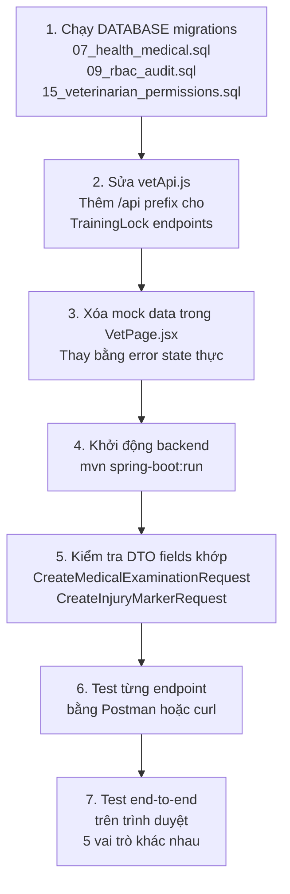

# Kế hoạch Full-Stack: Chức năng Bác sĩ thú y chạy được thực tế

> **Công nghệ:** Spring Boot 4.1 · Java 21 · Azure SQL · React/Vite  
> **Mục tiêu:** Loại bỏ mock data, kết nối thực tế frontend ↔ backend ↔ database  
> **Ngày:** 01/10/2026

---

## Phát hiện quan trọng: Backend đã có sẵn rất nhiều!

> [!NOTE]
> **Tin tốt:** Backend module `health` đã được implement đầy đủ:
> - ✅ `MedicalExaminationController/Service` (FR09)
> - ✅ `InjuryController/Service` (FR10)  
> - ✅ `TrainingLockController/Service` + Entity/Repository (FR11)
> - ✅ `PreventiveCareController/Service` (FR12)
> - ✅ `BarnHealthController/Service` (FR08)
> - ✅ Database schema `07_health_medical.sql` đã có đủ bảng
>
> **Vấn đề cần giải quyết:** RBAC permission chưa được seed cho role VETERINARIAN, một số endpoint URL bị sai, và frontend đang dùng mock data.

---

## Giai đoạn 1: Kiểm tra & Kết nối Database (Ngày 1)

### 1.1 Xác nhận database đang chạy

**Kiểm tra kết nối Azure SQL:**
```powershell
# Test connect tới Azure SQL
cd BACKEND
mvn spring-boot:run -Dspring-boot.run.arguments="--debug" 2>&1 | Select-String "HikariPool|Connected|ERROR"
```

**Nếu dùng local SQL Server thay thế, tạo file `.env` trong BACKEND:**
```env
DB_URL=jdbc:sqlserver://localhost:1433;databaseName=racehorse;encrypt=false
DB_USERNAME=sa
DB_PASSWORD=YourPassword
JWT_SECRET=cmFjZWhvcnNlLWRldmVsb3BtZW50LWtleS1jaGFuZ2UtbWUtbm93
```

### 1.2 Chạy migration `07_health_medical.sql`

> [!IMPORTANT]
> Chạy theo đúng thứ tự nếu database chưa có schema y tế:

```powershell
cd DATABASE
# Chạy tuần tự từ 00 đến 11
sqlcmd -S racehorse-training-management.database.windows.net -d racehorse -U racehorse_admin -P RaceSWP391 -i 07_health_medical.sql
sqlcmd -S ... -i 09_racing_reporting_rbac_audit.sql   # Tạo bảng RBAC + seed roles
```

### 1.3 Xác nhận các bảng đã tồn tại

Chạy SQL query kiểm tra:
```sql
SELECT TABLE_NAME FROM INFORMATION_SCHEMA.TABLES 
WHERE TABLE_NAME IN (
  'horse_health_status', 'horse_health_status_history',
  'medical_examinations', 'medical_examination_addenda',
  'injury_markers', 'injury_recovery_updates',
  'training_locks', 
  'preventive_care_schedules'
);
-- Phải trả về đủ 8 bảng
```

---

## Giai đoạn 2: Vá lỗi RBAC & Cấp quyền cho VETERINARIAN (Ngày 1–2)

### 2.1 Vấn đề: Backend yêu cầu `PERM_MEDICAL_VIEW` và `PERM_MEDICAL_EDIT`

Mọi endpoint y tế đều có `@PreAuthorize` kiểm tra:
```java
@PreAuthorize("hasRole('VETERINARIAN') and hasAuthority('PERM_MEDICAL_EDIT')")
@PreAuthorize("hasAuthority('PERM_MEDICAL_VIEW') and hasAnyRole('VETERINARIAN','CLUB_MANAGER',...)")
```

→ Nếu VETERINARIAN chưa được cấp `PERM_MEDICAL_VIEW` và `PERM_MEDICAL_EDIT` trong bảng `module_permissions`, mọi API đều trả về **403 Forbidden**.

### 2.2 SQL Script: Seed quyền cho VETERINARIAN

**Tạo file `DATABASE/15_veterinarian_permissions.sql`:**
```sql
USE [racehorse];
GO

-- Cấp quyền VIEW + EDIT cho module MEDICAL
MERGE INTO dbo.module_permissions AS target
USING (
    VALUES
    ('VETERINARIAN', 'MEDICAL', 1, 1, 0),  -- View=Yes, Edit=Yes, Approve=No
    ('VETERINARIAN', 'PROFILE', 1, 0, 0),  -- Xem hồ sơ ngựa
    ('VETERINARIAN', 'STABLE_CARE', 1, 0, 0), -- Xem chuồng trại
    ('VETERINARIAN', 'TRAINING', 1, 0, 0)  -- Xem huấn luyện (để kiểm tra khóa)
) AS source (role_code, module_code, can_view, can_edit, can_approve)
ON target.role_code = source.role_code 
   AND target.module_code = source.module_code
WHEN MATCHED THEN
    UPDATE SET can_view = source.can_view,
               can_edit = source.can_edit,
               can_approve = source.can_approve
WHEN NOT MATCHED THEN
    INSERT (id, role_code, module_code, can_view, can_edit, can_approve)
    VALUES (NEWID(), source.role_code, source.module_code, source.can_view, source.can_edit, source.can_approve);
GO

-- Tạo tài khoản test Bác sĩ thú y nếu chưa có
-- (Thực hiện qua API /api/auth/register sau khi backend chạy)
```

> [!CAUTION]
> Cần kiểm tra lại tên bảng `module_permissions` và các cột `can_view/can_edit/can_approve` có khớp với schema thực tế trong `09_racing_reporting_rbac_audit.sql` không trước khi chạy.

### 2.3 Kiểm tra bảng permissions trong code

Tìm class load permission từ DB trong backend:
```
BACKEND/src/main/java/com/racehorse/auth/security/
```
→ Tìm class implement `UserDetailsService` hoặc `JwtDecoder` để hiểu cách permission được đọc từ DB và nhúng vào JWT.

---

## Giai đoạn 3: Sửa Frontend – Loại bỏ Mock Data (Ngày 2–3)

### 3.1 Bảng đối chiếu URL Frontend ↔ Backend thực tế

| Chức năng | URL Frontend (vetApi.js) | URL Backend thực tế | Trạng thái |
|---|---|---|---|
| Bản đồ sức khỏe | `GET /api/health/barn-map` | `GET /api/health/barn-map` | ✅ Khớp |
| Danh sách ngựa | `GET /api/horses?size=150` | `GET /api/horses?size=150` | ✅ Khớp |
| Tạo phiếu khám | `POST /api/horses/{id}/medical-examinations` | `POST /api/horses/{id}/medical-examinations` | ✅ Khớp |
| Thêm addendum | `POST /api/medical-examinations/{id}/addenda` | `POST /api/medical-examinations/{id}/addenda` | ✅ Khớp |
| Danh sách khám | `GET /api/horses/{id}/medical-examinations` | `GET /api/horses/{id}/medical-examinations` | ✅ Khớp |
| Tạo chấn thương | `POST /api/horses/{id}/injuries` | `POST /api/horses/{id}/injuries` | ✅ Khớp |
| Thêm recovery update | `POST /api/injuries/{id}/recovery-updates` | `POST /api/injuries/{id}/recovery-updates` | ✅ Khớp |
| DS chấn thương ngựa | `GET /api/horses/{id}/injuries` | `GET /api/horses/{id}/injuries` | ✅ Khớp |
| Khóa huấn luyện | `POST /api/horses/{id}/training-locks` | `POST /horses/{id}/training-locks` | ⚠️ Thiếu `/api` prefix |
| Gỡ khóa | `POST /api/training-locks/{id}/release` | `POST /training-locks/{id}/release` | ⚠️ Thiếu `/api` prefix |
| Lịch phòng ngừa | `GET /api/horses/{id}/preventive-care` | `GET /api/horses/{id}/preventive-care` | ✅ Khớp |
| Tạo lịch phòng ngừa | `POST /api/horses/{id}/preventive-care` | `POST /api/horses/{id}/preventive-care` | ✅ Khớp |
| Hoàn thành lịch | `POST /api/preventive-care/{id}/complete` | `POST /api/preventive-care/{id}/complete` | ✅ Khớp |
| Due preventive | `GET /api/preventive-care/due?days=7` | `GET /api/preventive-care/due` | ⚠️ Kiểm tra param |

### 3.2 Sửa `vetApi.js` – Endpoint bị sai prefix

```javascript
// Sửa 2 dòng bị thiếu /api prefix:
releaseTrainingLock: (lockId, payload) =>
  api(`/api/training-locks/${lockId}/release`, {   // Thêm /api
    method: 'POST',
    body: JSON.stringify(payload),
  }),

getCurrentTrainingLock: (horseId) => 
  api(`/api/horses/${horseId}/training-locks/current`), // Thêm /api

getTrainingLockHistory: (horseId) => 
  api(`/api/horses/${horseId}/training-locks`),  // Thêm /api

createTrainingLock: (horseId, payload) =>
  api(`/api/horses/${horseId}/training-locks`, {  // Thêm /api
    method: 'POST',
    body: JSON.stringify(payload),
  }),
```

### 3.3 Sửa `VetPage.jsx` – Xóa mock data, xử lý lỗi real API

**Trong `MedicalRecordsView`** – Xóa khối `catch { setRecords([...mock...]) }`, thay bằng:
```jsx
} catch (err) {
  setError(err.message || 'Không thể tải hồ sơ khám. Kiểm tra kết nối.')
}
```

**Trong `InjuryTrackingView`** – Tương tự, xóa mock data:
```jsx
} catch (err) {
  setInjuries([])
  setError(err.message || 'Không thể tải chấn thương.')
}
```

**Trong `PreventiveCareView`** – Tương tự.

### 3.4 Kiểm tra DTO Request/Response

**`CreateMedicalExaminationRequest` (backend DTO) yêu cầu các field:**
```java
// Xem file: BACKEND/src/main/java/com/racehorse/health/dto/CreateMedicalExaminationRequest.java
```
→ Frontend form phải gửi đúng field names theo DTO (camelCase). Cần kiểm tra để map form data cho khớp.

---

## Giai đoạn 4: Kiểm tra từng API hoạt động (Ngày 3)

### 4.1 Khởi động backend local

```powershell
cd BACKEND
mvn spring-boot:run
# Chờ: "Started RacehorseBackendApplication in X.XXX seconds"
```

### 4.2 Tạo tài khoản test VETERINARIAN

```bash
# Đăng ký tài khoản Bác sĩ thú y qua API
curl -X POST http://localhost:8080/api/auth/register \
  -H "Content-Type: application/json" \
  -d '{"username":"bacsi_test","email":"vet@test.com","password":"Test1234!","role":"VETERINARIAN"}'
```

### 4.3 Test tuần tự từng API với token JWT

```bash
# 1. Đăng nhập lấy token
TOKEN=$(curl -s -X POST http://localhost:8080/api/auth/login \
  -H "Content-Type: application/json" \
  -d '{"email":"vet@test.com","password":"Test1234!"}' | jq -r '.accessToken')

# 2. Test FR08 - Bản đồ sức khỏe
curl -H "Authorization: Bearer $TOKEN" http://localhost:8080/api/health/barn-map
# Kỳ vọng: 200 OK với danh sách ngựa theo trạng thái sức khỏe

# 3. Test FR09 - Tạo phiếu khám
curl -X POST -H "Authorization: Bearer $TOKEN" \
  -H "Content-Type: application/json" \
  http://localhost:8080/api/horses/{HORSE_ID}/medical-examinations \
  -d '{"examDate":"2026-10-01","symptoms":"Thử nghiệm","diagnosis":"Kiểm tra","treatmentPlan":"Không"}'
# Kỳ vọng: 201 Created

# 4. Test FR11 - Khóa huấn luyện
curl -X POST -H "Authorization: Bearer $TOKEN" \
  -H "Content-Type: application/json" \
  http://localhost:8080/api/horses/{HORSE_ID}/training-locks \
  -d '{"reason":"Test khóa","estimatedReturnDate":"2026-10-10"}'
# Kỳ vọng: 201 Created
```

> [!WARNING]
> Nếu nhận **403 Forbidden** → RBAC chưa được cấp đúng (Quay lại Giai đoạn 2)  
> Nếu nhận **404 Not Found** → URL sai prefix (Quay lại Giai đoạn 3)  
> Nếu nhận **500 Internal Server Error** → Xem log backend để tìm NullPointerException hoặc lỗi SQL

### 4.4 Kiểm tra frontend kết nối được

```powershell
cd FRONTEND
npm run dev
# Mở http://localhost:5173, đăng nhập với vet@test.com
# Mở F12 > Network, thực hiện từng thao tác trong VetPage
# Kiểm tra các request có trả về 200 không, xem response data
```

---

## Giai đoạn 5: Kiểm tra tích hợp End-to-End (Ngày 4)

### 5.1 Kịch bản test thực tế

#### Kịch bản A: Bác sĩ xử lý ca ngựa chấn thương

1. Đăng nhập với role VETERINARIAN
2. Mở **Bản đồ sức khỏe** → Tìm ngựa đang `INJURED`
3. Click vào ngựa → Chuyển sang **Hồ sơ khám** → Tạo phiếu khám mới
4. Nhập: Triệu chứng, Chẩn đoán, Phác đồ điều trị, Đơn thuốc
5. Lưu → Phiếu khám xuất hiện trong danh sách ✓
6. Vào **Theo dõi chấn thương** → Ghi nhận vị trí chấn thương mới
7. Cập nhật tiến trình: `ACUTE` → `RECOVERING`
8. Vào **Khóa huấn luyện** → Ban hành lệnh khóa với lý do và ngày tái khám

#### Kịch bản B: Bác sĩ lên lịch phòng ngừa

1. Vào **Chăm sóc phòng ngừa** → Tạo lịch tiêm vắc-xin cho từng ngựa
2. Lịch với `dueDate` < hôm nay → hiển thị badge 🔴 Quá hạn
3. Click **Đánh dấu hoàn thành** → Hệ thống tự tạo lịch lặp tiếp theo
4. Kiểm tra database: `preventive_care_schedules` có record mới

#### Kịch bản C: Kiểm tra RBAC chéo vai trò

1. Đăng nhập với **HEAD_TRAINER** → Thử truy cập `/vet/medical-records` → Phải bị redirect
2. Đăng nhập với **VETERINARIAN** → Thử truy cập `/fitness` → Phải bị redirect
3. Đăng nhập với **STABLE_STAFF** → Thử truy cập `/horses` → Phải bị redirect
4. Đăng nhập với **HORSE_OWNER** → Vào `/horses` → Chỉ thấy ngựa của mình

### 5.2 Checklist kết quả

**Backend:**
- [ ] Backend khởi động thành công, kết nối Azure SQL OK
- [ ] `PERM_MEDICAL_VIEW` và `PERM_MEDICAL_EDIT` đã được seed cho VETERINARIAN
- [ ] `GET /api/health/barn-map` → 200 OK
- [ ] `POST /api/horses/{id}/medical-examinations` → 201 Created
- [ ] `POST /api/horses/{id}/injuries` → 201 Created
- [ ] `POST /api/injuries/{id}/recovery-updates` → 201 Created
- [ ] `POST /api/horses/{id}/training-locks` → 201 Created
- [ ] `POST /api/training-locks/{id}/release` → 200 OK
- [ ] `POST /api/horses/{id}/preventive-care` → 201 Created
- [ ] `POST /api/preventive-care/{id}/complete` → 200 OK (và lịch tiếp theo được tạo)

**Frontend:**
- [ ] Không còn mock data trong `VetPage.jsx`
- [ ] `vetApi.js` đã sửa URL thiếu `/api` prefix
- [ ] Form tạo phiếu khám gửi đúng field names theo DTO backend
- [ ] Error state hiển thị rõ ràng khi API thất bại

---

## Tóm tắt ưu tiên công việc



---

## Bảng công việc chi tiết

| # | Việc cần làm | File | Độ ưu tiên |
|---|---|---|---|
| 1 | Chạy SQL `15_veterinarian_permissions.sql` | `DATABASE/` | 🔴 Cao nhất |
| 2 | Sửa URL prefix `/api` trong `vetApi.js` | `FRONTEND/src/vetApi.js` | 🔴 Cao nhất |
| 3 | Xóa mock data trong `VetPage.jsx` | `FRONTEND/src/VetPage.jsx` | 🔴 Cao nhất |
| 4 | Đọc DTO `CreateMedicalExaminationRequest`, map form fields | `VetPage.jsx` | 🔴 Cao |
| 5 | Đọc DTO `CreateInjuryMarkerRequest`, map form fields | `VetPage.jsx` | 🔴 Cao |
| 6 | Đọc DTO `CreatePreventiveCareRequest`, map form fields | `VetPage.jsx` | 🔴 Cao |
| 7 | Đọc DTO `CreateTrainingLockRequest`, map form fields | `VetPage.jsx` | 🔴 Cao |
| 8 | Kiểm tra `BarnHealthController` base URL mapping | `BACKEND/` | 🟡 Trung bình |
| 9 | Test Postman từng endpoint FR08–FR12 | — | 🟡 Trung bình |
| 10 | Test end-to-end trên trình duyệt | — | 🟢 Cuối cùng |

---

> [!IMPORTANT]
> **Bước quan trọng nhất:** Đọc các file DTO trong `BACKEND/src/main/java/com/racehorse/health/dto/`  
> để biết chính xác backend cần nhận những field nào, rồi đảm bảo form trong `VetPage.jsx` gửi đúng field name và kiểu dữ liệu.  
> Đây là nguyên nhân phổ biến nhất dẫn đến `400 Bad Request` khi kết nối frontend–backend.
