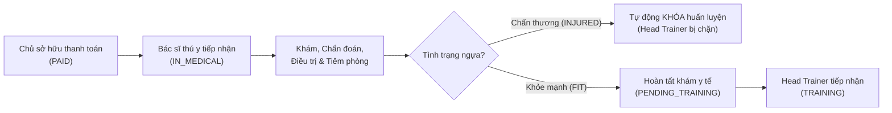
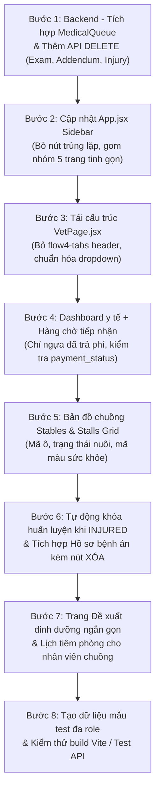

# Kế Hoạch Tái Cấu Trúc & Nâng Cấp Bảng Điều Khiển Bác Sĩ Thú Y (Vet Dashboard Revamp)

> **Nhánh thực hiện:** `bacsithuy` *(Tuyệt đối không sửa code ở bất kỳ nhánh nào khác)*  
> **Tham khảo nghiệp vụ:** Nhánh `Horse-Owner+Head-Trainer` (Thanh toán phí, tiếp nhận y tế `PAID` → `IN_MEDICAL` → `PENDING_TRAINING`)  
> **Ngày lập kế hoạch:** 02/10/2026

---

## I. TỔNG QUAN CÁC ĐIỀU CHỈNH CHÍNH THEO YÊU CẦU

---

## II. CHI TIẾT 8 HẠNG MỤC CẦN LÀM

### 1. Bỏ thanh điều hướng thừa trên đầu trang (Loại bỏ ảnh chụp `flow4-tabs`)
* **Vấn đề hiện tại:** Thanh tab button `flow4-tabs` trên đỉnh trang `VetPage.jsx` có 6 nút dài ngoằng, bị tràn xuống dòng và trùng lặp với Sidebar.
* **Giải pháp:**
  * **Xóa hoàn toàn** thanh tab `flow4-tabs` trong `VetPage.jsx`.
  * Điều hướng tập trung tại **Sidebar bên trái (`App.jsx`)**, gom nhóm tinh gọn thành các mục rõ ràng:
    1. `HeartPulse` **Bảng điều khiển y tế** (`/vet`) - Tổng quan thể trạng + Hàng chờ tiếp nhận y tế
    2. `Home` **Bản đồ chuồng & Thể trạng** (`/vet/health-map`) - Sơ đồ ô chuồng trực quan theo khu
    3. `FileText` **Hồ sơ bệnh án & Chấn thương** (`/vet/medical-records`) - Khám bệnh, điều trị và theo dõi chấn thương tích hợp
    4. `Calendar` **Lịch tiêm phòng & Phòng ngừa** (`/vet/preventive`) - Lên lịch tiêm/tẩy giun, gửi nhân viên chuồng
    5. `Utensils` **Đề xuất khẩu phần ăn** (`/vet/nutrition`) - Đề xuất dinh dưỡng ngắn gọn gửi nhân viên chuồng
    6. `Activity` **Hồ sơ ngựa** (`/horses`) - Danh mục ngựa toàn CLB (chế độ chỉ xem)

---

### 2. Điều kiện chăm sóc y tế: Ngựa đã trả phí (`PAID`) & Hàng chờ tiếp nhận y tế
* **Tham khảo từ nhánh `Horse-Owner+Head-Trainer`:**
  * Ngựa chỉ được chăm sóc y tế khi: `payment_status` là `'PAID'`, `'IN_MEDICAL'`, `'PENDING_TRAINING'`, `'TRAINING'` HOẶC `service_override = true` (CLB bảo lãnh).
  * Ngựa `payment_status = 'UNPAID'` (chưa đóng phí) và không có bảo lãnh: **KHÔNG ĐƯỢC PHÉP** tạo phiếu khám, không tiêm phòng, không lên lịch dinh dưỡng.
* **Triển khai kỹ thuật:**
  * Mang package `com.racehorse.medical` (`MedicalQueueController`, `MedicalQueueService`) vào nhánh `bacsithuy`.
  * **Tích hợp vào Dashboard Bác sĩ thú y (`/vet`):**
    * Thống kê: **Số ngựa cần chăm sóc y tế** (ngựa đã trả phí chờ tiếp nhận + ngựa đang chấn thương/điều trị + ngựa đến hạn tiêm).
    * Bảng **Hàng chờ tiếp nhận khám y tế ban đầu (`/api/medical/queue`)**: Danh sách ngựa vừa thanh toán phí (`PAID`). Bác sĩ bấm *"Tiếp nhận khám"* (`POST /api/medical/queue/{horseId}/receive`) → Ngựa chuyển sang `IN_MEDICAL` và nằm trong danh sách đang phụ trách.
    * Sau khi khám và xác nhận đủ thể lực, bác sĩ bấm *"Hoàn tất khám y tế"* (`POST /api/medical/queue/{horseId}/complete`) → Chuyển sang `PENDING_TRAINING` để chuyển giao cho Head Trainer tiếp nhận huấn luyện.

---

### 3. Làm lại Bản đồ chuồng theo Sơ đồ Ô chuồng (Stables & Stalls Grid)
* **Tham khảo từ `AdminPages.jsx` và `StableCarePage.jsx`:**
  * Không dùng danh sách card ngựa đơn lẻ. Chuyển sang sơ đồ ô chuồng chuyên nghiệp:
    * **4 Thẻ so sánh (KPIs):** Tổng số khu chuồng, Tổng số ô chuồng, Số ô đang nuôi (tỷ lệ lấp đầy %), Số ô trống.
    * **Thanh Sub-tabs chọn khu chuồng:** `Chuồng A`, `Chuồng B`, `Chuồng C`...
    * **Lưới sơ đồ ô chuồng (`stalls-grid`):**
      * Hiển thị từng ô: Mã ô (Ô 101, Ô 102...), Trạng thái (Đang nuôi / Trống).
      * Nếu có ngựa: Tên ngựa, Mã ngựa, Giống.
      * Badge thanh toán: `✓ Đã trả phí` / `⭐ Bảo lãnh` / `⚠️ Chưa phí`.
      * Badge sức khỏe mã màu: 🟢 `FIT (Khỏe)` / 🟡 `MONITOR (Theo dõi)` / 🔴 `INJURED (Chấn thương)` / 🟣 `QUARANTINED (Cách ly)`.
    * **Side Panel tương tác:** Khi click vào ô có ngựa → Mở bảng chi tiết lâm sàng bên phải (Thể trạng hiện tại, Lịch sử khám gần nhất, Cập nhật nhanh thể trạng, Nút dẫn tới khám bệnh).

---

### 4. Loại bỏ trang Khóa huấn luyện (FR11) → Tự động khóa khi chấn thương
* **Yêu cầu:** Bỏ menu và trang riêng "Khóa huấn luyện (FR11)".
* **Cơ chế tự động hóa:**
  * Khi bác sĩ cập nhật thể trạng ngựa sang **`INJURED`** (hoặc tạo phiếu khám kết luận chấn thương, hoặc ghi nhận chấn thương `ACUTE`/`RECOVERING`):
    * Hệ thống **tự động kích hoạt lệnh khóa huấn luyện** (`training_locks`).
    * Phía Head Trainer: Khi mở kế hoạch tập hoặc phân công lịch chạy sẽ bị chặn ngay lập tức kèm cảnh báo y tế rõ ràng.
  * Khi bác sĩ khám lại và xác nhận bình phục, cập nhật thể trạng sang **`FIT`** (hoặc đánh dấu chấn thương `RESOLVED`):
    * Hệ thống **tự động giải tỏa lệnh khóa huấn luyện**, cho phép Head Trainer lên lịch chạy bình thường.

---

### 5. Thêm chức năng XÓA thông tin
* **Các mục cần có thao tác Xóa (kèm xác nhận Confirm dialog an toàn):**
  1. **Xóa phiếu khám bệnh (Medical Examination):**
     * Backend: Bổ sung `@DeleteMapping("/api/medical-examinations/{id}")` trong `MedicalExaminationController.java` & `MedicalExaminationService.java`.
     * Frontend: Thêm nút icon thùng rác `Trash2` tại từng phiếu khám.
  2. **Xóa phụ lục bệnh án (Addendum):**
     * Backend: Bổ sung `@DeleteMapping("/api/medical-examinations/addenda/{addendumId}")`.
     * Frontend: Thêm nút xóa phụ lục ghi chú.
  3. **Xóa chấn thương (Injury Marker):**
     * Backend: Bổ sung `@DeleteMapping("/api/injuries/{id}")` trong `InjuryController.java` & `InjuryService.java`.
     * Frontend: Thêm nút xóa mốc chấn thương đã khỏi hoặc ghi nhận nhầm.
  4. **Xóa lịch tiêm phòng / phòng ngừa (Preventive Care):**
     * Backend: Đã có sẵn `@DeleteMapping("/api/preventive-care/{id}")`.
     * Frontend: Bổ sung nút xóa lịch tiêm `Trash2` trên từng dòng lịch.
  5. **Xóa đề xuất khẩu phần dinh dưỡng (Nutrition Plan):**
     * Backend: Bổ sung endpoint xóa / vô hiệu hóa đề xuất dinh dưỡng.

---

### 6. Khẩu phần dinh dưỡng: Tạo đề xuất ngắn gọn gửi nhân viên chăm sóc
* **Giao diện mới tại `/vet/nutrition`:**
  * Bác sĩ chọn con ngựa cần chỉ định dinh dưỡng (chỉ chọn ngựa đã trả phí).
  * Điền form **Đề xuất dinh dưỡng ngắn gọn**:
    * Ngày áp dụng (`effectiveDate`).
    * Ghi chú chỉ định chuyên môn (`notes`: ví dụ *"Hồi phục sau chấn thương, tăng vitamin C, giảm 30% cám tinh, tăng cỏ tươi"*).
    * Thiết lập các bữa trong ngày: Sáng, Trưa, Chiều, Tối với số kg cám, số kg cỏ và thực phẩm bổ sung.
  * Bấm **"Gửi đề xuất tới nhân viên chăm sóc"** (`POST /api/horses/{id}/nutrition-plan`).
  * Nhân viên chuồng (Stable Staff) khi mở trang `StableCarePage` tab `nutrition` sẽ thấy ngay khẩu phần này để thực hiện cho ăn.

---

### 7. Chăm sóc phòng ngừa: Tiêm phòng, tẩy giun & phân công nhân viên chuồng
* **Quy trình nghiệp vụ:**
  * Bác sĩ thú y: Lên lịch tiêm vắc-xin / tẩy giun định kỳ (`careType`: `VACCINATION`, `DEWORMING`, `FARRIER`).
  * Có nút **Xóa lịch** nếu hủy mũi tiêm.
  * **Phân công thực hiện:** Lịch tiêm sau khi tạo sẽ hiển thị trạng thái `ĐANG CHỜ TIÊM`.
  * **Nhân viên chăm sóc (Stable Staff)** hoặc Bác sĩ sẽ là người bấm **"Xác nhận đã tiêm"** (`POST /api/preventive-care/{id}/complete`).
  * Cập nhật Backend `@PreAuthorize` tại endpoint `complete`: Cho phép cả `STABLE_STAFF`, `VETERINARIAN`, `CLUB_MANAGER` xác nhận hoàn thành mũi tiêm.

---

### 8. Chuẩn hóa giao diện & Dropdown theo đúng Design System
* Đồng bộ toàn bộ dropdown `<select>`:
  * Chiều cao `min-height: 42px`, padding `10px 14px`, border `1px solid #d9ded6`, border-radius `11px`, background `white`.
  * Khi focus: `border-color: #398069; box-shadow: 0 0 0 3px rgba(41,113,88,.1)`.
  * Đặt toàn bộ trong `<label className="field">` kèm label chữ đậm rõ ràng.
  * Thống nhất font chữ: `Playfair Display` cho tiêu đề và `DM Sans` cho nội dung.

---

## III. KẾ HOẠCH TRIỂN KHAI THEO TỪNG BƯỚC

---

## IV. CHECKLIST KIỂM THỬ XÁC NHẬN (ACCEPTANCE CRITERIA)

- [ ] **Giao diện:** Thanh tab dài `flow4-tabs` trên đầu trang đã biến mất hoàn toàn; giao diện thoáng đãng, chuyên nghiệp.
- [ ] **Dropdown:** Các dropdown select chuẩn style 100%, không bị vỡ layout hoặc lệch font.
- [ ] **Thanh toán & Tiếp nhận:**
  - [ ] Ngựa `UNPAID` không được phép tạo phiếu khám/tiêm phòng; hiển thị nhãn `Chưa phí`.
  - [ ] Ngựa `PAID` xuất hiện trong hàng chờ tiếp nhận y tế; bấm "Tiếp nhận khám" chuyển thành `IN_MEDICAL`.
  - [ ] Sau khi khám xong, bấm "Hoàn tất khám" chuyển thành `PENDING_TRAINING` cho HLV trưởng.
- [ ] **Bản đồ chuồng:** Hiển thị trực quan theo từng khu chuồng (Chuồng A, Chuồng B...) và từng ô chuồng (Mã ô, Đang nuôi/Trống, Tên ngựa, Thể trạng mã màu).
- [ ] **Tự động khóa huấn luyện:** Không còn trang riêng Khóa huấn luyện. Khi ngựa bị đánh dấu `INJURED`, hệ thống tự động khóa; khi chuyển về `FIT`, tự động gỡ khóa.
- [ ] **Chức năng Xóa:** Bác sĩ có thể xóa phiếu khám, xóa phụ lục, xóa chấn thương, xóa lịch tiêm phòng.
- [ ] **Đề xuất dinh dưỡng:** Bác sĩ tạo đề xuất ngắn gọn thành công; nhân viên chuồng xem được và thực hiện.
- [ ] **Lịch tiêm phòng:** Bác sĩ lên lịch, có nút xóa; nhân viên chăm sóc chuồng có thể xác nhận đã tiêm.
- [ ] **Build:** `npm run build` chạy thành công không có bất kỳ warning/lỗi nào.
