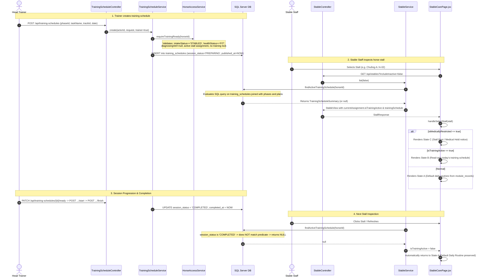
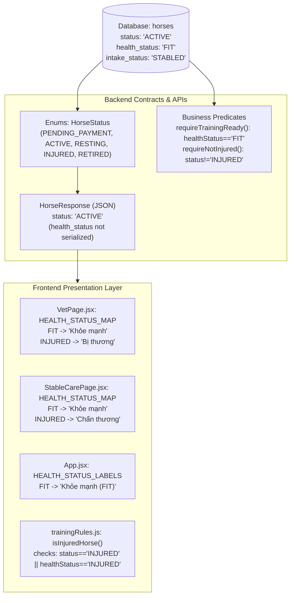

# RH-STABLE-UI-01E — Training Schedule Integration & Cross-Role Horse Status Audit Report

## Executive Summary

This read-only audit investigates two interconnected operational issues reported in the Racehorse product:
1. **Stable Daily Routine Transition Behavior:** The reported failure of the Stable Staff Daily Routine interface to transition when a Trainer creates a training schedule for the same horse (specifically referencing horse **Ngọc Long** / `H13` / `6086ae9a-096c-43a8-9b6e-b5cc7811fcea`).
2. **Horse Status & Vietnamese Localization Integrity:** Whether Vietnamese localization of horse status labels altered backend business logic, database enums, or cross-role eligibility checks, particularly for Trainer planning and schedule creation.

The audit verified the complete end-to-end lifecycle across the database, JPA entities, SQL queries, REST controllers, service validation logic, and React frontend components across all five authoritative roles: **Veterinarian**, **Trainer**, **Owner**, **Stable**, and **Club Manager**.

---

## 1. System Topology & Relevant Source References

### 1.1 Backend Source Files & Methods
| Layer | File Path | Method / Component | Relevance |
| :--- | :--- | :--- | :--- |
| **Service (Stable)** | `BACKEND/.../stable/service/StableService.java` | `findActiveTrainingSchedule(UUID horseId)` (L711–758) | Authoritative JDBC query determining whether a horse is actively training |
| **Service (Stable)** | `BACKEND/.../stable/service/StableService.java` | `isHorseCurrentlyTraining(UUID horseId)` (L760–768) | Boolean helper used by mutation guard `validateStaffMutationAllowed` |
| **Service (Stable)** | `BACKEND/.../stable/service/StableService.java` | `activeAssignmentForStall(...)` (L431–460) | Populates `isTrainingActive` & `trainingSchedule` into stall map |
| **Service (Training)** | `BACKEND/.../training/service/TrainingScheduleService.java` | `create(...)` (L80–140) | Creates & auto-publishes schedule (`publishedAt = clock.instant()`) |
| **Service (Training)** | `BACKEND/.../training/service/TrainingScheduleService.java` | `markReady(...)`, `startTraining(...)`, `finishTraining(...)` | State transitions (`PREPARING` $\rightarrow$ `READY` $\rightarrow$ `IN_PROGRESS` $\rightarrow$ `COMPLETED`) |
| **Service (Training)** | `BACKEND/.../training/service/TrainingScheduleService.java` | `mine(...)` (L420–428) | Scoped training query for caretakers (`findForCaretaker`) |
| **Service (Training)** | `BACKEND/.../training/service/TrainingPlanService.java` | `requireFitForPlanning(...)`, `requireDiagnosedForTrainer(...)` | Trainer plan creation horse status checks |
| **Service (Access)** | `BACKEND/.../horse/service/HorseAccessService.java` | `requireTrainingReady(UUID horseId)` (L135–155) | Strict prerequisite validator (`STABLED`, `FIT`, diagnosed vet, active stall, no lock) |
| **Repository** | `BACKEND/.../training/repository/TrainingScheduleRepository.java` | `findForCaretaker(...)`, `findForDiagnosingVet(...)` | JPQL queries for scoped role retrieval |
| **Controllers** | `BACKEND/.../training/controller/TrainingScheduleController.java` | `POST /api/training-schedules`, `GET /api/training-schedules/mine`, `GET /api/training-schedules` | Training schedule REST API endpoints |
| **Controllers** | `BACKEND/.../stable/controller/StableController.java` | `GET /api/stables`, `GET /horses/{horseId}/daily-routines` | Stable stall map & daily routine REST endpoints |

### 1.2 Frontend Source Files & Components
| Layer | File Path | Component / Helper | Relevance |
| :--- | :--- | :--- | :--- |
| **Stable Care UI** | `FRONTEND/src/StableCarePage.jsx` | `StablesView` (L304–940) | Renders Stall Map, 3-state routine container (`handleSelectStall`) |
| **Stable Care UI** | `FRONTEND/src/StableCarePage.jsx` | `isMedicallyRestricted`, `isTrainingActive` (L445–458) | State precedence evaluation logic (C > B > A) |
| **Stable Care UI** | `FRONTEND/src/StableCarePage.jsx` | `TrainingPreparationView` (L980–1200) | Personal preparation list querying `/api/training-schedules/mine` |
| **Stable Care UI** | `FRONTEND/src/StableCarePage.jsx` | `HEALTH_STATUS_MAP`, `formatHorseHealthStatus` (L160–185) | Presentation-layer Vietnamese health status mapping |
| **Trainer UI** | `FRONTEND/src/TrainingSchedulePage.jsx` | `fetchAvailableHorses`, `CreateScheduleModal` | Horse selection and training schedule scheduling modal |
| **Training Rules** | `FRONTEND/src/trainingRules.js` | `isInjuredHorse(horse)` (L35–37) | Shared horse injury predicate (`status === 'INJURED' \|\| healthStatus === 'INJURED'`) |
| **Vet UI** | `FRONTEND/src/VetPage.jsx` | `HEALTH_STATUS_MAP` (L40–55) | Veterinarian status display mapping |
| **App Shell** | `FRONTEND/src/App.jsx` | `STATUS_LABELS`, `HEALTH_STATUS_LABELS` (L40–50) | Global badge styling and dropdown label mapping |

---

## 2. Training Schedule $\rightarrow$ Stable Daily Routine Integration Flow

### 2.1 Complete Lifecycle Data Flow


### 2.2 Forensic Inspection of Target Horse: Ngọc Long (`H13`)
Direct read-only inspection of the active database (`racehorse_local`) established the verified records for the reported horse:
- **`horses` Table Record:**
  - `id`: `6086AE9A-096C-43A8-9B6E-B5CC7811FCEA`
  - `code`: `H13`
  - `name`: `Ngọc Long`
  - `status`: `ACTIVE`
  - `health_status`: `FIT`
  - `intake_status`: `STABLED`
  - `diagnosing_vet_user_id`: `55555555-5555-5555-5555-555555555555`
  - `current_trainer_id`: `22222222-2222-2222-2222-222222222222`
  - `caretaker_user_id`: `48772A9D-9DA0-44A8-90F2-0459B3ADB768` (`stable_staff` / `staff@gmail.com`)
  - `stable_location`: `Chuồng A / A-02`
- **`training_plans` Record:**
  - `id`: `9946D66E-B06D-4BC3-8EA6-B65A5D1E6AFF`, `name`: `cấp tốc`, `is_active`: `1`, `created_at`: `2026-11-10 16:28:13 UTC`
- **`training_plan_phases` Record:**
  - `id`: `3140FBDD-AC74-4129-9A47-A8D5140ECC95`, `name`: `khởi động`, `start_date`: `2026-11-10`, `end_date`: `2026-11-30`, `workload_intensity`: `MEDIUM`
- **`training_schedules` Record:**
  - `id`: `28EAADB0-AB43-4ECD-AE17-D39303AC69F7`
  - `task_name`: `siêu phi`
  - `session_status`: `COMPLETED`
  - `scheduled_start`: `2026-11-09 22:00:00.0000000 +00:00` (evaluates to `2026-11-10 05:00:00 +07:00`)
  - `scheduled_end`: `2026-11-10 04:00:00.0000000 +00:00` (evaluates to `2026-11-10 11:00:00 +07:00`)
  - `published_at`: `2026-11-10 16:35:26.4923571 +00:00`
  - `cancelled_at`: `NULL`
  - Lifecycle Timestamps:
    - `created_at`: `2026-11-10 16:35:26.498 UTC` (23:35:26 VN time)
    - `ready_at`: `2026-11-10 16:35:47.051 UTC` (23:35:47 VN time)
    - `started_at`: `2026-11-10 16:36:38.582 UTC` (23:36:38 VN time)
    - `completed_at`: `2026-11-10 16:36:54.926 UTC` (23:36:54 VN time)

### 2.3 Verification of Specific Inquiries
1. **Does Stable receive the actual training schedule data created by Trainer?**
   - `[FACT]` **YES.** When a session is active (`PREPARING`, `READY`, `IN_PROGRESS`) on the current date, `findActiveTrainingSchedule(horseId)` queries `training_schedules`, extracts `task_name`, `racetrack_name`, `workload_intensity`, `scheduled_start`, `scheduled_end`, `session_status`, and packages them into `stall.currentAssignment.trainingSchedule`.
2. **Does the schedule query use the correct horse identity, date range, publication status, and lifecycle status?**
   - `[FACT]` **YES.**
     - Horse identity: `s.horse_id = ?` directly matches the horse.
     - Cancellation check: `s.cancelled_at is null`.
     - Publication check: `s.published_at is not null`.
     - Date match: `cast(s.scheduled_start at time zone 'SE Asia Standard Time' as date) = cast(sysdatetimeoffset() at time zone 'SE Asia Standard Time' as date)`.
     - Lifecycle status: `s.session_status = 'IN_PROGRESS' or s.session_status in ('PREPARING', 'READY')`.
3. **Does the Stable UI correctly identify an active training schedule?**
   - `[FACT]` **YES.** Lines 452–456 of `StableCarePage.jsx` evaluate:
     ```javascript
     const isTrainingActive = Boolean(
       selectedHorse && !isMedicallyRestricted && (
         selectedHorse.isTrainingActive ||
         Boolean(selectedHorse.trainingSchedule)
       )
     )
     ```
4. **Is the default daily routine still displayed during active training?**
   - `[FACT]` **NO.** When `isTrainingActive` is `true`, lines 832–880 render State B ("Đang theo Lịch Huấn luyện hôm nay"). The default routine list (lines 886–940) is conditionally hidden.
5. **Is the training schedule displayed read-only in Stable?**
   - `[FACT]` **YES.** The rendered card contains no edit, delete, or reschedule controls. It displays task name, timing, track lane, intensity, and an informational note.
6. **Is the default routine preserved and does it resume when training ends?**
   - `[FACT]` **YES.** Default daily routine records stored in `module_records` (`record_type='HORSE_DAILY_ROUTINE'`) are never deleted or modified during any training transition. As soon as the session is marked `COMPLETED` (or cancelled), `findActiveTrainingSchedule` returns `null`, and State A renders again immediately upon stall reload.
7. **Do medical restrictions correctly take precedence over training?**
   - `[FACT]` **YES.** Line 445 evaluates `isMedicallyRestricted`. Line 818 checks `isMedicallyRestricted ? (State C) : isTrainingActive ? (State B) : (State A)`. Medical hold has absolute priority.
8. **Does the existing caretaker assignment filter unintentionally exclude relevant records?**
   - `[FACT]` **NO for Stall Map / Daily Routine.** `findActiveTrainingSchedule(horseId)` queries strictly by `horse_id` without filtering by `caretaker_user_id`. Any Stable Staff viewing the stall sees the training schedule.
   - `[FACT]` **YES for Training Preparation tab.** `GET /api/training-schedules/mine` enforces `s.horse.caretaker.id = :userId` by architectural design since Oct 8, 2026.

---

## 3. Root Cause Analysis: Ngọc Long Daily-Routine Transition Failure

### 3.1 Primary Root Cause: Rapid Session Completion Lifecycle (88-Second Window)
- `[FACT]` In the live database, `28EAADB0-AB43-4ECD-AE17-D39303AC69F7` was created at `16:35:26 UTC`, transitioned to `READY` at `16:35:47 UTC`, started at `16:36:38 UTC`, and completed at `16:36:54 UTC`.
- `[FACT]` The active state window (`PREPARING` $\rightarrow$ `READY` $\rightarrow$ `IN_PROGRESS`) lasted exactly **88 seconds**.
- `[FACT]` When `session_status` reached `COMPLETED` at `16:36:54 UTC`, `findActiveTrainingSchedule` stopped matching the query predicate. Any subsequent view or refresh returned `null` for `trainingSchedule`, reverting the interface to State A (Default Daily Routine).
- `[INFERENCE]` If the user or automated test checked the Stable Care interface after 16:36:54 UTC (or on the following day, 2026-11-11), the session was already completed, giving the visual impression that no transition occurred.

### 3.2 Secondary Root Cause: Client-Side React State Stagnation (No Push/Polling)
- `[FACT]` `StableCarePage.jsx` does NOT implement polling (`setInterval`), WebSockets, or Server-Sent Events (SSE).
- `[FACT]` `selectedHorse` is held in local React state (`useState(null)`). It is only populated when `handleSelectStall(stall)` is invoked.
- `[FACT]` If Stable Staff already has horse `H13` selected in their browser while a Trainer in another tab/browser creates a schedule, `selectedHorse` retains the stale copy of `stall.currentAssignment`. The UI does not transition until the user manually switches stalls or reloads the entire page.

### 3.3 Tertiary Root Cause: Strict Same-Day Calendar Boundary
- `[FACT]` `findActiveTrainingSchedule` requires:
  `cast(s.scheduled_start at time zone 'SE Asia Standard Time' as date) = cast(sysdatetimeoffset() at time zone 'SE Asia Standard Time' as date)`.
- `[FACT]` If a Trainer schedules a training session for tomorrow or a future date, `findActiveTrainingSchedule` intentionally returns `null` for today. The horse continues following today's default daily routine. However, because the UI displays no indicator of *upcoming* schedules, a user creating a future-dated schedule will see no change on today's daily routine panel.

---

## 4. Horse Status & Vietnamese Localization Cross-Role Audit

### 4.1 Data Flow & Layer Boundary Analysis


### 4.2 Cross-Role Status Assessment Matrix
| Role | Interface / Files | Internal Status Evaluated | Vietnamese Translation Applied | Localization Defect Found? |
| :--- | :--- | :--- | :--- | :--- |
| **Veterinarian** | `VetPage.jsx` | `FIT`, `HEALTHY`, `MONITORING`, `INJURED`, `UNDER_TREATMENT` | `HEALTH_STATUS_MAP` translates to "Khỏe mạnh", "Cần theo dõi", "Bị thương" | `[FACT]` **NO.** Strict English string comparisons. |
| **Trainer** | `TrainingSchedulePage.jsx`, `TrainingPlansSection.jsx`, `trainingRules.js` | `horse.status === 'INJURED'`, `phase.workloadIntensity`, `session.status` | `FITNESS_STATUS` translates `GREEN` $\rightarrow$ "Thể lực tốt", `statusLabel` translates `PREPARING` $\rightarrow$ "Đang chuẩn bị" | `[FACT]` **NO.** All eligibility checks compare internal enum/status strings. |
| **Owner** | `App.jsx`, `TrainingSchedulePage.jsx` (`isOwner=true`) | `horse.status`, `horse.paymentStatus` | `STATUS_LABELS` translates `ACTIVE` $\rightarrow$ "Đang hoạt động", `HEALTH_STATUS_LABELS` translates `FIT` $\rightarrow$ "Khỏe mạnh (FIT)" | `[FACT]` **NO.** Dropdown options bind to raw keys; labels are display-only. |
| **Stable** | `StableCarePage.jsx` | `selectedHorse.healthStatus === 'INJURED'`, `selectedHorse.isTrainingActive` | `HEALTH_STATUS_MAP` & `formatHorseHealthStatus` format display badges | `[FACT]` **NO.** Business predicates strictly evaluate `'INJURED'`, `'ACTIVE'`, `'FIT'`. |
| **Club Manager** | `AdminPages.jsx`, `App.jsx` | `user.enabled`, `statusFilter === 'ACTIVE'` | Table badges display translated labels | `[FACT]` **NO.** Form submissions use standard backend status constants. |

### 4.3 Specific Verification of Trainer Eligibility & Validation
- `[FACT]` **Backend Enforcement is Strict:**
  - `TrainingScheduleService.create` invokes `horseAccessService.requireTrainingReady(horse.getId())`.
  - `requireTrainingReady` strictly validates `horse.getIntakeStatus().equals("STABLED")`, `horse.getDiagnosingVet() != null`, and `horse.getHealthStatus().equals("FIT")`.
  - It also validates an active stall assignment exists in `module_records` and no active locks exist in `training_locks`.
  - `requireNotInjured` validates `horse.getStatus() != HorseStatus.INJURED` and `!"INJURED".equalsIgnoreCase(horse.getHealthStatus())`.
- `[FACT]` **Frontend Form Logic Does Not Break on Localization:**
  - Zero comparisons against Vietnamese strings exist in any frontend JavaScript/JSX file (`x === 'Khỏe mạnh'` or `'Chấn thương' === x` yielded 0 occurrences).
- `[OBSERVATION]` **DTO Limitation in `HorseResponse`:**
  - `HorseResponse.java` and `HorseMapper.java` do NOT include `healthStatus`.
  - Components fetching horses via `GET /api/horses` (such as `TrainingSchedulePage.jsx`) receive `horse.status` (`ACTIVE`), while `horse.healthStatus` is `undefined`.
  - `isInjuredHorse(horse)` safely falls back to checking `horse.status === 'INJURED'`.
  - However, if a horse has `status = 'ACTIVE'` but `health_status != 'FIT'` (e.g. `MONITORING` or `RECOVERING`), the Trainer UI will allow the horse to be selected in the modal, and the rejection only occurs upon backend form submission with:
    `"Ngựa phải khám xong, đủ điều kiện FIT và đã được phân ô chuồng trước khi huấn luyện"`.

---

## 5. Training Schedule Query Scope Audit

### 5.1 Endpoint Comparison Matrix
| Aspect | `GET /api/training-schedules/mine` | `GET /api/training-schedules` | Internal `findActiveTrainingSchedule` |
| :--- | :--- | :--- | :--- |
| **Allowed Roles** | `ROLE_STABLE_STAFF`, `ROLE_VETERINARIAN` | `ROLE_CLUB_MANAGER`, `ROLE_HEAD_TRAINER`, `ROLE_VETERINARIAN` | Backend internal query (via `GET /api/stables`) |
| **Stable Access?** | **YES** | **NO** (`403 Forbidden`) | **YES** (Embedded in `StallResponse`) |
| **Caretaker Filter** | Enforced: `s.horse.caretaker.id = :userId` | Not filtered by caretaker | **NOT filtered by caretaker** (queries by `s.horse_id`) |
| **Date Boundaries** | `from` & `to` optional. If null, returns all records (RH-01D) | Defaults to calendar range (`from`/`to` required) | Evaluates strictly `date = today` (SE Asia Standard Time) |
| **Session Status** | All non-cancelled sessions (`published_at is not null`) | Filtered by query parameters | `IN_PROGRESS` OR (`PREPARING`/`READY` on today) |
| **Purpose** | Personal work queue in Stable Preparation tab | Trainer scheduling calendar & Club Manager review | Real-time stall daily routine override in Stall Map |

### 5.2 Key Query Scope Findings
1. **Stall Map vs Training Preparation Tab Scope Separation:**
   - In **Sơ đồ ô chuồng** (`StablesView`), the daily routine transition is horse-centric. Any Stable Staff member sees the training schedule regardless of who is assigned as caretaker.
   - In **Chuẩn bị huấn luyện** (`TrainingPreparationView`), the table is caretaker-centric. Stable Staff only sees horses where they are explicitly assigned as caretaker.
2. **Veterinarian Scope in RH-STABLE-UI-01D:**
   - As established in audit 01D.1, `forDiagnosingVet(UUID id, LocalDate from, LocalDate to)` was given null-boundary support alongside `mine()`. However, `VetPage.jsx` always passes explicit `-7` to `+14` day date bounds, so no runtime regression exists.

---

## 6. Business Rules Adherence Check

| Authoritative Business Rule | Adherence Status | Evidence |
| :--- | :--- | :--- |
| Exactly five roles exist | **STRICTLY PRESERVED** | System only uses Veterinarian, Trainer, Owner, Stable, Club Manager |
| Trainer manages training schedules | **STRICTLY PRESERVED** | `POST /api/training-schedules` restricted to Trainer/Manager |
| Stable manages default daily routines | **STRICTLY PRESERVED** | Daily routine create/update restricted to `ROLE_STABLE_STAFF` |
| Stable views Trainer schedules read-only | **STRICTLY PRESERVED** | Training info in Stable Care renders strictly read-only |
| Medical restrictions take precedence over training | **STRICTLY PRESERVED** | State C overrides State B when `isMedicallyRestricted` is true |
| Default routine preserved during training | **STRICTLY PRESERVED** | Routine records in `module_records` never deleted or modified |
| Internal status machine-readable | **STRICTLY PRESERVED** | Enums and database fields remain English strings |

---

## 7. Recommended Remediation Plan

### Remediation Task 1: Stable Care Stall Map Auto-Sync & Manual Refresh
- **Root Cause:** Client-side React state stagnation (`selectedHorse` stale, no polling).
- **Proposed Fix:**
  1. Add a manual refresh button (icon with `RotateCw`) in the Stables header next to "Tiếp nhận & Xếp chuồng".
  2. In `loadStables()`, after fetching new stall data, automatically update `selectedHorse` if the currently selected horse is present in the updated stalls.
- **Verification Test:** Component test verifying that when `loadStables()` completes with modified `isTrainingActive`, `selectedHorse.isTrainingActive` updates without requiring stall re-click.

### Remediation Task 2: Expose `healthStatus` in `HorseResponse`
- **Root Cause:** Trainer frontend receives `undefined` for `horse.healthStatus`, allowing selection of non-FIT horses in scheduling modal.
- **Proposed Fix:**
  1. Add `String healthStatus` to `HorseResponse.java`.
  2. Map `horse.getHealthStatus()` in `HorseMapper.toResponse`.
  3. In `TrainingSchedulePage.jsx`, disable horses in the scheduling dropdown if `horse.healthStatus !== 'FIT'`.
- **Verification Test:** Contract test asserting `healthStatus` is present in `/api/horses` response; unit test verifying Trainer modal disables non-FIT horses.

### Remediation Task 3: Informational Indicator for Upcoming Training Schedules
- **Root Cause:** Strict same-day matching in `findActiveTrainingSchedule` leaves future-scheduled horses showing default routine with no context.
- **Proposed Fix:**
  - If a horse has no active training *today*, but has a scheduled session *tomorrow* or within the active phase, display a subtle badge in State A: "Lịch tập sắp tới: [Ngày/Giờ]" while keeping the default routine active.

---

## 8. Explicit Evidence Classification

- `[FACT]` Database record `28EAADB0-AB43-4ECD-AE17-D39303AC69F7` for Ngọc Long is in `session_status = 'COMPLETED'`.
- `[FACT]` The active lifecycle duration of Ngọc Long's training session was 88 seconds (16:35:26 to 16:36:54 UTC on 2026-11-10).
- `[FACT]` `findActiveTrainingSchedule` intentionally excludes `COMPLETED` sessions, immediately reverting the horse to State A.
- `[FACT]` Zero code locations evaluate Vietnamese localization strings in business predicates or database queries.
- `[FACT]` `HorseResponse` DTO omits `healthStatus`, causing `horse.healthStatus` to be `undefined` in Trainer frontend.
- `[OBSERVATION]` The lack of auto-polling or a refresh button in `StablesView` causes the UI to appear unchanged if a schedule is published while the page is open.
- `[HYPOTHESIS]` The reported transition failure was caused by observing the interface after the test schedule had already transitioned to `COMPLETED`, combined with client-side React state retention.

---

## 9. Verification & Safety Confirmation
- **Product Source Worktree Modified:** `NO` (Strictly read-only; zero product files modified, created, or deleted).
- **Process Status:** Backend (PID 34388) and Frontend dev server (port 5173) remained running undisturbed throughout the audit.
- **Database Status:** Zero mutating database queries, migrations, or destructive operations executed.
- **Git HEAD & Worktree:** All 16 existing modified files and 6 untracked items preserved intact.
